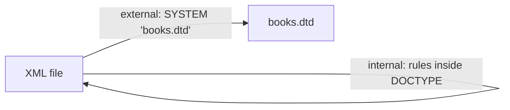

# Session 02: XML Namespaces and DTDs

> Module: Data Processing with XML and JSON · Term 2 (DISM) · ⏱ ~2 hours

## 🎯 Learning Objectives

By the end of this session you will be able to:

- Explain the naming-conflict problem that namespaces solve
- Declare prefixed and default namespaces using `xmlns`
- Describe the purpose and structure of a Document Type Definition (DTD)
- Write internal and external DTDs with element, attribute and entity declarations
- Distinguish between well-formed and valid documents and test validity

## 📖 Concepts Explained

### 1. The problem: name collisions

Imagine one XML file that combines furniture data and HTML data. Both use a `<table>` tag but mean completely different things. A program cannot tell which one is which. **Namespaces** solve this by giving each vocabulary a unique identifier.

### 2. Namespace syntax

```xml
<root xmlns:f="https://example.com/furniture"
      xmlns:h="http://www.w3.org/1999/xhtml">
  <f:table><f:legs>4</f:legs></f:table>
  <h:table><h:tr><h:td>Cell</h:td></h:tr></h:table>
</root>
```

| Part | Meaning |
|---|---|
| `xmlns:f` | Declares the prefix `f` |
| `"https://example.com/furniture"` | The namespace name (a URI). It is only a unique label; it does **not** need to be a working web page |
| `f:table` | A *qualified name*: prefix + local name |

- **Scope:** a namespace applies to the element where it is declared and all its descendants.
- **Default namespace:** `xmlns="URI"` (no prefix) applies to the element and all unprefixed children.
- **Attributes:** unprefixed attributes do *not* belong to the default namespace; give them a prefix if they must be in a namespace (e.g. `xlink:href`).

### 3. What is a DTD?

A **Document Type Definition** is a set of rules that says which elements may appear, in what order, how many times, and which attributes they can have. It is like a **form template**: the XML file is the filled-in form, and the DTD says what boxes exist.

Why use one?
- Teams agree on one structure for exchanged files.
- Applications can reject bad data automatically.
- It documents the format.

### 4. Internal vs external DTD



| Type | Syntax | Use when |
|---|---|---|
| Internal | `<!DOCTYPE library [ ...rules... ]>` | Quick tests, single file |
| External (private) | `<!DOCTYPE library SYSTEM "books.dtd">` | Many files share the same rules |
| External (public) | `<!DOCTYPE html PUBLIC "-//W3C//DTD XHTML 1.0 Strict//EN" "url">` | Published standards |

### 5. Element declarations

| Declaration | Meaning |
|---|---|
| `<!ELEMENT title (#PCDATA)>` | Text only |
| `<!ELEMENT br EMPTY>` | No content |
| `<!ELEMENT note ANY>` | Anything (avoid in real projects) |
| `<!ELEMENT book (title, author, price)>` | Children in this exact order |
| `<!ELEMENT contact (phone \| email)>` | One of the choices |

**Occurrence indicators:** `?` = zero or one, `*` = zero or more, `+` = one or more, no symbol = exactly one.

### 6. Attribute declarations

```
<!ATTLIST element-name attribute-name type default>
```

| Type | Example |
|---|---|
| `CDATA` | any text |
| `(a\|b\|c)` | enumerated list |
| `ID` | unique identifier in the document |
| `IDREF` | refers to an existing ID |

| Default | Meaning |
|---|---|
| `#REQUIRED` | must be present |
| `#IMPLIED` | optional |
| `#FIXED "v"` | always this value |
| `"value"` | default value if missing |

### 7. Entity declarations

```
<!ENTITY inst "Aptech Learning">     <!-- use as &inst; -->
```

Entities act like constants: change them in one place and every use updates.

### 8. Validity and how to test it

A document is **valid** when it is well-formed *and* obeys its DTD. Browsers only check well-formedness. To check validity use:
- VS Code with the Red Hat XML extension (shows red squiggles for DTD errors),
- `xmllint --noout --valid file.xml` on the command line,
- an online validator that supports DTD.

## 💻 Code Examples

All examples below are also saved as files in this folder, so you can open and run them directly.

### Example 1: Internal DTD (`books-internal.xml`)

```xml
<?xml version="1.0" encoding="UTF-8"?>
<!DOCTYPE library [
  <!ELEMENT library (book+)>
  <!ELEMENT book (title, author+, price, publisher?)>
  <!ELEMENT title (#PCDATA)>
  <!ELEMENT author (#PCDATA)>
  <!ELEMENT price (#PCDATA)>
  <!ELEMENT publisher (#PCDATA)>
  <!ATTLIST book
      isbn ID #REQUIRED
      category (programming|database|design) "programming"
      format CDATA #IMPLIED>
  <!ATTLIST price currency CDATA #FIXED "PKR">
  <!ENTITY pub "Karachi Tech Press">
]>
<library>
  <book isbn="B978-1" category="programming" format="paperback">
    <title>PHP for Beginners</title>
    <author>Hamza Siddiqui</author>
    <price currency="PKR">2200</price>
    <publisher>&pub;</publisher>
  </book>
  <book isbn="B978-2" category="database">
    <title>MySQL Made Simple</title>
    <author>Nida Rauf</author>
    <author>Usman Ali</author>
    <price>1800</price>
  </book>
</library>
```

**How it works:**

- `book+` means the library needs at least one book.
- `author+` allows several authors; `publisher?` makes the publisher optional.
- `isbn` is of type `ID`, so two books cannot share the same value (IDs must start with a letter, hence `B978-1`).
- `category` only accepts the three listed values and defaults to `programming`.
- `&pub;` expands to "Karachi Tech Press" when parsed.

### Example 2: External DTD file (`products.dtd`)

```dtd
<!-- products.dtd : shared rules for product catalogues -->
<!ELEMENT catalog (product*)>
<!ELEMENT product (name, price, stock, tags?)>
<!ELEMENT name (#PCDATA)>
<!ELEMENT price (#PCDATA)>
<!ELEMENT stock (#PCDATA)>
<!ELEMENT tags (tag+)>
<!ELEMENT tag (#PCDATA)>
<!ATTLIST product
    code ID #REQUIRED
    available (yes|no) "yes">
```

**How it works:**

This file contains only rules, no data, and no `<!DOCTYPE>` wrapper. Any number of XML files can point to it.

### Example 3: XML using the external DTD and a namespace (`products.xml`)

```xml
<?xml version="1.0" encoding="UTF-8"?>
<!DOCTYPE catalog SYSTEM "products.dtd">
<catalog>
  <product code="P100">
    <name>USB-C Charger</name>
    <price>2500</price>
    <stock>40</stock>
    <tags><tag>mobile</tag><tag>accessory</tag></tags>
  </product>
  <product code="P101" available="no">
    <name>Laptop Stand</name>
    <price>4200</price>
    <stock>0</stock>
  </product>
</catalog>
```

**How it works:**

`SYSTEM "products.dtd"` tells the validator to load the rules from the file next to it. Run `xmllint --noout --valid products.xml` to confirm the document is valid. Try deleting `<stock>` from a product and validate again to see the error.

### Example 4: Two vocabularies in one file (`namespaces.xml`)

```xml
<?xml version="1.0" encoding="UTF-8"?>
<order xmlns="https://shop.example.pk/order"
       xmlns:cust="https://shop.example.pk/customer">
  <cust:customer>
    <cust:name>Fahad Qureshi</cust:name>
    <cust:city>Karachi</cust:city>
  </cust:customer>
  <item sku="P100" qty="2"/>
  <item sku="P101" qty="1"/>
  <total>9200</total>
</order>
```

**How it works:**

- `order`, `item` and `total` have no prefix, so they belong to the **default** order namespace.
- Elements prefixed with `cust:` belong to the customer namespace, so a customer `name` never clashes with a product name.

## 🧪 Lab Practice

1. **Add a namespace:** take your `books.xml` from Session 1 and put all elements in a default namespace `https://library.example.pk/books`.
2. **Internal DTD:** write an internal DTD for `books.xml` that requires `title` and `author`, makes `year` optional and allows multiple authors.
3. **External DTD:** move the rules into `library.dtd` and link it with `SYSTEM`. Validate with VS Code or `xmllint --valid`.
4. **Break it on purpose:** remove a required element and add an attribute value that is not in an enumerated list. Note the exact error messages.
5. **Entities:** declare an entity for your institute name and use it in three places.

## 📝 Assignment

Create `hospital.xml` with an external DTD `hospital.dtd`. Rules: a hospital has one or more departments; each department has a `code` (ID, required) and contains a `name`, one or more `doctor` elements and zero or more `nurse` elements; each doctor has a `shift` attribute limited to `morning|evening|night` with default `morning`. Add a second vocabulary (e.g. `billing`) with a prefixed namespace. Submit both files plus a screenshot of a successful validation.

## ❓ Quick Quiz

1. Which attribute declares a namespace?
   - a) ns
   - b) xmlns
   - c) namespace
   - d) xml:ns
2. In a DTD, what does `+` after an element name mean?
   - a) Zero or one
   - b) Zero or more
   - c) One or more
   - d) Exactly two
3. Which default value makes an attribute optional?
   - a) #REQUIRED
   - b) #FIXED
   - c) #IMPLIED
   - d) #OPTIONAL
4. Does the namespace URI have to open a real web page?
5. What keyword links an XML file to a private external DTD?

<details>
<summary>Show answers</summary>

1. b) `xmlns`
2. c) One or more
3. c) `#IMPLIED`
4. No. It is only a unique name; parsers never download it.
5. `SYSTEM`, e.g. `<!DOCTYPE catalog SYSTEM "products.dtd">`

</details>

## 💼 Interview Questions

1. **Why are namespaces important when combining XML from different sources?**

   <details><summary>Model answer</summary>

   Different vocabularies often reuse the same element names (e.g. `table`, `title`). Namespaces qualify each name with a unique URI so software can tell them apart and process each correctly.

   </details>

2. **What are the limitations of DTDs?**

   <details><summary>Model answer</summary>

   DTDs are not written in XML syntax, have almost no data types (everything is text), cannot express ranges or patterns, and have weak namespace support. XML Schema (XSD) solves these problems.

   </details>

3. **Explain ID and IDREF attribute types.**

   <details><summary>Model answer</summary>

   An ID attribute gives an element a value unique across the whole document. An IDREF attribute must contain a value that matches some existing ID, creating a link between elements, similar to a foreign key.

   </details>

## ✅ Summary

- Namespaces prevent element-name clashes by binding names to unique URIs.
- Use `xmlns:prefix="URI"` for prefixed names and `xmlns="URI"` for a default namespace.
- A DTD defines allowed elements, their order and count, attributes and entities.
- DTDs can be internal (inside DOCTYPE) or external (separate .dtd file).
- Valid = well-formed + follows the DTD/schema; browsers only check well-formedness.

---

[⬅ Previous](../Session-01-Introduction-to-XML/README.md) · [🏠 Module Home](../README.md) · [Next ➡](../Session-03-XML-Schema-XSD/README.md)

<sub>Prepared by Zeeshan Abbas · Aptech Learning North Nazimabad</sub>
