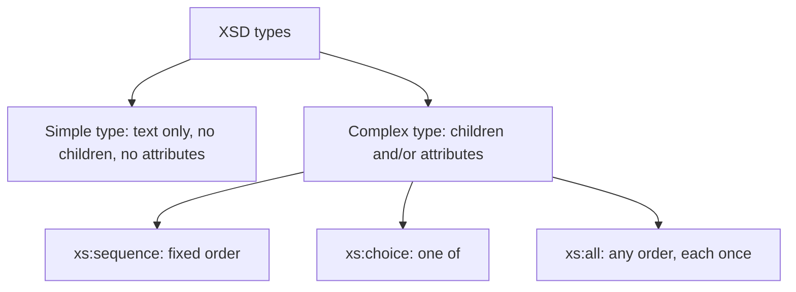

# Session 03: XML Schema (XSD) and Data Types

> Module: Data Processing with XML and JSON · Term 2 (DISM) · ⏱ ~2 hours

## 🎯 Learning Objectives

By the end of this session you will be able to:

- Explain what an XML Schema is and why it replaced DTDs in most projects
- Compare DTDs and XSD feature by feature
- Use built-in data types such as `xs:string`, `xs:int`, `xs:date` and `xs:decimal`
- Define simple types with restrictions and facets (ranges, patterns, enumerations)
- Build complex types with sequences, attributes and nested structures
- Link an XML file to a schema and validate it

## 📖 Concepts Explained

### 1. What is an XML Schema?

An **XML Schema Definition (XSD)** describes the structure *and* the data types of an XML document. It is itself written in XML. If a DTD is a form template, an XSD is a form template that also says "this box must be a date" and "this number must be between 0 and 100".

### 2. DTD vs XSD

| Feature | DTD | XSD |
|---|---|---|
| Syntax | Special DTD syntax | Pure XML |
| Data types | Text only | 40+ built-in types (int, date, boolean...) |
| Ranges and patterns | No | Yes (facets) |
| Namespaces | Poor support | Full support |
| Reusable custom types | No | Yes |
| Learning curve | Easy | Moderate |

### 3. Skeleton of a schema

```xml
<xs:schema xmlns:xs="http://www.w3.org/2001/XMLSchema">
  <xs:element name="student" type="xs:string"/>
</xs:schema>
```

All schema keywords live in the namespace `http://www.w3.org/2001/XMLSchema`, usually with the prefix `xs`.

### 4. Common built-in data types

| Type | Example value |
|---|---|
| `xs:string` | `Karachi` |
| `xs:int` / `xs:integer` | `42` |
| `xs:decimal` | `2499.50` |
| `xs:boolean` | `true` / `false` |
| `xs:date` | `2026-03-15` (YYYY-MM-DD) |
| `xs:time` | `14:30:00` |
| `xs:dateTime` | `2026-03-15T14:30:00` |
| `xs:anyURI` | `https://aptech.pk` |

### 5. Simple types vs complex types



### 6. Restrictions and facets

You create a custom simple type by **restricting** a base type with **facets**:

| Facet | Purpose | Example |
|---|---|---|
| `minInclusive` / `maxInclusive` | Number range | marks 0 to 100 |
| `minLength` / `maxLength` / `length` | Text length | CNIC length 15 |
| `pattern` | Regular expression | `[0-9]{5}-[0-9]{7}-[0-9]` |
| `enumeration` | Allowed values list | `male`, `female`, `other` |
| `totalDigits` / `fractionDigits` | Decimal precision | price with 2 decimals |

### 7. Occurrence and attributes

- `minOccurs="0"` makes an element optional; `maxOccurs="unbounded"` allows unlimited repeats.
- Attributes are declared inside a complex type with `<xs:attribute name="id" type="xs:string" use="required"/>`.

### 8. Linking XML to a schema

```xml
<students xmlns:xsi="http://www.w3.org/2001/XMLSchema-instance"
          xsi:noNamespaceSchemaLocation="students.xsd">
```

If your elements are in a namespace, use `xsi:schemaLocation="namespaceURI file.xsd"` and set `targetNamespace` in the schema.

### 9. Named vs anonymous types

An **anonymous** type is written inside the element that uses it. A **named** type (`<xs:simpleType name="MarksType">`) can be reused by many elements. Prefer named types for anything used more than once.

## 💻 Code Examples

All examples below are also saved as files in this folder, so you can open and run them directly.

### Example 1: Schema for a student record (`students.xsd`)

```xml
<?xml version="1.0" encoding="UTF-8"?>
<xs:schema xmlns:xs="http://www.w3.org/2001/XMLSchema">

  <!-- Reusable simple types -->
  <xs:simpleType name="MarksType">
    <xs:restriction base="xs:int">
      <xs:minInclusive value="0"/>
      <xs:maxInclusive value="100"/>
    </xs:restriction>
  </xs:simpleType>

  <xs:simpleType name="StudentIdType">
    <xs:restriction base="xs:string">
      <xs:pattern value="STU-[0-9]{4}"/>
    </xs:restriction>
  </xs:simpleType>

  <xs:simpleType name="GenderType">
    <xs:restriction base="xs:string">
      <xs:enumeration value="male"/>
      <xs:enumeration value="female"/>
      <xs:enumeration value="other"/>
    </xs:restriction>
  </xs:simpleType>

  <!-- Complex type for one subject result -->
  <xs:complexType name="SubjectType">
    <xs:simpleContent>
      <xs:extension base="MarksType">
        <xs:attribute name="name" type="xs:string" use="required"/>
      </xs:extension>
    </xs:simpleContent>
  </xs:complexType>

  <!-- Complex type for a student -->
  <xs:complexType name="StudentType">
    <xs:sequence>
      <xs:element name="name" type="xs:string"/>
      <xs:element name="gender" type="GenderType"/>
      <xs:element name="dob" type="xs:date"/>
      <xs:element name="email" type="xs:string" minOccurs="0"/>
      <xs:element name="subject" type="SubjectType" maxOccurs="unbounded"/>
    </xs:sequence>
    <xs:attribute name="id" type="StudentIdType" use="required"/>
    <xs:attribute name="active" type="xs:boolean" default="true"/>
  </xs:complexType>

  <!-- Root element -->
  <xs:element name="students">
    <xs:complexType>
      <xs:sequence>
        <xs:element name="student" type="StudentType" maxOccurs="unbounded"/>
      </xs:sequence>
    </xs:complexType>
  </xs:element>
</xs:schema>
```

**How it works:**

- `MarksType` restricts integers to 0-100 using two facets.
- `StudentIdType` uses a `pattern` facet so IDs must look like `STU-0001`.
- `GenderType` is an enumeration of three allowed values.
- `SubjectType` uses `simpleContent` + `extension` to give a numeric value **and** a `name` attribute: `<subject name="PHP">88</subject>`.
- `StudentType` is a sequence; `email` is optional (`minOccurs="0"`) and `subject` can repeat.

### Example 2: An XML file that follows the schema (`students.xml`)

```xml
<?xml version="1.0" encoding="UTF-8"?>
<students xmlns:xsi="http://www.w3.org/2001/XMLSchema-instance"
          xsi:noNamespaceSchemaLocation="students.xsd">
  <student id="STU-0001">
    <name>Hira Baig</name>
    <gender>female</gender>
    <dob>2005-08-21</dob>
    <email>hira@example.com</email>
    <subject name="XML">91</subject>
    <subject name="MySQL">84</subject>
  </student>
  <student id="STU-0002" active="false">
    <name>Danish Iqbal</name>
    <gender>male</gender>
    <dob>2004-01-10</dob>
    <subject name="XML">77</subject>
  </student>
</students>
```

**How it works:**

`xsi:noNamespaceSchemaLocation` points to the schema. Validate it with `xmllint --noout --schema students.xsd students.xml` or open it in VS Code with the Red Hat XML extension. Change a mark to `105` or a date to `21-08-2005` and you will get a validation error.

### Example 3: Validate with Python (optional) (`validate.py`)

```python
# pip install lxml
from lxml import etree

schema = etree.XMLSchema(etree.parse("students.xsd"))
doc = etree.parse("students.xml")

if schema.validate(doc):
    print("students.xml is VALID")
else:
    for error in schema.error_log:
        print(f"Line {error.line}: {error.message}")
```

**How it works:**

`lxml` loads the schema, then `validate()` returns `True` or `False`. The `error_log` lists each problem with its line number, which is how real back-end systems reject bad uploads.

## 🧪 Lab Practice

1. **Create** `employee.xsd` for the employees file from Session 1: salary must be a decimal greater than 0, `joined` must be an `xs:date`, and `status` must be `active`, `on-leave` or `resigned`.
2. **Pattern facet:** add a `phone` element whose pattern accepts Pakistani mobile numbers like `0300-1234567`.
3. **Validate** the XML against the schema with `xmllint` or VS Code. Fix all errors.
4. **Experiment:** convert one anonymous type into a named type and reuse it for two elements.
5. **Compare:** write the same rules for `books.xml` as a DTD and as an XSD, then list three things only the XSD could enforce.

## 📝 Assignment

Build `inventory.xsd` and `inventory.xml` for a mobile shop. Each product needs: `sku` attribute matching `SKU-[A-Z]{2}[0-9]{3}`, `brand` (enumeration of 4 brands), `price` (decimal, 2 fraction digits, max 999999.99), `quantity` (0-500), `releaseDate` (date) and an optional `warrantyMonths` (6, 12 or 24). Include at least 5 products, validate, and submit the files with a screenshot of the validation result.

## ❓ Quick Quiz

1. XSD files are written in:
   - a) JSON
   - b) A special DTD syntax
   - c) XML
   - d) SQL
2. Which facet limits a number to a maximum value?
   - a) maxLength
   - b) maxInclusive
   - c) totalDigits
   - d) maxOccurs
3. What does `maxOccurs="unbounded"` mean?
4. Which compositor requires children in a fixed order?
   - a) xs:all
   - b) xs:choice
   - c) xs:sequence
   - d) xs:group
5. Name two advantages of XSD over DTD.

<details>
<summary>Show answers</summary>

1. c) XML
2. b) `maxInclusive`
3. The element can appear any number of times.
4. c) `xs:sequence`
5. Any two: real data types, facets (ranges/patterns), namespace support, written in XML, reusable named types.

</details>

## 💼 Interview Questions

1. **What is the difference between a simple type and a complex type in XSD?**

   <details><summary>Model answer</summary>

   A simple type holds only text (it can be restricted with facets) and has no child elements or attributes. A complex type can have child elements, attributes or both.

   </details>

2. **How would you make an element optional and repeatable?**

   <details><summary>Model answer</summary>

   Set `minOccurs="0"` to make it optional and `maxOccurs="unbounded"` (or a number) to allow repeats.

   </details>

3. **Why validate XML on the server side?**

   <details><summary>Model answer</summary>

   Data from clients or partners cannot be trusted. Validation rejects malformed or out-of-range data early, prevents crashes and bad database records, and gives clear error messages.

   </details>

## ✅ Summary

- XSD defines structure and data types and is written in XML.
- Built-in types include string, int, decimal, boolean, date and dateTime.
- Custom simple types use restrictions and facets such as ranges, patterns and enumerations.
- Complex types group child elements (sequence, choice, all) and declare attributes.
- Link XML to a schema with `xsi:noNamespaceSchemaLocation` or `xsi:schemaLocation`, then validate.

---

[⬅ Previous](../Session-02-Namespaces-and-DTD/README.md) · [🏠 Module Home](../README.md) · [Next ➡](../Session-04-Styling-XML-CSS-XSLT-XPath/README.md)

<sub>Prepared by Zeeshan Abbas · Aptech Learning North Nazimabad</sub>
