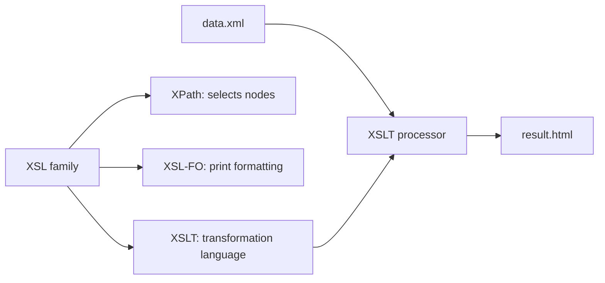

# Session 04: Styling and Transforming XML: CSS, XSLT and XPath

> Module: Data Processing with XML and JSON · Term 2 (DISM) · ⏱ ~2 hours

## 🎯 Learning Objectives

By the end of this session you will be able to:

- Apply a CSS stylesheet to an XML document using a processing instruction
- Use selectors, the box model, positioning, cascading and inheritance on XML elements
- Explain XSL, XSLT and XPath and how they work together
- Write XSLT templates using `xsl:value-of`, `xsl:for-each`, `xsl:if`, `xsl:choose` and `xsl:sort`
- Select nodes with XPath expressions and functions
- Transform an XML file into an HTML report

## 📖 Concepts Explained

### 1. Two ways to present XML

| Approach | What it does | Best for |
|---|---|---|
| **CSS** | Styles elements as they are, in document order | Simple display |
| **XSLT** | Transforms XML into a *new* document (HTML, text, other XML) and can filter, sort and calculate | Reports, tables, conversions |

### 2. CSS for XML

Link a stylesheet with a processing instruction placed after the prolog:

```xml
<?xml-stylesheet type="text/css" href="catalog.css"?>
```

XML elements have no default look, so you must set `display` yourself (`block`, `inline`, `table-row`...).

- **Selectors:** element (`book`), descendant (`book title`), attribute (`book[category="database"]`), pseudo (`book:first-child`), and `::before` to add labels.
- **Box model:** `margin`, `border`, `padding` around the content.
- **Positioning:** `static`, `relative`, `absolute`, `fixed`.
- **Cascading:** when two rules clash, the more specific selector wins; if equal, the later rule wins.
- **Inheritance:** text properties like `color` and `font-family` pass from parent to children.

**Limitation:** CSS cannot sort, filter, count or show attribute values as content easily. That is XSLT's job.

### 3. The XSL family



The **processor** (built into every browser, or `xsltproc`, Saxon, PHP's XSLTProcessor) reads the XML and the stylesheet and writes the output.

### 4. XSLT structure

```xml
<xsl:stylesheet version="1.0" xmlns:xsl="http://www.w3.org/1999/XSL/Transform">
  <xsl:output method="html"/>
  <xsl:template match="/"> ... </xsl:template>
</xsl:stylesheet>
```

| Element | Purpose |
|---|---|
| `xsl:template match="..."` | Rule that runs for matching nodes |
| `xsl:apply-templates select="..."` | Process children with their own templates |
| `xsl:value-of select="..."` | Output the text of a node |
| `xsl:for-each select="..."` | Loop over nodes |
| `xsl:sort select="..."` | Sort inside a loop |
| `xsl:if test="..."` | Simple condition |
| `xsl:choose / when / otherwise` | If / else-if / else |
| `xsl:text` | Output literal text and control spaces |
| `xsl:attribute` | Add an attribute to an output element |

### 5. XPath: the address system for XML

| Expression | Selects |
|---|---|
| `/library` | the root element `library` |
| `/library/book` | all `book` children of `library` |
| `//title` | all `title` elements anywhere |
| `book/@isbn` | the `isbn` attribute |
| `book[price > 2000]` | books costing more than 2000 |
| `book[1]` / `book[last()]` | first / last book |
| `title/text()` | the text node inside title |
| `.` and `..` | current node and parent |

**Functions:**
- Node-set: `count()`, `position()`, `last()`
- String: `concat()`, `contains()`, `substring()`, `string-length()`, `normalize-space()`
- Numeric: `sum()`, `round()`, `floor()`, `ceiling()`
- Boolean: `not()`, `true()`, `false()`

### 6. Result tree fragments and switching styles

A **result tree fragment** is a piece of output stored in a variable (`<xsl:variable name="x">...</xsl:variable>`). In XSLT 1.0 you can copy it to the output but not query it with XPath.

To **switch styles**, keep one XML file and several stylesheets (for example `table.xsl` and `cards.xsl`). Change the `href` in the processing instruction, or let PHP/JavaScript apply a different stylesheet on request.

> **Tip:** Chrome blocks XSLT on files opened with `file://`. Use VS Code *Live Server* or `python -m http.server` and open `http://localhost:8000/catalog-xslt.xml`.

## 💻 Code Examples

All examples below are also saved as files in this folder, so you can open and run them directly.

### Example 1: CSS for XML (`catalog.css`)

```css
catalog {
  display: block;
  font-family: "Segoe UI", Arial, sans-serif;
  background: #f4f6fb;
  padding: 20px;
}
book {
  display: block;
  background: #fff;
  border: 1px solid #d0d7e2;
  border-radius: 8px;
  margin: 0 0 12px;
  padding: 12px 16px;
}
book[category="database"] { border-left: 6px solid #2a9d8f; }
book[category="programming"] { border-left: 6px solid #e76f51; }
title { display: block; font-size: 1.2em; font-weight: bold; color: #1d3557; }
author::before { content: "By "; color: #888; }
author, price { display: inline; margin-right: 16px; }
price::before { content: "Rs. "; }
```

**How it works:**

`display: block` turns each book into a card. Attribute selectors colour the left border by category, and `::before` adds the labels "By" and "Rs." because XML itself carries no presentation text.

### Example 2: XML linked to the CSS (`catalog-css.xml`)

```xml
<?xml version="1.0" encoding="UTF-8"?>
<?xml-stylesheet type="text/css" href="catalog.css"?>
<catalog>
  <book category="programming"><title>Modern JavaScript</title><author>Ali Raza</author><price>2400</price></book>
  <book category="database"><title>MySQL in Practice</title><author>Maria Shah</author><price>1900</price></book>
  <book category="programming"><title>PHP 8 Quick Guide</title><author>Imran Javed</author><price>1500</price></book>
</catalog>
```

**How it works:**

Open this file through a local server and the browser applies `catalog.css`, showing styled cards instead of a raw tree.

### Example 3: XSLT that builds an HTML report (`catalog.xsl`)

```xml
<?xml version="1.0" encoding="UTF-8"?>
<xsl:stylesheet version="1.0" xmlns:xsl="http://www.w3.org/1999/XSL/Transform">
  <xsl:output method="html" encoding="UTF-8" indent="yes"/>

  <xsl:template match="/">
    <html>
      <head>
        <title>Book Report</title>
        <style>
          body { font-family: Arial, sans-serif; margin: 30px; }
          table { border-collapse: collapse; width: 100%; }
          th, td { border: 1px solid #ccc; padding: 8px; text-align: left; }
          th { background: #1d3557; color: #fff; }
          .expensive { background: #ffe8d6; }
        </style>
      </head>
      <body>
        <h1>Book Report</h1>
        <p>Total books: <xsl:value-of select="count(/catalog/book)"/></p>
        <table>
          <tr><th>#</th><th>Title</th><th>Author</th><th>Category</th><th>Price (Rs.)</th></tr>
          <xsl:for-each select="/catalog/book">
            <xsl:sort select="price" data-type="number" order="descending"/>
            <tr>
              <xsl:if test="price &gt; 2000">
                <xsl:attribute name="class">expensive</xsl:attribute>
              </xsl:if>
              <td><xsl:value-of select="position()"/></td>
              <td><xsl:value-of select="title"/></td>
              <td><xsl:value-of select="author"/></td>
              <td>
                <xsl:choose>
                  <xsl:when test="@category='database'">Database</xsl:when>
                  <xsl:when test="@category='programming'">Programming</xsl:when>
                  <xsl:otherwise>Other</xsl:otherwise>
                </xsl:choose>
              </td>
              <td><xsl:value-of select="price"/></td>
            </tr>
          </xsl:for-each>
        </table>
        <p>Total value: Rs. <xsl:value-of select="sum(/catalog/book/price)"/></p>
        <p>Average price: Rs. <xsl:value-of select="round(sum(/catalog/book/price) div count(/catalog/book))"/></p>
      </body>
    </html>
  </xsl:template>
</xsl:stylesheet>
```

**How it works:**

- The template matching `/` builds the whole HTML page once.
- `xsl:for-each` loops over books and `xsl:sort` orders them by price, highest first.
- `xsl:if` adds a CSS class when the price is above 2000 (`&gt;` is the safe habit; a `<` inside a test must always be written as `&lt;`).
- `xsl:choose` converts the category code into a friendly label.
- XPath functions `count()`, `sum()`, `round()` and `position()` calculate totals without any extra programming language.

### Example 4: XML linked to the XSLT (`catalog-xslt.xml`)

```xml
<?xml version="1.0" encoding="UTF-8"?>
<?xml-stylesheet type="text/xsl" href="catalog.xsl"?>
<catalog>
  <book category="programming"><title>Modern JavaScript</title><author>Ali Raza</author><price>2400</price></book>
  <book category="database"><title>MySQL in Practice</title><author>Maria Shah</author><price>1900</price></book>
  <book category="programming"><title>PHP 8 Quick Guide</title><author>Imran Javed</author><price>1500</price></book>
  <book category="design"><title>UI Basics</title><author>Zara Noor</author><price>2100</price></book>
</catalog>
```

**How it works:**

Serve the folder with `python -m http.server` and open `http://localhost:8000/catalog-xslt.xml`. Or run `xsltproc catalog.xsl catalog-xslt.xml > report.html` to produce a static HTML file.

## 🧪 Lab Practice

1. **CSS:** style `books.xml` from Session 1 with an external CSS file. Use at least one attribute selector and one `::before` label.
2. **XSLT table:** write `books.xsl` that outputs an HTML table of all books sorted by year.
3. **Filter with XPath:** show only books with `price < 2000` using a predicate in `xsl:for-each select`.
4. **Switch styles:** create a second stylesheet `books-cards.xsl` that shows each book as a card. Switch between them by editing the processing instruction.
5. **XPath practice:** in Chrome DevTools console, open an XML file and run `document.evaluate('count(//book)', document, null, XPathResult.NUMBER_TYPE, null).numberValue`.

## 📝 Assignment

Create `results.xml` with 8 students and their marks in 3 subjects. Write `results.xsl` that produces an HTML result sheet showing: each student's total and percentage (calculated with XPath), a Pass/Fail column using `xsl:choose` (pass at 50%), rows sorted by total descending, failing rows highlighted in red, and a class average at the bottom.

## ❓ Quick Quiz

1. Which processing instruction links an XSLT file?
   - a) `<?xml-stylesheet type="text/css"?>`
   - b) `<?xml-stylesheet type="text/xsl" href="a.xsl"?>`
   - c) `<link rel="xsl">`
   - d) `<xsl:import>`
2. What does the XPath `//price` select?
3. Which XSLT element is used for if / else-if / else logic?
   - a) xsl:if
   - b) xsl:choose
   - c) xsl:switch
   - d) xsl:case
4. Name one thing XSLT can do that CSS cannot.
5. How do you select the `isbn` attribute of a book in XPath?

<details>
<summary>Show answers</summary>

1. b) `<?xml-stylesheet type="text/xsl" href="a.xsl"?>`
2. Every `price` element at any depth in the document.
3. b) `xsl:choose` with `xsl:when` and `xsl:otherwise`
4. Sort, filter, calculate totals, reorder or rename content, or output a different format.
5. `book/@isbn`

</details>

## 💼 Interview Questions

1. **Explain the roles of XSLT and XPath.**

   <details><summary>Model answer</summary>

   XSLT is the language that describes how to transform an XML document into another document. XPath is the expression language used inside XSLT to locate nodes, test conditions and compute values.

   </details>

2. **What is the difference between xsl:for-each and xsl:apply-templates?**

   <details><summary>Model answer</summary>

   `for-each` loops inline in the current template (pull style). `apply-templates` hands each selected node to whichever template matches it (push style), which is more modular and handles mixed or unknown structures better.

   </details>

3. **Where is XSLT used in real projects?**

   <details><summary>Model answer</summary>

   Generating HTML or PDF reports from XML data, converting between partner XML formats in integrations, transforming RSS feeds, and producing documentation or config files in build pipelines.

   </details>

## ✅ Summary

- CSS can style XML in place, but must set `display` for each element and cannot reorder data.
- XSLT transforms XML into HTML, text or other XML using templates.
- XPath locates nodes with paths, predicates and functions like `count()`, `sum()` and `contains()`.
- Key XSLT elements: template, apply-templates, value-of, for-each, sort, if, choose.
- Keep data in one XML file and switch presentation by switching stylesheets.

---

[⬅ Previous](../Session-03-XML-Schema-XSD/README.md) · [🏠 Module Home](../README.md) · [Next ➡](../Session-05-Introduction-to-JSON/README.md)

<sub>Prepared by Zeeshan Abbas · Aptech Learning North Nazimabad</sub>
