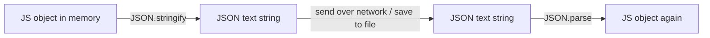

# Session 05: Introduction to JSON and Working with JSON Data

> Module: Data Processing with XML and JSON · Term 2 (DISM) · ⏱ ~2 hours

## 🎯 Learning Objectives

By the end of this session you will be able to:

- Define JSON and describe its features and advantages
- Compare JSON with XML
- Write valid JSON using the correct syntax rules and data types
- Convert JavaScript object literals to JSON and back
- Serialize and deserialize data with `JSON.stringify()` and `JSON.parse()`
- Represent nested and complex data with objects and arrays

## 📖 Concepts Explained

### 1. What is JSON?

**JSON (JavaScript Object Notation)** is a lightweight text format for data exchange. It borrowed its look from JavaScript objects, but today every language (PHP, Python, C#, Java, Dart) can read and write it. When your phone app shows the weather, the server almost certainly sent the data as JSON.

### 2. Features and advantages

- Lightweight and compact (no closing tags)
- Easy for humans to read, easy for machines to parse
- Maps naturally to objects/arrays in programming languages
- Native support in browsers (`JSON.parse`) and most databases (MySQL `JSON` column)
- The default format for REST APIs

### 3. JSON vs XML

| Point | JSON | XML |
|---|---|---|
| Size | Smaller | Larger (repeated tag names) |
| Data types | string, number, boolean, null, object, array | Everything is text unless a schema is used |
| Arrays | Built in `[ ]` | No native array, repeat elements |
| Comments | Not allowed | Allowed |
| Attributes / namespaces | No | Yes |
| Validation | JSON Schema | DTD / XSD |
| Typical use | Web APIs, mobile apps, config | Documents, SOAP, office formats, feeds |

The same data in both formats:

```xml
<student id="7"><name>Ali</name><skills><skill>PHP</skill><skill>SQL</skill></skills></student>
```

```json
{ "id": 7, "name": "Ali", "skills": ["PHP", "SQL"] }
```

### 4. Syntax rules

1. Data is in **name/value pairs**: `"name": "Ali"`
2. Names (keys) **must** be in double quotes.
3. Strings use **double quotes only**, never single quotes.
4. Pairs are separated by commas; **no trailing comma** after the last item.
5. Objects use `{ }`, arrays use `[ ]`.
6. No comments, no functions, no `undefined`.

### 5. Data types

| Type | Example |
|---|---|
| String | `"Karachi"` |
| Number | `42`, `3.14`, `-7`, `1.5e3` |
| Boolean | `true`, `false` |
| Null | `null` |
| Object | `{ "city": "Lahore" }` |
| Array | `[1, 2, 3]` |

Dates are not a JSON type. Store them as ISO strings: `"2026-03-15T10:00:00Z"`.

### 6. JavaScript literal vs JSON

```js
const jsObj = { name: 'Ali', age: 20, greet() { return "hi"; }, extra: undefined };
JSON.stringify(jsObj); // '{"name":"Ali","age":20}'
```

Functions and `undefined` disappear, keys get double quotes. JSON is a **string**; the JS object is a **live value in memory**.

### 7. Serialization and deserialization



- `JSON.stringify(value, replacer, space)`: `space` = indentation for pretty output; `replacer` can pick or change keys.
- `JSON.parse(text, reviver)`: `reviver` can convert values while parsing (e.g. date strings into `Date` objects).
- Invalid JSON makes `JSON.parse` throw a `SyntaxError`, so wrap it in `try...catch`.

### 8. Complex (nested) data

Real data is nested: an order contains a customer object and an array of item objects. Access values with dot and bracket notation: `order.items[0].price`.

### 9. Tools

VS Code (built-in JSON formatting and errors), browser DevTools (Network tab shows JSON responses), online formatters such as https://jsonformatter.org, and `jq` on the command line.

## 💻 Code Examples

All examples below are also saved as files in this folder, so you can open and run them directly.

### Example 1: A product inventory file (`inventory.json`)

```json
{
  "store": "TechZone Karachi",
  "updated": "2026-03-15T09:30:00Z",
  "currency": "PKR",
  "products": [
    {
      "sku": "TZ-1001",
      "name": "Wireless Mouse",
      "price": 1500,
      "inStock": true,
      "tags": ["accessory", "usb"],
      "supplier": { "name": "Alpha Traders", "phone": "021-111-222" }
    },
    {
      "sku": "TZ-1002",
      "name": "Mechanical Keyboard",
      "price": 8500,
      "inStock": false,
      "tags": ["accessory", "gaming"],
      "supplier": { "name": "Beta Imports", "phone": null }
    },
    {
      "sku": "TZ-1003",
      "name": "27-inch Monitor",
      "price": 52000,
      "inStock": true,
      "tags": ["display"],
      "supplier": { "name": "Alpha Traders", "phone": "021-111-222" }
    }
  ]
}
```

**How it works:**

The root is an object. `products` is an array of objects, each with a nested `supplier` object and a `tags` array. Every key is double-quoted, `null` marks a missing phone, and the date is an ISO string.

### Example 2: Parse, stringify and use a reviver (run with Node.js) (`json-basics.js`)

```javascript
// Run: node json-basics.js
const fs = require("fs");

// 1. Deserialize: JSON text -> JS object
const text = fs.readFileSync("inventory.json", "utf8");
const data = JSON.parse(text);
console.log("Store:", data.store);
console.log("First product:", data.products[0].name);
console.log("Second supplier:", data.products[1].supplier.name);

// 2. Work with the data like any JS object
const available = data.products.filter(p => p.inStock);
const totalValue = available.reduce((sum, p) => sum + p.price, 0);
console.log(`In stock: ${available.length}, total value: Rs. ${totalValue}`);

// 3. Serialize: JS object -> JSON text (pretty printed)
const summary = { count: available.length, totalValue, generatedAt: new Date() };
const json = JSON.stringify(summary, null, 2);
console.log(json);
fs.writeFileSync("summary.json", json);

// 4. Replacer: keep only selected keys
console.log(JSON.stringify(data.products[0], ["sku", "price"]));

// 5. Reviver: turn ISO date strings back into Date objects
const revived = JSON.parse(text, (key, value) =>
  key === "updated" ? new Date(value) : value
);
console.log("Updated year:", revived.updated.getFullYear());

// 6. Always guard against bad JSON
try {
  JSON.parse("{ name: 'Ali' }"); // invalid: unquoted key, single quotes
} catch (err) {
  console.log("Invalid JSON ->", err.message);
}
```

**How it works:**

- `JSON.parse` converts the file text into an object we can filter and sum.
- `JSON.stringify(summary, null, 2)` writes pretty JSON; the `Date` becomes an ISO string automatically.
- Passing an array as the replacer keeps only `sku` and `price`.
- The reviver function runs for every key and rebuilds a real `Date` for `updated`.
- The final `try...catch` shows the error you get for JavaScript-style (non-JSON) text.

### Example 3: Show JSON in a web page (`index.html`)

```html
<!DOCTYPE html>
<html lang="en">
<head>
  <meta charset="UTF-8">
  <title>Inventory Viewer</title>
  <style>
    body { font-family: Arial, sans-serif; margin: 30px; }
    .card { border: 1px solid #ddd; border-radius: 8px; padding: 12px; margin: 8px 0; }
    .out { color: #c0392b; font-weight: bold; }
  </style>
</head>
<body>
  <h1>Inventory Viewer</h1>
  <div id="list">Loading...</div>
  <script>
    // Serve this folder with: python -m http.server  (fetch does not work on file://)
    fetch("inventory.json")
      .then(res => res.json())
      .then(data => {
        document.getElementById("list").innerHTML = data.products.map(p => `
          <div class="card">
            <strong>${p.name}</strong> (${p.sku})<br>
            Rs. ${p.price.toLocaleString()} -
            <span class="${p.inStock ? "" : "out"}">${p.inStock ? "In stock" : "Out of stock"}</span><br>
            Tags: ${p.tags.join(", ")}
          </div>`).join("");
      })
      .catch(err => {
        document.getElementById("list").textContent = "Could not load data: " + err.message;
      });
  </script>
</body>
</html>
```

**How it works:**

`fetch()` loads the JSON file, `res.json()` parses it, and `map()` turns each product into an HTML card. Template literals (backticks) make building HTML strings easy.

## 🧪 Lab Practice

1. **Create** `students.json` with 5 students. Each has `id`, `name`, `batch`, `isActive`, a `marks` object (`xml`, `js`, `mysql`) and a `hobbies` array.
2. **Validate** it at https://jsonformatter.org. Then add a trailing comma and single quotes on purpose and read the errors.
3. **Console practice:** in the browser console, create a JS object with a method and an `undefined` value, then `JSON.stringify` it. Which keys disappeared?
4. **Node script:** read `students.json`, print each student's average mark, and write the top student to `topper.json`.
5. **Convert:** rewrite `employees.xml` from Session 1 as JSON by hand. Which format is shorter?

## 📝 Assignment

Build a small web page `menu.html` plus `menu.json` for a restaurant. The JSON must hold categories (array) and each category must hold items with name, price, `isSpicy` (boolean) and an optional `calories` (number or null). The page must fetch the JSON and display the menu grouped by category, marking spicy items with a 🌶 label and showing the most expensive item at the top.

## ❓ Quick Quiz

1. Which of these is valid JSON?
   - a) {name: "Ali"}
   - b) {'name': 'Ali'}
   - c) {"name": "Ali"}
   - d) {"name": "Ali",}
2. Which JSON data type does NOT exist?
   - a) null
   - b) boolean
   - c) date
   - d) array
3. Which method converts a JS object into a JSON string?
4. What happens to a function property when you stringify an object?
5. What error does `JSON.parse` throw on invalid input?

<details>
<summary>Show answers</summary>

1. c)
2. c) date (store dates as strings)
3. `JSON.stringify()`
4. It is skipped (removed from the output).
5. A `SyntaxError`

</details>

## 💼 Interview Questions

1. **Why has JSON replaced XML for most web APIs?**

   <details><summary>Model answer</summary>

   JSON is smaller, faster to parse, maps directly to objects and arrays in modern languages, and is parsed natively by browsers. XML still wins for documents, mixed content and strict schema-driven enterprise systems.

   </details>

2. **What is serialization?**

   <details><summary>Model answer</summary>

   Converting an in-memory object into a format (like a JSON string) that can be stored or sent over a network. Deserialization is the reverse: rebuilding the object from that text.

   </details>

3. **How do you handle dates in JSON?**

   <details><summary>Model answer</summary>

   JSON has no date type, so dates are sent as ISO 8601 strings (e.g. `2026-03-15T10:00:00Z`) or Unix timestamps, and converted back with a reviver or `new Date()` on the receiving side.

   </details>

## ✅ Summary

- JSON is a lightweight, language-independent text format for data exchange.
- It supports strings, numbers, booleans, null, objects and arrays.
- Keys and strings must use double quotes; no comments or trailing commas.
- `JSON.stringify` serializes and `JSON.parse` deserializes; guard parsing with try...catch.
- Nested objects and arrays represent complex real-world data.

---

[⬅ Previous](../Session-04-Styling-XML-CSS-XSLT-XPath/README.md) · [🏠 Module Home](../README.md) · [Next ➡](../Session-06-JSON-Schema-APIs-Security/README.md)

<sub>Prepared by Zeeshan Abbas · Aptech Learning North Nazimabad</sub>
