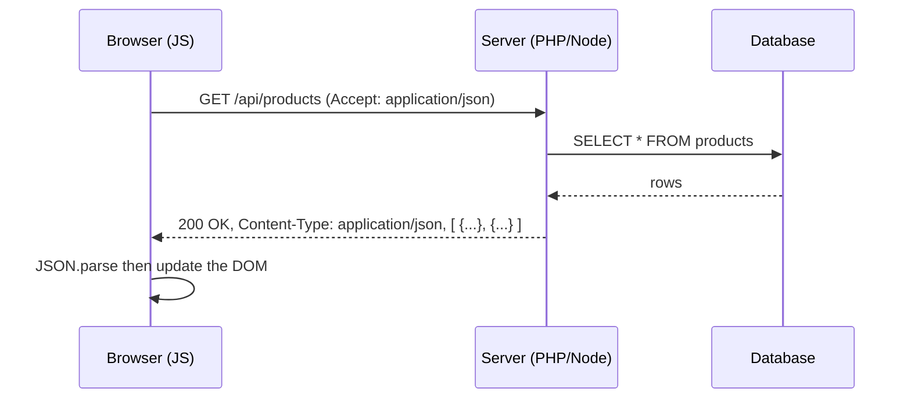

# Session 06: JSON in the Real World: Schema, APIs, Storage and Security

> Module: Data Processing with XML and JSON · Term 2 (DISM) · ⏱ ~2 hours

## 🎯 Learning Objectives

By the end of this session you will be able to:

- Describe a JSON document's structure and validate it with JSON Schema
- Explain how JSON is used in REST APIs and the `application/json` content type
- Fetch JSON from a public API and display it with error handling
- Use JSON for configuration and browser storage (`localStorage`)
- Compare JSON document storage with relational databases
- Identify security and portability risks and apply safe practices

## 📖 Concepts Explained

### 1. JSON Schema

**JSON Schema** is to JSON what XSD is to XML: a JSON document that describes what another JSON document must look like.

| Keyword | Purpose |
|---|---|
| `type` | `object`, `array`, `string`, `number`, `integer`, `boolean`, `null` |
| `properties` | rules for each key of an object |
| `required` | list of keys that must exist |
| `minimum` / `maximum` | number range |
| `minLength` / `maxLength` / `pattern` | string rules |
| `enum` | allowed values |
| `items` | rules for each element of an array |
| `additionalProperties: false` | reject unknown keys |

Validators: https://www.jsonschemavalidator.net, the `ajv` package for Node.js, and VS Code (add `"$schema"` to your JSON file for live checking).

### 2. JSON in web development



- A **REST API** exposes URLs (endpoints) that return JSON.
- HTTP methods: `GET` read, `POST` create, `PUT/PATCH` update, `DELETE` remove.
- When sending JSON you set the header `Content-Type: application/json` and send `JSON.stringify(data)` as the body.

### 3. JSON content types

| Content type | Use |
|---|---|
| `application/json` | Standard JSON (the official media type) |
| `application/ld+json` | Linked data, used for SEO structured data |
| `application/geo+json` | Geographic data |
| `application/x-ndjson` | Newline-delimited JSON: one object per line, used for logs and streaming |

Old code sometimes uses `text/json` or `text/javascript`; avoid them.

### 4. Browser and language support

All modern browsers include the global `JSON` object. PHP has `json_encode()`/`json_decode()`, Python has the `json` module, C# has `System.Text.Json`, Java has Jackson/Gson, and MySQL, PostgreSQL and MongoDB can store and query JSON.

### 5. JSON for storage and configuration

- **Config files:** `package.json`, `composer.json`, `.vscode/settings.json`, `appsettings.json`.
- **Browser storage:** `localStorage` saves strings only, so you stringify before saving and parse when reading.
- **Document databases:** MongoDB stores JSON-like (BSON) documents.

### 6. JSON vs relational database

| Point | JSON documents | Relational tables (MySQL) |
|---|---|---|
| Structure | Flexible, nested | Fixed columns, normalized tables |
| Relationships | Embedded copies | Foreign keys and JOINs |
| Integrity | Needs app logic or schema | Constraints, types, transactions |
| Best for | Settings, logs, varied product attributes, caching API data | Orders, accounts, finance, anything needing consistency |

Many projects use both: MySQL tables with one `JSON` column for flexible extra attributes.

### 7. Security considerations

| Risk | Safe practice |
|---|---|
| Running JSON as code with `eval()` | Never use `eval`; always `JSON.parse` |
| XSS: inserting API text with `innerHTML` | Use `textContent`, or escape values before building HTML |
| Trusting client data | Validate on the server with a schema; check types and ranges |
| Leaking secrets | Never put API keys or passwords in public JSON or front-end code |
| Huge payloads | Limit request body size and paginate results |
| CORS misconfiguration | Allow only trusted origins on your API |

### 8. Portability

JSON is UTF-8 text, so it moves easily between systems. Watch out for: very large integers (JavaScript numbers lose precision beyond 2^53, so send big IDs as strings), date formats (use ISO 8601), and inconsistent key naming (`camelCase` vs `snake_case`). Agree on a style and document it with a schema.

## 💻 Code Examples

All examples below are also saved as files in this folder, so you can open and run them directly.

### Example 1: JSON Schema for a product (`product.schema.json`)

```json
{
  "$schema": "https://json-schema.org/draft/2020-12/schema",
  "title": "Product",
  "type": "object",
  "required": ["sku", "name", "price", "inStock"],
  "properties": {
    "sku": { "type": "string", "pattern": "^TZ-[0-9]{4}$" },
    "name": { "type": "string", "minLength": 3, "maxLength": 60 },
    "price": { "type": "number", "minimum": 0 },
    "inStock": { "type": "boolean" },
    "category": { "enum": ["accessory", "display", "storage", "networking"] },
    "tags": { "type": "array", "items": { "type": "string" }, "uniqueItems": true }
  },
  "additionalProperties": false
}
```

**How it works:**

The schema requires four keys, forces the SKU to match `TZ-` followed by 4 digits, keeps price non-negative, limits category to four values and rejects any unknown key.

### Example 2: Validate data with Ajv (Node.js) (`validate.js`)

```javascript
// Setup: npm init -y && npm install ajv
// Run:   node validate.js
const Ajv2020 = require("ajv/dist/2020");
const schema = require("./product.schema.json");

const ajv = new Ajv2020({ allErrors: true });
const validate = ajv.compile(schema);

const samples = [
  { sku: "TZ-1001", name: "Wireless Mouse", price: 1500, inStock: true, category: "accessory" },
  { sku: "1001", name: "TV", price: -5, inStock: "yes", color: "black" }
];

for (const item of samples) {
  if (validate(item)) {
    console.log(`VALID   -> ${item.name}`);
  } else {
    console.log(`INVALID -> ${item.name}`);
    validate.errors.forEach(e => console.log(`   ${e.instancePath || "(root)"} ${e.message}`));
  }
}
```

**How it works:**

`ajv.compile` turns the schema into a fast validation function. The second sample fails on pattern, length, minimum, type and the extra `color` key; `allErrors: true` reports them all at once.

### Example 3: Fetch a REST API, save settings in localStorage (`api-demo.html`)

```html
<!DOCTYPE html>
<html lang="en">
<head>
  <meta charset="UTF-8">
  <title>JSON API Demo</title>
  <style>
    body { font-family: Arial, sans-serif; margin: 30px; }
    body.dark { background: #1e1e1e; color: #eee; }
    .user { border: 1px solid #999; border-radius: 6px; padding: 10px; margin: 6px 0; }
    #status { font-style: italic; }
  </style>
</head>
<body>
  <h1>Users from a REST API</h1>
  <label><input type="checkbox" id="darkToggle"> Dark mode (saved as JSON)</label>
  <p><button id="loadBtn">Load users</button> <span id="status"></span></p>
  <div id="users"></div>

  <script>
    // ---------- Settings stored as JSON in localStorage ----------
    const defaults = { theme: "light", lastLoaded: null };
    const settings = JSON.parse(localStorage.getItem("settings")) ?? defaults;

    function saveSettings() {
      localStorage.setItem("settings", JSON.stringify(settings));
    }
    function applyTheme() {
      document.body.classList.toggle("dark", settings.theme === "dark");
      document.getElementById("darkToggle").checked = settings.theme === "dark";
    }
    document.getElementById("darkToggle").addEventListener("change", e => {
      settings.theme = e.target.checked ? "dark" : "light";
      saveSettings();
      applyTheme();
    });
    applyTheme();

    // ---------- Fetch JSON from a public test API ----------
    async function loadUsers() {
      const status = document.getElementById("status");
      const box = document.getElementById("users");
      status.textContent = "Loading...";
      box.innerHTML = "";
      try {
        const res = await fetch("https://jsonplaceholder.typicode.com/users");
        if (!res.ok) throw new Error(`HTTP ${res.status}`);
        console.log("Content-Type:", res.headers.get("Content-Type"));
        const users = await res.json();
        users.forEach(u => {
          const div = document.createElement("div");
          div.className = "user";
          // textContent avoids XSS: API text is never treated as HTML
          div.textContent = `${u.name} - ${u.email} - ${u.address.city}`;
          box.appendChild(div);
        });
        settings.lastLoaded = new Date().toISOString();
        saveSettings();
        status.textContent = `Loaded ${users.length} users at ${settings.lastLoaded}`;
      } catch (err) {
        status.textContent = "Failed: " + err.message;
      }
    }
    document.getElementById("loadBtn").addEventListener("click", loadUsers);
  </script>
</body>
</html>
```

**How it works:**

- Settings are an object saved with `JSON.stringify` and restored with `JSON.parse`; `??` falls back to defaults on the first visit.
- `fetch` calls a free fake REST API, checks `res.ok`, then `res.json()` parses the body (its content type is `application/json`).
- Each user is shown with `textContent`, so even malicious text from an API cannot inject HTML.
- `try...catch` shows a friendly message if the network or API fails.

## 🧪 Lab Practice

1. **Schema:** write `student.schema.json` for your `students.json` from Session 5 and validate every record with Ajv or an online validator.
2. **API:** change `api-demo.html` to load `https://jsonplaceholder.typicode.com/posts?_limit=10` and display title and body.
3. **POST request:** send a new post with `fetch(url, { method: 'POST', headers: { 'Content-Type': 'application/json' }, body: JSON.stringify({...}) })` and log the response.
4. **Settings:** add a font-size setting (small/medium/large) saved in the same `settings` object.
5. **Security review:** replace `textContent` with `innerHTML` temporarily, then explain in two lines what risk you just created.

## 📝 Assignment

Create a "Website Settings" mini app: `config.json` holds the site title, primary colour, menu items and a list of social links; `config.schema.json` validates it; `index.html` loads the config with `fetch`, validates basic types in JavaScript, builds the header and menu from it, and lets the user override the colour (saved in `localStorage`). Write a short README section explaining one security and one portability decision you made.

## ❓ Quick Quiz

1. What is the official media type for JSON?
   - a) text/json
   - b) application/json
   - c) text/javascript
   - d) json/text
2. Which JSON Schema keyword lists mandatory keys?
   - a) mandatory
   - b) required
   - c) must
   - d) keys
3. Why should you never use `eval()` on JSON text?
4. What type of value can `localStorage` store directly?
5. Give one case where a relational table is better than storing JSON.

<details>
<summary>Show answers</summary>

1. b) `application/json`
2. b) `required`
3. It runs the text as code, so malicious input could execute in your app. Use `JSON.parse`.
4. Strings only, so objects must be stringified first.
5. Financial transactions, orders or any data needing constraints, JOINs and strong consistency.

</details>

## 💼 Interview Questions

1. **How does a front-end send JSON to a back-end API?**

   <details><summary>Model answer</summary>

   It sends an HTTP request (usually POST/PUT) with the header `Content-Type: application/json` and the body `JSON.stringify(data)`. The server parses the body, validates it and replies with JSON and a status code.

   </details>

2. **What is JSON Schema and why use it?**

   <details><summary>Model answer</summary>

   A JSON-based vocabulary that describes the required structure, types and constraints of JSON data. It enables automatic validation, documentation and code generation, and it keeps API clients and servers in agreement.

   </details>

3. **What precision problem can occur with large numbers in JSON?**

   <details><summary>Model answer</summary>

   JavaScript stores numbers as 64-bit floats, so integers above 2^53 lose precision. Large IDs should be sent as strings.

   </details>

## ✅ Summary

- JSON Schema validates JSON structure, types, ranges and patterns.
- REST APIs exchange JSON over HTTP with the `application/json` content type.
- `fetch` + `res.json()` + try/catch is the standard way to consume an API in the browser.
- JSON is ideal for config, caching and flexible attributes; relational tables suit consistent, related data.
- Never `eval` JSON, escape output, validate input on the server, and keep secrets out of JSON files.

---

[⬅ Previous](../Session-05-Introduction-to-JSON/README.md) · [🏠 Module Home](../README.md) · [Next ➡](../../02-Programming-with-JavaScript/README.md)

<sub>Prepared by Zeeshan Abbas · Aptech Learning North Nazimabad</sub>
