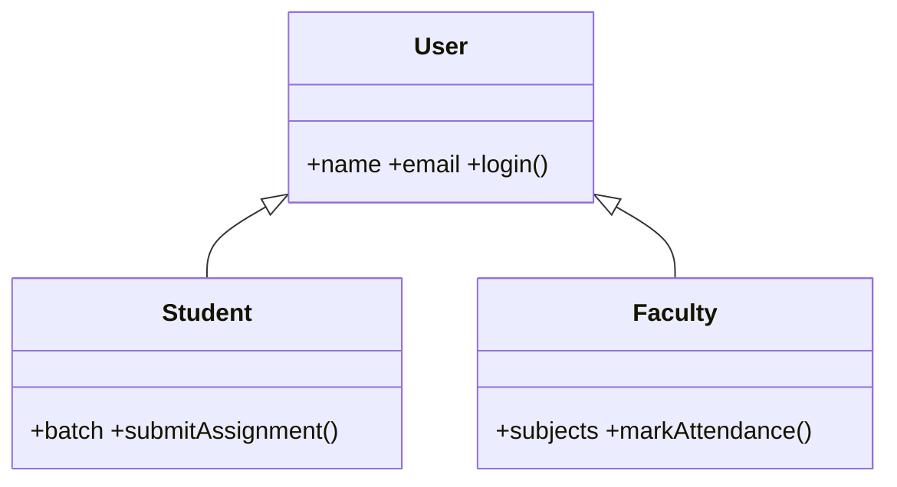

# Session 01: JavaScript Classes and Modules

> Module: Programming with JavaScript · Term 2 (DISM) · ⏱ ~2 hours

## 🎯 Learning Objectives

By the end of this session you will be able to:

- Describe what JavaScript is and where it runs today
- Create classes with constructors, methods, getters/setters and private fields
- Use inheritance with `extends` and `super`
- Split code into ES modules using `export` and `import`
- Run module-based code in the browser and in Node.js

## 📖 Concepts Explained

### 1. JavaScript today

JavaScript is the programming language of the web. It runs in **every browser**, on **servers** (Node.js), in **mobile apps** (React Native), **desktop apps** (Electron) and even on microcontrollers. It is dynamically typed, single-threaded with an event loop, and supports both object-oriented and functional styles.

### 2. Why classes?

When an app has many similar things (users, products, orders) we want one **blueprint** and many **objects**. A class is that blueprint.

| Term | Meaning | Analogy |
|---|---|---|
| Class | Blueprint | Architect's house plan |
| Object / instance | A thing built from the class | An actual house |
| Constructor | Runs when an object is created | Construction day |
| Property | Data stored in the object | Number of rooms |
| Method | Function that belongs to the object | Open the door |

### 3. Class syntax

```js
class Product {
  #stock = 0;                    // private field (only inside the class)
  static count = 0;              // shared by the class, not each object

  constructor(name, price) {     // runs on: new Product(...)
    this.name = name;
    this.price = price;
    Product.count++;
  }
  get inStock() { return this.#stock > 0; }   // getter: used like a property
  addStock(qty) { this.#stock += qty; }       // method
}
```

- `this` refers to the current object.
- `#field` is truly private: `p.#stock` from outside is a syntax error.
- `static` members are called on the class: `Product.count`.

### 4. Inheritance



`class Student extends User` inherits all of `User`'s methods. Inside the child constructor you **must** call `super(...)` before using `this`. A child can **override** a parent method and still call the parent version with `super.method()`.

### 5. ES modules

As an app grows, one huge file becomes impossible to manage. **Modules** let each file own one responsibility.

| Syntax | Meaning |
|---|---|
| `export function add() {}` | Named export |
| `export default class Cart {}` | Default export (one per file) |
| `import { add } from "./math.js"` | Import a named export |
| `import Cart from "./cart.js"` | Import the default export |
| `import * as utils from "./utils.js"` | Import everything as an object |

Rules:
- In the browser load the entry file with `<script type="module" src="main.js"></script>`.
- Modules run in **strict mode** automatically and have their own scope (no accidental globals).
- Paths must include the extension (`./utils.js`).
- Modules need a web server (`http://`), not `file://`.
- In Node.js use the `.mjs` extension or add `"type": "module"` to `package.json`.

### 6. Steps to implement classes and modules

1. Identify the "things" in your app (nouns) and make each a class.
2. Put each class in its own file and `export` it.
3. Put shared helpers (formatting, validation) in `utils.js`.
4. Create one entry file (`main.js`) that imports and wires everything together.
5. Load only the entry file in HTML with `type="module"`.

## 💻 Code Examples

All examples below are also saved as files in this folder, so you can open and run them directly.

### Example 1: A base class and a child class (`user.js`)

```javascript
// user.js
export class User {
  #password; // private field

  constructor(name, email, password) {
    this.name = name;
    this.email = email;
    this.#password = password;
    this.loggedIn = false;
  }

  login(password) {
    this.loggedIn = password === this.#password;
    return this.loggedIn ? `${this.name} logged in` : "Wrong password";
  }

  logout() {
    this.loggedIn = false;
    return `${this.name} logged out`;
  }

  get role() {
    return "user";
  }

  toString() {
    return `${this.name} <${this.email}> (${this.role})`;
  }
}

export class Student extends User {
  constructor(name, email, password, batch) {
    super(name, email, password); // must come before using `this`
    this.batch = batch;
    this.submissions = [];
  }

  get role() {
    return "student";
  }

  submit(title) {
    if (!this.loggedIn) return "Please log in first";
    this.submissions.push({ title, at: new Date().toISOString() });
    return `Submitted: ${title}`;
  }
}
```

**How it works:**

- `#password` cannot be read from outside the class, so only `login()` can check it.
- `Student` extends `User`, calls `super()` to reuse the parent constructor, and overrides the `role` getter.
- `toString()` is defined once in `User` but automatically uses the child's `role`: that is polymorphism.

### Example 2: A module of helper functions (`utils.js`)

```javascript
// utils.js
export const formatPKR = amount =>
  new Intl.NumberFormat("en-PK", { style: "currency", currency: "PKR", maximumFractionDigits: 0 }).format(amount);

export function isValidEmail(email) {
  return /^[^\s@]+@[^\s@]+\.[^\s@]+$/.test(email);
}

export default function log(message) {
  console.log(`[${new Date().toLocaleTimeString()}] ${message}`);
}
```

**How it works:**

Two named exports and one default export. Other files choose exactly what they need.

### Example 3: Entry module that wires everything together (`main.js`)

```javascript
// main.js  (Node: node main.js after adding "type": "module" in package.json)
import { Student } from "./user.js";
import log, { formatPKR, isValidEmail } from "./utils.js";

const s = new Student("Hina Malik", "hina@example.com", "secret123", "2510B");

log(`Email valid? ${isValidEmail(s.email)}`);
log(s.login("wrong"));
log(s.login("secret123"));
log(s.submit("JS Classes Lab"));
log(String(s));
log(`Fee due: ${formatPKR(45000)}`);
log(s.logout());

// Uncommenting the next line causes a SyntaxError: private field
// console.log(s.#password);
```

**How it works:**

`main.js` imports the default `log` and two named helpers in one line. The same file works in the browser through `index.html` and in Node.js through the included `package.json`.

### Example 4: Loading modules in the browser (`index.html`)

```html
<!DOCTYPE html>
<html lang="en">
<head>
  <meta charset="UTF-8">
  <title>Classes and Modules</title>
</head>
<body>
  <h1>Open the console (F12)</h1>
  <p>Serve this folder with <code>npx serve</code> or VS Code Live Server.</p>
  <script type="module" src="main.js"></script>
</body>
</html>
```

**How it works:**

Only the entry module is loaded; the browser follows the `import` statements and downloads `user.js` and `utils.js` itself.

## 🧪 Lab Practice

1. **Run it:** serve the folder with Live Server and read the console output. Then run `node main.js` in a terminal.
2. **Faculty class:** add a `Faculty` class in `user.js` that extends `User`, has a `subjects` array and a `markAttendance(student)` method.
3. **Static counter:** add `static total = 0` to `User` and increase it in the constructor. Print `User.total` after creating three users.
4. **Private check:** try reading `s.#password` from `main.js` and note the error. Then add a `changePassword(old, newPass)` method.
5. **New module:** move `isValidEmail` into a new `validators.js` module and update the imports.

## 📝 Assignment

Build a **Library system** with modules: `book.js` (class `Book` with title, author, ISBN, private `#available`, methods `borrow()` and `return()`), `member.js` (class `Member` with a borrowing limit of 3), `library.js` (class `Library` that holds books and members and has `issue(isbn, memberId)`), and `main.js` that demonstrates five scenarios including errors (book already issued, limit reached).

## ❓ Quick Quiz

1. Which keyword creates a child class?
   - a) inherits
   - b) extends
   - c) super
   - d) implements
2. What must a child constructor call before using `this`?
3. How do you declare a truly private field?
   - a) _name
   - b) private name
   - c) #name
   - d) $name
4. How many default exports can a module have?
5. Which attribute is required on a `<script>` tag to use `import`?

<details>
<summary>Show answers</summary>

1. b) `extends`
2. `super(...)`
3. c) `#name`
4. One.
5. `type="module"`

</details>

## 💼 Interview Questions

1. **Are JavaScript classes real classes like Java?**

   <details><summary>Model answer</summary>

   They are mostly syntax over JavaScript's prototype system. Methods live on the prototype object, and `extends` sets up the prototype chain. The syntax is cleaner, and private fields and static blocks are genuine language features.

   </details>

2. **What is the difference between named and default exports?**

   <details><summary>Model answer</summary>

   A module can have many named exports, imported with braces and exact names. It can have one default export, imported without braces under any name. Named exports are easier for tooling and refactoring.

   </details>

3. **Why are modules important for large applications?**

   <details><summary>Model answer</summary>

   They give each file its own scope, avoid global name clashes, make dependencies explicit, enable code reuse and testing, and allow bundlers to remove unused code (tree shaking).

   </details>

## ✅ Summary

- Classes are blueprints; `new` creates objects; the constructor initializes them.
- Use `#private` fields to protect data and getters/setters for controlled access.
- `extends` and `super` provide inheritance and method overriding.
- ES modules split code into files with `export` and `import`.
- Browsers need `type="module"` and a web server; Node needs `.mjs` or `"type": "module"`.

---

[⬅ Previous](../README.md) · [🏠 Module Home](../README.md) · [Next ➡](../Session-02-Scalable-App-Structure/README.md)

<sub>Prepared by Zeeshan Abbas · Aptech Learning North Nazimabad</sub>
