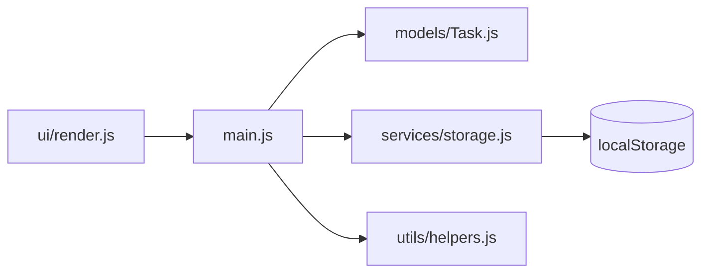

# Session 02: Building Scalable Applications: Structure and Best Practices

> Module: Programming with JavaScript · Term 2 (DISM) · ⏱ ~2 hours

## 🎯 Learning Objectives

By the end of this session you will be able to:

- Organise a JavaScript project into a clear folder structure
- Apply separation of concerns: data, logic and UI in different modules
- Use naming conventions, small functions and pure functions
- Configure ESLint and Prettier to keep code consistent
- Build a small modular app that follows these practices

## 📖 Concepts Explained

### 1. What does "scalable" mean for code?

Scalable code is code that stays **easy to change** when the app grows from 200 lines to 20,000 lines and from one developer to ten. It is less about speed and more about **organisation**.

### 2. A recommended folder structure

```
task-manager/
├── index.html
├── package.json
├── src/
│   ├── main.js            ← entry point: wires modules together
│   ├── models/
│   │   └── Task.js        ← data shape and rules
│   ├── services/
│   │   └── storage.js     ← talking to localStorage / APIs
│   ├── ui/
│   │   └── render.js      ← DOM updates only
│   └── utils/
│       └── helpers.js     ← small reusable functions
└── styles/
    └── style.css
```



### 3. Best practices

| Practice | Why | Example |
|---|---|---|
| **Separation of concerns** | Each file has one job | `storage.js` never touches the DOM |
| **Small functions** | Easier to read and test | One function = one task |
| **Pure functions** | Same input, same output, no side effects | `calculateTotal(items)` |
| **Meaningful names** | Code explains itself | `isOverdue` instead of `flag2` |
| **const by default** | Prevents accidental reassignment | `const tasks = []` |
| **Avoid globals** | Prevents name clashes | Use modules |
| **Single source of truth** | No conflicting copies of data | One `state` object |
| **Handle errors at boundaries** | App does not crash | try/catch around storage and fetch |
| **Consistent formatting** | Clean diffs in Git | Prettier |
| **Linting** | Catch bugs early | ESLint |

### 4. Naming conventions

| Thing | Convention | Example |
|---|---|---|
| Variables, functions | camelCase | `totalPrice`, `getTasks()` |
| Classes | PascalCase | `TaskManager` |
| Constants | UPPER_SNAKE_CASE | `MAX_TASKS` |
| Booleans | is/has/can prefix | `isDone`, `hasError` |
| Files (modules) | camelCase or kebab-case | `storage.js`, `date-utils.js` |

### 5. The state → render pattern

Instead of changing the DOM in many places, keep data in one `state` object. Every change follows: **update state → save → render**. This is the same idea used by React and Vue, so learning it now makes frameworks easier later.

### 6. Tooling for quality

- **npm** manages packages (`package.json`).
- **ESLint** finds problems (unused variables, `==` instead of `===`).
- **Prettier** formats code automatically.
- **Git** tracks changes (covered in Term 1).

Install: `npm init -y` then `npm install --save-dev eslint prettier`, and run `npx eslint src`.

## 💻 Code Examples

All examples below are also saved as files in this folder, so you can open and run them directly.

### Example 1: Model: data and rules (`src/models/Task.js`)

```javascript
// src/models/Task.js
export class Task {
  constructor({ id = crypto.randomUUID(), title, done = false, createdAt = Date.now() }) {
    if (!title || !title.trim()) throw new Error("Task title is required");
    this.id = id;
    this.title = title.trim();
    this.done = done;
    this.createdAt = createdAt;
  }

  toggle() {
    this.done = !this.done;
  }
}
```

**How it works:**

The model only knows about task data and its rules (a title is required). It does not know about the DOM or storage.

### Example 2: Service: persistence (`src/services/storage.js`)

```javascript
// src/services/storage.js
const KEY = "tasks.v1";

export function loadTasks() {
  try {
    return JSON.parse(localStorage.getItem(KEY)) ?? [];
  } catch {
    console.warn("Corrupt data in storage, starting fresh");
    return [];
  }
}

export function saveTasks(tasks) {
  localStorage.setItem(KEY, JSON.stringify(tasks));
}
```

**How it works:**

All storage code lives here. If we later switch to a REST API, only this file changes. The versioned key (`tasks.v1`) helps when the data format changes.

### Example 3: Utilities: pure functions (`src/utils/helpers.js`)

```javascript
// src/utils/helpers.js
export const countDone = tasks => tasks.filter(t => t.done).length;

export const sortByNewest = tasks => [...tasks].sort((a, b) => b.createdAt - a.createdAt);

export function escapeHTML(text) {
  const div = document.createElement("div");
  div.textContent = text;
  return div.innerHTML;
}
```

**How it works:**

`countDone` and `sortByNewest` are pure: they do not change their input (`[...tasks]` copies before sorting). `escapeHTML` protects the UI from HTML injection.

### Example 4: UI: rendering only (`src/ui/render.js`)

```javascript
// src/ui/render.js
import { countDone, sortByNewest, escapeHTML } from "../utils/helpers.js";

export function render(tasks, listEl, statsEl) {
  listEl.innerHTML = sortByNewest(tasks)
    .map(t => `
      <li data-id="${t.id}" class="${t.done ? "done" : ""}">
        <input type="checkbox" ${t.done ? "checked" : ""} aria-label="toggle">
        <span>${escapeHTML(t.title)}</span>
        <button class="delete" aria-label="delete">✕</button>
      </li>`)
    .join("");
  statsEl.textContent = `${countDone(tasks)} of ${tasks.length} done`;
}
```

**How it works:**

The renderer receives data and draws it. It never saves anything, which keeps it predictable.

### Example 5: Entry point: state → save → render (`src/main.js`)

```javascript
// src/main.js
import { Task } from "./models/Task.js";
import { loadTasks, saveTasks } from "./services/storage.js";
import { render } from "./ui/render.js";

const form = document.querySelector("#taskForm");
const input = document.querySelector("#taskInput");
const list = document.querySelector("#taskList");
const stats = document.querySelector("#stats");

// Single source of truth
let tasks = loadTasks().map(data => new Task(data));

function update() {
  saveTasks(tasks);
  render(tasks, list, stats);
}

form.addEventListener("submit", e => {
  e.preventDefault();
  try {
    tasks.push(new Task({ title: input.value }));
    input.value = "";
    update();
  } catch (err) {
    alert(err.message);
  }
});

// Event delegation: one listener for all list items
list.addEventListener("click", e => {
  const id = e.target.closest("li")?.dataset.id;
  if (!id) return;
  if (e.target.matches("input[type=checkbox]")) {
    tasks.find(t => t.id === id).toggle();
  } else if (e.target.matches(".delete")) {
    tasks = tasks.filter(t => t.id !== id);
  }
  update();
});

update();
```

**How it works:**

- Data is loaded once and converted to `Task` objects.
- Every user action changes `tasks`, then calls `update()`, which saves and re-renders.
- **Event delegation** puts one click listener on the `<ul>` instead of one per item, which scales to thousands of tasks.

### Example 6: Page shell (`index.html`)

```html
<!DOCTYPE html>
<html lang="en">
<head>
  <meta charset="UTF-8">
  <meta name="viewport" content="width=device-width, initial-scale=1.0">
  <title>Task Manager</title>
  <style>
    body { font-family: system-ui, sans-serif; max-width: 520px; margin: 40px auto; }
    li { display: flex; gap: 8px; align-items: center; padding: 6px 0; }
    li.done span { text-decoration: line-through; color: #888; }
    .delete { margin-left: auto; border: none; background: none; cursor: pointer; }
  </style>
</head>
<body>
  <h1>Task Manager</h1>
  <form id="taskForm">
    <input id="taskInput" placeholder="New task..." required>
    <button>Add</button>
  </form>
  <p id="stats"></p>
  <ul id="taskList"></ul>
  <script type="module" src="src/main.js"></script>
</body>
</html>
```

**How it works:**

The HTML only provides the skeleton; all behaviour comes from the modules.

## 🧪 Lab Practice

1. **Run** the app with Live Server, add tasks, refresh the page and confirm they persist.
2. **Filter feature:** add buttons All / Active / Done. Keep the current filter in a `state` object, not in the DOM.
3. **Lint:** run `npm init -y`, `npm i -D eslint`, `npx eslint --init`, then `npx eslint src`. Fix every warning.
4. **Prettier:** install Prettier, add a `.prettierrc` with `{ "singleQuote": false, "semi": true }` and format the project.
5. **Swap storage:** write `services/memoryStorage.js` with the same two functions but no persistence, and switch to it by changing one import.

## 📝 Assignment

Refactor a messy single-file script of your own (or the to-do list from Term 1) into the folder structure shown in this session. Your submission must include: at least one model class, one service, one UI module and one utils module; ESLint passing with zero errors; and a short `ARCHITECTURE.md` with a diagram of how modules depend on each other.

## ❓ Quick Quiz

1. What is "separation of concerns"?
2. Which naming style is used for classes?
   - a) camelCase
   - b) PascalCase
   - c) snake_case
   - d) kebab-case
3. What makes a function pure?
4. What is event delegation?
5. Which tool formats code automatically?
   - a) ESLint
   - b) Prettier
   - c) Babel
   - d) npm

<details>
<summary>Show answers</summary>

1. Giving each module one responsibility (data, storage, UI, helpers) so changes in one area do not break others.
2. b) PascalCase
3. Same inputs always give the same output and it has no side effects (it does not change outside data, the DOM or storage).
4. Attaching one listener to a parent element and using `event.target` to handle events from its children.
5. b) Prettier

</details>

## 💼 Interview Questions

1. **How would you structure a medium-sized vanilla JS project?**

   <details><summary>Model answer</summary>

   By responsibility: models for data rules, services for APIs/storage, UI modules for rendering, utils for pure helpers, and one entry file that wires them. Each module exports a small, clear interface.

   </details>

2. **Why keep a single source of truth for state?**

   <details><summary>Model answer</summary>

   When data lives in one place, every part of the UI renders from the same values, so there are no out-of-sync copies, and debugging means inspecting one object.

   </details>

3. **What is the difference between ESLint and Prettier?**

   <details><summary>Model answer</summary>

   ESLint analyses code for possible errors and bad patterns (unused variables, unsafe comparisons). Prettier only formats layout (spacing, quotes, line breaks). Teams usually use both.

   </details>

## ✅ Summary

- Scalable code is organised so it stays easy to change as it grows.
- Split code by responsibility: models, services, UI, utils, entry point.
- Prefer small, pure, well-named functions and `const`.
- Use the state → save → render flow and event delegation.
- ESLint and Prettier keep a team's code consistent and catch mistakes early.

---

[⬅ Previous](../Session-01-Classes-and-Modules/README.md) · [🏠 Module Home](../README.md) · [Next ➡](../Session-03-Pattern-Matching-RegEx/README.md)

<sub>Prepared by Zeeshan Abbas · Aptech Learning North Nazimabad</sub>
