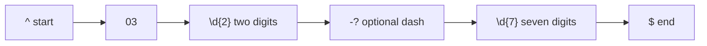

# Session 03: Pattern Matching with Regular Expressions

> Module: Programming with JavaScript · Term 2 (DISM) · ⏱ ~2 hours

## 🎯 Learning Objectives

By the end of this session you will be able to:

- Explain what regular expressions are and where they are used
- Write patterns using character classes, quantifiers, anchors and groups
- Use `test`, `match`, `matchAll`, `replace` and `split` with regex
- Extract data with capture groups and named groups
- Validate common inputs such as email, phone and CNIC

## 📖 Concepts Explained

### 1. What is pattern matching?

A **regular expression (regex)** is a mini-language for describing text patterns. Instead of checking characters one by one, you describe the *shape* of the text: "five digits, a dash, seven digits, a dash, one digit" and JavaScript finds or checks it for you.

Real uses: form validation, searching logs, extracting prices from text, cleaning data, URL routing.

### 2. Creating a regex

```js
const a = /cat/i;                 // literal (preferred when pattern is fixed)
const b = new RegExp("cat", "i"); // constructor (when pattern is built at runtime)
```

### 3. Building blocks

| Token | Meaning | Example match |
|---|---|---|
| `.` | any character except newline | `c.t` → cat, cut |
| `\d` / `\D` | digit / non-digit | `\d\d` → 42 |
| `\w` / `\W` | word char (letter, digit, _) / non-word | `\w+` → hello_1 |
| `\s` / `\S` | whitespace / non-whitespace | `a\sb` → "a b" |
| `[abc]` | one of a, b, c | `[aeiou]` vowels |
| `[^abc]` | anything except a, b, c | `[^0-9]` |
| `[a-z]` | range | lowercase letter |
| `^` / `$` | start / end of string (or line with `m`) | `^\d+$` only digits |
| `\b` | word boundary | `\bcat\b` not "category" |
| `a\|b` | a or b | `jpg\|png` |

### 4. Quantifiers

| Quantifier | Meaning |
|---|---|
| `*` | 0 or more |
| `+` | 1 or more |
| `?` | 0 or 1 (optional) |
| `{n}` | exactly n |
| `{n,}` | n or more |
| `{n,m}` | between n and m |

Quantifiers are **greedy** (match as much as possible). Add `?` to make them **lazy**: `<.+?>` matches one tag, not the whole line.

### 5. Flags

| Flag | Meaning |
|---|---|
| `g` | global: find all matches |
| `i` | ignore case |
| `m` | multiline: `^` and `$` work per line |
| `s` | dotAll: `.` also matches newline |
| `u` | Unicode mode (needed for emoji and Urdu text) |
| `d` | provide match indices |

### 6. Groups

- `( )` capturing group: remembers the matched part.
- `(?<name> )` named group: access with `match.groups.name`.
- `(?: )` non-capturing: groups without remembering.
- Lookahead `(?=...)` / negative `(?!...)`: check what follows without consuming it. Example: password must contain a digit `^(?=.*\d).{8,}$`.

### 7. String and RegExp methods

| Method | Returns |
|---|---|
| `regex.test(str)` | `true` / `false` |
| `str.match(regex)` | first match with groups, or all matches with `g` |
| `str.matchAll(regex)` | iterator of all matches with groups (needs `g`) |
| `str.replace(regex, repl)` | new string; use `$1` or `$<name>` in `repl`, or a function |
| `str.replaceAll(regex, repl)` | needs `g` flag |
| `str.split(regex)` | array split by pattern |
| `str.search(regex)` | index of first match or -1 |

### 8. Read a pattern step by step

`^03\d{2}-?\d{7}$` (Pakistani mobile):



> **Tip:** test patterns at https://regex101.com (choose the ECMAScript flavour) before using them in code.

## 💻 Code Examples

All examples below are also saved as files in this folder, so you can open and run them directly.

### Example 1: Validation with test() (`regex-basics.js`)

```javascript
// Run: node regex-basics.js
const patterns = {
  email: /^[\w.+-]+@[\w-]+\.[\w.-]+$/,
  mobile: /^03\d{2}-?\d{7}$/,
  cnic: /^\d{5}-\d{7}-\d$/,
  strongPassword: /^(?=.*[a-z])(?=.*[A-Z])(?=.*\d)(?=.*[^\w\s]).{8,}$/,
  postalCode: /^\d{5}$/
};

const samples = {
  email: ["ali@example.com", "ali@com", "sara.k+news@mail.co.uk"],
  mobile: ["0300-1234567", "03001234567", "0213-1234567"],
  cnic: ["42101-1234567-1", "4210112345671"],
  strongPassword: ["Passw0rd!", "password", "Abc12345"],
  postalCode: ["74600", "7460"]
};

for (const [name, regex] of Object.entries(patterns)) {
  for (const value of samples[name]) {
    console.log(`${name.padEnd(15)} ${value.padEnd(25)} ${regex.test(value) ? "✔ valid" : "✘ invalid"}`);
  }
}
```

**How it works:**

Each pattern is anchored with `^` and `$`, so the **whole** string must match. The password pattern uses four lookaheads to require lowercase, uppercase, digit and symbol before checking the length with `.{8,}`.

### Example 2: Extracting and transforming data (`extract.js`)

```javascript
// Run: node extract.js
const log = `
2026-03-01 10:15 ORDER #A1023 total Rs. 4,500 by ali@example.com
2026-03-01 11:02 ORDER #A1024 total Rs. 12,300 by sara@shop.pk
2026-03-02 09:40 REFUND #A1023 amount Rs. 4,500
`;

// 1. Named groups with matchAll
const orderRe = /(?<date>\d{4}-\d{2}-\d{2}) \d{2}:\d{2} ORDER #(?<id>A\d+) total Rs\. (?<amount>[\d,]+)/g;
const orders = [...log.matchAll(orderRe)].map(m => ({
  id: m.groups.id,
  date: m.groups.date,
  amount: Number(m.groups.amount.replace(/,/g, ""))
}));
console.table(orders);

// 2. All emails
console.log("Emails:", log.match(/[\w.+-]+@[\w-]+\.[\w.]+/g));

// 3. Reformat dates YYYY-MM-DD -> DD/MM/YYYY
console.log(log.replace(/(\d{4})-(\d{2})-(\d{2})/g, "$3/$2/$1").trim());

// 4. Replace with a function: mask emails
const masked = log.replace(/([\w.+-])[\w.+-]*@/g, (_, first) => `${first}***@`);
console.log(masked.trim());

// 5. Split on commas, semicolons or pipes with optional spaces
console.log("PHP, MySQL;Laravel | WordPress".split(/\s*[,;|]\s*/));

// 6. Greedy vs lazy
const html = "<b>bold</b> and <i>italic</i>";
console.log(html.match(/<.+>/)[0]);   // greedy: whole string
console.log(html.match(/<.+?>/g));    // lazy: each tag
```

**How it works:**

- `matchAll` with named groups turns unstructured log text into clean objects.
- `$3/$2/$1` reorders captured groups during replacement.
- A replacement **function** receives the match and groups, so you can compute the new text.
- `split` with a regex handles several separators at once.
- The greedy vs lazy example shows why `+?` matters when matching tags.

### Example 3: Live form validation with regex (`form.html`)

```html
<!DOCTYPE html>
<html lang="en">
<head>
  <meta charset="UTF-8">
  <title>Regex Form Validation</title>
  <style>
    body { font-family: system-ui, sans-serif; max-width: 420px; margin: 40px auto; }
    label { display: block; margin-top: 12px; }
    input { width: 100%; padding: 8px; box-sizing: border-box; }
    .ok { border: 2px solid #2a9d8f; }
    .bad { border: 2px solid #e63946; }
    small { color: #e63946; }
  </style>
</head>
<body>
  <h1>Admission Form</h1>
  <form id="f" novalidate>
    <label>Email <input name="email" data-pattern="^[\w.+-]+@[\w-]+\.[\w.-]+$"></label>
    <small></small>
    <label>Mobile (03XX-XXXXXXX) <input name="mobile" data-pattern="^03\d{2}-?\d{7}$"></label>
    <small></small>
    <label>CNIC (XXXXX-XXXXXXX-X) <input name="cnic" data-pattern="^\d{5}-\d{7}-\d$"></label>
    <small></small>
    <button>Submit</button>
  </form>
  <script>
    const form = document.getElementById("f");
    function check(input) {
      const ok = new RegExp(input.dataset.pattern).test(input.value.trim());
      input.className = ok ? "ok" : "bad";
      input.parentElement.nextElementSibling.textContent = ok ? "" : `Invalid ${input.name}`;
      return ok;
    }
    form.addEventListener("input", e => check(e.target));
    form.addEventListener("submit", e => {
      e.preventDefault();
      const allOk = [...form.querySelectorAll("input")].map(check).every(Boolean);
      alert(allOk ? "Form is valid!" : "Please fix the highlighted fields");
    });
  </script>
</body>
</html>
```

**How it works:**

Each input stores its pattern in a `data-pattern` attribute and `new RegExp()` builds the regex at runtime. Validation runs on every keystroke and again on submit. Remember: client-side checks improve user experience, but the server must validate again.

## 🧪 Lab Practice

1. **regex101:** recreate the mobile and CNIC patterns at regex101.com and read the explanation panel.
2. **Extend validation:** add a pattern for a Pakistani landline like `021-34567890` and a URL that must start with `https://`.
3. **Extract:** from a paragraph of text, extract all hashtags (`#word`) and all prices like `Rs. 1,250`.
4. **Clean data:** remove extra spaces from a string so `"  hello    world  "` becomes `"hello world"` using one `replace` and `trim`.
5. **Password meter:** show Weak/Medium/Strong based on how many of four lookahead rules a password passes.

## 📝 Assignment

Write `parser.js` that takes a multi-line string of student records in an inconsistent format (e.g. `Name: Ali | Roll: 2510-23 | Marks: 78`, `name=Sara;roll=2510-24;marks=91`) and uses regular expressions with named groups to convert them into a clean array of objects, rejecting invalid roll numbers (`\d{4}-\d{2}`). Print the result with `console.table` and the class average.

## ❓ Quick Quiz

1. What does `\d{3}` match?
2. Which flag finds all matches instead of the first?
   - a) i
   - b) m
   - c) g
   - d) s
3. What does `^` mean at the start of a pattern?
4. How do you access a named group `year`?
   - a) m.year
   - b) m[year]
   - c) m.groups.year
   - d) m.$year
5. What is the difference between `+` and `+?`?

<details>
<summary>Show answers</summary>

1. Exactly three digits.
2. c) `g`
3. Start of the string (or line with the `m` flag).
4. c) `m.groups.year`
5. `+` is greedy (matches as much as possible); `+?` is lazy (as little as possible).

</details>

## 💼 Interview Questions

1. **When should you not use regex?**

   <details><summary>Model answer</summary>

   For parsing nested or complex formats like full HTML, JSON or programming languages. Use a proper parser (DOMParser, JSON.parse). Very complex regex is also hard to maintain.

   </details>

2. **Explain capturing vs non-capturing groups.**

   <details><summary>Model answer</summary>

   `( )` remembers the matched text so you can reuse it with `$1` or `match[1]`. `(?: )` only groups for quantifiers or alternation and does not store the match, which is slightly faster and keeps group numbers clean.

   </details>

3. **Is client-side regex validation enough?**

   <details><summary>Model answer</summary>

   No. It improves user experience, but anyone can bypass the browser. The server must always validate the data again.

   </details>

## ✅ Summary

- Regular expressions describe text patterns for searching, validating and transforming.
- Core tokens: character classes, quantifiers, anchors, alternation, groups.
- Flags `g i m s u` change how matching works.
- Use `test` to validate, `matchAll` with named groups to extract, `replace` to transform.
- Anchor validation patterns with `^...$` and always revalidate on the server.

---

[⬅ Previous](../Session-02-Scalable-App-Structure/README.md) · [🏠 Module Home](../README.md) · [Next ➡](../Session-04-Advanced-Data-Handling/README.md)

<sub>Prepared by Zeeshan Abbas · Aptech Learning North Nazimabad</sub>
