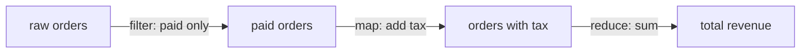

# Session 04: Advanced Data Handling and Error Handling

> Module: Programming with JavaScript · Term 2 (DISM) · ⏱ ~2 hours

## 🎯 Learning Objectives

By the end of this session you will be able to:

- Use destructuring, spread, rest and template literals fluently
- Transform data with `map`, `filter`, `reduce`, `find`, `some`, `every` and `Object` helpers
- Use `Map`, `Set` and `structuredClone` for the right job
- Manage `undefined` and `null` safely with `?.` and `??`
- Handle errors with try/catch/finally and custom error classes

## 📖 Concepts Explained

### 1. Modern syntax refresher

| Feature | Example | Use |
|---|---|---|
| Object destructuring | `const { name, city = "Karachi" } = user` | Pull out values with defaults |
| Array destructuring | `const [first, , third] = arr` | Pick by position |
| Spread | `const all = [...a, ...b]`, `{ ...user, city: "Lahore" }` | Copy and merge |
| Rest | `function sum(...nums) {}` | Collect remaining items |
| Template literal | `` `Hi ${name}` `` | Readable strings |
| Default params | `function greet(name = "Guest")` | Safe defaults |
| Ternary | `age >= 18 ? "adult" : "minor"` | Short if/else |
| Shorthand properties | `{ name, age }` | Same name variables |

### 2. Array methods: the data pipeline



| Method | Returns | Use |
|---|---|---|
| `map` | new array, same length | transform each item |
| `filter` | new array, fewer items | keep matching items |
| `reduce` | a single value | totals, grouping |
| `find` / `findLast` | first/last match or `undefined` | look up one item |
| `some` / `every` | boolean | any / all match |
| `flat` / `flatMap` | flattened array | nested lists |
| `toSorted`, `toReversed` | new sorted/reversed copy (ES2023) | sort without mutating |
| `at(-1)` | last item | negative index |

### 3. Object helpers

`Object.keys(obj)`, `Object.values(obj)`, `Object.entries(obj)` turn an object into arrays; `Object.fromEntries(pairs)` turns them back. `Object.groupBy(items, fn)` (ES2024) groups items by a key.

### 4. Map and Set

| Structure | Best for |
|---|---|
| Object | Fixed, known keys (a record) |
| `Map` | Dynamic keys of any type, frequent add/remove, keeps insertion order, has `.size` |
| Array | Ordered list, duplicates allowed |
| `Set` | Unique values; fast `has()` checks |

**Copying:** spread makes a *shallow* copy (nested objects are shared). `structuredClone(obj)` makes a *deep* copy.

### 5. Managing undefined and null

- `undefined`: a value was never assigned (missing property, no return).
- `null`: intentionally "no value".

| Operator | Meaning | Example |
|---|---|---|
| `?.` optional chaining | stop and return `undefined` if the left side is null/undefined | `user?.address?.city` |
| `??` nullish coalescing | use the right side only if left is null/undefined | `qty ?? 1` |
| `\|\|` logical OR | use right side for **any** falsy value (0, "", false) | careful: `0 \|\| 10` gives 10 |
| `??=` | assign only if null/undefined | `settings.theme ??= "light"` |

### 6. Error handling for real-world code

```js
try {
  riskyOperation();
} catch (err) {
  console.error(err.name, err.message);
} finally {
  hideLoader(); // always runs
}
```

Built-in error types: `SyntaxError`, `TypeError`, `ReferenceError`, `RangeError`. Create **custom errors** by extending `Error`, so callers can react differently with `instanceof`.

Good practices:
- Catch errors where you can **do something** (show a message, retry, use a default).
- Never swallow errors silently with an empty `catch {}`.
- Throw `Error` objects, not strings.
- Use `error.cause` to keep the original error: `throw new Error("Save failed", { cause: err })`.

## 💻 Code Examples

All examples below are also saved as files in this folder, so you can open and run them directly.

### Example 1: Data pipeline with modern methods (`data-handling.js`)

```javascript
// Run: node data-handling.js   (Node 21+ for Object.groupBy; Node 20 users can use the reduce version)
const orders = [
  { id: 1, customer: { name: "Ali", city: "Karachi" }, items: [{ p: "Mouse", qty: 2, price: 1500 }], paid: true },
  { id: 2, customer: { name: "Sara", city: "Lahore" }, items: [{ p: "Monitor", qty: 1, price: 52000 }], paid: false },
  { id: 3, customer: { name: "Omar" }, items: [{ p: "Keyboard", qty: 1, price: 8500 }, { p: "Pad", qty: 3, price: 600 }], paid: true },
  { id: 4, customer: null, items: [], paid: true }
];

// Destructuring with defaults inside a callback
const orderTotal = ({ items = [] }) => items.reduce((sum, { qty, price }) => sum + qty * price, 0);

// Pipeline: filter -> map -> reduce
const paid = orders.filter(o => o.paid && o.items.length);
const withTotals = paid.map(o => ({ ...o, total: orderTotal(o) }));
const revenue = withTotals.reduce((sum, o) => sum + o.total, 0);
console.log("Revenue:", revenue);

// Optional chaining + nullish coalescing for messy data
orders.forEach(o => {
  const city = o.customer?.city ?? "Unknown city";
  const name = o.customer?.name ?? "Walk-in";
  console.log(`#${o.id} ${name} - ${city}`);
});

// Grouping by city with reduce (works everywhere)
const byCity = orders.reduce((acc, o) => {
  const city = o.customer?.city ?? "Unknown";
  (acc[city] ??= []).push(o.id);
  return acc;
}, {});
console.log("Grouped:", byCity);

// Set for unique products, Map for counts
const products = orders.flatMap(o => o.items.map(i => i.p));
console.log("Unique products:", [...new Set(products)]);
const qtyMap = new Map();
orders.flatMap(o => o.items).forEach(({ p, qty }) => qtyMap.set(p, (qtyMap.get(p) ?? 0) + qty));
console.log("Quantities:", Object.fromEntries(qtyMap));

// Shallow vs deep copy
const shallow = { ...orders[0] };
const deep = structuredClone(orders[0]);
shallow.customer.city = "Hyderabad";
console.log("Original city after shallow edit:", orders[0].customer.city); // changed!
console.log("Deep copy city:", deep.customer.city);                        // still Karachi

// Non-mutating sort (ES2023)
console.log(withTotals.toSorted((a, b) => b.total - a.total).map(o => o.id));
```

**How it works:**

- `orderTotal` destructures each item directly in the parameters.
- The pipeline filters paid orders, adds totals with spread, then reduces to revenue.
- `?.` and `??` handle a missing `city` and a `null` customer without crashing.
- `(acc[city] ??= []).push(...)` creates the array only the first time.
- The copy demo proves that spread shares nested objects while `structuredClone` does not.

### Example 2: Custom errors and safe handling (`errors.js`)

```javascript
// Run: node errors.js
class ValidationError extends Error {
  constructor(field, message) {
    super(message);
    this.name = "ValidationError";
    this.field = field;
  }
}

class PaymentError extends Error {
  constructor(message, options) {
    super(message, options);
    this.name = "PaymentError";
  }
}

function validateOrder(order) {
  if (!order?.items?.length) throw new ValidationError("items", "Order has no items");
  if (order.items.some(i => i.qty <= 0)) throw new ValidationError("qty", "Quantity must be positive");
}

function chargeCard(amount) {
  try {
    if (amount > 100000) throw new RangeError("Card limit exceeded");
    return `Charged Rs. ${amount}`;
  } catch (err) {
    throw new PaymentError("Payment failed", { cause: err });
  }
}

function checkout(order) {
  try {
    validateOrder(order);
    const total = order.items.reduce((s, i) => s + i.qty * i.price, 0);
    return chargeCard(total);
  } catch (err) {
    if (err instanceof ValidationError) return `Please fix "${err.field}": ${err.message}`;
    if (err instanceof PaymentError) return `${err.message} (reason: ${err.cause.message})`;
    throw err; // unknown error: let it bubble up
  } finally {
    console.log("checkout attempt finished");
  }
}

console.log(checkout({ items: [{ qty: 2, price: 1500 }] }));
console.log(checkout({ items: [] }));
console.log(checkout({ items: [{ qty: -1, price: 10 }] }));
console.log(checkout({ items: [{ qty: 3, price: 52000 }] }));
```

**How it works:**

- `ValidationError` and `PaymentError` extend `Error` and add useful fields (`field`, `cause`).
- `chargeCard` wraps the low-level `RangeError` in a `PaymentError` and keeps the original as `cause`.
- `checkout` reacts differently to each error type with `instanceof`, re-throws unknown errors, and `finally` always runs.

## 🧪 Lab Practice

1. **Destructure:** given an API user object with nested `address.geo.lat`, extract `name`, `city` and `lat` in one statement with a default city.
2. **Pipeline:** from an array of 10 students with marks, produce an array of names of students who passed, sorted by marks (use `toSorted`).
3. **Group:** group students by grade (A/B/C/F) using `reduce`, then try `Object.groupBy` if you have Node 21+.
4. **Null safety:** rewrite `if (user && user.profile && user.profile.phone)` using `?.` and give a default with `??`.
5. **Custom error:** create an `InsufficientStockError` and throw it from a `buy(product, qty)` function. Catch it and show a friendly message.

## 📝 Assignment

Write `report.js` that takes a JSON array of 15 sales records (some with missing or null fields) and produces: total revenue, revenue per city (Map), unique customers (Set), the top 3 products by quantity, and a list of invalid records. Use custom error classes for invalid records and make sure the script never crashes on bad data.

## ❓ Quick Quiz

1. What does `user?.address?.city` return if `address` is undefined?
2. What is the result of `0 ?? 5` and `0 || 5`?
3. Which method returns a single value from an array?
   - a) map
   - b) filter
   - c) reduce
   - d) forEach
4. Which structure stores only unique values?
   - a) Map
   - b) Set
   - c) Array
   - d) WeakRef
5. Which block always runs, error or not?

<details>
<summary>Show answers</summary>

1. `undefined` (no error is thrown).
2. `0 ?? 5` is `0`; `0 || 5` is `5`.
3. c) `reduce`
4. b) `Set`
5. `finally`

</details>

## 💼 Interview Questions

1. **What is the difference between `map` and `forEach`?**

   <details><summary>Model answer</summary>

   `map` returns a new array of transformed values and is chainable. `forEach` returns `undefined` and is used only for side effects such as logging or DOM updates.

   </details>

2. **Explain shallow vs deep copy.**

   <details><summary>Model answer</summary>

   A shallow copy (spread, `Object.assign`) copies top-level properties, but nested objects are still shared references. A deep copy (`structuredClone`) duplicates every level, so changes never affect the original.

   </details>

3. **Why create custom error classes?**

   <details><summary>Model answer</summary>

   They let code tell error kinds apart with `instanceof`, carry extra context (field name, status code) and produce clearer logs and user messages.

   </details>

## ✅ Summary

- Destructuring, spread/rest and template literals make data code short and clear.
- `map`, `filter` and `reduce` form readable data pipelines without loops.
- Use `Map` for dynamic keys, `Set` for uniqueness, `structuredClone` for deep copies.
- `?.` and `??` handle missing data safely; `??` only replaces null/undefined.
- Use try/catch/finally, custom error classes and `cause` for robust error handling.

---

[⬅ Previous](../Session-03-Pattern-Matching-RegEx/README.md) · [🏠 Module Home](../README.md) · [Next ➡](../Session-05-Async-JavaScript/README.md)

<sub>Prepared by Zeeshan Abbas · Aptech Learning North Nazimabad</sub>
