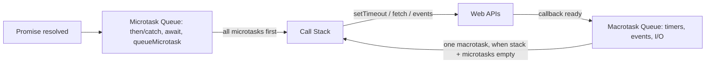

# Session 05: Non-Blocking JavaScript: Event Loop, Promises and async/await

> Module: Programming with JavaScript · Term 2 (DISM) · ⏱ ~2 hours

## 🎯 Learning Objectives

By the end of this session you will be able to:

- Explain synchronous vs asynchronous execution and why JS needs non-blocking code
- Describe the event loop, call stack, microtask queue and macrotask queue
- Move from callbacks to Promises to async/await
- Run tasks in parallel with `Promise.all`, `allSettled`, `race` and `any`
- Fetch API data with loading states, timeouts and error handling

## 📖 Concepts Explained

### 1. Synchronous vs asynchronous

JavaScript runs on **one main thread**. If one line takes 5 seconds (a slow loop or a network call done synchronously), the whole page freezes: no clicks, no scrolling. **Asynchronous** code starts a long task, continues with other work, and handles the result later.

Analogy: at a restaurant the waiter (main thread) takes your order to the kitchen and serves other tables. The kitchen (browser APIs) cooks; when the food is ready the waiter brings it. The waiter never stands still waiting.

### 2. The event loop



Order of work in each loop turn:
1. Run all synchronous code on the call stack.
2. Run **all** microtasks (Promise callbacks).
3. Browser may render the screen.
4. Take **one** macrotask (timer, click, message), then repeat.

That is why `Promise.resolve().then(...)` always runs before `setTimeout(..., 0)`.

### 3. From callbacks to async/await

| Style | Example | Problem / benefit |
|---|---|---|
| Callback | `getUser(id, user => getOrders(user, orders => ...))` | Deep nesting ("callback hell"), messy errors |
| Promise | `getUser(id).then(getOrders).then(show).catch(handle)` | Flat chain, one error handler |
| async/await | `const user = await getUser(id);` | Reads like normal code, use try/catch |

A **Promise** is an object representing a future value. States: **pending → fulfilled** or **pending → rejected**. Once settled it never changes.

### 4. Combining promises

| Method | Resolves when | Rejects when |
|---|---|---|
| `Promise.all([...])` | all succeed (array of results) | any one fails |
| `Promise.allSettled([...])` | all finish (status of each) | never |
| `Promise.race([...])` | first one settles | first one rejects |
| `Promise.any([...])` | first one succeeds | all fail |

**Sequential vs parallel:** `await a(); await b();` takes time a + b. `await Promise.all([a(), b()])` takes max(a, b).

### 5. Fetch API essentials

```js
const res = await fetch(url, { method: "GET", signal });
if (!res.ok) throw new Error(`HTTP ${res.status}`); // fetch does NOT reject on 404/500
const data = await res.json();
```

- `fetch` only rejects on network failure; you must check `res.ok`.
- `AbortController` (or `AbortSignal.timeout(ms)`) cancels slow requests.
- Always show the user three states: **loading**, **success**, **error**.

## 💻 Code Examples

All examples below are also saved as files in this folder, so you can open and run them directly.

### Example 1: Predict the output (`event-loop.js`)

```javascript
// Run: node event-loop.js   — predict the order BEFORE running!
console.log("1: script start");

setTimeout(() => console.log("6: setTimeout (macrotask)"), 0);

Promise.resolve()
  .then(() => console.log("3: promise then (microtask)"))
  .then(() => console.log("4: second then (microtask)"));

queueMicrotask(() => console.log("3b: queueMicrotask"));

(async () => {
  console.log("2: inside async function (sync part)");
  await null;
  console.log("5: after await (microtask)");
})();

console.log("2b: script end");
```

**How it works:**

Synchronous lines run first (1, 2, 2b). Then the microtask queue empties in the order the tasks were queued (3, 3b, 5, 4), and only then the timer callback (6) runs. The numbers in the labels are a rough guide; run the file to see the exact order and explain it.

### Example 2: Callbacks → Promises → async/await (`promises.js`)

```javascript
// Run: node promises.js
const wait = (ms, value, fail = false) =>
  new Promise((resolve, reject) =>
    setTimeout(() => (fail ? reject(new Error(`${value} failed`)) : resolve(value)), ms)
  );

// 1. Callback style (for comparison)
function getUserCb(id, cb) {
  setTimeout(() => cb(null, { id, name: "Ali" }), 300);
}
getUserCb(1, (err, user) => {
  if (err) return console.error(err);
  console.log("callback:", user.name);
});

// 2. Promise chain
wait(300, "promise chain")
  .then(v => v.toUpperCase())
  .then(v => console.log(v))
  .catch(err => console.error(err.message));

// 3. async/await with sequential vs parallel timing
async function demo() {
  console.time("sequential");
  await wait(500, "A");
  await wait(500, "B");
  console.timeEnd("sequential"); // ~1000ms

  console.time("parallel");
  const [a, b] = await Promise.all([wait(500, "A"), wait(500, "B")]);
  console.timeEnd("parallel"); // ~500ms
  console.log("results:", a, b);

  const settled = await Promise.allSettled([wait(100, "ok"), wait(100, "bad", true)]);
  console.log(settled.map(s => s.status));

  const fastest = await Promise.any([wait(300, "slow"), wait(100, "fast")]);
  console.log("any:", fastest);

  try {
    await Promise.all([wait(100, "x"), wait(50, "y", true)]);
  } catch (err) {
    console.log("all() rejected:", err.message);
  }
}
demo();
```

**How it works:**

- `wait` wraps `setTimeout` in a Promise so we can await it.
- The timing test shows that independent tasks should run in parallel with `Promise.all`.
- `allSettled` never rejects, `any` gives the first success, and `all` rejects as soon as one fails.

### Example 3: Random users with loader, timeout and errors (`fetch-users.html`)

```html
<!DOCTYPE html>
<html lang="en">
<head>
  <meta charset="UTF-8">
  <title>Random Users</title>
  <style>
    body { font-family: system-ui, sans-serif; max-width: 640px; margin: 30px auto; }
    .grid { display: grid; grid-template-columns: repeat(auto-fill, minmax(180px, 1fr)); gap: 12px; }
    .card { border: 1px solid #ddd; border-radius: 10px; padding: 12px; text-align: center; }
    .card img { border-radius: 50%; }
    .loader { width: 36px; height: 36px; border: 4px solid #ddd; border-top-color: #457b9d;
              border-radius: 50%; animation: spin 0.8s linear infinite; margin: 20px auto; }
    @keyframes spin { to { transform: rotate(360deg); } }
    .error { color: #e63946; }
    [hidden] { display: none !important; }
  </style>
</head>
<body>
  <h1>Random Users</h1>
  <button id="load">Load 6 users</button>
  <button id="bad">Try a broken URL</button>
  <div class="loader" id="loader" hidden></div>
  <p class="error" id="error" hidden></p>
  <div class="grid" id="grid"></div>

  <script>
    const $ = id => document.getElementById(id);

    async function getJSON(url, timeoutMs = 5000) {
      const res = await fetch(url, { signal: AbortSignal.timeout(timeoutMs) });
      if (!res.ok) throw new Error(`Server replied ${res.status}`);
      return res.json();
    }

    async function loadUsers(url) {
      $("loader").hidden = false;
      $("error").hidden = true;
      $("grid").innerHTML = "";
      try {
        const { results } = await getJSON(url);
        for (const u of results) {
          const card = document.createElement("div");
          card.className = "card";
          card.innerHTML = ``;
          const info = document.createElement("p");
          info.textContent = `${u.name.first} ${u.name.last} — ${u.location.country}`;
          card.append(info);
          $("grid").append(card);
        }
      } catch (err) {
        $("error").textContent = err.name === "TimeoutError" ? "Request timed out" : `Error: ${err.message}`;
        $("error").hidden = false;
      } finally {
        $("loader").hidden = true;
      }
    }

    $("load").onclick = () => loadUsers("https://randomuser.me/api/?results=6");
    $("bad").onclick = () => loadUsers("https://randomuser.me/api/does-not-exist");
  </script>
</body>
</html>
```

**How it works:**

- `getJSON` adds a timeout with `AbortSignal.timeout` and turns HTTP errors into exceptions.
- `loadUsers` shows the loader, awaits the data, builds cards, and always hides the loader in `finally`.
- Names are inserted with `textContent` to stay safe from HTML injection.

## 🧪 Lab Practice

1. **Predict:** write down the order for `event-loop.js`, run it, and explain any difference.
2. **Promisify:** convert `getUserCb` into a function `getUser(id)` that returns a Promise, then use it with `await`.
3. **Parallel fetch:** fetch `https://jsonplaceholder.typicode.com/users/1` and `/posts?userId=1` at the same time with `Promise.all` and show the user with their post count.
4. **Retry:** write `fetchWithRetry(url, tries = 3)` that retries failed requests with a 1-second delay.
5. **Cancel:** add a Cancel button to `fetch-users.html` using an `AbortController`.

## 📝 Assignment

Build a **Weather Dashboard** page that fetches current weather for three cities in parallel from the free Open-Meteo API (`https://api.open-meteo.com/v1/forecast?latitude=24.86&longitude=67.01&current=temperature_2m,wind_speed_10m`). Show a loader, display each city card as soon as all data arrives, use `Promise.allSettled` so one failing city does not break the others, and add a 5-second timeout.

## ❓ Quick Quiz

1. Which runs first: a resolved Promise's `.then` or `setTimeout(fn, 0)`?
2. Does `fetch` reject when the server returns 404?
3. Which method waits for all promises and never rejects?
   - a) all
   - b) race
   - c) allSettled
   - d) any
4. What keyword can only be used inside an async function (or a module top level)?
5. What are the three states of a Promise?

<details>
<summary>Show answers</summary>

1. The `.then` callback (microtasks run before macrotasks).
2. No. It resolves; you must check `res.ok` or `res.status`.
3. c) `Promise.allSettled`
4. `await`
5. Pending, fulfilled, rejected.

</details>

## 💼 Interview Questions

1. **Explain the event loop in simple terms.**

   <details><summary>Model answer</summary>

   JS runs one task at a time on the call stack. Long operations are handed to the browser or Node. When they finish, callbacks are queued. After the current code finishes, the loop runs all microtasks (promise callbacks), may render, then takes the next macrotask (timer, event) and repeats.

   </details>

2. **What is the difference between `Promise.all` and `Promise.allSettled`?**

   <details><summary>Model answer</summary>

   `all` resolves with all results only if every promise succeeds and rejects on the first failure. `allSettled` waits for every promise and returns each one's status and value or reason, so partial failures can be handled.

   </details>

3. **How do you handle errors with async/await?**

   <details><summary>Model answer</summary>

   Wrap the awaited calls in try/catch (with finally for cleanup), or attach `.catch()` to the returned promise. Remember to check `res.ok` for fetch.

   </details>

## ✅ Summary

- JavaScript is single-threaded; async code keeps the UI responsive.
- The event loop runs sync code, then all microtasks, then one macrotask.
- Promises replaced callbacks; async/await makes promise code read like sync code.
- Use `Promise.all` for parallel work; `allSettled`, `race` and `any` for other needs.
- With fetch: check `res.ok`, add timeouts, and show loading, success and error states.

---

[⬅ Previous](../Session-04-Advanced-Data-Handling/README.md) · [🏠 Module Home](../README.md) · [Next ➡](../Session-06-Performance-Workers-Lazy-Loading/README.md)

<sub>Prepared by Zeeshan Abbas · Aptech Learning North Nazimabad</sub>
