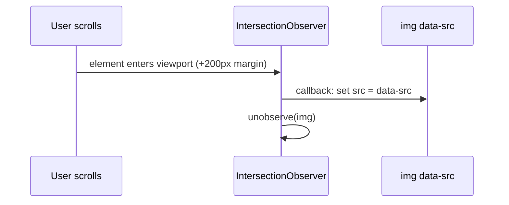

# Session 06: Performance: Lazy Loading, Web Workers, Debounce and Throttle

> Module: Programming with JavaScript · Term 2 (DISM) · ⏱ ~2 hours

## 🎯 Learning Objectives

By the end of this session you will be able to:

- Explain why heavy work on the main thread makes pages feel slow
- Lazy-load images and content with Intersection Observer
- Move CPU-heavy work to a Web Worker
- Compare Web Workers with async techniques
- Implement debounce and throttle and choose the right one

## 📖 Concepts Explained

### 1. The main thread budget

A smooth page draws about **60 frames per second**, which leaves roughly **16 ms** per frame. If your JavaScript runs longer than that, the page stutters ("jank"). Async code (Promises, fetch) helps with **waiting**, but it does **not** help with heavy **calculation**: a 3-second loop still blocks the thread even inside an async function.

| Problem | Tool |
|---|---|
| Waiting for network / timers | Promises, async/await |
| Loading things the user cannot see yet | Lazy loading (Intersection Observer, `loading="lazy"`) |
| Heavy calculation (image processing, big loops, parsing large files) | Web Worker |
| Events that fire too often (scroll, resize, typing) | Debounce / throttle |

### 2. Microtasks vs macrotasks recap

Microtasks (promise callbacks) all run before the browser can paint. Queuing thousands of microtasks can freeze rendering just like a long loop. Splitting work with `setTimeout` (macrotasks) or `requestAnimationFrame` gives the browser a chance to draw between chunks.

### 3. Lazy loading

- **Native:** `` is the easiest option for images and iframes.
- **Intersection Observer:** tells you when an element enters the viewport, so you can load images, start animations, or fetch the next page (infinite scroll).



### 4. Web Workers

A **Web Worker** runs a script on a **separate thread**. It has no access to the DOM; it talks to the page with messages.

| Main thread | Worker thread |
|---|---|
| `const w = new Worker("worker.js")` | `self.onmessage = e => {...}` |
| `w.postMessage(data)` | `self.postMessage(result)` |
| `w.onmessage = e => show(e.data)` | Can use `fetch`, timers, IndexedDB |
| `w.terminate()` | Cannot touch `document` or `window` |

Data is **copied** between threads (structured clone), so send only what is needed.

### 5. Debounce vs throttle

| | Debounce | Throttle |
|---|---|---|
| Idea | Wait until the user **stops** for X ms, then run once | Run **at most once** every X ms |
| Analogy | Lift door waits until people stop entering | A metro train leaves every 5 minutes no matter what |
| Best for | Search box suggestions, auto-save, window resize end | Scroll position, mouse move, infinite scroll checks |

## 💻 Code Examples

All examples below are also saved as files in this folder, so you can open and run them directly.

### Example 1: Worker: count primes off the main thread (`worker.js`)

```javascript
// worker.js — runs on a separate thread
function countPrimes(limit) {
  let count = 0;
  for (let n = 2; n <= limit; n++) {
    let prime = true;
    for (let d = 2; d * d <= n; d++) {
      if (n % d === 0) { prime = false; break; }
    }
    if (prime) count++;
  }
  return count;
}

self.onmessage = event => {
  const start = performance.now();
  const result = countPrimes(event.data);
  self.postMessage({ result, ms: Math.round(performance.now() - start) });
};
```

**How it works:**

The worker waits for a message (the limit), does the heavy loop, and posts the result back. It never touches the DOM.

### Example 2: Lazy gallery, worker demo, debounce and throttle (`index.html`)

```html
<!DOCTYPE html>
<html lang="en">
<head>
  <meta charset="UTF-8">
  <title>Performance Lab</title>
  <style>
    body { font-family: system-ui, sans-serif; max-width: 760px; margin: 20px auto; }
    #spinner { display: inline-block; animation: spin 1s linear infinite; }
    @keyframes spin { to { transform: rotate(360deg); } }
    .gallery { display: grid; grid-template-columns: repeat(3, 1fr); gap: 8px; }
    .gallery img { width: 100%; height: 160px; object-fit: cover; background: #eee; opacity: 0; transition: opacity .4s; }
    .gallery img.loaded { opacity: 1; }
    #status { position: sticky; top: 0; background: #fff; padding: 6px 0; }
  </style>
</head>
<body>
  <h1>Performance Lab <span id="spinner">⚙️</span></h1>
  <p>If the gear stops spinning, the main thread is blocked.</p>

  <h2>1. Heavy work</h2>
  <button id="mainBtn">Count primes on MAIN thread</button>
  <button id="workerBtn">Count primes in WORKER</button>
  <p id="primeOut"></p>

  <h2>2. Debounce vs throttle</h2>
  <input id="search" placeholder="Type to search (debounced 400ms)">
  <p id="searchOut"></p>
  <p id="status">Scroll events handled (throttled 200ms): <b id="scrollCount">0</b> / raw: <b id="rawCount">0</b></p>

  <h2>3. Lazy-loaded gallery</h2>
  <div class="gallery" id="gallery"></div>

  <script>
    const LIMIT = 8_000_000;
    const out = document.getElementById("primeOut");

    // ---- Heavy work: main thread vs worker ----
    function countPrimes(limit) {
      let count = 0;
      for (let n = 2; n <= limit; n++) {
        let prime = true;
        for (let d = 2; d * d <= n; d++) if (n % d === 0) { prime = false; break; }
        if (prime) count++;
      }
      return count;
    }
    document.getElementById("mainBtn").onclick = () => {
      out.textContent = "Working on main thread... (page frozen)";
      setTimeout(() => {
        const t = performance.now();
        const r = countPrimes(LIMIT);
        out.textContent = `Main thread: ${r} primes in ${Math.round(performance.now() - t)} ms`;
      }, 50);
    };
    const worker = new Worker("worker.js");
    worker.onmessage = e => (out.textContent = `Worker: ${e.data.result} primes in ${e.data.ms} ms (page stayed smooth)`);
    document.getElementById("workerBtn").onclick = () => {
      out.textContent = "Working in worker... try scrolling!";
      worker.postMessage(LIMIT);
    };

    // ---- Debounce and throttle ----
    function debounce(fn, delay) {
      let timer;
      return (...args) => {
        clearTimeout(timer);
        timer = setTimeout(() => fn(...args), delay);
      };
    }
    function throttle(fn, interval) {
      let last = 0;
      return (...args) => {
        const now = Date.now();
        if (now - last >= interval) {
          last = now;
          fn(...args);
        }
      };
    }
    let searches = 0;
    document.getElementById("search").addEventListener("input", debounce(e => {
      searches++;
      document.getElementById("searchOut").textContent = `Search #${searches} for "${e.target.value}"`;
    }, 400));

    let raw = 0, handled = 0;
    window.addEventListener("scroll", () => (document.getElementById("rawCount").textContent = ++raw), { passive: true });
    window.addEventListener("scroll", throttle(() => (document.getElementById("scrollCount").textContent = ++handled), 200), { passive: true });

    // ---- Lazy loading with IntersectionObserver ----
    const gallery = document.getElementById("gallery");
    for (let i = 1; i <= 30; i++) {
      const img = document.createElement("img");
      img.alt = `Photo ${i}`;
      img.dataset.src = `https://picsum.photos/seed/accp${i}/400/300`;
      gallery.append(img);
    }
    const observer = new IntersectionObserver((entries, obs) => {
      entries.forEach(entry => {
        if (!entry.isIntersecting) return;
        const img = entry.target;
        img.src = img.dataset.src;
        img.onload = () => img.classList.add("loaded");
        obs.unobserve(img);
        console.log("Loaded", img.alt);
      });
    }, { rootMargin: "200px" });
    gallery.querySelectorAll("img").forEach(img => observer.observe(img));
  </script>
</body>
</html>
```

**How it works:**

- **Heavy work:** the main-thread button freezes the spinning gear; the worker button keeps it spinning because the loop runs on another thread.
- **Debounce:** the search runs only after you stop typing for 400 ms. **Throttle:** compare the raw scroll count with the throttled count.
- **Lazy loading:** images get their real `src` only when they come within 200 px of the viewport. Watch the Network tab in DevTools as you scroll.

## 🧪 Lab Practice

1. **Measure:** open DevTools → Performance, record while clicking the main-thread button, and find the long task (red corner).
2. **Native lazy:** create a second gallery that uses only `loading="lazy"` and compare the Network tab with the observer version.
3. **Infinite scroll:** observe a sentinel `<div>` at the bottom of a list and load 10 more items from `https://jsonplaceholder.typicode.com/posts?_page=N&_limit=10` each time it appears.
4. **Worker progress:** make the worker post progress messages every 10% and show a progress bar.
5. **Choose:** for each case decide debounce or throttle and explain: auto-save notes, sticky header on scroll, resize chart, button double-click protection.

## 📝 Assignment

Build a **Photo Search** page: a search input (debounced) queries a local array of 500 generated photo objects, results render as a lazy-loaded grid, and a "Generate thumbnails report" button sends the full array to a Web Worker that calculates statistics (counts per tag, average size) without freezing the page. Include a short note on the measured difference between main thread and worker.

## ❓ Quick Quiz

1. Does making a heavy loop `async` stop it from blocking the page?
2. Can a Web Worker change the DOM directly?
   - a) Yes
   - b) No
3. Which is best for a search box that should query after typing stops?
   - a) Throttle
   - b) Debounce
   - c) Web Worker
   - d) setInterval
4. Which API tells you when an element enters the viewport?
5. What attribute gives native lazy loading for images?

<details>
<summary>Show answers</summary>

1. No. Async helps with waiting, not computation. Use a Web Worker.
2. b) No; it must send a message to the main thread.
3. b) Debounce
4. `IntersectionObserver`
5. `loading="lazy"`

</details>

## 💼 Interview Questions

1. **When would you use a Web Worker?**

   <details><summary>Model answer</summary>

   For CPU-heavy tasks that would block the UI: processing large files or images, complex calculations, parsing big JSON, encryption. Not for DOM work, and not for simple network waiting, which async already handles.

   </details>

2. **Explain debounce vs throttle with examples.**

   <details><summary>Model answer</summary>

   Debounce delays running until events stop for a set time, so it runs once at the end (search suggestions, auto-save). Throttle runs at most once per interval while events continue (scroll tracking, mouse move).

   </details>

3. **How does lazy loading improve performance?**

   <details><summary>Model answer</summary>

   It delays downloading off-screen images or content until needed, reducing initial page weight, speeding up first render, and saving data for users who never scroll down.

   </details>

## ✅ Summary

- Keep main-thread tasks short (~16 ms per frame) for smooth pages.
- Async code helps waiting; Web Workers help heavy computation.
- Intersection Observer and `loading="lazy"` load content only when needed.
- Debounce runs after activity stops; throttle runs at a fixed maximum rate.
- Measure with DevTools Performance before and after optimising.

---

[⬅ Previous](../Session-05-Async-JavaScript/README.md) · [🏠 Module Home](../README.md) · [Next ➡](../Session-07-Babel-and-Webpack/README.md)

<sub>Prepared by Zeeshan Abbas · Aptech Learning North Nazimabad</sub>
