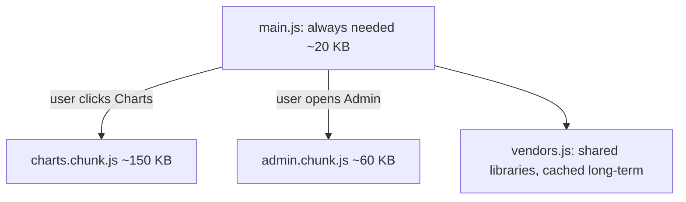

# Session 08: Tree Shaking, Code Splitting and Bundle Analysis

> Module: Programming with JavaScript · Term 2 (DISM) · ⏱ ~2 hours

## 🎯 Learning Objectives

By the end of this session you will be able to:

- Explain tree shaking and write code that can be tree-shaken
- Split code with dynamic `import()` and load it on demand
- Use `splitChunks` to separate vendor libraries
- Analyse bundle size with Webpack Bundle Analyzer
- Apply a checklist to reduce bundle size

## 📖 Concepts Explained

### 1. Why bundle size matters

Every kilobyte of JavaScript must be **downloaded, parsed and executed**. On a mid-range phone on a 4G connection, 1 MB of JS can delay interaction by several seconds. Smaller bundles mean faster first load, better Core Web Vitals and better SEO.

### 2. Tree shaking

**Tree shaking** removes exported code that is never imported. Think of shaking a tree so the dead leaves fall off.

It works only when:
- You use **ES module** syntax (`import`/`export`), not `require`.
- You build in **production mode**.
- Packages are side-effect free (`"sideEffects": false` in their `package.json`).

| Tree-shakable | Not tree-shakable |
|---|---|
| `import { debounce } from "lodash-es"` | `const _ = require("lodash")` |
| `import { format } from "date-fns"` | `import moment from "moment"` (one big object) |

### 3. Code splitting

Instead of one giant `main.js`, split the app so users download only what they need **now**.



| Technique | How |
|---|---|
| **Dynamic import** | `const mod = await import("./charts.js")` creates a separate chunk |
| **Vendor splitting** | `optimization.splitChunks: { chunks: "all" }` puts node_modules in their own file |
| **Route-based splitting** | Load each page's code when the user visits that page |
| **Magic comments** | `import(/* webpackChunkName: "charts" */ "./charts.js")` names the chunk |
| **Prefetch** | `/* webpackPrefetch: true */` downloads the chunk when the browser is idle |

### 4. Lazy loading code vs lazy loading images

Lazy loading images (Session 6) delays media. Dynamic `import()` delays **code**. Both follow the same rule: *don't load it until it's needed*.

### 5. Webpack Bundle Analyzer

The analyzer draws an interactive **treemap**: each rectangle is a module, its area is its size. You instantly see which library is huge, which file is duplicated, and what ended up in which chunk.

Three sizes are shown:
- **Stat:** original size before minification
- **Parsed:** size after minification (what the browser parses)
- **Gzip:** size over the network

### 6. Bundle diet checklist

1. Build in production mode.
2. Replace heavy libraries with lighter ones (moment → date-fns or `Intl`, lodash → lodash-es or native methods).
3. Import only what you use.
4. Split rarely used features with dynamic `import()`.
5. Separate vendor code for better caching.
6. Check the analyzer after every big dependency you add.

## 💻 Code Examples

All examples below are also saved as files in this folder, so you can open and run them directly.

### Example 1: Config with splitChunks and the analyzer (`webpack.config.js`)

```javascript
// webpack.config.js
const path = require("path");
const HtmlWebpackPlugin = require("html-webpack-plugin");
const { BundleAnalyzerPlugin } = require("webpack-bundle-analyzer");

module.exports = (env = {}) => ({
  mode: "production",
  entry: "./src/index.js",
  output: {
    path: path.resolve(__dirname, "dist"),
    filename: "[name].[contenthash].js",
    chunkFilename: "[name].[contenthash].chunk.js",
    clean: true
  },
  optimization: {
    usedExports: true, // mark unused exports for tree shaking
    splitChunks: {
      chunks: "all",
      cacheGroups: {
        vendors: { test: /[\\/]node_modules[\\/]/, name: "vendors", priority: 10 }
      }
    }
  },
  plugins: [
    new HtmlWebpackPlugin({ title: "Code Splitting Demo" }),
    // run "npm run analyze" to open the treemap
    ...(env.analyze ? [new BundleAnalyzerPlugin()] : [])
  ]
});
```

**How it works:**

- `usedExports` + production mode enables tree shaking.
- `splitChunks` moves everything from `node_modules` into a separate `vendors` file that rarely changes and caches well.
- The analyzer plugin is added only when you pass `--env analyze`.

### Example 2: Scripts and dependencies (`package.json`)

```json
{
  "name": "code-splitting-demo",
  "version": "1.0.0",
  "private": true,
  "sideEffects": false,
  "scripts": {
    "build": "webpack",
    "analyze": "webpack --env analyze"
  },
  "dependencies": {
    "lodash-es": "^4.17.21"
  },
  "devDependencies": {
    "html-webpack-plugin": "^5.6.0",
    "webpack": "^5.91.0",
    "webpack-bundle-analyzer": "^4.10.2",
    "webpack-cli": "^5.1.4"
  }
}
```

**How it works:**

`"sideEffects": false` tells Webpack that our files do nothing on import except export values, so unused ones can be dropped safely.

### Example 3: Dynamic import on click (`src/index.js`)

```javascript
// src/index.js
import { debounce } from "lodash-es"; // named import: only debounce is bundled

document.body.innerHTML = `
  <h1>Code Splitting Demo</h1>
  <input id="q" placeholder="Type...">
  <p id="out"></p>
  <button id="report">Show sales report (loads a separate chunk)</button>
  <pre id="report-out"></pre>
`;

document.getElementById("q").addEventListener("input", debounce(e => {
  document.getElementById("out").textContent = `You typed: ${e.target.value}`;
}, 300));

document.getElementById("report").addEventListener("click", async () => {
  // This module is downloaded only on the first click
  const { buildReport } = await import(/* webpackChunkName: "report" */ "./report.js");
  document.getElementById("report-out").textContent = buildReport();
});
```

**How it works:**

The `report.js` module becomes its own chunk. Open DevTools → Network, click the button and watch `report.[hash].chunk.js` download only then.

### Example 4: The lazily loaded module (`src/report.js`)

```javascript
// src/report.js — imagine this file is large (charts, PDF generation...)
const sales = [
  { month: "Jan", amount: 120000 },
  { month: "Feb", amount: 98000 },
  { month: "Mar", amount: 143500 }
];

export function buildReport() {
  const total = sales.reduce((s, r) => s + r.amount, 0);
  const lines = sales.map(r => `${r.month}: ${"█".repeat(Math.round(r.amount / 10000))} ${r.amount}`);
  return [...lines, `Total: ${total}`].join("\n");
}

export function unusedExport() {
  return "tree shaking removes me";
}
```

**How it works:**

`buildReport` is used through the dynamic import; `unusedExport` is never used and is removed in production.

## 🧪 Lab Practice

1. **Build and inspect:** run `npm run build` and list the files in `dist/`. Which chunk contains lodash?
2. **Analyze:** run `npm run analyze` and take a screenshot of the treemap. Note the parsed and gzip sizes.
3. **Bad import experiment:** change the import to `import _ from "lodash"` (install `lodash`), rebuild and compare the vendor size.
4. **Prefetch:** add `/* webpackPrefetch: true */` to the dynamic import and check the `<link rel="prefetch">` added to the page.
5. **Second chunk:** create `settings.js` loaded only when a Settings button is clicked. Name the chunk `settings`.

## 📝 Assignment

Take the Webpack project from the Session 7 assignment, add one heavy library (for example `chart.js`), and load it only when the user opens a "Statistics" view with dynamic `import()`. Produce before/after Bundle Analyzer screenshots and a short table of main bundle size before and after splitting.

## ❓ Quick Quiz

1. What is tree shaking?
2. Which syntax creates a separate chunk?
   - a) import x from
   - b) require()
   - c) import()
   - d) export default
3. Why is `import { debounce } from "lodash-es"` better than `require("lodash")`?
4. What does Webpack Bundle Analyzer show?
5. What does `splitChunks: { chunks: "all" }` help with?

<details>
<summary>Show answers</summary>

1. Removing exported code that is never imported, during a production build.
2. c) dynamic `import()`
3. Named ES module imports are tree-shakable, so only `debounce` is bundled.
4. An interactive treemap of modules in each bundle and their stat, parsed and gzip sizes.
5. Separating shared/vendor code into its own chunk for better caching and less duplication.

</details>

## 💼 Interview Questions

1. **How would you reduce a large JavaScript bundle?**

   <details><summary>Model answer</summary>

   Measure with an analyzer, switch to production mode, remove or replace heavy dependencies, use named ES imports for tree shaking, split rarely used features and routes with dynamic import, and separate vendor code for caching.

   </details>

2. **What conditions are needed for tree shaking to work?**

   <details><summary>Model answer</summary>

   ES module syntax, a production build with minification, and modules marked side-effect free so the bundler can safely drop unused exports.

   </details>

3. **What is the difference between code splitting and lazy loading?**

   <details><summary>Model answer</summary>

   Code splitting is the build step that divides code into chunks. Lazy loading is the runtime decision to download a chunk only when it is needed. Dynamic import does both.

   </details>

## ✅ Summary

- Smaller bundles load, parse and run faster, especially on phones.
- Tree shaking drops unused ES module exports in production builds.
- Dynamic `import()` and `splitChunks` divide code into on-demand and vendor chunks.
- Webpack Bundle Analyzer visualises what makes a bundle heavy.
- Measure, then optimise: replace heavy libraries, import selectively, split by feature.

---

[⬅ Previous](../Session-07-Babel-and-Webpack/README.md) · [🏠 Module Home](../README.md) · [Next ➡](../Session-09-Debugging-DevTools/README.md)

<sub>Prepared by Zeeshan Abbas · Aptech Learning North Nazimabad</sub>
