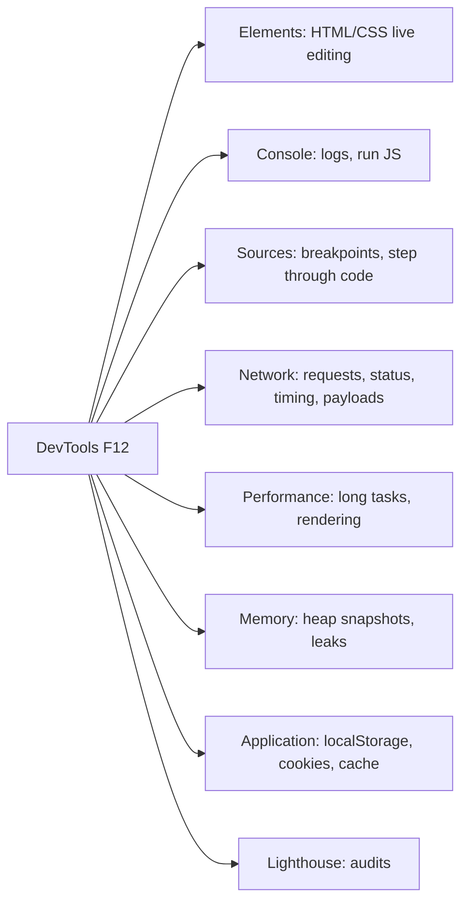

# Session 09: Debugging with Chrome DevTools and Cross-Browser Testing

> Module: Programming with JavaScript · Term 2 (DISM) · ⏱ ~2 hours

## 🎯 Learning Objectives

By the end of this session you will be able to:

- Identify syntax, runtime and logical errors
- Use console methods, `debugger` and breakpoints effectively
- Debug asynchronous code using the call stack and Network panel
- Analyse page performance and memory with DevTools
- Plan cross-browser testing and feature detection

## 📖 Concepts Explained

### 1. Types of errors

| Type | When found | Example | Clue |
|---|---|---|---|
| **Syntax error** | Before the code runs | missing `)` or `}` | Red error with file and line on load |
| **Runtime error** | While running | `user.name` when `user` is `undefined` (TypeError) | Error in console when that line runs |
| **Logical error** | Never reported | `total = price + qty` instead of `*` | Wrong output, no error |

Logical errors are the hardest, which is why debugging skills matter more than memorising syntax.

### 2. The console beyond `console.log`

| Method | Use |
|---|---|
| `console.table(arr)` | Show arrays of objects as a table |
| `console.error / warn / info` | Coloured levels, filterable |
| `console.group / groupEnd` | Collapsible groups |
| `console.time / timeEnd` | Measure duration |
| `console.count(label)` | How many times a line runs |
| `console.assert(cond, msg)` | Log only when a condition is false |
| `console.trace()` | Print the call stack |
| `console.dir(el)` | Show an element as an object |

### 3. Chrome DevTools panels



### 4. Breakpoints and stepping

| Breakpoint type | How |
|---|---|
| Line | Click a line number in Sources |
| Conditional | Right-click line → *Add conditional breakpoint* (`qty > 10`) |
| Logpoint | Right-click → *Add logpoint*: logs without editing code |
| DOM | Elements → right-click node → *Break on* subtree/attribute change |
| Event listener | Sources → *Event Listener Breakpoints* → Mouse → click |
| XHR/fetch | Sources → *XHR/fetch Breakpoints* → URL contains `api` |
| Exceptions | *Pause on exceptions* button |
| In code | the `debugger;` statement |

Stepping controls: **Resume (F8)**, **Step over (F10)**, **Step into (F11)**, **Step out (Shift+F11)**. While paused, read the **Scope** (variable values), **Watch** (custom expressions) and **Call Stack** panes.

### 5. Debugging async code

- The **Call Stack** shows async frames (marked "async") so you can see what started a promise chain.
- Turn on **Pause on caught exceptions** to stop inside promise rejections.
- In the **Network** panel check: status code, request payload, response preview, timing. Use *Throttling* (Slow 4G) to test loaders and timeouts.
- An "Uncaught (in promise)" message means a rejected promise had no `catch`.

### 6. Performance and memory

- **Performance panel:** record, interact, stop. Long tasks have a red corner; the flame chart shows which function took the time.
- **Lighthouse:** scores for performance, accessibility, best practices and SEO.
- **Memory panel:** take heap snapshots before and after an action; growing detached DOM nodes suggest a leak (e.g. listeners never removed).

### 7. Cross-browser testing

| Step | Practice |
|---|---|
| Decide targets | Use your browserslist: Chrome, Edge, Firefox, Safari (iOS!), Android Chrome |
| Check support | https://caniuse.com and MDN compatibility tables |
| Feature detection | `if ("IntersectionObserver" in window) {...} else {...}` instead of browser sniffing |
| Polyfills / transpile | Babel + core-js (Session 7) |
| Test on real devices | Phones, plus DevTools device mode for quick checks |
| Cloud testing | Services such as BrowserStack or LambdaTest for browsers you do not own |

## 💻 Code Examples

All examples below are also saved as files in this folder, so you can open and run them directly.

### Example 1: A broken form to debug (`buggy-form.html`)

```html
<!DOCTYPE html>
<html lang="en">
<head>
  <meta charset="UTF-8">
  <title>Buggy Order Form</title>
  <style>body { font-family: system-ui, sans-serif; max-width: 420px; margin: 40px auto; } label { display:block; margin-top:10px; }</style>
</head>
<body>
  <h1>Order Form (contains 4 bugs)</h1>
  <form id="orderForm">
    <label>Product price <input id="price" type="number" value="1500"></label>
    <label>Quantity <input id="qty" type="number" value="2"></label>
    <label>Discount code <input id="code" placeholder="SAVE10"></label>
    <button type="submit">Calculate</button>
  </form>
  <p id="result"></p>
  <script src="buggy-form.js"></script>
</body>
</html>
```

**How it works:**

Open this page with DevTools and follow Lab Task 1. The script is in `buggy-form.js`.

### Example 2: The buggy script (`buggy-form.js`)

```javascript
// buggy-form.js — find and fix the bugs using DevTools (do not just read!)
const form = document.getElementById("orderForm");

function getDiscount(code) {
  const codes = { SAVE10: 0.1, SAVE20: 0.2 };
  return codes[code];                       // BUG 3: unknown code returns undefined
}

function calculateTotal(price, qty, code) {
  const subtotal = price + qty;             // BUG 2: logical error
  const discount = subtotal * getDiscount(code);
  return subtotal - discount;
}

form.addEventListener("submit", () => {     // BUG 1: page reloads, result disappears
  const price = document.getElementById("price").value;  // BUG 4: value is a string
  const qty = document.getElementById("qty").value;
  const code = document.getElementById("code").value.trim().toUpperCase();
  debugger; // execution pauses here when DevTools is open
  const total = calculateTotal(price, qty, code);
  document.getElementById("result").textContent = `Total: Rs. ${total}`;
});
```

**How it works:**

The comments tell you where the bugs are so you can check your work, but practise finding each one with breakpoints, the Scope pane and the Console. The fixed version is `fixed-form.js`.

### Example 3: The corrected script (`fixed-form.js`)

```javascript
// fixed-form.js — load this instead of buggy-form.js to compare
const form = document.getElementById("orderForm");

function getDiscount(code) {
  const codes = { SAVE10: 0.1, SAVE20: 0.2 };
  return codes[code] ?? 0;                  // unknown/empty code = no discount
}

function calculateTotal(price, qty, code) {
  if (!Number.isFinite(price) || !Number.isFinite(qty) || price < 0 || qty < 1) {
    throw new RangeError("Price and quantity must be valid positive numbers");
  }
  const subtotal = price * qty;
  return subtotal - subtotal * getDiscount(code);
}

form.addEventListener("submit", event => {
  event.preventDefault();                   // stop the page reload
  const price = Number(document.getElementById("price").value);
  const qty = Number(document.getElementById("qty").value);
  const code = document.getElementById("code").value.trim().toUpperCase();
  const result = document.getElementById("result");
  try {
    const total = calculateTotal(price, qty, code);
    console.table({ price, qty, code, total });
    result.textContent = `Total: Rs. ${total.toLocaleString()}`;
  } catch (err) {
    console.error(err);
    result.textContent = err.message;
  }
});
```

**How it works:**

- `preventDefault()` stops the reload (bug 1).
- Multiplication replaces addition (bug 2).
- `?? 0` handles unknown codes (bug 3); without it the total became `NaN`.
- `Number()` converts input strings (bug 4); `"1500" + "2"` would give `"15002"`.
- Validation plus try/catch gives a clear message instead of a silent wrong answer.

### Example 4: Console methods tour (paste into the console or run with Node) (`console-tricks.js`)

```javascript
const students = [
  { name: "Ali", marks: 78 },
  { name: "Sara", marks: 91 },
  { name: "Omar", marks: 45 }
];

console.table(students);

console.group("Results");
students.forEach(s => {
  console.count("checked");
  console.assert(s.marks >= 50, `${s.name} failed with ${s.marks}`);
});
console.groupEnd();

console.time("sort");
const sorted = [...students].sort((a, b) => b.marks - a.marks);
console.timeEnd("sort");

function level3() { console.trace("Who called me?"); }
function level2() { level3(); }
level2();

console.warn("This is a warning");
console.error("This is an error (not a crash)");
console.log("Top student:", sorted[0].name);
```

**How it works:**

Each method produces a different kind of output. `console.assert` prints only for Omar, `console.trace` prints the chain level2 → level3, and `console.time` measures how long sorting took.

## 🧪 Lab Practice

1. **Debug the form:** open `buggy-form.html`, set a breakpoint inside `calculateTotal`, inspect `price` and `qty` in the Scope pane, and fix all four bugs yourself before comparing with `fixed-form.js`.
2. **Conditional breakpoint:** in any loop, add a conditional breakpoint that pauses only when `i === 7`.
3. **Network:** open the Session 5 `fetch-users.html`, enable *Slow 4G* throttling, and confirm the loader appears. Block the request URL (right-click → Block request URL) and check your error message.
4. **Performance:** record the Session 6 main-thread prime counter and identify the long task and its function name in the flame chart.
5. **Cross-browser:** check `structuredClone`, `Array.prototype.toSorted` and `:has()` on caniuse.com and write a feature-detection fallback for one of them.

## 📝 Assignment

Write a 1-page **Debugging Report** (`DEBUG-REPORT.md`) for a bug you find in one of your own previous lab programs (or introduce one deliberately). Include: symptoms, steps to reproduce, DevTools screenshots (breakpoint paused with Scope pane visible), root cause, the fix, and how you would prevent it (test, lint rule or validation).

## ❓ Quick Quiz

1. Which error type produces no error message?
   - a) Syntax
   - b) Runtime
   - c) Logical
   - d) Reference
2. Which keyword pauses execution when DevTools is open?
3. What does F10 do while paused?
   - a) Resume
   - b) Step over
   - c) Step into
   - d) Step out
4. Which DevTools panel shows request status codes and payloads?
5. Why is feature detection better than browser detection?

<details>
<summary>Show answers</summary>

1. c) Logical
2. `debugger`
3. b) Step over
4. Network
5. It checks whether the feature actually exists, so it works for any browser and version, including future ones.

</details>

## 💼 Interview Questions

1. **Walk me through how you debug a JavaScript bug.**

   <details><summary>Model answer</summary>

   Reproduce it reliably, read the console error and stack trace, form a hypothesis, set breakpoints near the cause, inspect variables and the call stack, check network requests if data is involved, fix the root cause, then retest and add a test or validation so it cannot return.

   </details>

2. **What is a logpoint and why use it?**

   <details><summary>Model answer</summary>

   A breakpoint that logs a message or expression without pausing and without editing the source. It is useful in production-like code or loops where adding `console.log` and reloading is slow.

   </details>

3. **How do you find a memory leak in a web app?**

   <details><summary>Model answer</summary>

   Use the Memory panel: take a heap snapshot, repeat the suspected action several times, take another snapshot and compare. Look for growing objects or detached DOM nodes, often caused by listeners, timers or caches that were never cleared.

   </details>

## ✅ Summary

- Errors are syntax (before run), runtime (during run) or logical (wrong result).
- Use rich console methods: table, group, time, count, assert, trace.
- Breakpoints (line, conditional, DOM, event, fetch) and stepping reveal what code really does.
- Network, Performance, Memory and Lighthouse panels diagnose data, speed and leaks.
- Test across target browsers with caniuse, feature detection, polyfills and real devices.

---

[⬅ Previous](../Session-08-Tree-Shaking-Code-Splitting/README.md) · [🏠 Module Home](../README.md) · [Next ➡](../Session-10-JS-Frameworks-Vue-Svelte-Solid/README.md)

<sub>Prepared by Zeeshan Abbas · Aptech Learning North Nazimabad</sub>
