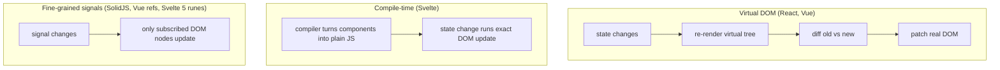

# Session 10: Exploring JavaScript Frameworks: Vue, Svelte and SolidJS

> Module: Programming with JavaScript · Term 2 (DISM) · ⏱ ~2 hours

## 🎯 Learning Objectives

By the end of this session you will be able to:

- Explain the difference between a library and a framework
- Describe reactivity, components and virtual DOM vs compile-time approaches
- Build a Vue 3 counter and a multi-view app with Vue Router
- Share state across components with Pinia (Vuex successor)
- Compare Vue, Svelte, SolidJS, React and Angular

## 📖 Concepts Explained

### 1. Library vs framework

| | Library | Framework |
|---|---|---|
| Who is in control | **You** call the library | The framework calls **your** code ("inversion of control") |
| Scope | One job (e.g. UI rendering, dates) | Full structure: routing, state, build conventions |
| Examples | React (UI library), Lodash, Chart.js | Angular, Vue (progressive framework), SvelteKit, Next.js |

### 2. Shared ideas in modern UI tools

- **Components:** reusable pieces of UI with their own template, logic and style.
- **Reactivity:** when data changes, the UI updates automatically. No manual `innerHTML`.
- **Declarative templates:** describe *what* the UI should look like for given data, not *how* to change the DOM.
- **One-way data flow:** parents pass data down (props); children send events up.

### 3. Three approaches to updating the DOM



### 4. The frameworks at a glance

| | Vue 3 | Svelte 5 | SolidJS | React 18 | Angular 17+ |
|---|---|---|---|---|---|
| Style | Templates + Composition API | Compiler, `.svelte` files, runes | JSX + signals | JSX + hooks | TypeScript, full framework |
| DOM strategy | Virtual DOM + fine-grained reactivity | No virtual DOM | No virtual DOM | Virtual DOM | Change detection (signals added) |
| Runtime size | Small | Tiny | Tiny | Medium | Large |
| Learning curve | Gentle | Gentle | Moderate | Moderate | Steep |
| Official router/state | Vue Router, Pinia | SvelteKit | Solid Router | Community (React Router, Redux, Zustand) | Built in |

Benchmarks change every year, but generally Solid and Svelte top raw DOM-update speed tests, Vue is close behind, and React/Angular are heavier but have the biggest job markets. Choose by **team skills, ecosystem and project needs**, not only speed.

### 5. Vue essentials (Composition API)

| Feature | Syntax |
|---|---|
| Reactive value | `const count = ref(0)` (use `count.value` in JS) |
| Computed value | `const double = computed(() => count.value * 2)` |
| Interpolation | `{{ count }}` |
| Event | `@click="count++"` |
| Two-way binding | `v-model="name"` |
| Conditional / loop | `v-if`, `v-for="item in items" :key="item.id"` |
| Attribute binding | `:class="{ done: task.done }"` |

### 6. Vue Router and Pinia (Vuex)

- **Vue Router** maps URLs to components (`/` → Home, `/about` → About) without full page reloads. `<router-link>` creates links; `<router-view>` shows the active page.
- **Pinia** is the official state store (successor to **Vuex**). It holds data shared by many components: cart, logged-in user. Vuex uses the same idea with *state, mutations, actions, getters*; Pinia simplifies it to *state, getters, actions*.

## 💻 Code Examples

All examples below are also saved as files in this folder, so you can open and run them directly.

### Example 1: Vue 3 counter via CDN (`vue-counter.html`)

```html
<!DOCTYPE html>
<html lang="en">
<head>
  <meta charset="UTF-8">
  <title>Vue Counter</title>
  <script src="https://unpkg.com/vue@3/dist/vue.global.prod.js"></script>
  <style>body { font-family: system-ui, sans-serif; text-align: center; margin-top: 60px; } button { font-size: 1.2rem; margin: 4px; }</style>
</head>
<body>
  <div id="app">
    <h1>{{ title }}</h1>
    <p style="font-size: 3rem">{{ count }}</p>
    <p>Double: {{ double }} · {{ count % 2 === 0 ? "Even" : "Odd" }}</p>
    <button @click="count--" :disabled="count === 0">−</button>
    <button @click="count++">+</button>
    <button @click="count = 0">Reset</button>
    <p><input v-model="title" placeholder="Edit title"></p>
  </div>
  <script>
    const { createApp, ref, computed } = Vue;
    createApp({
      setup() {
        const count = ref(0);
        const title = ref("Vue Counter");
        const double = computed(() => count.value * 2);
        return { count, title, double };
      }
    }).mount("#app");
  </script>
</body>
</html>
```

**How it works:**

- `ref(0)` creates reactive state; when it changes, every `{{ count }}` updates automatically.
- `computed` recalculates `double` only when `count` changes.
- `@click` handles events, `:disabled` binds an attribute, and `v-model` keeps the input and `title` in sync both ways.

### Example 2: Multi-view app with Vue Router and Pinia (`vue-router-pinia.html`)

```html
<!DOCTYPE html>
<html lang="en">
<head>
  <meta charset="UTF-8">
  <title>Vue Router + Pinia</title>
  <script src="https://unpkg.com/vue@3/dist/vue.global.prod.js"></script>
  <script src="https://unpkg.com/vue-demi"></script>
  <script src="https://unpkg.com/pinia@2/dist/pinia.iife.prod.js"></script>
  <script src="https://unpkg.com/vue-router@4/dist/vue-router.global.prod.js"></script>
  <style>
    body { font-family: system-ui, sans-serif; max-width: 600px; margin: 30px auto; }
    nav a { margin-right: 12px; }
    .router-link-active { font-weight: bold; }
  </style>
</head>
<body>
  <div id="app">
    <nav>
      <router-link to="/">Shop</router-link>
      <router-link to="/cart">Cart ({{ cart.count }})</router-link>
      <router-link to="/about">About</router-link>
    </nav>
    <router-view></router-view>
  </div>

  <script>
    const { createApp, computed } = Vue;
    const { createRouter, createWebHashHistory } = VueRouter;
    const { createPinia, defineStore } = Pinia;

    // ---- Pinia store: shared state ----
    const useCart = defineStore("cart", {
      state: () => ({ items: [] }),
      getters: {
        count: s => s.items.length,
        total: s => s.items.reduce((sum, p) => sum + p.price, 0)
      },
      actions: {
        add(product) { this.items.push(product); },
        remove(index) { this.items.splice(index, 1); }
      }
    });

    // ---- Page components ----
    const Shop = {
      setup() {
        const cart = useCart();
        const products = [
          { id: 1, name: "Mouse", price: 1500 },
          { id: 2, name: "Keyboard", price: 8500 },
          { id: 3, name: "Headphones", price: 6000 }
        ];
        return { cart, products };
      },
      template: `<h2>Shop</h2>
        <div v-for="p in products" :key="p.id">
          {{ p.name }} — Rs. {{ p.price }} <button @click="cart.add(p)">Add</button>
        </div>`
    };
    const Cart = {
      setup() { return { cart: useCart() }; },
      template: `<h2>Cart</h2>
        <p v-if="!cart.count">Your cart is empty.</p>
        <ul><li v-for="(item, i) in cart.items" :key="i">{{ item.name }} <button @click="cart.remove(i)">✕</button></li></ul>
        <p><b>Total: Rs. {{ cart.total }}</b></p>`
    };
    const About = { template: `<h2>About</h2><p>Demo of Vue Router and Pinia via CDN.</p>` };

    // ---- Router ----
    const router = createRouter({
      history: createWebHashHistory(),
      routes: [
        { path: "/", component: Shop },
        { path: "/cart", component: Cart },
        { path: "/about", component: About }
      ]
    });

    const app = createApp({ setup() { return { cart: useCart() }; } });
    app.use(createPinia());
    app.use(router);
    app.mount("#app");
  </script>
</body>
</html>
```

**How it works:**

- `defineStore` creates a cart store with state, getters (`count`, `total`) and actions (`add`, `remove`). Every component that calls `useCart()` shares the same data.
- The router maps three paths to three components; `createWebHashHistory` uses `#/cart` URLs so no server setup is needed.
- `<router-link>` changes the view without reloading, and the nav badge updates instantly because it reads the shared store.

### Example 3: The same counter in Svelte 5 (for comparison) (`Counter.svelte`)

```html
<!-- Counter.svelte — try it at https://svelte.dev/playground -->
<script>
  let count = $state(0);
  let double = $derived(count * 2);
</script>

<h1>Svelte Counter</h1>
<p>{count} (double: {double})</p>
<button onclick={() => count--} disabled={count === 0}>−</button>
<button onclick={() => count++}>+</button>
```

**How it works:**

Svelte 5 uses **runes**: `$state` creates reactive state and `$derived` a computed value. The compiler turns this file into small JavaScript that updates exactly the text nodes that changed, with no virtual DOM.

### Example 4: The same counter in SolidJS (for comparison) (`solid-counter.jsx`)

```jsx
// solid-counter.jsx — try it at https://playground.solidjs.com
import { createSignal, createMemo } from "solid-js";
import { render } from "solid-js/web";

function Counter() {
  const [count, setCount] = createSignal(0);
  const double = createMemo(() => count() * 2);
  return (
    <>
      <h1>Solid Counter</h1>
      <p>{count()} (double: {double()})</p>
      <button onClick={() => setCount(count() - 1)} disabled={count() === 0}>−</button>
      <button onClick={() => setCount(count() + 1)}>+</button>
    </>
  );
}

render(() => <Counter />, document.getElementById("app"));
```

**How it works:**

Solid looks like React (JSX) but the component function runs **once**. `count()` is a signal getter; only the DOM text bound to it updates when it changes.

## 🧪 Lab Practice

1. **Run the counter:** open `vue-counter.html`, then add a *step* input so + and − change the count by the chosen step.
2. **Router:** in `vue-router-pinia.html` add a `/product/:id` route that shows one product's details using `useRoute().params.id`.
3. **Store:** add a `clear()` action to the cart store and a *Clear cart* button on the Cart page.
4. **Compare:** build the counter in the Svelte and Solid playgrounds and write three differences you noticed.
5. **Research:** list two real companies or products that use each of Vue, Svelte and Angular.

## 📝 Assignment

Build a **Student Directory** single-page app in Vue 3 (CDN or `npm create vue@latest`) with three routes: list (with a search box using `v-model` and a computed filtered list), details (`/student/:id`) and favourites. Store favourites in a Pinia store and persist them in `localStorage`. Data can come from a local array or `https://jsonplaceholder.typicode.com/users`.

## ❓ Quick Quiz

1. In a framework, who controls the flow of the program?
2. Which framework compiles components and has no virtual DOM?
   - a) React
   - b) Vue
   - c) Svelte
   - d) Angular
3. In Vue's Composition API, how do you read a `ref` in JavaScript?
4. What is the official state library for Vue 3?
   - a) Redux
   - b) Pinia
   - c) MobX
   - d) NgRx
5. Which Vue directive creates two-way binding?

<details>
<summary>Show answers</summary>

1. The framework calls your code (inversion of control).
2. c) Svelte (SolidJS also has no virtual DOM)
3. With `.value`, e.g. `count.value`.
4. b) Pinia (successor to Vuex)
5. `v-model`

</details>

## 💼 Interview Questions

1. **What is reactivity in UI frameworks?**

   <details><summary>Model answer</summary>

   A system that tracks which parts of the UI depend on which data and automatically updates those parts when the data changes, so developers describe the UI declaratively instead of manipulating the DOM by hand.

   </details>

2. **Virtual DOM vs fine-grained reactivity?**

   <details><summary>Model answer</summary>

   A virtual DOM re-renders a component's tree in memory and diffs it to find DOM changes. Fine-grained reactivity (signals) links each piece of state directly to the DOM nodes that use it, so updates skip diffing and touch only what changed.

   </details>

3. **How would you choose a framework for a new project?**

   <details><summary>Model answer</summary>

   Consider team experience, hiring market, ecosystem (router, UI kits, SSR), performance needs, long-term support and project size. React or Angular for large hiring pools and enterprise, Vue for gentle adoption, Svelte or Solid for small bundles and high performance.

   </details>

## ✅ Summary

- A library is called by you; a framework calls your code.
- Components, reactivity and declarative templates are shared ideas across tools.
- React/Vue use a virtual DOM; Svelte compiles; Solid uses fine-grained signals.
- Vue 3: `ref`, `computed`, directives, Vue Router for pages, Pinia for shared state.
- Choose a framework by team, ecosystem and project needs, not only benchmarks.

---

[⬅ Previous](../Session-09-Debugging-DevTools/README.md) · [🏠 Module Home](../README.md) · [Next ➡](../Session-11-AI-and-ML-with-JavaScript/README.md)

<sub>Prepared by Zeeshan Abbas · Aptech Learning North Nazimabad</sub>
