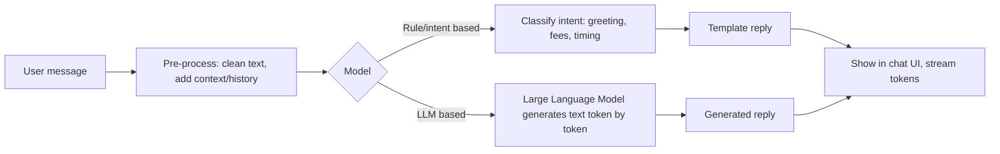

# Session 11: Integrating AI and Machine Learning with JavaScript

> Module: Programming with JavaScript · Term 2 (DISM) · ⏱ ~2 hours

## 🎯 Learning Objectives

By the end of this session you will be able to:

- Describe ways to add AI features to web apps (in-browser models vs cloud APIs)
- Use TensorFlow.js pre-trained models for image classification and text toxicity
- Explain ML techniques behind chatbots and real-time predictions
- Handle model loading, real-time data and performance concerns
- Call an AI API safely through a back-end proxy

## 📖 Concepts Explained

### 1. Two ways to add AI to a web app

| | In-browser ML (TensorFlow.js, ONNX Runtime Web, Transformers.js) | Cloud AI API (OpenAI, Google Gemini, Azure AI) |
|---|---|---|
| Where it runs | User's device (WebGL/WebGPU/WASM) | Provider's servers |
| Privacy | Data never leaves the device | Data is sent to the provider |
| Cost | Free after download | Pay per request |
| Offline | Works offline after load | Needs internet |
| Model size / power | Small to medium models | Very large, powerful models |
| Best for | Webcam/pose detection, image tags, simple text classification | Chatbots, summaries, content generation |

### 2. Key ML vocabulary

| Term | Meaning |
|---|---|
| **Model** | A function learned from data that maps inputs to outputs |
| **Training** | Adjusting a model's weights using examples |
| **Inference** | Using a trained model to make a prediction |
| **Pre-trained model** | A model someone already trained that you reuse |
| **Transfer learning** | Re-training the last layers of a pre-trained model on your own small dataset |
| **Tensor** | A multi-dimensional array of numbers (the data format of ML) |
| **Confidence / probability** | How sure the model is (0 to 1) |

### 3. How chatbots work (simplified)



- **Intent classification:** a small model labels the message (e.g. "ask_fee"), and code returns a prepared answer. Predictable and cheap.
- **Large Language Models (LLMs):** generate free text. Powerful but must be guided with a *system prompt*, limited to safe topics, and checked for mistakes.
- **Retrieval-Augmented Generation (RAG):** search your own documents first, then give the relevant parts to the LLM so answers are grounded in your data.

### 4. Real-time data with ML

Examples: webcam pose detection, live sentiment on comments, sensor anomaly detection. Techniques:
- Run inference in a `requestAnimationFrame` loop, but **skip frames** if the previous prediction has not finished.
- Use a **Web Worker** or the WebGPU backend for heavy models.
- **Warm up** the model with one dummy prediction so the first real one is fast.
- Dispose of tensors (`tf.tidy`) to avoid memory leaks.

### 5. Using pre-trained models with TensorFlow.js

Popular ready models: **MobileNet** (image classification), **COCO-SSD** (object detection), **Toxicity** (text classification), **Universal Sentence Encoder** (text similarity), **Pose/Face/Hand detection**.

### 6. Responsible AI checklist

- Never put API keys in front-end code; call AI APIs from your server.
- Tell users when content is AI-generated and that it can be wrong.
- Do not send personal data to third parties without consent.
- Test for bias (does the model work equally well for different users?).
- Provide a fallback when the model fails or is slow.

## 💻 Code Examples

All examples below are also saved as files in this folder, so you can open and run them directly.

### Example 1: Classify an image with MobileNet (`image-classifier.html`)

```html
<!DOCTYPE html>
<html lang="en">
<head>
  <meta charset="UTF-8">
  <title>Image Classifier (TensorFlow.js)</title>
  <script src="https://cdn.jsdelivr.net/npm/@tensorflow/tfjs@4"></script>
  <script src="https://cdn.jsdelivr.net/npm/@tensorflow-models/mobilenet@2"></script>
  <style>
    body { font-family: system-ui, sans-serif; max-width: 600px; margin: 30px auto; }
    img { max-width: 100%; max-height: 320px; display: block; margin: 10px 0; }
    li { margin: 4px 0; }
  </style>
</head>
<body>
  <h1>What is in this picture?</h1>
  <p id="status">Loading model...</p>
  <input type="file" id="file" accept="image/*" disabled>
  
  <ol id="results"></ol>

  <script>
    let model;
    const status = document.getElementById("status");

    mobilenet.load().then(m => {
      model = m;
      status.textContent = `Model ready (backend: ${tf.getBackend()}). Choose an image.`;
      document.getElementById("file").disabled = false;
    }).catch(err => (status.textContent = "Model failed to load: " + err.message));

    document.getElementById("file").addEventListener("change", e => {
      const file = e.target.files[0];
      if (!file) return;
      const img = document.getElementById("preview");
      img.src = URL.createObjectURL(file);
      img.onload = async () => {
        status.textContent = "Thinking...";
        const t = performance.now();
        const predictions = await model.classify(img, 3);
        status.textContent = `Done in ${Math.round(performance.now() - t)} ms`;
        document.getElementById("results").innerHTML = predictions
          .map(p => `<li>${p.className} — ${(p.probability * 100).toFixed(1)}%</li>`)
          .join("");
      };
    });
  </script>
</body>
</html>
```

**How it works:**

- The page loads TensorFlow.js and the MobileNet model from a CDN; the model downloads once and is cached by the browser.
- `model.classify(img, 3)` runs inference **in the browser** and returns the top 3 labels with probabilities. The image never leaves the device.
- Time the first and second predictions: the first includes warm-up.

### Example 2: Detect toxic comments in real time (`sentiment.html`)

```html
<!DOCTYPE html>
<html lang="en">
<head>
  <meta charset="UTF-8">
  <title>Comment Moderator</title>
  <script src="https://cdn.jsdelivr.net/npm/@tensorflow/tfjs@4"></script>
  <script src="https://cdn.jsdelivr.net/npm/@tensorflow-models/toxicity@1"></script>
  <style>
    body { font-family: system-ui, sans-serif; max-width: 600px; margin: 30px auto; }
    textarea { width: 100%; height: 80px; }
    .flag { color: #e63946; } .ok { color: #2a9d8f; }
  </style>
</head>
<body>
  <h1>Comment Moderator</h1>
  <p id="status">Loading toxicity model (~25 MB)...</p>
  <textarea id="comment" placeholder="Type an English comment..." disabled></textarea>
  <ul id="labels"></ul>
  <script>
    const threshold = 0.85;
    let model, timer;
    toxicity.load(threshold).then(m => {
      model = m;
      document.getElementById("status").textContent = "Ready. Start typing (checked 600 ms after you stop).";
      document.getElementById("comment").disabled = false;
    });

    document.getElementById("comment").addEventListener("input", e => {
      clearTimeout(timer); // debounce: do not run the model on every key
      timer = setTimeout(async () => {
        const text = e.target.value.trim();
        if (!text) return;
        const results = await model.classify([text]);
        document.getElementById("labels").innerHTML = results.map(r => {
          const match = r.results[0].match; // true, false or null (unsure)
          const cls = match ? "flag" : "ok";
          return `<li class="${cls}">${r.label}: ${match === null ? "unsure" : match ? "YES" : "no"}</li>`;
        }).join("");
      }, 600);
    });
  </script>
</body>
</html>
```

**How it works:**

The toxicity model labels text across categories such as insult, threat and obscene. The input is **debounced** (Session 6) so the model runs only after typing pauses, which keeps the page responsive while processing real-time input.

### Example 3: Node.js proxy for a cloud AI chatbot (keeps the key secret) (`chatbot-proxy.js`)

```javascript
// chatbot-proxy.js — Node 20+, no packages needed
// Run: set OPENAI_API_KEY in your environment, then: node chatbot-proxy.js
import http from "node:http";

const SYSTEM_PROMPT =
  "You are a helpful assistant for a computer institute in Karachi. " +
  "Only answer questions about courses, timings and admissions. Keep answers short.";

const server = http.createServer(async (req, res) => {
  res.setHeader("Access-Control-Allow-Origin", "http://localhost:5500"); // your front-end only
  res.setHeader("Access-Control-Allow-Headers", "Content-Type");
  if (req.method === "OPTIONS") return res.end();
  if (req.method !== "POST" || req.url !== "/chat") {
    res.writeHead(404);
    return res.end();
  }

  let body = "";
  for await (const chunk of req) body += chunk;
  const { message } = JSON.parse(body || "{}");
  if (!message || message.length > 500) {
    res.writeHead(400, { "Content-Type": "application/json" });
    return res.end(JSON.stringify({ error: "Message required (max 500 chars)" }));
  }

  try {
    const aiRes = await fetch("https://api.openai.com/v1/chat/completions", {
      method: "POST",
      headers: {
        "Content-Type": "application/json",
        Authorization: `Bearer ${process.env.OPENAI_API_KEY}` // secret stays on the server
      },
      body: JSON.stringify({
        model: "gpt-4o-mini",
        messages: [
          { role: "system", content: SYSTEM_PROMPT },
          { role: "user", content: message }
        ],
        max_tokens: 200
      })
    });
    const data = await aiRes.json();
    const reply = data.choices?.[0]?.message?.content ?? "Sorry, I could not answer that.";
    res.writeHead(200, { "Content-Type": "application/json" });
    res.end(JSON.stringify({ reply }));
  } catch (err) {
    res.writeHead(502, { "Content-Type": "application/json" });
    res.end(JSON.stringify({ error: "AI service unavailable" }));
  }
});

server.listen(3000, () => console.log("Chat proxy on http://localhost:3000/chat"));
```

**How it works:**

- The browser sends `{ message }` to **your** server; your server adds the secret key and calls the AI provider. The key is never exposed to users.
- The system prompt limits the bot to institute topics; input length is validated; CORS allows only your front-end origin.
- Errors return clear JSON with proper status codes. Add `"type": "module"` in a `package.json` (or rename to `.mjs`) to use `import`.

## 🧪 Lab Practice

1. **Classify:** run `image-classifier.html` (via Live Server) with five different photos. Record when the model is confident and when it is wrong.
2. **Webcam:** change the classifier to use `<video>` and `navigator.mediaDevices.getUserMedia`, classifying a frame every second.
3. **Moderator:** in `sentiment.html`, disable a *Post* button whenever any label is flagged.
4. **Rule-based bot:** without any API, build a small chatbot that matches intents (greeting, fee, timing) with regex from Session 3 and replies from a JSON file.
5. **Proxy:** if you have an API key, run `chatbot-proxy.js` and build a chat page that posts to it. If not, mock the proxy to return a fixed reply.

## 📝 Assignment

Create an **AI Study Helper** page with two features: (1) an image classifier that tags uploaded photos and stores the top label and confidence in `localStorage` history; (2) a rule-based FAQ chatbot for your institute that detects at least 6 intents. Add a section in your README describing which parts run in the browser, what data (if any) leaves the device, and one responsible-AI risk you addressed.

## ❓ Quick Quiz

1. What is inference?
2. Name one advantage of running ML in the browser.
3. Why should AI API keys never be in front-end JavaScript?
4. Which TensorFlow.js model classifies images into everyday categories?
   - a) COCO-SSD
   - b) MobileNet
   - c) Toxicity
   - d) BERT
5. What does RAG add to a chatbot?

<details>
<summary>Show answers</summary>

1. Using a trained model to make predictions on new data.
2. Privacy (data stays on the device), no server cost, offline use, or low latency.
3. Anyone can read front-end code and steal the key; calls must go through your own server.
4. b) MobileNet
5. It retrieves relevant information from your own documents and gives it to the LLM so answers are grounded in your data.

</details>

## 💼 Interview Questions

1. **When would you choose in-browser ML over a cloud AI API?**

   <details><summary>Model answer</summary>

   When privacy matters, latency must be low (real-time camera), the app must work offline, or costs per request must be zero, and a small model is accurate enough. Cloud APIs suit heavy tasks like open-ended chat or large-scale generation.

   </details>

2. **How do you keep a real-time ML feature responsive?**

   <details><summary>Model answer</summary>

   Throttle or skip frames, run inference off the main thread (Web Worker or WebGPU), warm up the model, use smaller models, dispose of tensors, and show progress or fallbacks.

   </details>

3. **What risks come with LLM chatbots and how do you reduce them?**

   <details><summary>Model answer</summary>

   Wrong or invented answers, prompt injection, data leakage and inappropriate content. Reduce them with system prompts, limited scope, retrieval from trusted data, input and output filtering, rate limits, logging, and clear disclaimers.

   </details>

## ✅ Summary

- AI features run either in the browser (TensorFlow.js) or through cloud APIs.
- Pre-trained models like MobileNet and Toxicity give instant capabilities without training.
- Chatbots range from intent classification to LLMs, often grounded with RAG.
- Real-time ML needs throttling, workers, warm-up and memory care.
- Keep keys on the server, protect user data, disclose AI output and plan fallbacks.

---

[⬅ Previous](../Session-10-JS-Frameworks-Vue-Svelte-Solid/README.md) · [🏠 Module Home](../README.md) · [Next ➡](../Session-12-Future-Trends-Web-APIs/README.md)

<sub>Prepared by Zeeshan Abbas · Aptech Learning North Nazimabad</sub>
