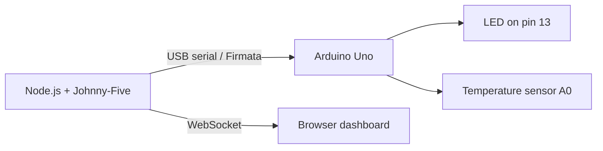
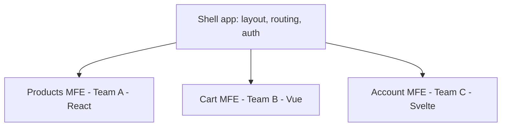

# Session 12: Future Trends: Dynamic Imports, Emerging Web APIs, IoT and Micro Frontends

> Module: Programming with JavaScript · Term 2 (DISM) · ⏱ ~2 hours

## 🎯 Learning Objectives

By the end of this session you will be able to:

- Use dynamic imports and top-level await in modern modules
- Experiment with emerging Web APIs: Web Speech, Web Share, Clipboard, WebXR and WebUSB
- Describe JavaScript's role in IoT with Johnny-Five
- Explain micro-frontend architecture and when to use it
- Compare where JavaScript and its frameworks are heading

## 📖 Concepts Explained

### 1. Dynamic imports and top-level await

```js
// load a module only when needed, from any condition
if (user.isAdmin) {
  const { AdminPanel } = await import("./admin.js");
  new AdminPanel().show();
}

// top-level await: allowed directly in ES modules
const config = await fetch("/config.json").then(r => r.json());
```

Dynamic imports are also used for **feature-based loading** (load a polyfill only if a feature is missing) and **language packs** (`import(`./i18n/${lang}.js`)`).

### 2. Emerging and modern Web APIs

| API | What it does | Support (2025) |
|---|---|---|
| **Web Speech: SpeechRecognition** | Voice → text | Chrome, Edge (prefixed `webkitSpeechRecognition`), Safari partial |
| **Web Speech: SpeechSynthesis** | Text → voice | All major browsers |
| **Web Share** | Open the phone's native share sheet | Mobile browsers, Safari, Edge |
| **Clipboard** | Read/write clipboard with permission | All modern browsers |
| **Geolocation** | User's location with permission | All |
| **WebXR** | Virtual and augmented reality in the browser | Chrome/Android, Meta Quest browser |
| **WebUSB / Web Serial / Web Bluetooth** | Talk to hardware from the browser | Chromium browsers only |
| **WebGPU** | Fast GPU graphics and ML compute | Chrome, Edge; others in progress |
| **View Transitions** | Animated page/state transitions | Chromium, Safari 18 |

Rules for all of them: **feature-detect**, require **HTTPS** (localhost is allowed), and ask for **permission** at a moment that makes sense to the user (for example after a button click).

### 3. JavaScript in IoT

Node.js can control hardware. **Johnny-Five** is a robotics/IoT library that talks to an Arduino board (running the *StandardFirmata* sketch) over USB.



Other options: **Espruino** and **Moddable** run JavaScript directly on microcontrollers; **MQTT.js** connects devices to IoT message brokers.

### 4. Micro frontends

As front-end apps grow, many teams work on one huge codebase. **Micro frontends** split the UI into independently built and deployed pieces, each owned by one team, combined in a **shell (host)** app.



| Approach | How |
|---|---|
| Module Federation (Webpack 5 / Rspack / Vite plugin) | Host loads remote bundles at runtime |
| Web Components | Each MFE is a custom element `<cart-widget>` |
| Server-side composition | Server stitches HTML fragments |
| iframes | Strong isolation, weaker UX |

**Pros:** independent deployments, team autonomy, gradual migration from old tech. **Cons:** more complexity, risk of duplicated dependencies, harder consistency in design. Use it only when several teams truly need independence.

### 5. Where JavaScript is heading

- **TypeScript** is the default for serious projects; Node.js can now run many `.ts` files directly.
- **Signals** are spreading across frameworks (Solid, Vue, Angular, Svelte runes, Preact) and are proposed for the language itself.
- **Meta-frameworks** (Next.js, Nuxt, SvelteKit, Astro) combine server rendering, routing and data loading.
- **Edge runtimes** run JS close to users (Cloudflare Workers, Deno Deploy).
- **WebAssembly** runs C/C++/Rust code next to JS for heavy tasks.
- **AI-assisted development** speeds up coding, but understanding fundamentals remains essential for checking AI-generated code.

## 💻 Code Examples

All examples below are also saved as files in this folder, so you can open and run them directly.

### Example 1: Speech, Share, Clipboard and dynamic import demo (`web-apis.html`)

```html
<!DOCTYPE html>
<html lang="en">
<head>
  <meta charset="UTF-8">
  <title>Modern Web APIs</title>
  <style>
    body { font-family: system-ui, sans-serif; max-width: 640px; margin: 30px auto; }
    section { border: 1px solid #ddd; border-radius: 10px; padding: 12px; margin: 12px 0; }
    textarea { width: 100%; height: 80px; }
    .na { color: #999; }
  </style>
</head>
<body>
  <h1>Modern Web APIs Playground</h1>

  <section>
    <h2>🎤 Voice to text</h2>
    <button id="listen">Start listening</button>
    <select id="lang"><option value="en-US">English</option><option value="ur-PK">Urdu</option></select>
    <textarea id="transcript" placeholder="Your speech appears here"></textarea>
  </section>

  <section>
    <h2>🔊 Text to voice · 📋 Copy · 📤 Share</h2>
    <button id="speak">Speak text</button>
    <button id="copy">Copy text</button>
    <button id="share">Share text</button>
    <p id="msg"></p>
  </section>

  <section>
    <h2>📦 Dynamic import</h2>
    <button id="stats">Load text statistics module</button>
    <pre id="statsOut"></pre>
  </section>

  <script type="module">
    const $ = id => document.getElementById(id);
    const text = () => $("transcript").value.trim();
    const say = m => ($("msg").textContent = m);

    // ---- Speech recognition (feature detection) ----
    const SR = window.SpeechRecognition || window.webkitSpeechRecognition;
    if (!SR) {
      $("listen").disabled = true;
      $("listen").textContent = "Speech recognition not supported in this browser";
    } else {
      const rec = new SR();
      rec.interimResults = true;
      rec.continuous = false;
      rec.onresult = e => ($("transcript").value = [...e.results].map(r => r[0].transcript).join(" "));
      rec.onerror = e => say("Speech error: " + e.error);
      rec.onend = () => ($("listen").textContent = "Start listening");
      $("listen").onclick = () => {
        rec.lang = $("lang").value;
        rec.start();
        $("listen").textContent = "Listening...";
      };
    }

    // ---- Speech synthesis ----
    $("speak").onclick = () => {
      if (!text()) return say("Type or say something first");
      speechSynthesis.speak(new SpeechSynthesisUtterance(text()));
    };

    // ---- Clipboard ----
    $("copy").onclick = async () => {
      try {
        await navigator.clipboard.writeText(text());
        say("Copied to clipboard ✔");
      } catch {
        say("Clipboard permission denied");
      }
    };

    // ---- Web Share ----
    $("share").onclick = async () => {
      if (!navigator.share) return say("Web Share not supported here (try on a phone)");
      try {
        await navigator.share({ title: "My note", text: text() });
      } catch (err) {
        if (err.name !== "AbortError") say("Share failed: " + err.message);
      }
    };

    // ---- Dynamic import ----
    $("stats").onclick = async () => {
      const { analyze } = await import("./text-stats.js");
      $("statsOut").textContent = JSON.stringify(analyze(text()), null, 2);
    };
  </script>
</body>
</html>
```

**How it works:**

- Every API is **feature-detected** first, so unsupported browsers show a helpful message instead of crashing.
- Speech recognition fills the textarea as you talk (try Urdu with `ur-PK`).
- Clipboard and Share are called from button clicks because browsers require a user gesture.
- `text-stats.js` is downloaded only when its button is clicked.

### Example 2: Module loaded on demand (`text-stats.js`)

```javascript
// text-stats.js
export function analyze(text) {
  const words = text.split(/\s+/).filter(Boolean);
  const freq = words.reduce((m, w) => m.set(w.toLowerCase(), (m.get(w.toLowerCase()) ?? 0) + 1), new Map());
  const top = [...freq].sort((a, b) => b[1] - a[1]).slice(0, 3);
  return {
    characters: text.length,
    words: words.length,
    readingTimeSeconds: Math.ceil((words.length / 200) * 60),
    topWords: Object.fromEntries(top)
  };
}
```

**How it works:**

A small, pure analysis module. In a real app this could be a large library such as a PDF generator.

### Example 3: IoT: blink an LED and read a sensor with Johnny-Five (`blink.js`)

```javascript
// blink.js — needs an Arduino with StandardFirmata uploaded (Arduino IDE → Examples → Firmata)
// Setup: npm init -y && npm install johnny-five
// Run:   node blink.js
const { Board, Led, Sensor } = require("johnny-five");

const board = new Board(); // auto-detects the Arduino on a USB port

board.on("ready", () => {
  console.log("Board ready");

  const led = new Led(13);
  led.blink(500); // toggle every 500 ms

  // Analog temperature sensor (e.g. LM35) on pin A0, read every second
  const sensor = new Sensor({ pin: "A0", freq: 1000 });
  sensor.on("data", function () {
    const celsius = (this.value * 5 * 100) / 1024; // LM35: 10 mV per °C
    console.log(`Temperature: ${celsius.toFixed(1)} °C`);
    if (celsius > 35) led.on(); // solid light as an alert
  });

  board.on("exit", () => led.off());
});
```

**How it works:**

Johnny-Five sends commands over USB using the Firmata protocol. The same event-driven style you use in the browser (`on("data")`) controls real hardware. No Arduino? Simulate one in Wokwi (https://wokwi.com).

## 🧪 Lab Practice

1. **Voice notes:** run `web-apis.html` in Chrome, dictate a sentence in English and in Urdu, then speak it back.
2. **Feature report:** write a script that checks 10 APIs (`'share' in navigator`, `'gpu' in navigator`, `'usb' in navigator`...) and prints a supported/unsupported table.
3. **Geolocation:** add a button that shows the user's latitude and longitude and opens it on OpenStreetMap.
4. **Micro frontend with Web Components:** create a `<price-tag amount="1500">` custom element in its own file and use it in a page built by another "team" (another file).
5. **IoT simulation:** build the LED/sensor circuit at wokwi.com and describe how `blink.js` would control it.

## 📝 Assignment

Build a **Voice-Controlled To-Do List**: the user says commands such as "add buy milk", "complete buy milk" or "clear all", recognized with the Web Speech API and parsed with regular expressions. Confirm each action with speech synthesis, share the list with the Web Share API (with a clipboard fallback), and lazy-load a statistics module with dynamic import. Include feature detection for every API.

## ❓ Quick Quiz

1. Which syntax loads a module only when the code reaches it?
2. What is required for most powerful Web APIs to work?
   - a) HTTP
   - b) HTTPS (or localhost)
   - c) A framework
   - d) Node.js
3. Which library lets Node.js control an Arduino?
   - a) Three.js
   - b) Johnny-Five
   - c) Express
   - d) Pinia
4. What is a micro frontend?
5. Name the API that opens the phone's native share sheet.

<details>
<summary>Show answers</summary>

1. Dynamic `import("./file.js")`
2. b) HTTPS (or localhost)
3. b) Johnny-Five
4. An independently built and deployed part of a web UI owned by one team, combined with others in a shell app.
5. The Web Share API (`navigator.share`).

</details>

## 💼 Interview Questions

1. **What are the trade-offs of micro frontends?**

   <details><summary>Model answer</summary>

   Benefits: independent deployments, team autonomy, mixing technologies and gradual migration. Costs: more infrastructure, possible duplicate libraries and larger downloads, harder shared design and state, and more complex testing. They suit large organisations with many front-end teams.

   </details>

2. **How do you use a cutting-edge browser API safely in production?**

   <details><summary>Model answer</summary>

   Feature-detect it, provide a fallback or hide the feature when unsupported, serve over HTTPS, request permissions only after a user action, handle errors, and track support on caniuse/MDN.

   </details>

3. **Which JavaScript trends do you think matter most for a new developer?**

   <details><summary>Model answer</summary>

   TypeScript, component frameworks with signals, meta-frameworks for server rendering, edge runtimes, WebAssembly for performance, and using AI tools responsibly while keeping strong fundamentals.

   </details>

## ✅ Summary

- Dynamic imports and top-level await enable on-demand, conditional loading.
- Modern Web APIs (Speech, Share, Clipboard, WebXR, WebUSB, WebGPU) bring native-like features; always feature-detect.
- Johnny-Five and similar tools let JavaScript control IoT hardware.
- Micro frontends split large UIs across teams, at the cost of extra complexity.
- TypeScript, signals, meta-frameworks, edge and WebAssembly shape JavaScript's future.

---

[⬅ Previous](../Session-11-AI-and-ML-with-JavaScript/README.md) · [🏠 Module Home](../README.md) · [Next ➡](../../03-Working-with-MySQL/README.md)

<sub>Prepared by Zeeshan Abbas · Aptech Learning North Nazimabad</sub>
