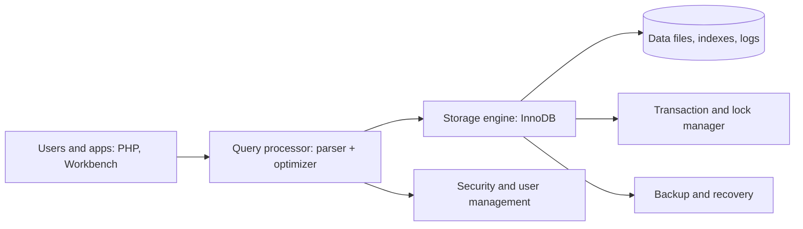

# Session 01: Introduction to Databases and MySQL

> Module: Working with MySQL · Term 2 (DISM) · ⏱ ~2 hours

## 🎯 Learning Objectives

By the end of this session you will be able to:

- Define a database and a DBMS and explain why organisations need them
- List the components of a DBMS and the main database models
- Explain RDBMS terminology: table, row, column, key, schema
- Describe MySQL's features, limitations and editions
- Install MySQL Server and MySQL Workbench and connect to a server
- Run your first SQL statements from Workbench and the command line

## 📖 Concepts Explained

### 1. What is a database?

A **database** is an organised collection of related data stored so it can be searched, updated and protected easily. Your mobile contacts, a bank's accounts, Daraz's product catalogue and your institute's attendance records are all databases.

A **DBMS (Database Management System)** is the software that stores the data and lets users and programs work with it safely. MySQL, PostgreSQL, SQL Server, Oracle and SQLite are DBMSs.

| Without a DBMS (files/spreadsheets) | With a DBMS |
|---|---|
| Duplicate, inconsistent copies | One shared, consistent copy |
| Hard to search large data | Fast queries with indexes |
| No control over who sees what | Users, roles and permissions |
| Two people editing = lost changes | Concurrency control and transactions |
| Crash = data loss | Logs, backups and recovery |

### 2. Components of a DBMS



Other components: **hardware** (servers, disks), **data** (actual records plus metadata in the *data dictionary*), **procedures** (backup policies) and **people** (DBA, developers, end users).

### 3. Database models

| Model | Structure | Example |
|---|---|---|
| Hierarchical | Tree: each child has one parent | Old IBM IMS, Windows Registry |
| Network | Graph: a child can have many parents | Early CODASYL systems |
| **Relational** | Tables linked by keys | MySQL, PostgreSQL, SQL Server, Oracle |
| Object-oriented | Objects with methods stored directly | db4o, ObjectDB |
| NoSQL (document, key-value, graph) | JSON documents, key-value pairs, graphs | MongoDB, Redis, Neo4j |

### 4. RDBMS terminology

An **RDBMS** stores data in **relations (tables)** and links them with **keys**. It follows rules described by E. F. Codd in 1970.

| Term | Also called | Example |
|---|---|---|
| Table | Relation | `students` |
| Row | Record, tuple | one student |
| Column | Field, attribute | `email` |
| Primary key (PK) | | `student_id` uniquely identifies a row |
| Foreign key (FK) | | `enrollments.student_id` points to `students` |
| Schema | Database (in MySQL) | `institute_db` |
| Domain | Allowed values | `marks` 0-100 |

### 5. MySQL at a glance

- Open source (GPL) **Community Edition**, plus commercial **Enterprise Edition** by Oracle. **MariaDB** is a community fork.
- Part of the classic **LAMP/XAMPP** stack (Linux/Windows, Apache, MySQL, PHP).
- Used by WordPress, Facebook (heavily customised), YouTube, Booking.com and countless Pakistani startups.

| Features | Limitations |
|---|---|
| Fast, reliable, easy to install | Fewer advanced analytics features than PostgreSQL/Oracle |
| ACID transactions with InnoDB | Some SQL standard features arrived late (e.g. `INTERSECT` only in 8.0.31) |
| Replication and partitioning | Full-text search is basic compared to dedicated engines |
| Works with every language | Enterprise tools (e.g. thread pool, audit) are paid |
| JSON column type, window functions, CTEs (8.0) | |

### 6. Installing MySQL (Windows)

1. Download **MySQL Installer** from https://dev.mysql.com/downloads/installer/.
2. Choose *Custom* → select **MySQL Server 8.x**, **MySQL Workbench**, **MySQL Shell**.
3. Keep port **3306**, choose *Strong password encryption*, set a **root password** (write it down).
4. Configure it as a Windows Service that starts automatically.
5. Open **Workbench** → click the *Local instance 3306* tile → enter the root password.

> Using XAMPP? It ships **MariaDB**, which is almost identical for this course. Use phpMyAdmin or connect Workbench to `127.0.0.1:3306` with user `root`.

### 7. MySQL Workbench tour

| Area | Use |
|---|---|
| Navigator → Schemas | Browse databases, tables, views, routines |
| SQL Editor tab | Write and run queries (⚡ runs all or selection, Ctrl+Enter runs current statement) |
| Result Grid | View/edit results, export to CSV |
| Output panel | Messages, errors, execution time |
| Administration | Server status, users and privileges, data export/import |
| Database → Reverse Engineer | Draw an ER diagram from an existing database |

## 💻 Code Examples

All examples below are also saved as files in this folder, so you can open and run them directly.

### Example 1: Your first SQL session (`first-queries.sql`)

```sql
-- first-queries.sql : run in MySQL Workbench or the mysql command-line client

-- 1. Server information
SELECT VERSION() AS mysql_version, CURRENT_USER() AS logged_in_as, NOW() AS server_time;

-- 2. Which databases exist?
SHOW DATABASES;

-- 3. Create and use a practice database
CREATE DATABASE IF NOT EXISTS institute_db
  CHARACTER SET utf8mb4 COLLATE utf8mb4_unicode_ci;
USE institute_db;

-- 4. A first table
CREATE TABLE IF NOT EXISTS students (
  student_id INT AUTO_INCREMENT PRIMARY KEY,
  full_name  VARCHAR(100) NOT NULL,
  city       VARCHAR(50)  DEFAULT 'Karachi',
  joined_on  DATE
);

-- 5. Insert and read data
INSERT INTO students (full_name, city, joined_on) VALUES
  ('Ayesha Khan', 'Karachi', '2025-01-15'),
  ('Bilal Ahmed', 'Hyderabad', '2025-02-01'),
  ('Sana Javed', DEFAULT, '2025-02-10');

SELECT * FROM students;

-- 6. Describe the structure
DESCRIBE students;
SHOW TABLES;
```

**How it works:**

- `SELECT VERSION()` confirms the connection works.
- `utf8mb4` supports every language and emoji, including Urdu text.
- `AUTO_INCREMENT PRIMARY KEY` gives each student a unique number automatically.
- `DEFAULT` inserts the column's default value (`Karachi`).
- `DESCRIBE` shows columns, types, keys and defaults.

### Example 2: Connecting from the command line (`cli-connect.txt`)

```text
# Windows: open "MySQL 8.x Command Line Client" or a terminal in
#   C:\Program Files\MySQL\MySQL Server 8.0\bin
# XAMPP: C:\xampp\mysql\bin

mysql -u root -p                       # connect to the local server, prompts for password
mysql -h 127.0.0.1 -P 3306 -u root -p  # explicit host and port

# Inside the mysql> prompt:
STATUS;                                 -- connection details
SHOW DATABASES;
USE institute_db;
SOURCE C:/path/to/first-queries.sql;    -- run a script file
EXIT;
```

**How it works:**

Workbench is friendly, but the command-line client is always available on servers and is how you run scripts quickly. Note that the `SOURCE` path uses forward slashes even on Windows.

## 🧪 Lab Practice

1. **Install** MySQL Server 8 and Workbench (or XAMPP). Take a screenshot of a successful connection.
2. **Run** `first-queries.sql` in Workbench. Find the new schema in the Navigator (right-click → *Refresh All*).
3. **Explore** the Result Grid: sort by a column, edit a city, click *Apply*, and read the SQL Workbench generated.
4. **Command line:** connect with `mysql -u root -p`, run `USE institute_db; SELECT * FROM students;` and exit.
5. **Identify models:** for each system (bank accounts, family tree app, Instagram followers, product catalogue with varying attributes), suggest the best database model and why.

## 📝 Assignment

Write a one-page comparison (`DBMS-COMPARISON.md`) of MySQL, PostgreSQL, SQL Server, SQLite and MongoDB covering: model, licence/cost, typical use, two strengths and one limitation each. Then create a database `my_shop` with a `products` table (id, name, price, stock) and insert 5 products. Submit the SQL script and a screenshot of `SELECT * FROM products`.

## ❓ Quick Quiz

1. What is a DBMS?
2. In an RDBMS, a row is also called a:
   - a) Field
   - b) Tuple/record
   - c) Domain
   - d) Schema
3. What is MySQL's default port?
   - a) 80
   - b) 1433
   - c) 3306
   - d) 5432
4. What does a primary key guarantee?
5. Which character set should you use for full Unicode (including emoji)?

<details>
<summary>Show answers</summary>

1. Software that stores, manages, secures and retrieves data in a database.
2. b) Tuple/record
3. c) 3306
4. Each row is uniquely identified; values are unique and not NULL.
5. `utf8mb4`

</details>

## 💼 Interview Questions

1. **What is the difference between a database and a DBMS?**

   <details><summary>Model answer</summary>

   The database is the organised data itself. The DBMS is the software (like MySQL) that creates, stores, queries, secures and backs up that data.

   </details>

2. **Why is the relational model so widely used?**

   <details><summary>Model answer</summary>

   It is simple (tables), based on solid mathematics, avoids duplication through keys and normalization, enforces integrity with constraints, supports a standard language (SQL), and offers ACID transactions.

   </details>

3. **What is the difference between MySQL and MariaDB?**

   <details><summary>Model answer</summary>

   MariaDB is a community fork of MySQL created after Oracle acquired MySQL. They are highly compatible for everyday SQL, but newer versions differ in some features, optimizer behaviour and storage engines.

   </details>

## ✅ Summary

- A database stores organised data; a DBMS manages it safely and efficiently.
- DBMS components include the query processor, storage engine, security, transactions and recovery.
- Relational databases store data in tables linked by primary and foreign keys.
- MySQL is a fast, popular, open-source RDBMS with ACID support through InnoDB.
- Workbench and the `mysql` CLI are the two main ways to work with the server.

---

[⬅ Previous](../README.md) · [🏠 Module Home](../README.md) · [Next ➡](../Session-02-Database-Design-Normalization/README.md)

<sub>Prepared by Zeeshan Abbas · Aptech Learning North Nazimabad</sub>
