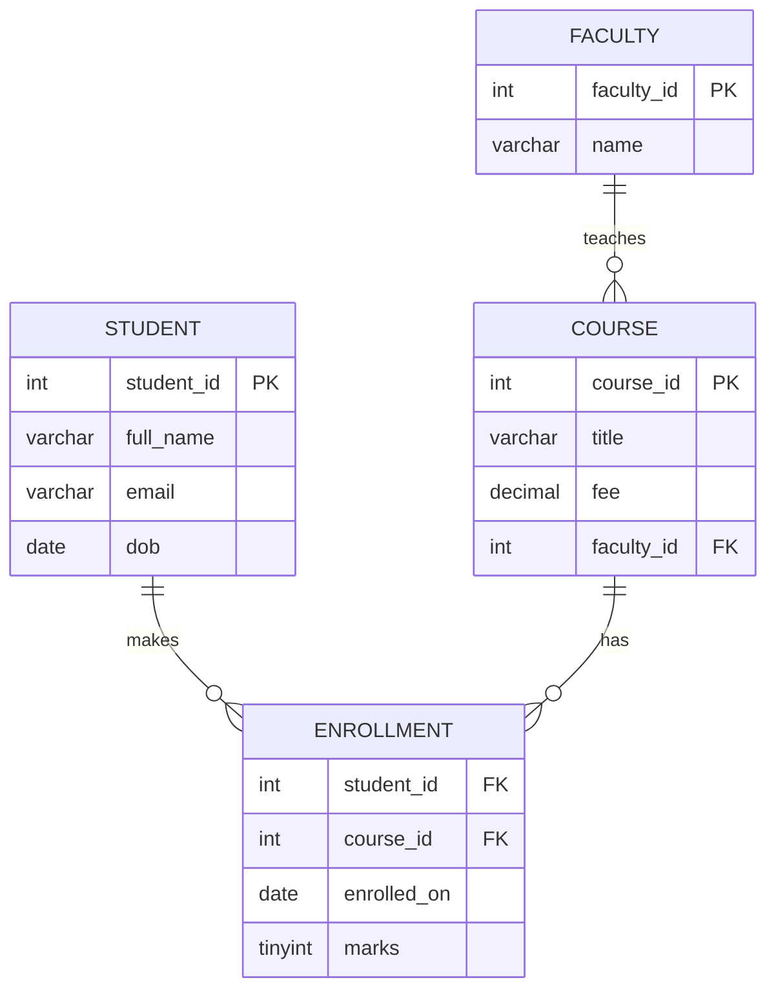
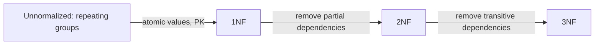

# Session 02: Database Design and Normalization

> Module: Working with MySQL · Term 2 (DISM) · ⏱ ~2 hours

## 🎯 Learning Objectives

By the end of this session you will be able to:

- Identify entities, attributes and relationships from a real-world scenario
- Draw an ER diagram with cardinalities (1:1, 1:N, M:N)
- Choose primary, foreign, candidate and composite keys
- Explain anomalies caused by poor design
- Normalize a table to 1NF, 2NF and 3NF
- Plan the schema for a Student Enrollment System

## 📖 Concepts Explained

### 1. Why design first?

Building tables without a plan is like constructing a house without drawings. You end up with duplicated data, wrong totals and painful changes later. Design happens on paper (or a diagram tool) **before** `CREATE TABLE`.

### 2. Entities, attributes and relationships

| Concept | Meaning | Example (institute) |
|---|---|---|
| **Entity** | A thing we store data about (a noun) | Student, Course, Faculty |
| **Attribute** | A property of an entity | Student name, Course fee |
| **Relationship** | How entities are connected (a verb) | Student *enrolls in* Course |

Attribute types: **simple** (`city`), **composite** (`address` = street + city), **multi-valued** (`phone numbers`, becomes its own table), **derived** (`age` from `dob`, usually not stored).

### 3. Cardinality

| Type | Example | How to implement |
|---|---|---|
| One-to-one (1:1) | Student – Student login account | FK with `UNIQUE` on one side |
| One-to-many (1:N) | Faculty – Batches | FK on the "many" side (`batches.faculty_id`) |
| Many-to-many (M:N) | Students – Courses | A **junction table** (`enrollments`) with two FKs |

### 4. ER diagram



`||--o{` reads "exactly one ... zero or many".

### 5. Keys

| Key | Meaning |
|---|---|
| **Super key** | Any set of columns that uniquely identifies a row |
| **Candidate key** | A minimal super key (e.g. `email`, `cnic`) |
| **Primary key** | The candidate key chosen as the main identifier |
| **Alternate key** | Candidate keys not chosen (enforce with `UNIQUE`) |
| **Composite key** | PK made of 2+ columns (`student_id, course_id`) |
| **Foreign key** | Column referring to another table's PK |
| **Surrogate key** | Artificial ID (`AUTO_INCREMENT`) instead of a natural value |

### 6. Anomalies in a badly designed table

| student_id | student_name | course | faculty | faculty_phone |
|---|---|---|---|---|
| 1 | Ayesha | PHP | Mr. Imran | 0300-1111111 |
| 1 | Ayesha | MySQL | Ms. Hina | 0301-2222222 |
| 2 | Bilal | PHP | Mr. Imran | 0300-1111111 |

- **Update anomaly:** Mr. Imran's phone changes; we must update many rows, and missing one creates conflicting data.
- **Insert anomaly:** we cannot add a new course until a student enrolls in it.
- **Delete anomaly:** if Bilal leaves and he was the only student in a course, we lose the course and faculty information too.

### 7. Normal forms



| Form | Rule | Simple test |
|---|---|---|
| **1NF** | Each cell holds one value; no repeating groups; each row unique (has a PK) | No commas inside cells, no `course1, course2` columns |
| **2NF** | 1NF + every non-key column depends on the **whole** PK (matters for composite keys) | In `(student_id, course_id)`, `student_name` depends only on `student_id` → move it out |
| **3NF** | 2NF + no non-key column depends on another non-key column | `faculty_phone` depends on `faculty`, not on the key → move to a faculty table |

Memory trick: every non-key attribute must depend on "**the key, the whole key, and nothing but the key**".

### 8. When to denormalize

Normalized designs avoid anomalies, but sometimes reports need speed. Teams may add a summary column or table (e.g. `orders.total_amount`) on purpose. That is **controlled denormalization**: do it knowingly and keep it updated with transactions or triggers.

## 💻 Code Examples

All examples below are also saved as files in this folder, so you can open and run them directly.

### Example 1: From one messy table to 3NF (`normalization-walkthrough.sql`)

```sql
-- normalization-walkthrough.sql
CREATE DATABASE IF NOT EXISTS design_demo;
USE design_demo;

-- UNNORMALIZED: multiple values in one cell (violates 1NF)
CREATE TABLE raw_enrollments (
  student_id INT,
  student_name VARCHAR(100),
  courses VARCHAR(255),          -- 'PHP:Mr. Imran:0300-1111111, MySQL:Ms. Hina:0301-2222222'
  city VARCHAR(50)
);

-- 1NF: one value per cell, composite PK
CREATE TABLE enrollments_1nf (
  student_id INT,
  student_name VARCHAR(100),
  city VARCHAR(50),
  course_code VARCHAR(10),
  course_title VARCHAR(100),
  faculty_name VARCHAR(100),
  faculty_phone VARCHAR(20),
  PRIMARY KEY (student_id, course_code)
);
-- Problem: student_name and city depend only on student_id (partial dependency)

-- 2NF: split out data that depends on part of the key
CREATE TABLE students_2nf (
  student_id INT PRIMARY KEY,
  student_name VARCHAR(100),
  city VARCHAR(50)
);
CREATE TABLE courses_2nf (
  course_code VARCHAR(10) PRIMARY KEY,
  course_title VARCHAR(100),
  faculty_name VARCHAR(100),
  faculty_phone VARCHAR(20)      -- depends on faculty_name, not course_code (transitive)
);
CREATE TABLE enrollments_2nf (
  student_id INT,
  course_code VARCHAR(10),
  PRIMARY KEY (student_id, course_code)
);

-- 3NF: remove the transitive dependency course -> faculty -> phone
CREATE TABLE faculty (
  faculty_id INT AUTO_INCREMENT PRIMARY KEY,
  faculty_name VARCHAR(100) NOT NULL,
  phone VARCHAR(20) UNIQUE
);
CREATE TABLE students (
  student_id INT PRIMARY KEY,
  student_name VARCHAR(100) NOT NULL,
  city VARCHAR(50)
);
CREATE TABLE courses (
  course_code VARCHAR(10) PRIMARY KEY,
  course_title VARCHAR(100) NOT NULL,
  faculty_id INT,
  FOREIGN KEY (faculty_id) REFERENCES faculty(faculty_id)
);
CREATE TABLE enrollments (
  student_id INT,
  course_code VARCHAR(10),
  enrolled_on DATE DEFAULT (CURRENT_DATE),
  PRIMARY KEY (student_id, course_code),
  FOREIGN KEY (student_id) REFERENCES students(student_id),
  FOREIGN KEY (course_code) REFERENCES courses(course_code)
);
```

**How it works:**

Follow the comments from top to bottom: each step removes one kind of problem. In the final 3NF design, a faculty member's phone is stored exactly once, a course can exist without students, and deleting a student never deletes course information.

### Example 2: Design plan template for a mini database (`enrollment-plan.md`)

```markdown
# Design Plan: Student Enrollment System

## 1. Requirements (in plain words)
- Students register with name, email (unique), phone, date of birth.
- Courses have a code, title, duration (weeks) and fee.
- Each course is taught by one faculty member; a faculty member can teach many courses.
- A student can enroll in many courses; each enrollment stores date and final marks.
- Fee payments are recorded per enrollment (amount, date, method).

## 2. Entities and attributes
| Entity | Attributes | Primary key |
|---|---|---|
| Student | student_id, full_name, email, phone, dob | student_id |
| Faculty | faculty_id, full_name, email | faculty_id |
| Course | course_id, code, title, weeks, fee, faculty_id | course_id |
| Enrollment | enrollment_id, student_id, course_id, enrolled_on, marks | enrollment_id |
| Payment | payment_id, enrollment_id, amount, paid_on, method | payment_id |

## 3. Relationships
- Faculty 1 — N Course
- Student M — N Course (through Enrollment)
- Enrollment 1 — N Payment

## 4. Business rules / constraints
- email UNIQUE; marks 0–100; fee > 0; method IN ('cash','card','bank')
- A student cannot enroll twice in the same course: UNIQUE(student_id, course_id)

## 5. Normal form check
- [x] 1NF: atomic columns, every table has a PK
- [x] 2NF: no partial dependencies
- [x] 3NF: no transitive dependencies
```

**How it works:**

Use this template before every database you build. Writing rules in plain language first makes the SQL in the next session straightforward.

## 🧪 Lab Practice

1. **Identify:** read the requirements in `enrollment-plan.md` and list every entity, attribute and relationship on paper.
2. **ER diagram:** draw the diagram in draw.io (https://app.diagrams.net) or Workbench (*File → New Model → Add Diagram*).
3. **Normalize by hand:** convert this table to 3NF: `order_id, order_date, customer_name, customer_phone, product_name, product_price, qty`.
4. **Run** `normalization-walkthrough.sql` and use Workbench *Database → Reverse Engineer* to see the 3NF diagram.
5. **Find anomalies:** in the messy table of Section 6, write one example each of insert, update and delete anomalies in your own words.

## 📝 Assignment

Design a **Library Management System**: members, books, authors (a book can have many authors), copies of each book, and loans (issue date, due date, return date, fine). Submit an ER diagram (image), a design plan in the template format, and a short explanation of how your design satisfies 1NF, 2NF and 3NF.

## ❓ Quick Quiz

1. What is used to implement a many-to-many relationship?
2. Which normal form removes repeating groups and multi-valued cells?
   - a) 1NF
   - b) 2NF
   - c) 3NF
   - d) BCNF
3. A non-key column depending on another non-key column is a ____ dependency.
4. What is a composite key?
5. Is `age` a good column to store if you have `dob`?

<details>
<summary>Show answers</summary>

1. A junction (bridge) table with foreign keys to both tables.
2. a) 1NF
3. Transitive (removed in 3NF).
4. A primary key made of two or more columns.
5. Usually not; it is derived and becomes wrong over time. Calculate it in queries.

</details>

## 💼 Interview Questions

1. **Explain 1NF, 2NF and 3NF briefly.**

   <details><summary>Model answer</summary>

   1NF: atomic values, no repeating groups, a primary key. 2NF: in 1NF and every non-key column depends on the whole primary key. 3NF: in 2NF and no non-key column depends on another non-key column.

   </details>

2. **Surrogate key vs natural key?**

   <details><summary>Model answer</summary>

   A natural key comes from real data (CNIC, email). A surrogate key is an artificial ID like AUTO_INCREMENT. Surrogates are stable and compact; natural keys may change or be sensitive. Common practice: surrogate PK plus UNIQUE on the natural key.

   </details>

3. **When would you denormalize?**

   <details><summary>Model answer</summary>

   For read-heavy reporting where joins are too slow, you might store computed or duplicated values on purpose, accepting extra work to keep them consistent.

   </details>

## ✅ Summary

- Design before building: entities, attributes, relationships and rules.
- ER diagrams show cardinality: 1:1, 1:N and M:N (via junction tables).
- Keys: candidate, primary, alternate, composite, foreign, surrogate.
- Poor design causes insert, update and delete anomalies.
- Normalize to 3NF: the key, the whole key, and nothing but the key.

---

[⬅ Previous](../Session-01-Introduction-to-MySQL/README.md) · [🏠 Module Home](../README.md) · [Next ➡](../Session-03-Data-Types-and-DDL/README.md)

<sub>Prepared by Zeeshan Abbas · Aptech Learning North Nazimabad</sub>
