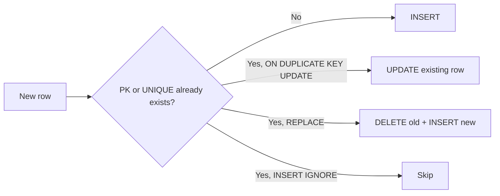

# Session 05: Updating, Deleting and Filtering Data

> Module: Working with MySQL · Term 2 (DISM) · ⏱ ~2 hours

## 🎯 Learning Objectives

By the end of this session you will be able to:

- Update and delete rows safely with WHERE
- Filter with LIKE patterns, BETWEEN, IN and NOT IN
- Remove duplicate results with DISTINCT
- Merge data with upsert techniques: `ON DUPLICATE KEY UPDATE` and `REPLACE`
- Protect yourself with safe-update mode and preview queries

## 📖 Concepts Explained

### 1. UPDATE

```sql
UPDATE table_name
SET column1 = value1, column2 = expression
WHERE condition;
```

- **Always** write the `WHERE` first. An `UPDATE` without `WHERE` changes **every row**.
- You can use the old value: `SET fee = fee * 1.10` (10% increase).
- `ORDER BY ... LIMIT n` is allowed on single-table updates (e.g. update the 5 oldest records).
- Multi-table update: `UPDATE a JOIN b ON ... SET a.x = b.y WHERE ...` (after Session 6).

### 2. DELETE

```sql
DELETE FROM table_name WHERE condition;
```

- Without `WHERE`, every row is deleted.
- Foreign keys may **block** the delete (`RESTRICT`) or **cascade** it to child rows.
- **Soft delete** is a popular alternative: add `is_active TINYINT DEFAULT 1` or `deleted_at DATETIME` and update it instead of deleting, so data can be restored.

### 3. Safety habits

1. Run the same condition as a `SELECT` first: `SELECT * FROM students WHERE city = 'Sukkur';` then turn it into `DELETE`.
2. Keep **safe updates** on (Workbench: *Edit → Preferences → SQL Editor → Safe Updates*). It blocks UPDATE/DELETE without a key-based WHERE or LIMIT.
3. Wrap risky changes in a transaction (Session 10) so you can `ROLLBACK`.
4. Check the "rows affected" count in the output panel.

### 4. Filtering operators

| Operator | Example | Meaning |
|---|---|---|
| `LIKE 'A%'` | names starting with A | `%` = any number of characters |
| `LIKE '%khan%'` | contains "khan" | |
| `LIKE '_a%'` | second letter is a | `_` = exactly one character |
| `LIKE '%\_%'` | contains a literal underscore | escape with `\` |
| `BETWEEN 20000 AND 30000` | inclusive range | works for numbers, dates, text |
| `IN ('Karachi','Lahore')` | matches any in the list | cleaner than many ORs |
| `NOT IN (...)` | none in the list | careful: if the list contains NULL, nothing matches |
| `REGEXP '^[AEIOU]'` | regex match | starts with a vowel |

`LIKE` is case-insensitive with the default `utf8mb4_unicode_ci` collation.

> **Performance tip:** `LIKE 'abc%'` can use an index; `LIKE '%abc'` cannot (it must scan every row).

### 5. DISTINCT

`SELECT DISTINCT city FROM students;` removes duplicate rows from the **result** (not the table). With several columns, the combination must be unique: `SELECT DISTINCT city, gender`.

### 6. Merging data (upserts)

Often you want "insert if new, update if it already exists". MySQL offers:

| Technique | Behaviour |
|---|---|
| `INSERT ... ON DUPLICATE KEY UPDATE` | If a PK/UNIQUE conflict happens, update the existing row instead |
| `REPLACE INTO` | If a conflict happens, **delete** the old row and insert the new one (can trigger cascades and new IDs; use with care) |
| `INSERT IGNORE` | Skip rows that would conflict, with warnings instead of errors |

Other databases call this `MERGE`. MySQL has no `MERGE` statement, but the techniques above give the same results.



## 💻 Code Examples

All examples below are also saved as files in this folder, so you can open and run them directly.

### Example 1: Safe UPDATE and DELETE (`update-delete.sql`)

```sql
-- update-delete.sql  (uses institute_db with seed data)
USE institute_db;

-- Workbench Safe Updates blocks UPDATE/DELETE whose WHERE does not use a key column.
-- For this practice script only, switch it off for the session and back on at the end.
SET SQL_SAFE_UPDATES = 0;

-- 1. Preview, then update one row
SELECT student_id, full_name, city FROM students WHERE email = 'zoya@mail.com';
UPDATE students SET city = 'Karachi', dob = '2004-06-06' WHERE email = 'zoya@mail.com';

-- 2. Expression update: increase all course fees above 25,000 by 5%
SELECT code, fee, ROUND(fee * 1.05, 2) AS new_fee FROM courses WHERE fee > 25000;  -- preview
UPDATE courses SET fee = ROUND(fee * 1.05, 2) WHERE fee > 25000;

-- 3. Conditional update with CASE: give grace marks to scores 45-49
UPDATE enrollments
SET marks = CASE WHEN marks BETWEEN 45 AND 49 THEN 50 ELSE marks END
WHERE marks IS NOT NULL AND marks < 50;

-- 4. Soft delete: add a flag and deactivate instead of deleting
ALTER TABLE students ADD COLUMN is_active TINYINT(1) NOT NULL DEFAULT 1;
UPDATE students SET is_active = 0 WHERE student_id = 9;
SELECT full_name FROM students WHERE is_active = 1;

-- 5. Hard delete: remove a payment recorded by mistake
SELECT * FROM payments WHERE payment_id = 16;
DELETE FROM payments WHERE payment_id = 16;

-- 6. Delete blocked by a foreign key (RESTRICT): try it and read the error
-- DELETE FROM courses WHERE course_id = 1;   -- Error 1451: cannot delete a parent row

SET SQL_SAFE_UPDATES = 1;
```

**How it works:**

- Every change is preceded by a `SELECT` with the same condition, so you see exactly which rows will change.
- `CASE` inside `SET` updates only rows that meet the inner condition.
- Soft delete keeps the data but hides it from normal queries.
- The commented delete shows referential integrity in action: a course with enrollments cannot be removed.
- `SET SQL_SAFE_UPDATES = 0` is used only because queries 2 and 3 filter on non-key columns; it is switched back on at the end.

### Example 2: LIKE, BETWEEN, IN, DISTINCT and upserts (`filtering.sql`)

```sql
-- filtering.sql
USE institute_db;

-- LIKE patterns
SELECT full_name FROM students WHERE full_name LIKE 'A%';        -- starts with A
SELECT full_name FROM students WHERE full_name LIKE '%a';        -- ends with a
SELECT full_name FROM students WHERE full_name LIKE '%ra%';      -- contains "ra"
SELECT full_name FROM students WHERE full_name LIKE '_a%';       -- second letter a
SELECT email FROM students WHERE email NOT LIKE '%@mail.com';

-- BETWEEN (inclusive) with numbers and dates
SELECT title, fee FROM courses WHERE fee BETWEEN 20000 AND 30000;
SELECT full_name, dob FROM students WHERE dob BETWEEN '2004-01-01' AND '2004-12-31';
SELECT payment_id, paid_on FROM payments WHERE paid_on BETWEEN '2025-03-01' AND '2025-03-31 23:59:59';

-- IN / NOT IN
SELECT full_name, city FROM students WHERE city IN ('Lahore', 'Islamabad', 'Sukkur');
SELECT code, title FROM courses WHERE code NOT IN ('XMLJ01', 'CMSW01');

-- REGEXP
SELECT full_name FROM students WHERE full_name REGEXP '^[AEIOU]';

-- DISTINCT
SELECT DISTINCT city FROM students ORDER BY city;
SELECT DISTINCT method FROM payments;
SELECT COUNT(DISTINCT city) AS number_of_cities FROM students;

-- Upsert 1: ON DUPLICATE KEY UPDATE (email is UNIQUE)
INSERT INTO students (full_name, email, gender, city)
VALUES ('Ayesha Khan', 'ayesha@mail.com', 'female', 'Hyderabad')
ON DUPLICATE KEY UPDATE city = VALUES(city);   -- updates Ayesha's city instead of failing

-- Upsert 2: INSERT IGNORE skips the duplicate silently (check SHOW WARNINGS)
INSERT IGNORE INTO students (full_name, email, gender) VALUES ('Duplicate', 'bilal@mail.com', 'male');
SHOW WARNINGS;

-- Upsert 3: REPLACE deletes then inserts (new row, cascades fire!) — demo on a safe table
CREATE TABLE IF NOT EXISTS settings (setting_key VARCHAR(50) PRIMARY KEY, setting_value VARCHAR(100));
REPLACE INTO settings VALUES ('theme', 'light');
REPLACE INTO settings VALUES ('theme', 'dark');
SELECT * FROM settings;
```

**How it works:**

- `%` and `_` wildcards cover most search needs; `REGEXP` handles complex patterns.
- `BETWEEN` with `DATETIME` needs the end time `23:59:59` (or use `< '2025-04-01'`) to include the whole last day.
- `COUNT(DISTINCT ...)` counts unique values.
- `VALUES(city)` refers to the value you tried to insert (MySQL 8.0.20+ also supports the alias syntax `AS new ... city = new.city`).
- `REPLACE` is shown on a standalone table because on `students` it would delete the old row and cascade-delete enrollments.

## 🧪 Lab Practice

1. **Preview first:** write a `SELECT` for students from Lahore, then convert it into an `UPDATE` that moves them to `Islamabad`.
2. **Patterns:** find students whose email contains a digit (use `REGEXP '[0-9]'`) and courses whose title contains the word `with`.
3. **Ranges:** list enrollments with marks between 70 and 89 and payments made in February 2025.
4. **Upsert:** create a table `daily_attendance(student_id, att_date, status, PRIMARY KEY(student_id, att_date))` and use `ON DUPLICATE KEY UPDATE` to correct a status.
5. **Safe mode:** with Safe Updates on, try `UPDATE students SET city = 'X';` and read the error. Explain why it is helpful.

## 📝 Assignment

For `institute_db` write `maintenance.sql` that: (1) increases fees of courses longer than 5 weeks by 8%; (2) marks students with no enrollments as inactive (use `NOT IN` with a subquery `SELECT student_id FROM enrollments`); (3) lists all distinct payment methods used in March 2025; (4) upserts three faculty records by email; (5) deletes payments under Rs. 11,000 recorded in cash. Each statement must have a preview SELECT above it.

## ❓ Quick Quiz

1. What happens if you run `DELETE FROM students;`?
2. Which wildcard matches exactly one character in LIKE?
   - a) %
   - b) _
   - c) *
   - d) ?
3. Is `BETWEEN 10 AND 20` inclusive?
4. What does `SELECT DISTINCT city` return?
5. Which upsert technique deletes the old row before inserting?
   - a) ON DUPLICATE KEY UPDATE
   - b) INSERT IGNORE
   - c) REPLACE
   - d) UPDATE

<details>
<summary>Show answers</summary>

1. Every row in the table is deleted (subject to FK rules).
2. b) `_`
3. Yes, it includes 10 and 20.
4. Each city once, without duplicates.
5. c) REPLACE

</details>

## 💼 Interview Questions

1. **How do you safely run an UPDATE on production data?**

   <details><summary>Model answer</summary>

   Write and run the matching SELECT first, check row counts, use a transaction so you can roll back, keep safe-update mode on, back up the table if the change is big, and run during low traffic.

   </details>

2. **Why can NOT IN return no rows unexpectedly?**

   <details><summary>Model answer</summary>

   If the list or subquery contains NULL, `x NOT IN (..., NULL)` evaluates to unknown for every row, so nothing matches. Use NOT EXISTS or filter out NULLs.

   </details>

3. **Compare REPLACE and INSERT ... ON DUPLICATE KEY UPDATE.**

   <details><summary>Model answer</summary>

   REPLACE deletes the conflicting row and inserts a new one, which can change AUTO_INCREMENT IDs, fire delete cascades and lose unspecified columns. ON DUPLICATE KEY UPDATE modifies the existing row in place and is usually safer.

   </details>

## ✅ Summary

- `UPDATE` and `DELETE` must almost always include a `WHERE` clause.
- Preview with SELECT, keep safe updates on, and use transactions for risky changes.
- Filter with LIKE wildcards, BETWEEN ranges, IN lists and REGEXP.
- DISTINCT removes duplicate rows from results.
- Upserts: ON DUPLICATE KEY UPDATE (update in place), INSERT IGNORE (skip), REPLACE (delete + insert).

---

[⬅ Previous](../Session-04-Insert-and-Select/README.md) · [🏠 Module Home](../README.md) · [Next ➡](../Session-06-Joins-and-Set-Operators/README.md)

<sub>Prepared by Zeeshan Abbas · Aptech Learning North Nazimabad</sub>
