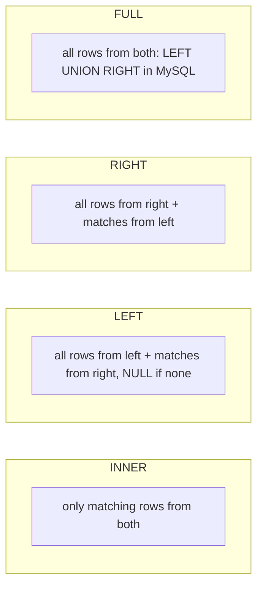

# Session 06: Joins and Combining Data

> Module: Working with MySQL · Term 2 (DISM) · ⏱ ~2 hours

## 🎯 Learning Objectives

By the end of this session you will be able to:

- Explain why joins are needed in a normalized database
- Write INNER, LEFT, RIGHT, CROSS and SELF joins
- Emulate a FULL OUTER JOIN with UNION
- Combine result sets with UNION, UNION ALL, INTERSECT and EXCEPT
- Explain the difference between joins and unions

## 📖 Concepts Explained

### 1. Why joins?

Normalization (Session 2) splits data across tables. To answer "Which student scored what in which course taught by whom?" we must **join** `students`, `enrollments`, `courses` and `faculty` back together using their keys.

### 2. Join types



| Join | Returns | Typical question |
|---|---|---|
| `INNER JOIN` | Rows with a match in both tables | Students **with** their enrollments |
| `LEFT JOIN` | All left rows; right side NULL when no match | All students, **including** those not enrolled |
| `RIGHT JOIN` | All right rows; left side NULL when no match | All courses, including those with no students (usually rewritten as LEFT JOIN) |
| `FULL OUTER JOIN` | All rows from both sides | Not supported directly; use `LEFT ... UNION ... RIGHT` |
| `CROSS JOIN` | Every combination (rows × rows) | All student–course combinations for a timetable grid |
| `SELF JOIN` | A table joined to itself | Employees and their managers; students from the same city |

### 3. Syntax

```sql
SELECT s.full_name, c.title, e.marks
FROM students AS s
INNER JOIN enrollments AS e ON e.student_id = s.student_id
INNER JOIN courses     AS c ON c.course_id  = e.course_id;
```

- **Table aliases** (`s`, `e`, `c`) keep queries short and are required when a column name appears in more than one table.
- `ON` gives the matching condition. `USING (student_id)` is a shortcut when the column names are identical.
- Join many tables by chaining joins.
- **Find non-matches** with `LEFT JOIN ... WHERE right.id IS NULL` (an *anti-join*).

> **Common mistake:** putting a condition on the right table in `WHERE` turns a LEFT JOIN into an INNER JOIN. Put it in the `ON` clause instead: `LEFT JOIN enrollments e ON e.student_id = s.student_id AND e.marks >= 50`.

### 4. Set operators

Set operators stack the results of two `SELECT`s **vertically**. Both queries must return the same number of columns with compatible types; column names come from the first query.

| Operator | Result | MySQL support |
|---|---|---|
| `UNION` | Rows from both, duplicates removed | Yes |
| `UNION ALL` | Rows from both, duplicates kept (faster) | Yes |
| `INTERSECT` | Rows present in both | 8.0.31+ (older: emulate with `IN`/`EXISTS` or `INNER JOIN`) |
| `EXCEPT` | Rows in the first but not the second | 8.0.31+ (older: emulate with `NOT IN`/`NOT EXISTS` or `LEFT JOIN ... IS NULL`) |

### 5. Joins vs unions

| JOIN | UNION |
|---|---|
| Combines **columns** side by side | Combines **rows** one below the other |
| Tables related by keys | Results with the same column structure |
| Width grows | Length grows |

## 💻 Code Examples

All examples below are also saved as files in this folder, so you can open and run them directly.

### Example 1: All join types on institute_db (`joins.sql`)

```sql
-- joins.sql
USE institute_db;

-- 1. INNER JOIN: result card (student, course, marks)
SELECT s.full_name, c.title, e.marks
FROM students s
INNER JOIN enrollments e ON e.student_id = s.student_id
INNER JOIN courses c     ON c.course_id  = e.course_id
ORDER BY s.full_name, c.title;

-- 2. Four tables: who teaches each enrolled student
SELECT s.full_name AS student, c.title AS course, f.full_name AS teacher
FROM enrollments e
JOIN students s ON s.student_id = e.student_id
JOIN courses  c ON c.course_id  = e.course_id
LEFT JOIN faculty f ON f.faculty_id = c.faculty_id;   -- LEFT: CMS course has no teacher

-- 3. LEFT JOIN: all students, enrolled or not
SELECT s.full_name, e.course_id
FROM students s
LEFT JOIN enrollments e ON e.student_id = s.student_id
ORDER BY s.full_name;

-- 4. Anti-join: students with NO enrollments
SELECT s.full_name
FROM students s
LEFT JOIN enrollments e ON e.student_id = s.student_id
WHERE e.enrollment_id IS NULL;

-- 5. RIGHT JOIN: every course, even with no enrollments
SELECT c.title, e.student_id
FROM enrollments e
RIGHT JOIN courses c ON c.course_id = e.course_id
ORDER BY c.title;

-- 6. FULL OUTER JOIN emulation: courses vs faculty
SELECT c.title, f.full_name FROM courses c LEFT JOIN faculty f ON f.faculty_id = c.faculty_id
UNION
SELECT c.title, f.full_name FROM courses c RIGHT JOIN faculty f ON f.faculty_id = c.faculty_id;

-- 7. Condition in ON vs WHERE
SELECT s.full_name, e.marks
FROM students s
LEFT JOIN enrollments e ON e.student_id = s.student_id AND e.marks >= 90;  -- keeps all students

-- 8. SELF JOIN: pairs of students from the same city
SELECT a.full_name AS student_1, b.full_name AS student_2, a.city
FROM students a
JOIN students b ON a.city = b.city AND a.student_id < b.student_id
ORDER BY a.city;

-- 9. CROSS JOIN: every faculty × course combination (planning grid)
SELECT f.full_name, c.code FROM faculty f CROSS JOIN courses c LIMIT 10;
```

**How it works:**

- Query 2 uses `LEFT JOIN faculty` so the course without a teacher still appears.
- Query 4 is the classic way to find "missing" relationships: keep all left rows and select those where the right side is NULL.
- Query 6 combines LEFT and RIGHT results with `UNION` to get the full outer result: the CMS course with no teacher **and** the faculty member with no course.
- Query 8's `a.student_id < b.student_id` avoids pairing a student with themselves and avoids duplicate pairs (A,B) and (B,A).

### Example 2: UNION, UNION ALL, INTERSECT and EXCEPT (`set-operators.sql`)

```sql
-- set-operators.sql
USE institute_db;

-- UNION: one contact list of everyone at the institute (duplicates removed)
SELECT full_name, email, 'student' AS role FROM students
UNION
SELECT full_name, email, 'faculty' FROM faculty
ORDER BY role, full_name;

-- UNION ALL keeps duplicates: courses joined by student 1 and student 4
SELECT course_id FROM enrollments WHERE student_id = 1
UNION ALL
SELECT course_id FROM enrollments WHERE student_id = 4;

-- INTERSECT (MySQL 8.0.31+): courses taken by BOTH student 1 and student 4
SELECT course_id FROM enrollments WHERE student_id = 1
INTERSECT
SELECT course_id FROM enrollments WHERE student_id = 4;

-- INTERSECT emulation for older versions
SELECT DISTINCT e1.course_id
FROM enrollments e1
JOIN enrollments e2 ON e2.course_id = e1.course_id
WHERE e1.student_id = 1 AND e2.student_id = 4;

-- EXCEPT (8.0.31+): courses student 1 took that student 4 did not
SELECT course_id FROM enrollments WHERE student_id = 1
EXCEPT
SELECT course_id FROM enrollments WHERE student_id = 4;

-- EXCEPT emulation
SELECT course_id FROM enrollments
WHERE student_id = 1
  AND course_id NOT IN (SELECT course_id FROM enrollments WHERE student_id = 4);
```

**How it works:**

- `UNION` merges students and faculty into one list; the extra literal column `role` tells them apart.
- `UNION ALL` keeps the repeated course 3 because both students took it.
- `INTERSECT` and `EXCEPT` exist from MySQL 8.0.31; the emulations work on any version and on MariaDB.

## 🧪 Lab Practice

1. **Result card:** list every student's name, course title, marks and a `result` column (`PASS` if marks ≥ 50, `FAIL` otherwise, `PENDING` if NULL) using `CASE`.
2. **Unassigned:** list courses that have no faculty and faculty members who teach no course (two anti-joins).
3. **Payments:** join `payments → enrollments → students → courses` to show who paid how much for which course, newest first.
4. **Full outer:** emulate a full outer join between `students` and `enrollments` and explain each NULL in the result.
5. **Union report:** produce one list of all email addresses in the system with a role column, sorted alphabetically.

## 📝 Assignment

Write `reports.sql` with six business reports: (1) each student's courses with teacher names; (2) students who have never paid anything; (3) courses with no enrollments; (4) students who are enrolled in both MySQL and JavaScript courses (use INTERSECT or its emulation); (5) a combined contact list (UNION); (6) pairs of faculty hired in the same year (SELF JOIN). Comment each query.

## ❓ Quick Quiz

1. Which join returns only matching rows?
   - a) LEFT
   - b) RIGHT
   - c) INNER
   - d) CROSS
2. How do you emulate a FULL OUTER JOIN in MySQL?
3. What is the difference between UNION and UNION ALL?
4. How do you find left rows with no match?
5. A CROSS JOIN of 10 rows and 6 rows returns how many rows?

<details>
<summary>Show answers</summary>

1. c) INNER JOIN
2. Combine a LEFT JOIN and a RIGHT JOIN with UNION.
3. UNION removes duplicates; UNION ALL keeps them and is faster.
4. `LEFT JOIN ... WHERE right_table.key IS NULL`
5. 60

</details>

## 💼 Interview Questions

1. **Explain LEFT JOIN with an example.**

   <details><summary>Model answer</summary>

   A LEFT JOIN returns every row from the left table plus matching rows from the right. Where there is no match, the right columns are NULL. For example, `students LEFT JOIN enrollments` lists all students, and those without enrollments show NULL course data.

   </details>

2. **Why can a WHERE condition turn a LEFT JOIN into an INNER JOIN?**

   <details><summary>Model answer</summary>

   Unmatched rows have NULL in the right table's columns. A WHERE condition like `e.marks >= 50` is false or unknown for NULL, so those rows are filtered out. Put such conditions in the ON clause to keep them.

   </details>

3. **What is a self join and when is it useful?**

   <details><summary>Model answer</summary>

   Joining a table to itself with aliases. It is used for hierarchical data (employee to manager), comparing rows (same city, same hire year) and finding duplicates.

   </details>

## ✅ Summary

- Joins rebuild related data from normalized tables using keys.
- INNER = matches only; LEFT/RIGHT = keep all rows of one side; CROSS = all combinations; SELF = table with itself.
- FULL OUTER JOIN is emulated with LEFT UNION RIGHT.
- UNION, UNION ALL, INTERSECT and EXCEPT stack query results vertically.
- Joins add columns; set operators add rows.

---

[⬅ Previous](../Session-05-Update-Delete-Filter/README.md) · [🏠 Module Home](../README.md) · [Next ➡](../Session-07-Subqueries-and-CTEs/README.md)

<sub>Prepared by Zeeshan Abbas · Aptech Learning North Nazimabad</sub>
