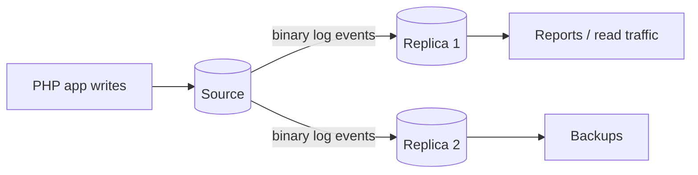

# Session 11: Replication and Partitioning

> Module: Working with MySQL · Term 2 (DISM) · ⏱ ~2 hours

## 🎯 Learning Objectives

By the end of this session you will be able to:

- Explain why databases are replicated and the source-replica model
- Describe binary logs, GTIDs and asynchronous vs semi-synchronous replication
- Configure a basic source-replica pair
- Explain horizontal partitioning and when it helps
- Create RANGE, LIST, HASH and KEY partitioned tables
- Use partition pruning and maintenance commands

## 📖 Concepts Explained

### 1. Replication

**Replication** copies changes from one MySQL server (the **source**, formerly "master") to one or more **replicas** (formerly "slaves").



Why: scale **reads**, run **backups and reports** without slowing the main server, and keep a **standby** for failover.

How it works:
1. The source writes every change to its **binary log**.
2. The replica's **I/O (receiver) thread** copies events into a **relay log**.
3. The replica's **SQL (applier) thread** replays them.

| Mode | Behaviour |
|---|---|
| Asynchronous (default) | source does not wait; fastest, small risk of losing last events |
| Semi-synchronous | source waits until at least one replica has received the event |
| Group Replication / InnoDB Cluster | multiple servers agree (consensus), automatic failover |

**GTID** (Global Transaction ID) labels each transaction uniquely, so replicas know exactly what they have applied and failover is easier.

### 2. Partitioning

**Partitioning** splits one large table into several physical pieces while it still looks like one table to SQL. Example: a `payments` table with 50 million rows split by year.

| Type | Rows go to a partition by | Good for |
|---|---|---|
| RANGE | value ranges (years, ids) | time-series, archiving old data |
| LIST | explicit value lists | regions, cities |
| HASH | a hash of an integer expression | even spread |
| KEY | MySQL's own hash of key columns | even spread on non-integer keys |

Benefits: **partition pruning** (queries read only relevant partitions), very fast removal of old data with `DROP PARTITION`. Rules: every unique key (including the PK) must include the partitioning column, and InnoDB partitioned tables cannot have foreign keys.

Partitioning (inside one server) is different from **sharding** (splitting data across many servers, handled by the application or a proxy).

## 💻 Code Examples

All examples below are also saved as files in this folder, so you can open and run them directly.

### Example 1: Source and replica configuration (`replication-setup.sql`)

```sql
-- replication-setup.sql
-- Lab setup: two MySQL 8 servers (two VMs, two Docker containers, or two ports on one PC).

-- ===== On the SOURCE: my.cnf / my.ini =====
-- [mysqld]
-- server-id                = 1
-- log-bin                  = mysql-bin
-- gtid_mode                = ON
-- enforce_gtid_consistency = ON

-- Create a replication account on the source
CREATE USER 'repl'@'%' IDENTIFIED BY 'Repl_Pass_789!';
GRANT REPLICATION SLAVE ON *.* TO 'repl'@'%';
SHOW BINARY LOG STATUS;   -- MySQL 8.2+ (older: SHOW MASTER STATUS)

-- ===== On the REPLICA: my.cnf / my.ini =====
-- [mysqld]
-- server-id                = 2
-- gtid_mode                = ON
-- enforce_gtid_consistency = ON
-- read_only                = ON

-- Point the replica at the source (MySQL 8.0.23+ syntax)
CHANGE REPLICATION SOURCE TO
  SOURCE_HOST = '192.168.1.10',
  SOURCE_PORT = 3306,
  SOURCE_USER = 'repl',
  SOURCE_PASSWORD = 'Repl_Pass_789!',
  SOURCE_AUTO_POSITION = 1,
  GET_SOURCE_PUBLIC_KEY = 1;

START REPLICA;
SHOW REPLICA STATUS\G
-- Check: Replica_IO_Running = Yes, Replica_SQL_Running = Yes, Seconds_Behind_Source = 0
```

**How it works:**

- Each server needs a unique `server-id`; the source must have binary logging on.
- `SOURCE_AUTO_POSITION = 1` uses GTIDs, so you do not need log file names and positions.
- `read_only` stops accidental writes on the replica.
- Run `SHOW REPLICA STATUS\G` in the mysql client (the `\G` prints vertically).

### Example 2: RANGE, LIST and HASH partitions (`partitioning.sql`)

```sql
-- partitioning.sql
USE institute_db;

-- RANGE by year: the PK must contain the partition column
CREATE TABLE fee_history (
  id      BIGINT UNSIGNED AUTO_INCREMENT,
  paid_on DATE NOT NULL,
  amount  DECIMAL(9,2) NOT NULL,
  PRIMARY KEY (id, paid_on)
)
PARTITION BY RANGE (YEAR(paid_on)) (
  PARTITION p2024 VALUES LESS THAN (2025),
  PARTITION p2025 VALUES LESS THAN (2026),
  PARTITION p2026 VALUES LESS THAN (2027),
  PARTITION pmax  VALUES LESS THAN MAXVALUE
);

INSERT INTO fee_history (paid_on, amount) VALUES
 ('2024-11-03', 15000), ('2025-02-10', 28000), ('2025-09-01', 26000), ('2026-01-15', 42000);

-- Partition pruning: only p2025 is read
EXPLAIN SELECT SUM(amount) FROM fee_history WHERE paid_on BETWEEN '2025-01-01' AND '2025-12-31';

-- Rows per partition
SELECT partition_name, table_rows
FROM information_schema.partitions
WHERE table_schema = 'institute_db' AND table_name = 'fee_history';

-- Archive old year instantly
ALTER TABLE fee_history DROP PARTITION p2024;

-- LIST by campus
CREATE TABLE campus_leads (
  id INT NOT NULL, campus_id INT NOT NULL, name VARCHAR(80),
  PRIMARY KEY (id, campus_id)
)
PARTITION BY LIST (campus_id) (
  PARTITION p_karachi VALUES IN (1, 2, 3),
  PARTITION p_lahore  VALUES IN (4, 5),
  PARTITION p_others  VALUES IN (6, 7, 8)
);

-- HASH: spread rows evenly over 4 partitions
CREATE TABLE login_events (
  user_id INT NOT NULL, logged_at DATETIME NOT NULL
)
PARTITION BY HASH (user_id) PARTITIONS 4;
```

**How it works:**

- `EXPLAIN` shows `partitions: p2025`, proving pruning.
- `DROP PARTITION` removes a whole year in milliseconds instead of a slow `DELETE`.
- LIST is chosen when values belong to known groups; HASH when you just want even spreading.

## 🧪 Lab Practice

1. Using two Docker containers (`docker run mysql:8.4`), set up source-replica replication and verify an INSERT appears on the replica.
2. Stop the replica (`STOP REPLICA`), insert rows on the source, start it again and watch it catch up.
3. Partition a `attendance` table by RANGE on month and check pruning with EXPLAIN.
4. Add a new partition with `ALTER TABLE ... REORGANIZE PARTITION pmax INTO (...)`.
5. Explain in two lines why foreign keys cannot be used with partitioned InnoDB tables.

## 📝 Assignment

Write a one-page design note (`scaling-plan.md`) for an institute with 30 campuses: which tables you would partition (and how), how many replicas you would use and for what, and how the PHP app would send reads vs writes.

## ❓ Quick Quiz

1. What does the source write that replicas read?
   - a) Redo log
   - b) Binary log
   - c) Error log
   - d) Slow log
2. Which replication mode waits for a replica to acknowledge?
3. What is partition pruning?
4. Which partition type uses explicit value lists?
5. Partitioning vs sharding?

<details>
<summary>Show answers</summary>

1. b) Binary log
2. Semi-synchronous replication
3. The optimizer reads only the partitions that can contain matching rows.
4. LIST
5. Partitioning splits a table inside one server; sharding spreads data across multiple servers.

</details>

## 💼 Interview Questions

1. **What problems does replication solve and which does it not?**

   <details><summary>Model answer</summary>

   It provides read scaling, high availability and offloaded backups. It does not replace backups: a mistaken DELETE replicates to every replica.

   </details>

2. **What is a GTID?**

   <details><summary>Model answer</summary>

   A unique id (server_uuid:sequence) attached to every committed transaction, letting replicas track exactly what they have applied and simplifying failover.

   </details>

3. **When is partitioning a bad idea?**

   <details><summary>Model answer</summary>

   On small tables, when queries do not filter on the partition key, or when you need foreign keys; it then adds overhead without benefit.

   </details>

## ✅ Summary

- Replication copies binary log events from a source to replicas.
- Use replicas for reads, reports, backups and failover; it is not a backup itself.
- GTIDs make replication positions automatic.
- Partitioning splits big tables by RANGE, LIST, HASH or KEY.
- Pruning and DROP PARTITION are the big wins of partitioning.

---

[⬅ Previous](../Session-10-Transactions-ACID-Backups/README.md) · [🏠 Module Home](../README.md) · [Next ➡](../Session-12-Performance-and-Storage/README.md)

<sub>Prepared by Zeeshan Abbas · Aptech Learning North Nazimabad</sub>
