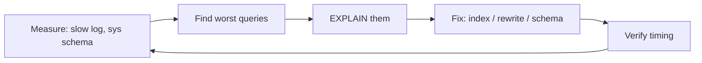

# Session 12: Performance Tuning and Storage Engines

> Module: Working with MySQL · Term 2 (DISM) · ⏱ ~2 hours

## 🎯 Learning Objectives

By the end of this session you will be able to:

- Compare InnoDB, MyISAM, MEMORY and other storage engines
- Find slow queries with the slow query log and Performance Schema
- Rewrite queries to use indexes (sargable conditions)
- Tune key server variables such as innodb_buffer_pool_size
- Choose efficient data types and maintain tables
- Use JSON columns sensibly

## 📖 Concepts Explained

### 1. Storage engines

MySQL's pluggable architecture lets each table choose a **storage engine**.

| Engine | Transactions | Locking | Crash safe | Typical use |
|---|---|---|---|---|
| **InnoDB** (default) | yes | row-level | yes | almost everything |
| MyISAM | no | table-level | no | legacy read-only data |
| MEMORY | no | table-level | data lost on restart | temporary lookups |
| ARCHIVE | no | row | yes | compressed logs, insert-only |
| CSV | no | table | no | exchange data as CSV files |

`SHOW ENGINES;` lists what your server supports. Stick with InnoDB unless you have a clear reason.

### 2. A tuning workflow



### 3. Writing index-friendly (sargable) SQL

| Slow (index ignored) | Fast |
|---|---|
| `WHERE YEAR(paid_on) = 2025` | `WHERE paid_on >= '2025-01-01' AND paid_on < '2026-01-01'` |
| `WHERE LOWER(email) = 'x'` | store emails lower-case; `WHERE email = 'x'` |
| `WHERE name LIKE '%khan'` | `LIKE 'khan%'` or a FULLTEXT index |
| `SELECT *` | select only needed columns (covering index) |
| `OFFSET 100000` paging | keyset paging: `WHERE id > last_id LIMIT 20` |

### 4. Server settings that matter most

| Variable | Guideline |
|---|---|
| `innodb_buffer_pool_size` | 50–70% of RAM on a dedicated DB server |
| `innodb_redo_log_capacity` | larger for write-heavy loads (8.0.30+) |
| `max_connections` | match real app needs; use connection pooling |
| `slow_query_log`, `long_query_time` | turn on, e.g. 1 second |

(The old query cache was removed in MySQL 8.0 — cache in the application, e.g. Redis.)

### 5. Data types and maintenance

Use the smallest correct type (`TINYINT` for marks, `DECIMAL` for money, `DATE` not `VARCHAR` for dates). Run `ANALYZE TABLE` to refresh statistics and `OPTIMIZE TABLE` after heavy deletes.

### 6. JSON columns

MySQL 8 has a native `JSON` type with functions like `JSON_EXTRACT` / `->>`. Good for flexible extras (preferences, metadata); keep data you filter on often in normal columns, or index it with a generated column.

## 💻 Code Examples

All examples below are also saved as files in this folder, so you can open and run them directly.

### Example 1: Finding and fixing slow queries (`performance.sql`)

```sql
-- performance.sql
USE institute_db;

SHOW ENGINES;
SELECT table_name, engine FROM information_schema.tables WHERE table_schema = 'institute_db';

-- Turn on the slow query log (needs admin privilege)
SET GLOBAL slow_query_log = 'ON';
SET GLOBAL long_query_time = 1;
SHOW VARIABLES LIKE 'slow_query_log_file';

-- Top statements by total time (sys schema, MySQL 8)
SELECT query, exec_count, total_latency
FROM sys.statement_analysis
ORDER BY total_latency DESC
LIMIT 5;

-- Non-sargable vs sargable
CREATE INDEX idx_pay_date ON payments(paid_on);
EXPLAIN SELECT SUM(amount) FROM payments WHERE YEAR(paid_on) = 2025;                     -- type ALL
EXPLAIN SELECT SUM(amount) FROM payments WHERE paid_on >= '2025-01-01' AND paid_on < '2026-01-01'; -- range

-- Keyset pagination instead of large OFFSET
SELECT student_id, full_name FROM students WHERE student_id > 5 ORDER BY student_id LIMIT 5;

-- Buffer pool size in MB
SELECT @@innodb_buffer_pool_size / 1024 / 1024 AS buffer_pool_mb;

-- Statistics and defragmentation
ANALYZE TABLE enrollments;
OPTIMIZE TABLE payments;
```

**How it works:**

- `sys.statement_analysis` ranks normalised queries by total time, showing where to start.
- Wrapping `paid_on` in `YEAR()` hides the column from the index; the range version uses `idx_pay_date`.
- Keyset pagination reads only the next rows instead of skipping thousands.

### Example 2: JSON column and engine comparison (`json-and-engines.sql`)

```sql
-- json-and-engines.sql
USE institute_db;

CREATE TABLE student_profiles (
  student_id INT UNSIGNED PRIMARY KEY,
  prefs JSON NOT NULL,
  lang VARCHAR(10) AS (prefs->>'$.language') STORED,   -- generated column
  INDEX idx_lang (lang)
) ENGINE = InnoDB;

INSERT INTO student_profiles (student_id, prefs) VALUES
 (1, '{"language":"en","dark_mode":true,"skills":["php","mysql"]}'),
 (2, '{"language":"ur","dark_mode":false,"skills":["js"]}');

SELECT student_id, prefs->>'$.language' AS language, JSON_LENGTH(prefs->'$.skills') AS skill_count
FROM student_profiles;

SELECT student_id FROM student_profiles WHERE lang = 'ur';   -- uses idx_lang

-- MEMORY engine for a temporary lookup (lost on restart)
CREATE TABLE city_codes (city VARCHAR(30) PRIMARY KEY, code CHAR(3)) ENGINE = MEMORY;
INSERT INTO city_codes VALUES ('Karachi','KHI'), ('Lahore','LHE'), ('Islamabad','ISB');
SELECT s.full_name, cc.code FROM students s LEFT JOIN city_codes cc ON cc.city = s.city;
```

**How it works:**

- `->>` extracts and unquotes a JSON value.
- The stored generated column `lang` copies a JSON field into a normal column so it can be indexed.
- The MEMORY table is very fast but empties when the server restarts, so use it only for rebuildable data.

## 🧪 Lab Practice

1. Run `SHOW ENGINES;` and convert a copy of `courses` to MyISAM; compare `SHOW TABLE STATUS` output.
2. Enable the slow query log with `long_query_time = 0` for 5 minutes, run some queries and inspect the log file.
3. Find one non-sargable query in your earlier scripts and rewrite it.
4. Check `innodb_buffer_pool_size` and calculate a good value for an 8 GB server.
5. Add a JSON `settings` column to `faculty` and query one key from it.

## 📝 Assignment

Performance report: generate 50,000 rows in `fee_history` (use a recursive CTE with `SET SESSION cte_max_recursion_depth = 60000`), time three queries before and after adding indexes, and record the results in `perf-report.md` with EXPLAIN screenshots.

## ❓ Quick Quiz

1. Which engine is the default and supports transactions?
   - a) MyISAM
   - b) MEMORY
   - c) InnoDB
   - d) CSV
2. Why is `WHERE YEAR(paid_on) = 2025` slow?
3. Which variable is the most important InnoDB memory setting?
4. What happened to the query cache in MySQL 8?
5. How can you index a value inside a JSON column?

<details>
<summary>Show answers</summary>

1. c) InnoDB
2. A function on the column prevents index use (non-sargable).
3. `innodb_buffer_pool_size`
4. It was removed.
5. Create a generated column from it and index that column (or a functional index).

</details>

## 💼 Interview Questions

1. **How do you troubleshoot a slow page in a PHP + MySQL app?**

   <details><summary>Model answer</summary>

   Enable the slow log or use Performance Schema / sys to find the query, run EXPLAIN, add or fix indexes, rewrite non-sargable conditions, select fewer columns, and verify timings; also check N+1 query patterns in the code.

   </details>

2. **InnoDB vs MyISAM?**

   <details><summary>Model answer</summary>

   InnoDB has transactions, row locks, foreign keys and crash recovery; MyISAM has table locks, no transactions and is not crash safe. InnoDB is the right default.

   </details>

3. **What is a covering index?**

   <details><summary>Model answer</summary>

   An index that contains all the columns a query needs, so MySQL answers from the index without reading the table rows.

   </details>

## ✅ Summary

- Choose InnoDB unless you have a special need.
- Measure first: slow log, Performance Schema, sys schema.
- Write sargable conditions and use keyset pagination.
- Give InnoDB a large buffer pool and correct data types.
- JSON columns add flexibility; index hot keys with generated columns.

---

[⬅ Previous](../Session-11-Replication-and-Partitioning/README.md) · [🏠 Module Home](../README.md) · [Next ➡](../../04-Navigating-Dynamic-Web-Development-with-PHP/README.md)

<sub>Prepared by Zeeshan Abbas · Aptech Learning North Nazimabad</sub>
