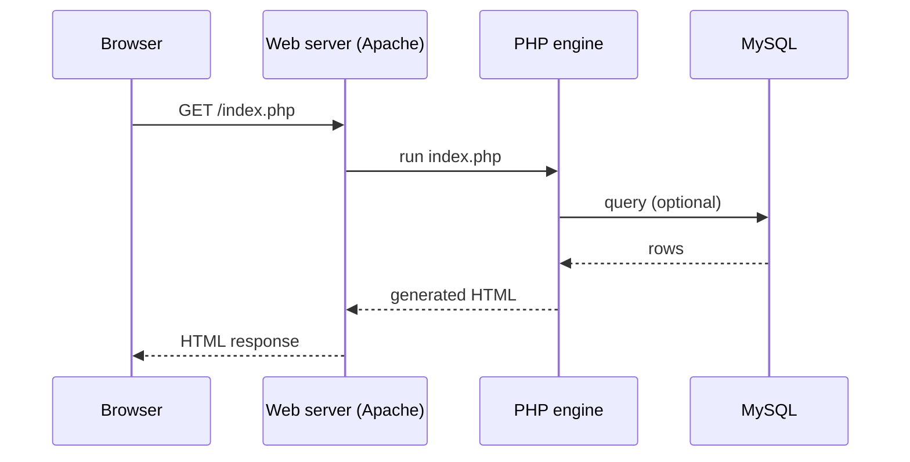

# Session 01: Introduction to PHP

> Module: Navigating Dynamic Web Development with PHP · Term 2 (DISM) · ⏱ ~2 hours

## 🎯 Learning Objectives

By the end of this session you will be able to:

- Explain what PHP is and how server-side scripting works
- Describe the history of PHP up to PHP 8.x
- List key PHP 8 features: JIT, named arguments, match, nullsafe operator, enums
- Name real-world uses of PHP
- Write and run a Hello World PHP page

## 📖 Concepts Explained

### 1. What is PHP?

**PHP** (PHP: Hypertext Preprocessor) is an open-source, **server-side** scripting language made for the web. The browser never sees PHP code; it only receives the HTML that PHP produces.



| Client-side (JavaScript in browser) | Server-side (PHP) |
|---|---|
| runs on the user's device | runs on the web server |
| code visible to user | code hidden, only output sent |
| UI interaction | database, sessions, files, email, security |

### 2. A short history

| Year | Milestone |
|---|---|
| 1994 | Rasmus Lerdorf writes "Personal Home Page Tools" |
| 1998 | PHP 3 – a real language, wide adoption |
| 2004 | PHP 5 – proper object-oriented programming, PDO |
| 2015 | PHP 7 – about twice as fast, scalar type declarations |
| 2020 | PHP 8.0 – JIT compiler, named arguments, `match`, union types |
| 2021–2024 | 8.1 enums & readonly, 8.2 readonly classes, 8.3 typed constants, 8.4 property hooks |

### 3. PHP 8 highlights

- **JIT (Just-In-Time) compiler**: compiles hot code to machine code at runtime; big gains in CPU-heavy work (maths, image processing), smaller for typical web pages.
- **Named arguments**: `str_pad(string: "7", length: 3, pad_string: "0", pad_type: STR_PAD_LEFT)`.
- **match expression**: a stricter, shorter `switch` that returns a value.
- **Nullsafe operator** `?->` and **constructor property promotion**.
- **Union types** (`int|float`), **enums** and **readonly** properties (8.1).

### 4. Where PHP is used

WordPress (over 40% of all websites), Laravel and Symfony apps, Wikipedia (MediaWiki), Facebook's early code (now Hack), e-commerce (WooCommerce, Magento) and countless local business sites.

## 💻 Code Examples

All examples below are also saved as files in this folder, so you can open and run them directly.

### Example 1: Hello World with echo (`hello.php`)

```php
<?php
// hello.php - place in C:\xampp\htdocs\php-course\ and open http://localhost/php-course/hello.php
$name = "Aptech Student";
$today = date("l, d F Y");
?>
<!DOCTYPE html>
<html lang="en">
<head>
  <meta charset="UTF-8">
  <title>Hello PHP</title>
</head>
<body>
  <h1><?php echo "Hello, World!"; ?></h1>
  <p>Welcome <?= htmlspecialchars($name) ?>. Today is <?= $today ?>.</p>
  <p>You are running PHP version <?= PHP_VERSION ?>.</p>
</body>
</html>
```

**How it works:**

- The PHP block at the top runs on the server and creates two variables.
- `<?= ... ?>` is a short way to write `<?php echo ...; ?>`.
- `htmlspecialchars()` escapes special characters, a good habit whenever you print data.
- View the page source in the browser: you will see only HTML, no PHP.

### Example 2: A taste of PHP 8 (`php8-features.php`)

```php
<?php
// php8-features.php - run with:  php php8-features.php
declare(strict_types=1);

// Named arguments
echo str_pad(string: "7", length: 3, pad_string: "0", pad_type: STR_PAD_LEFT), PHP_EOL; // 007

// match expression
$marks = 78;
$grade = match (true) {
    $marks >= 85 => "A+",
    $marks >= 75 => "A",
    $marks >= 60 => "B",
    default      => "C or below",
};
echo "Grade: $grade", PHP_EOL;

// Union types + nullsafe operator
function half(int|float $n): float { return $n / 2; }
echo half(9), PHP_EOL;

$student = null;
echo $student?->name ?? "No student loaded", PHP_EOL;

// Enum (PHP 8.1)
enum Status: string { case Active = 'active'; case Left = 'left'; }
echo Status::Active->value, PHP_EOL;
```

**How it works:**

- Run it from the terminal with `php php8-features.php` (PHP must be on your PATH, e.g. `C:\xampp\php`).
- `match` compares strictly and returns a value; no `break` needed.
- `?->` returns `null` instead of an error when the object is `null`; `??` then supplies a default.

## 🧪 Lab Practice

1. Install XAMPP (next session covers it in detail) and run `hello.php` in the browser.
2. Change `hello.php` to show your name, your campus and the current time with `date('h:i A')`.
3. Run `php -v` in a terminal and note your version.
4. Run `php8-features.php` and change `$marks` to see different grades.

## 📝 Assignment

Create `about-me.php` that prints your name, three skills in an HTML list and your age calculated from your birth year with `date('Y')`.

## ❓ Quick Quiz

1. PHP code runs on the…
   - a) browser
   - b) server
   - c) DNS
   - d) CSS engine
2. Which PHP version introduced the JIT compiler?
3. What does `<?= $x ?>` do?
4. Name one difference between match and switch.
5. Can the visitor see PHP source code in View Source?

<details>
<summary>Show answers</summary>

1. b) server
2. PHP 8.0
3. Echoes `$x` (short echo tag).
4. match uses strict comparison and returns a value (no break).
5. No, only the generated output.

</details>

## 💼 Interview Questions

1. **What is the difference between server-side and client-side scripting?**

   <details><summary>Model answer</summary>

   Server-side code runs on the server and sends output (HTML/JSON) to the client; it can access databases and secrets. Client-side code runs in the browser and handles UI interactions.

   </details>

2. **What is JIT in PHP 8?**

   <details><summary>Model answer</summary>

   A compiler inside OPcache that turns frequently executed opcodes into native machine code at runtime, boosting CPU-intensive workloads.

   </details>

3. **Why is PHP still popular?**

   <details><summary>Model answer</summary>

   Easy hosting, huge ecosystem (WordPress, Laravel, Composer packages), good performance since PHP 7/8, and a large community.

   </details>

## ✅ Summary

- PHP is a server-side language that generates HTML.
- PHP 8 added JIT, named arguments, match, union types, nullsafe operator; 8.1 added enums.
- Files end in `.php` and run through a web server such as Apache.
- Always escape output with `htmlspecialchars()`.

---

[⬅ Previous](../README.md) · [🏠 Module Home](../README.md) · [Next ➡](../Session-02-Installation-and-Syntax/README.md)

<sub>Prepared by Zeeshan Abbas · Aptech Learning North Nazimabad</sub>
