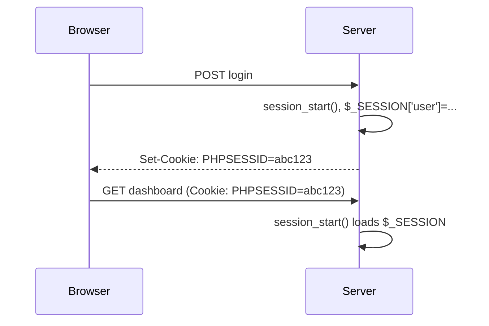

# Session 08: Cookies and Sessions

> Module: Navigating Dynamic Web Development with PHP · Term 2 (DISM) · ⏱ ~2 hours

## 🎯 Learning Objectives

By the end of this session you will be able to:

- Explain why HTTP needs cookies and sessions
- Set, read and delete cookies with secure options
- Start sessions and store login state
- Destroy sessions on logout
- Apply session security basics (regenerate id, HttpOnly, SameSite)

## 📖 Concepts Explained

### 1. HTTP is stateless

Each request is independent; the server does not remember you. **Cookies** and **sessions** add memory.

| Cookie | Session |
|---|---|
| stored in the **browser** | stored on the **server** |
| small (~4 KB) | can hold larger data |
| user can see and edit it | user only holds a session ID cookie |
| survives browser restart if it has an expiry | ends on logout/timeout |
| preferences, "remember me" token | login state, cart, flash messages |

### 2. Cookies in PHP

```php
setcookie("theme", "dark", [
  "expires" => time() + 60*60*24*30, "path" => "/",
  "secure" => true, "httponly" => true, "samesite" => "Lax",
]);
echo $_COOKIE["theme"] ?? "light";        // available on the NEXT request
setcookie("theme", "", time() - 3600, "/"); // delete
```

`setcookie()` sends a header, so call it **before any output**.

### 3. Sessions



- `session_start()` at the top of every page that uses sessions.
- `session_regenerate_id(true)` after login prevents **session fixation**.
- Logout: `$_SESSION = []; session_destroy();` and delete the cookie.

## 💻 Code Examples

All examples below are also saved as files in this folder, so you can open and run them directly.

### Example 1: Login system with sessions (no database) (`session-login.php`)

```php
<?php
// session-login.php - demo users kept in an array (Session 14 uses a database)
session_start();

$users = [
    "admin@demo.pk"   => ["name" => "Admin",  "hash" => password_hash("admin123", PASSWORD_DEFAULT)],
    "student@demo.pk" => ["name" => "Ayesha", "hash" => password_hash("student123", PASSWORD_DEFAULT)],
];

if (isset($_GET['logout'])) {
    $_SESSION = [];
    session_destroy();
    setcookie(session_name(), '', time() - 3600, '/');
    header("Location: session-login.php");
    exit;
}

$error = "";
if ($_SERVER['REQUEST_METHOD'] === 'POST') {
    $email = strtolower(trim($_POST['email'] ?? ''));
    $pass  = $_POST['password'] ?? '';
    if (isset($users[$email]) && password_verify($pass, $users[$email]['hash'])) {
        session_regenerate_id(true);
        $_SESSION['user'] = ["email" => $email, "name" => $users[$email]['name']];
        $_SESSION['login_time'] = time();
        if (!empty($_POST['remember'])) {
            setcookie("last_email", $email, ["expires" => time() + 86400 * 30, "path" => "/",
                      "httponly" => true, "samesite" => "Lax"]);
        }
        header("Location: session-login.php");
        exit;
    }
    $error = "Invalid credentials";
}
$_SESSION['views'] = ($_SESSION['views'] ?? 0) + 1;
?>
<!DOCTYPE html><html><body style="font-family:sans-serif;max-width:420px;margin:40px auto">
<?php if (isset($_SESSION['user'])): ?>
  <h2>Hello, <?= htmlspecialchars($_SESSION['user']['name']) ?></h2>
  <p>Logged in <?= time() - $_SESSION['login_time'] ?> seconds ago. Page views this session: <?= $_SESSION['views'] ?></p>
  <a href="?logout=1">Logout</a>
<?php else: ?>
  <h2>Login</h2>
  <p style="color:red"><?= $error ?></p>
  <form method="post">
    <input name="email" placeholder="Email" value="<?= htmlspecialchars($_COOKIE['last_email'] ?? '') ?>"><br><br>
    <input name="password" type="password" placeholder="Password"><br><br>
    <label><input type="checkbox" name="remember" value="1"> Remember my email</label><br><br>
    <button>Login</button>
  </form>
  <small>Try student@demo.pk / student123</small>
<?php endif; ?>
</body></html>
```

**How it works:**

- Passwords are compared with `password_verify` against hashes, never in plain text.
- After a successful login the session id is regenerated and the user is redirected (PRG).
- The "remember" cookie only stores the email to pre-fill the form, never the password.
- Logout clears the array, destroys the session and expires the session cookie.

### Example 2: Remembering a preference with a cookie (`theme-cookie.php`)

```php
<?php
// theme-cookie.php
$allowed = ["light", "dark"];
if (isset($_GET['theme']) && in_array($_GET['theme'], $allowed, true)) {
    setcookie("theme", $_GET['theme'], ["expires" => time() + 86400 * 365, "path" => "/", "samesite" => "Lax"]);
    header("Location: theme-cookie.php");   // reload so $_COOKIE has the new value
    exit;
}
$theme = $_COOKIE['theme'] ?? "light";
$bg = $theme === "dark" ? "#222; color:#eee" : "#fff; color:#222";
?>
<body style="background:<?= $bg ?>;font-family:sans-serif;padding:30px">
  <h2>Current theme: <?= $theme ?></h2>
  <a href="?theme=light">Light</a> | <a href="?theme=dark">Dark</a>
</body>
```

**How it works:**

The cookie value is whitelisted with `in_array(..., true)` because users can edit cookies. After setting it we redirect, since `$_COOKIE` only contains values sent by the browser.

## 🧪 Lab Practice

1. Run `session-login.php`, log in, and inspect the `PHPSESSID` cookie in DevTools → Application.
2. Add an automatic logout after 10 minutes of inactivity.
3. Create a visit counter cookie that shows 'Welcome back! Visit #n'.
4. Store a flash message in the session that appears once after login.
5. Delete the theme cookie with a 'Reset' link.

## 📝 Assignment

Build a 3-page mini site (`login.php`, `dashboard.php`, `profile.php`) where dashboard and profile redirect to login if `$_SESSION['user']` is not set. Include logout and a "last login time" cookie.

## ❓ Quick Quiz

1. Where is session data stored?
   - a) Browser
   - b) Server
   - c) URL
   - d) DNS
2. Which function must run before using $_SESSION?
3. How do you delete a cookie?
4. Why call session_regenerate_id(true) after login?
5. Why must setcookie be called before output?

<details>
<summary>Show answers</summary>

1. b) Server
2. `session_start()`
3. Set it again with an expiry time in the past.
4. To prevent session fixation attacks.
5. It sends an HTTP header and headers go before the body.

</details>

## 💼 Interview Questions

1. **Cookies vs sessions?**

   <details><summary>Model answer</summary>

   Cookies store data on the client and are sent with every request; sessions store data on the server and the client only holds an ID cookie. Sessions are safer for sensitive state.

   </details>

2. **What do HttpOnly, Secure and SameSite do?**

   <details><summary>Model answer</summary>

   HttpOnly hides the cookie from JavaScript (limits XSS theft), Secure sends it only over HTTPS, SameSite limits cross-site sending (helps against CSRF).

   </details>

3. **How do you implement logout properly?**

   <details><summary>Model answer</summary>

   Clear $_SESSION, call session_destroy(), expire the session cookie and redirect.

   </details>

## ✅ Summary

- HTTP is stateless; cookies and sessions add memory.
- Cookies live in the browser; sessions live on the server.
- Use secure cookie flags and never store passwords in cookies.
- Regenerate the session id on login; destroy it on logout.

---

[⬅ Previous](../Session-07-Functions/README.md) · [🏠 Module Home](../README.md) · [Next ➡](../Session-09-File-Upload-and-Handling/README.md)

<sub>Prepared by Zeeshan Abbas · Aptech Learning North Nazimabad</sub>
