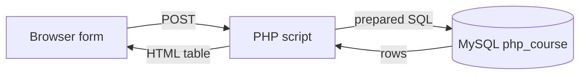

# Session 10: PHP and MySQL: Connecting, Creating and Reading

> Module: Navigating Dynamic Web Development with PHP · Term 2 (DISM) · ⏱ ~2 hours

## 🎯 Learning Objectives

By the end of this session you will be able to:

- Explain how PHP talks to MySQL through PDO or MySQLi
- Create a database and table for a PHP app
- Connect securely with PDO and handle connection errors
- Insert form data with prepared statements
- Read and display records in an HTML table

## 📖 Concepts Explained

### 1. Three-tier picture



### 2. PDO vs MySQLi

| PDO | MySQLi |
|---|---|
| works with 12+ databases | MySQL only |
| named placeholders `:email` | positional `?` only |
| object-oriented API | procedural and OO |

We use **PDO** throughout this course (Laravel also uses PDO underneath).

### 3. SQL injection and prepared statements

Never build SQL by joining user input: `"... WHERE email = '$email'"` lets an attacker type `' OR '1'='1`. A **prepared statement** sends the SQL and the data separately, so data can never become code.

```php
$stmt = $pdo->prepare("INSERT INTO students (name, email) VALUES (:name, :email)");
$stmt->execute([':name' => $name, ':email' => $email]);
```

### 4. Fetching

| Method | Returns |
|---|---|
| `fetch()` | next row (or false) |
| `fetchAll()` | all rows as an array |
| `fetchColumn()` | one value, e.g. a count |
| `lastInsertId()` | id of the inserted row |

### 5. Setup

1. Start Apache and MySQL in XAMPP.
2. Open `http://localhost/phpmyadmin` → SQL tab → run `schema.sql` from this folder.
3. Adjust `db.php` if your MySQL user has a password.

## 💻 Code Examples

All examples below are also saved as files in this folder, so you can open and run them directly.

### Example 1: Database for the PHP sessions (`schema.sql`)

```sql
-- schema.sql : run once in phpMyAdmin or MySQL Workbench
CREATE DATABASE IF NOT EXISTS php_course CHARACTER SET utf8mb4 COLLATE utf8mb4_unicode_ci;
USE php_course;

CREATE TABLE IF NOT EXISTS students (
  id         INT AUTO_INCREMENT PRIMARY KEY,
  name       VARCHAR(100) NOT NULL,
  email      VARCHAR(120) NOT NULL UNIQUE,
  course     VARCHAR(60)  NOT NULL,
  city       VARCHAR(50)  NOT NULL DEFAULT 'Karachi',
  created_at TIMESTAMP DEFAULT CURRENT_TIMESTAMP
);

CREATE TABLE IF NOT EXISTS users (
  id         INT AUTO_INCREMENT PRIMARY KEY,
  name       VARCHAR(100) NOT NULL,
  email      VARCHAR(120) NOT NULL UNIQUE,
  password   VARCHAR(255) NOT NULL,          -- password_hash() output
  role       ENUM('admin','user') NOT NULL DEFAULT 'user',
  created_at TIMESTAMP DEFAULT CURRENT_TIMESTAMP
);

INSERT IGNORE INTO students (name, email, course, city) VALUES
 ('Ayesha Khan','ayesha@mail.com','PHP','Karachi'),
 ('Bilal Ahmed','bilal@mail.com','MySQL','Hyderabad'),
 ('Sana Javed','sana@mail.com','Laravel','Karachi'),
 ('Usman Ali','usman@mail.com','JavaScript','Lahore');
```

**How it works:**

Creates the `php_course` database used in Sessions 10–14 with `students` and `users` tables and some sample rows. `INSERT IGNORE` skips rows whose email already exists, so you can run it twice safely.

### Example 2: Reusable PDO connection (`db.php`)

```php
<?php
// db.php - one shared PDO connection (edit credentials for your setup)
$host = '127.0.0.1'; $db = 'php_course'; $user = 'root'; $pass = '';
$dsn = "mysql:host=$host;dbname=$db;charset=utf8mb4";
try {
    $pdo = new PDO($dsn, $user, $pass, [
        PDO::ATTR_ERRMODE            => PDO::ERRMODE_EXCEPTION,
        PDO::ATTR_DEFAULT_FETCH_MODE => PDO::FETCH_ASSOC,
        PDO::ATTR_EMULATE_PREPARES   => false,
    ]);
} catch (PDOException $e) {
    http_response_code(500);
    exit('Database connection failed. Check db.php settings.');
}
function e(?string $v): string { return htmlspecialchars((string) $v, ENT_QUOTES, 'UTF-8'); }
```

**How it works:**

- `ERRMODE_EXCEPTION` turns database errors into exceptions.
- `utf8mb4` supports Urdu text and emojis.
- `EMULATE_PREPARES = false` uses real server-side prepared statements.
- The `e()` helper escapes output everywhere.

### Example 3: Student registration (Create + Read) (`register.php`)

```php
<?php
// register.php
require __DIR__ . '/db.php';
$errors = []; $old = ['name' => '', 'email' => '', 'course' => 'PHP', 'city' => 'Karachi'];
$courses = ['PHP', 'MySQL', 'Laravel', 'JavaScript', 'WordPress'];

if ($_SERVER['REQUEST_METHOD'] === 'POST') {
    $old = array_map('trim', array_intersect_key($_POST, $old)) + $old;
    if (mb_strlen($old['name']) < 3) $errors[] = "Name must be at least 3 characters.";
    if (!filter_var($old['email'], FILTER_VALIDATE_EMAIL)) $errors[] = "Valid email required.";
    if (!in_array($old['course'], $courses, true)) $errors[] = "Choose a course.";

    if (!$errors) {
        try {
            $stmt = $pdo->prepare("INSERT INTO students (name, email, course, city) VALUES (:n, :e, :c, :ci)");
            $stmt->execute([':n' => $old['name'], ':e' => $old['email'], ':c' => $old['course'], ':ci' => $old['city']]);
            header("Location: register.php?added=" . $pdo->lastInsertId());
            exit;
        } catch (PDOException $ex) {
            $errors[] = $ex->errorInfo[1] === 1062 ? "This email is already registered." : "Could not save.";
        }
    }
}
$students = $pdo->query("SELECT id, name, email, course, city, created_at FROM students ORDER BY id DESC")->fetchAll();
$total = $pdo->query("SELECT COUNT(*) FROM students")->fetchColumn();
?>
<!DOCTYPE html><html lang="en"><head><meta charset="UTF-8"><title>Register</title>
<link href="https://cdn.jsdelivr.net/npm/bootstrap@5.3.3/dist/css/bootstrap.min.css" rel="stylesheet"></head>
<body class="container py-4">
<h2>Student Registration</h2>
<?php if (isset($_GET['added'])): ?><div class="alert alert-success">Student #<?= (int) $_GET['added'] ?> added.</div><?php endif; ?>
<?php foreach ($errors as $err): ?><div class="alert alert-danger py-2"><?= e($err) ?></div><?php endforeach; ?>
<form method="post" class="row g-2 mb-4">
  <div class="col-md-3"><input name="name" class="form-control" placeholder="Full name" value="<?= e($old['name']) ?>"></div>
  <div class="col-md-3"><input name="email" class="form-control" placeholder="Email" value="<?= e($old['email']) ?>"></div>
  <div class="col-md-2"><select name="course" class="form-select">
    <?php foreach ($courses as $c): ?><option <?= $c === $old['course'] ? 'selected' : '' ?>><?= $c ?></option><?php endforeach; ?>
  </select></div>
  <div class="col-md-2"><input name="city" class="form-control" value="<?= e($old['city']) ?>"></div>
  <div class="col-md-2"><button class="btn btn-primary w-100">Register</button></div>
</form>
<h5>All students (<?= $total ?>)</h5>
<table class="table table-striped">
  <tr><th>#</th><th>Name</th><th>Email</th><th>Course</th><th>City</th><th>Joined</th></tr>
  <?php foreach ($students as $s): ?>
  <tr><td><?= $s['id'] ?></td><td><?= e($s['name']) ?></td><td><?= e($s['email']) ?></td>
      <td><?= e($s['course']) ?></td><td><?= e($s['city']) ?></td><td><?= date('d M Y', strtotime($s['created_at'])) ?></td></tr>
  <?php endforeach; ?>
</table>
</body></html>
```

**How it works:**

- Validation runs first; only clean data reaches the prepared `INSERT`.
- Error 1062 is MySQL's duplicate key error, shown as a friendly message for repeated emails.
- After inserting we redirect (Post/Redirect/Get) and show the new id.
- `query()` is fine for SQL with no user input; anything with input uses `prepare()`.

## 🧪 Lab Practice

1. Run `schema.sql`, then register three students through the form.
2. Try to register the same email twice and read the message.
3. Display the total number of students per course using `GROUP BY` in PHP.
4. Show what happens (safely!) when you type `' OR '1'='1` in the name field.
5. Rewrite the connection using MySQLi as a comparison.

## 📝 Assignment

Create a "Feedback" app: table `feedback(id, name, rating 1-5, comment, created_at)`, a form to submit feedback with validation, and a page that lists all feedback with the average rating at the top.

## ❓ Quick Quiz

1. What protects against SQL injection?
   - a) addslashes
   - b) Prepared statements
   - c) strip_tags
   - d) md5
2. Which PDO method returns a single value?
3. Which charset should you use for full Unicode?
4. How do you get the id of a newly inserted row?
5. Which MySQL error code means duplicate entry?

<details>
<summary>Show answers</summary>

1. b) Prepared statements
2. `fetchColumn()`
3. `utf8mb4`
4. `$pdo->lastInsertId()`
5. 1062

</details>

## 💼 Interview Questions

1. **What is SQL injection?**

   <details><summary>Model answer</summary>

   An attack where user input is interpreted as SQL code, letting attackers read or modify data. Prevent it with prepared statements and least-privilege DB users.

   </details>

2. **Why choose PDO?**

   <details><summary>Model answer</summary>

   Database independence, named parameters, consistent exceptions and a clean OO API.

   </details>

3. **What does PDO::ATTR_EMULATE_PREPARES = false do?**

   <details><summary>Model answer</summary>

   Forces native prepared statements on the MySQL server instead of PHP emulating them, giving true separation of SQL and data and correct types.

   </details>

## ✅ Summary

- PHP connects to MySQL with PDO using a DSN.
- Always use prepared statements for user input.
- fetch/fetchAll/fetchColumn read data; lastInsertId gets new ids.
- Escape output with htmlspecialchars when displaying rows.

---

[⬅ Previous](../Session-09-File-Upload-and-Handling/README.md) · [🏠 Module Home](../README.md) · [Next ➡](../Session-11-PHP-MySQL-Update-Delete-Search/README.md)

<sub>Prepared by Zeeshan Abbas · Aptech Learning North Nazimabad</sub>
