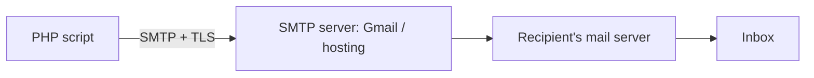

# Session 13: Sending Email with PHP

> Module: Navigating Dynamic Web Development with PHP · Term 2 (DISM) · ⏱ ~2 hours

## 🎯 Learning Objectives

By the end of this session you will be able to:

- Explain how email is sent through SMTP
- Install PHPMailer with Composer
- Send plain text and HTML emails
- Attach files to an email
- Connect a contact form to email and keep credentials out of code

## 📖 Concepts Explained

### 1. How email travels



PHP's built-in `mail()` relies on a mail server configured on the machine (usually missing on XAMPP) and gives poor error messages. **PHPMailer** talks SMTP directly, supports TLS, HTML, attachments and clear errors.

### 2. Installing with Composer

Composer is PHP's package manager (https://getcomposer.org/). In your project folder:

```bash
composer require phpmailer/phpmailer
```

This creates `vendor/` and `vendor/autoload.php`.

### 3. SMTP settings

| Setting | Gmail example |
|---|---|
| Host | `smtp.gmail.com` |
| Port | 587 (STARTTLS) or 465 (SMTPS) |
| Username | your Gmail address |
| Password | a Google **App Password** (needs 2-Step Verification), never your normal password |

For practice without a real inbox use **Mailtrap** (https://mailtrap.io/) or **MailHog**, which catch emails safely.

Keep credentials in a config file outside version control (add it to `.gitignore`).

## 💻 Code Examples

All examples below are also saved as files in this folder, so you can open and run them directly.

### Example 1: Configuration template (`mail-config.example.php`)

```php
<?php
// mail-config.example.php -> copy to mail-config.php and fill in. Never commit mail-config.php!
return [
    'host'      => 'sandbox.smtp.mailtrap.io',   // or smtp.gmail.com
    'port'      => 587,
    'username'  => 'your-username',
    'password'  => 'your-app-password',
    'from'      => 'noreply@yoursite.pk',
    'from_name' => 'Aptech Student Site',
    'to'        => 'you@example.com',             // where contact messages go
];
```

**How it works:**

A config file that returns an array; the real copy stays out of Git.

### Example 2: Contact form that emails you (`contact.php`)

```php
<?php
// contact.php  - first run: composer require phpmailer/phpmailer
use PHPMailer\PHPMailer\PHPMailer;
use PHPMailer\PHPMailer\Exception;
require __DIR__ . '/vendor/autoload.php';
$cfg = require __DIR__ . '/mail-config.php';

$status = ''; $errors = [];
if ($_SERVER['REQUEST_METHOD'] === 'POST') {
    $name = trim($_POST['name'] ?? ''); $email = trim($_POST['email'] ?? ''); $msg = trim($_POST['message'] ?? '');
    if ($name === '') $errors[] = 'Name is required';
    if (!filter_var($email, FILTER_VALIDATE_EMAIL)) $errors[] = 'Valid email is required';
    if (mb_strlen($msg) < 10) $errors[] = 'Message must be at least 10 characters';

    if (!$errors) {
        $mail = new PHPMailer(true);
        try {
            $mail->isSMTP();
            $mail->Host = $cfg['host']; $mail->Port = $cfg['port'];
            $mail->SMTPAuth = true; $mail->Username = $cfg['username']; $mail->Password = $cfg['password'];
            $mail->SMTPSecure = PHPMailer::ENCRYPTION_STARTTLS;
            $mail->CharSet = 'UTF-8';

            $mail->setFrom($cfg['from'], $cfg['from_name']);
            $mail->addAddress($cfg['to']);
            $mail->addReplyTo($email, $name);          // reply goes to the visitor

            $mail->isHTML(true);
            $mail->Subject = "New contact message from $name";
            $safe = nl2br(htmlspecialchars($msg));
            $mail->Body    = "<h3>New message</h3><p><b>Name:</b> " . htmlspecialchars($name) .
                             "<br><b>Email:</b> " . htmlspecialchars($email) . "</p><p>$safe</p>";
            $mail->AltBody = "Name: $name\nEmail: $email\n\n$msg";   // plain-text version

            if (!empty($_FILES['file']['tmp_name']) && $_FILES['file']['error'] === UPLOAD_ERR_OK
                && $_FILES['file']['size'] < 2_000_000) {
                $mail->addAttachment($_FILES['file']['tmp_name'], basename($_FILES['file']['name']));
            }
            $mail->send();
            $status = 'Thank you! Your message has been sent.';
        } catch (Exception $e) {
            $status = 'Sorry, the message could not be sent. ' . $mail->ErrorInfo;
        }
    }
}
?>
<!DOCTYPE html><html><head><title>Contact</title>
<link href="https://cdn.jsdelivr.net/npm/bootstrap@5.3.3/dist/css/bootstrap.min.css" rel="stylesheet"></head>
<body class="container py-4" style="max-width:560px">
<h2>Contact Us</h2>
<?php foreach ($errors as $er): ?><div class="alert alert-danger py-1"><?= $er ?></div><?php endforeach; ?>
<?php if ($status): ?><div class="alert alert-info"><?= htmlspecialchars($status) ?></div><?php endif; ?>
<form method="post" enctype="multipart/form-data">
  <input name="name" class="form-control mb-2" placeholder="Your name">
  <input name="email" class="form-control mb-2" placeholder="Your email">
  <textarea name="message" class="form-control mb-2" rows="5" placeholder="Message"></textarea>
  <input type="file" name="file" class="form-control mb-3">
  <button class="btn btn-primary">Send</button>
</form>
</body></html>
```

**How it works:**

- `new PHPMailer(true)` enables exceptions so failures land in `catch`.
- `Body` is HTML, `AltBody` is the plain-text fallback for simple mail clients.
- `addReplyTo` lets you reply directly to the visitor while the email is sent from your own address (sending "from" the visitor would fail SPF checks).
- An optional attachment under 2 MB is added from the upload's temporary file.

### Example 3: Composer dependency file (`composer.json`)

```json
{
    "require": {
        "phpmailer/phpmailer": "^6.9"
    }
}
```

**How it works:**

Running `composer install` in this folder downloads PHPMailer into `vendor/`.

### Example 4: Keep secrets and vendor out of Git (`.gitignore`)

```text
vendor/
mail-config.php
```

**How it works:**

Git will never commit your real credentials or downloaded packages.

## 🧪 Lab Practice

1. Install Composer and run `composer install` in this folder.
2. Create a free Mailtrap inbox, fill `mail-config.php` and send a test.
3. Send a welcome email automatically after registration (Session 10 form).
4. Send the same newsletter to 3 recipients using `addBCC`.
5. Embed an image in the HTML body with `addEmbeddedImage`.

## 📝 Assignment

Build a **password reset by email** flow: user enters email → a random token (`bin2hex(random_bytes(32))`) is saved with an expiry of 30 minutes → an email with a reset link is sent → `reset.php` verifies the token and updates the hashed password.

## ❓ Quick Quiz

1. Which protocol sends email between servers?
   - a) HTTP
   - b) FTP
   - c) SMTP
   - d) IMAP
2. Which command installs PHPMailer?
3. What should you use for Gmail SMTP instead of your normal password?
4. What is AltBody for?
5. Why use addReplyTo instead of setFrom with the visitor's address?

<details>
<summary>Show answers</summary>

1. c) SMTP
2. `composer require phpmailer/phpmailer`
3. An App Password.
4. A plain-text version for clients that do not render HTML.
5. Sending as another domain fails SPF/DMARC and lands in spam.

</details>

## 💼 Interview Questions

1. **Why use PHPMailer over mail()?**

   <details><summary>Model answer</summary>

   SMTP authentication, TLS encryption, HTML and attachments, readable errors and no need for a local mail server.

   </details>

2. **What is Composer?**

   <details><summary>Model answer</summary>

   PHP's dependency manager; it downloads packages listed in composer.json into vendor/ and generates an autoloader.

   </details>

3. **How do you keep credentials safe in a PHP project?**

   <details><summary>Model answer</summary>

   Store them in environment variables or an untracked config file, never in Git, and use least-privilege accounts.

   </details>

## ✅ Summary

- SMTP is how email is sent; PHPMailer makes it easy and secure.
- Install packages with Composer and load vendor/autoload.php.
- Send HTML with a plain-text fallback; add attachments if needed.
- Keep SMTP credentials out of source control.

---

[⬅ Previous](../Session-12-Admin-Panel-Dashboard/README.md) · [🏠 Module Home](../README.md) · [Next ➡](../Session-14-Authentication-and-Authorization/README.md)

<sub>Prepared by Zeeshan Abbas · Aptech Learning North Nazimabad</sub>
