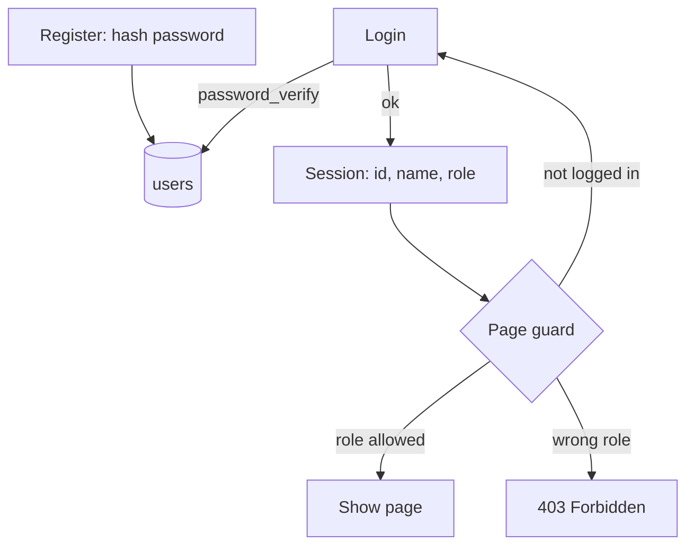

# Session 14: Authentication and Authorization

> Module: Navigating Dynamic Web Development with PHP · Term 2 (DISM) · ⏱ ~2 hours

## 🎯 Learning Objectives

By the end of this session you will be able to:

- Distinguish authentication from authorization
- Build registration with password hashing
- Implement login, logout and protected pages with sessions
- Restrict pages by role (admin vs user)
- Protect forms with CSRF tokens

## 📖 Concepts Explained

### 1. Two different questions

| Authentication | Authorization |
|---|---|
| *Who are you?* | *What are you allowed to do?* |
| login with email + password | role checks: admin vs user |
| happens once per session | happens on every protected request |

### 2. The flow



### 3. Security checklist

- `password_hash()` / `password_verify()` (bcrypt by default; `password_needs_rehash()` for upgrades).
- Same error message for wrong email or wrong password (do not reveal which).
- `session_regenerate_id(true)` after login.
- **CSRF token** on every POST form: a random value stored in the session and in a hidden field; reject the request if they do not match.
- Rate-limit login attempts (count failures in the session or a table).

## 💻 Code Examples

All examples below are also saved as files in this folder, so you can open and run them directly.

### Example 1: Auth helper functions (`auth.php`)

```php
<?php
// auth.php - include at the top of every page
session_start();
require_once __DIR__ . '/db.php';

function current_user(): ?array { return $_SESSION['user'] ?? null; }

function require_login(): void {
    if (!current_user()) { header('Location: login.php'); exit; }
}

function require_role(string $role): void {
    require_login();
    if (current_user()['role'] !== $role) {
        http_response_code(403);
        exit('<h2>403 Forbidden</h2><p>You do not have permission to view this page.</p><a href="dashboard.php">Back</a>');
    }
}

function csrf_token(): string {
    return $_SESSION['csrf'] ??= bin2hex(random_bytes(32));
}
function csrf_field(): string {
    return '<input type="hidden" name="csrf" value="' . csrf_token() . '">';
}
function verify_csrf(): void {
    if (!hash_equals($_SESSION['csrf'] ?? '', $_POST['csrf'] ?? '')) {
        http_response_code(419); exit('Invalid form token. Please reload the page.');
    }
}
```

**How it works:**

- `require_role('admin')` both checks login and the role; wrong roles get HTTP 403.
- `??=` creates the CSRF token only once per session.
- `hash_equals` compares tokens in constant time.

### Example 2: Registration with hashing (`register.php`)

```php
<?php
// register.php
require __DIR__ . '/auth.php';
$errors = [];
if ($_SERVER['REQUEST_METHOD'] === 'POST') {
    verify_csrf();
    $name = trim($_POST['name'] ?? ''); $email = strtolower(trim($_POST['email'] ?? '')); $pass = $_POST['password'] ?? '';
    if (mb_strlen($name) < 3) $errors[] = 'Name too short';
    if (!filter_var($email, FILTER_VALIDATE_EMAIL)) $errors[] = 'Invalid email';
    if (!preg_match('/^(?=.*[A-Z])(?=.*\d).{8,}$/', $pass)) $errors[] = 'Password: 8+ chars, 1 capital, 1 digit';
    if ($pass !== ($_POST['confirm'] ?? '')) $errors[] = 'Passwords do not match';
    if (!$errors) {
        try {
            $pdo->prepare("INSERT INTO users (name, email, password) VALUES (?, ?, ?)")
                ->execute([$name, $email, password_hash($pass, PASSWORD_DEFAULT)]);
            header('Location: login.php?registered=1'); exit;
        } catch (PDOException $e) { $errors[] = 'Email already registered'; }
    }
}
?>
<link href="https://cdn.jsdelivr.net/npm/bootstrap@5.3.3/dist/css/bootstrap.min.css" rel="stylesheet">
<form method="post" class="card p-4 mx-auto mt-5" style="width:380px">
  <h4>Create account</h4>
  <?php foreach ($errors as $er): ?><div class="text-danger small"><?= $er ?></div><?php endforeach; ?>
  <?= csrf_field() ?>
  <input name="name" class="form-control my-1" placeholder="Name">
  <input name="email" class="form-control my-1" placeholder="Email">
  <input name="password" type="password" class="form-control my-1" placeholder="Password">
  <input name="confirm" type="password" class="form-control my-1" placeholder="Confirm password">
  <button class="btn btn-primary mt-2">Register</button>
  <a href="login.php" class="small mt-2">Already have an account?</a>
</form>
```

**How it works:**

New users always get the default role `user`. Passwords are validated with a regex and stored only as hashes.

### Example 3: Login with role-based redirect (`login.php`)

```php
<?php
// login.php
require __DIR__ . '/auth.php';
$error = '';
$_SESSION['fails'] ??= 0;
if ($_SERVER['REQUEST_METHOD'] === 'POST') {
    verify_csrf();
    if ($_SESSION['fails'] >= 5) {
        $error = 'Too many attempts. Try again later.';
    } else {
        $stmt = $pdo->prepare("SELECT id, name, email, password, role FROM users WHERE email = ?");
        $stmt->execute([strtolower(trim($_POST['email'] ?? ''))]);
        $u = $stmt->fetch();
        if ($u && password_verify($_POST['password'] ?? '', $u['password'])) {
            session_regenerate_id(true);
            unset($u['password']);
            $_SESSION['user'] = $u; $_SESSION['fails'] = 0;
            header('Location: ' . ($u['role'] === 'admin' ? 'admin.php' : 'dashboard.php')); exit;
        }
        $_SESSION['fails']++;
        $error = 'Email or password is incorrect.';
    }
}
?>
<link href="https://cdn.jsdelivr.net/npm/bootstrap@5.3.3/dist/css/bootstrap.min.css" rel="stylesheet">
<form method="post" class="card p-4 mx-auto mt-5" style="width:360px">
  <h4>Login</h4>
  <?php if (isset($_GET['registered'])): ?><div class="text-success small">Account created. Please log in.</div><?php endif; ?>
  <div class="text-danger small"><?= $error ?></div>
  <?= csrf_field() ?>
  <input name="email" class="form-control my-1" placeholder="Email">
  <input name="password" type="password" class="form-control my-1" placeholder="Password">
  <button class="btn btn-success mt-2">Login</button>
  <a href="register.php" class="small mt-2">Create account</a>
</form>
```

**How it works:**

Admins are redirected to `admin.php`, users to `dashboard.php`. Failed attempts are counted; after five, login is blocked for the session.

### Example 4: Page for any logged-in user (`dashboard.php`)

```php
<?php
// dashboard.php
require __DIR__ . '/auth.php';
require_login();
$u = current_user();
?>
<h2>Welcome, <?= e($u['name']) ?></h2>
<p>Your role: <b><?= e($u['role']) ?></b></p>
<?php if ($u['role'] === 'admin'): ?><p><a href="admin.php">Go to admin area</a></p><?php endif; ?>
<form method="post" action="logout.php"><?= csrf_field() ?><button>Logout</button></form>
```

**How it works:**

Any authenticated user can view this page; links are shown based on role.

### Example 5: Admin-only page (`admin.php`)

```php
<?php
// admin.php
require __DIR__ . '/auth.php';
require_role('admin');
$users = $pdo->query("SELECT name, email, role, created_at FROM users ORDER BY created_at DESC")->fetchAll();
?>
<h2>Admin area</h2>
<table border="1" cellpadding="6">
<tr><th>Name</th><th>Email</th><th>Role</th><th>Joined</th></tr>
<?php foreach ($users as $x): ?>
<tr><td><?= e($x['name']) ?></td><td><?= e($x['email']) ?></td><td><?= $x['role'] ?></td><td><?= $x['created_at'] ?></td></tr>
<?php endforeach; ?>
</table>
<p><a href="dashboard.php">Dashboard</a></p>
```

**How it works:**

A normal user who types `admin.php` in the address bar receives 403 Forbidden.

### Example 6: Logout via POST (`logout.php`)

```php
<?php
// logout.php
require __DIR__ . '/auth.php';
if ($_SERVER['REQUEST_METHOD'] === 'POST') {
    verify_csrf();
    $_SESSION = [];
    session_destroy();
}
header('Location: login.php');
exit;
```

**How it works:**

Logout is a POST with a CSRF token, so another site cannot log users out with a hidden image.

### Example 7: Connection (`db.php`)

```php
<?php
// db.php - one shared PDO connection (edit credentials for your setup)
$host = '127.0.0.1'; $db = 'php_course'; $user = 'root'; $pass = '';
$dsn = "mysql:host=$host;dbname=$db;charset=utf8mb4";
try {
    $pdo = new PDO($dsn, $user, $pass, [
        PDO::ATTR_ERRMODE            => PDO::ERRMODE_EXCEPTION,
        PDO::ATTR_DEFAULT_FETCH_MODE => PDO::FETCH_ASSOC,
        PDO::ATTR_EMULATE_PREPARES   => false,
    ]);
} catch (PDOException $e) {
    http_response_code(500);
    exit('Database connection failed. Check db.php settings.');
}
function e(?string $v): string { return htmlspecialchars((string) $v, ENT_QUOTES, 'UTF-8'); }
```

**How it works:**

Same as Session 10.

### Example 8: Schema (`schema.sql`)

```sql
-- schema.sql : run once in phpMyAdmin or MySQL Workbench
CREATE DATABASE IF NOT EXISTS php_course CHARACTER SET utf8mb4 COLLATE utf8mb4_unicode_ci;
USE php_course;

CREATE TABLE IF NOT EXISTS students (
  id         INT AUTO_INCREMENT PRIMARY KEY,
  name       VARCHAR(100) NOT NULL,
  email      VARCHAR(120) NOT NULL UNIQUE,
  course     VARCHAR(60)  NOT NULL,
  city       VARCHAR(50)  NOT NULL DEFAULT 'Karachi',
  created_at TIMESTAMP DEFAULT CURRENT_TIMESTAMP
);

CREATE TABLE IF NOT EXISTS users (
  id         INT AUTO_INCREMENT PRIMARY KEY,
  name       VARCHAR(100) NOT NULL,
  email      VARCHAR(120) NOT NULL UNIQUE,
  password   VARCHAR(255) NOT NULL,          -- password_hash() output
  role       ENUM('admin','user') NOT NULL DEFAULT 'user',
  created_at TIMESTAMP DEFAULT CURRENT_TIMESTAMP
);

INSERT IGNORE INTO students (name, email, course, city) VALUES
 ('Ayesha Khan','ayesha@mail.com','PHP','Karachi'),
 ('Bilal Ahmed','bilal@mail.com','MySQL','Hyderabad'),
 ('Sana Javed','sana@mail.com','Laravel','Karachi'),
 ('Usman Ali','usman@mail.com','JavaScript','Lahore');

-- Promote yourself after registering:
-- UPDATE users SET role = 'admin' WHERE email = 'you@example.com';
```

**How it works:**

Run once; then promote one account to admin.

## 🧪 Lab Practice

1. Register two accounts; promote one to admin with SQL; test both logins.
2. Log in as a normal user and open `admin.php` directly — confirm 403.
3. Remove the hidden CSRF field from the login form and observe the 419 error.
4. Add a 'Change password' page that requires the current password.
5. Add automatic logout after 15 minutes of inactivity.

## 📝 Assignment

Add a third role `teacher` that can view the student list but not delete. Update `require_role` to accept an array of roles (`require_role(['admin','teacher'])`) and show/hide buttons according to role.

## ❓ Quick Quiz

1. Authentication answers which question?
   - a) What can you do?
   - b) Who are you?
   - c) Where are you?
   - d) When?
2. Which function hashes passwords?
3. Which HTTP status means logged in but not allowed?
4. What attack does a CSRF token prevent?
5. Why show the same message for wrong email and wrong password?

<details>
<summary>Show answers</summary>

1. b) Who are you?
2. `password_hash()`
3. 403 Forbidden
4. Cross-Site Request Forgery: another site submitting forms as the logged-in user.
5. To avoid revealing which emails are registered (user enumeration).

</details>

## 💼 Interview Questions

1. **How would you store passwords securely?**

   <details><summary>Model answer</summary>

   Use password_hash (bcrypt/argon2) with automatic salts, verify with password_verify, never store plain or MD5/SHA1 hashes, and rehash when algorithms improve.

   </details>

2. **Explain role-based access control.**

   <details><summary>Model answer</summary>

   Users are assigned roles and each protected action checks whether the role has permission, centralising authorization logic.

   </details>

3. **What is session fixation and how do you prevent it?**

   <details><summary>Model answer</summary>

   An attacker makes the victim use a known session id; after login the attacker shares the session. Regenerate the session id at login.

   </details>

## ✅ Summary

- Authentication = identity; authorization = permissions.
- Hash passwords and verify with password_verify.
- Guard pages with require_login / require_role on the server.
- Use CSRF tokens on POST forms and limit login attempts.

---

[⬅ Previous](../Session-13-Emailing-with-PHPMailer/README.md) · [🏠 Module Home](../README.md) · [Next ➡](../Session-15-OOP-Classes-and-Objects/README.md)

<sub>Prepared by Zeeshan Abbas · Aptech Learning North Nazimabad</sub>
