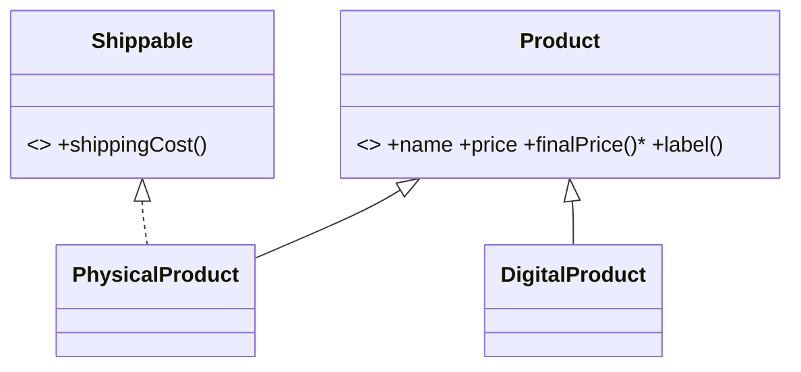

# Session 16: OOP Part 2: Inheritance, Interfaces and Abstract Classes

> Module: Navigating Dynamic Web Development with PHP · Term 2 (DISM) · ⏱ ~2 hours

## 🎯 Learning Objectives

By the end of this session you will be able to:

- Extend classes with inheritance and call parent methods
- Apply public, protected and private visibility
- Override methods and emulate overloading with optional/variadic parameters and __call
- Define contracts with interfaces and abstract classes
- Use static and final keywords appropriately

## 📖 Concepts Explained

### 1. Inheritance

`class DigitalProduct extends Product` — the child gets all public and protected members of the parent and can add or **override** methods. Call the parent version with `parent::method()`.

### 2. Visibility

| Modifier | Same class | Child class | Outside |
|---|---|---|---|
| `public` | yes | yes | yes |
| `protected` | yes | yes | no |
| `private` | yes | no | no |

### 3. Overriding vs overloading

- **Overriding**: child redefines a parent method with the same name (compatible signature).
- **Overloading** in Java/C# means several methods with the same name and different parameters. PHP does not support that directly; use optional or variadic parameters, union types, or the magic `__call()` method.

### 4. Abstract classes vs interfaces

| Abstract class | Interface |
|---|---|
| can have properties and implemented methods | only method signatures and constants |
| `abstract` methods must be implemented by children | all methods must be implemented |
| single inheritance (`extends`) | a class can `implements` many |
| "is a" with shared code | "can do" capability |

### 5. static and final

- `static` members belong to the class, not an object (`Product::count()`). `static::` uses late static binding.
- `final class` cannot be extended; a `final` method cannot be overridden — use it to protect critical logic.



## 💻 Code Examples

All examples below are also saved as files in this folder, so you can open and run them directly.

### Example 1: E-commerce product hierarchy (`shop.php`)

```php
<?php
// shop.php  (run: php shop.php)
declare(strict_types=1);

interface Shippable { public function shippingCost(string $city): float; }
interface Discountable { public function applyDiscount(float $percent): void; }

abstract class Product
{
    protected static int $created = 0;

    public function __construct(protected string $name, protected float $price)
    {
        static::$created++;
    }

    abstract public function finalPrice(): float;      // children must implement

    public function label(): string                   // shared behaviour
    {
        return sprintf("%-22s Rs %8s", $this->name, number_format($this->finalPrice()));
    }

    final public static function created(): int { return static::$created; }
}

class PhysicalProduct extends Product implements Shippable, Discountable
{
    public function __construct(string $name, float $price, private float $weightKg)
    {
        parent::__construct($name, $price);
    }
    public function finalPrice(): float { return $this->price; }
    public function shippingCost(string $city): float
    {
        $base = $city === 'Karachi' ? 150 : 300;
        return $base + 50 * ceil($this->weightKg);
    }
    public function applyDiscount(float $percent): void { $this->price *= (1 - $percent / 100); }
}

class DigitalProduct extends Product
{
    public function finalPrice(): float { return round($this->price * 1.05, 2); } // 5% digital tax
    public function label(): string { return parent::label() . "  [instant download]"; } // override
}

final class GiftCard extends DigitalProduct
{
    public function finalPrice(): float { return $this->price; }   // no tax on gift cards
}

class Cart
{
    private array $items = [];
    // "overloading" style: accept one or many products
    public function add(Product ...$products): void { array_push($this->items, ...$products); }

    public function __call(string $method, array $args): mixed   // magic method for unknown calls
    {
        if ($method === 'count') return count($this->items);
        throw new BadMethodCallException("Method $method does not exist");
    }

    public function checkout(string $city): void
    {
        $total = 0;
        foreach ($this->items as $p) {
            echo $p->label(), PHP_EOL;                  // polymorphism: each class decides
            $total += $p->finalPrice();
            if ($p instanceof Shippable) $total += $p->shippingCost($city);
        }
        echo str_repeat('-', 50), PHP_EOL, "Total incl. shipping: Rs ", number_format($total), PHP_EOL;
    }
}

$mouse = new PhysicalProduct("Wireless Mouse", 2500, 0.3);
$mouse->applyDiscount(10);
$cart = new Cart();
$cart->add($mouse, new PhysicalProduct("Monitor 24\"", 38000, 4.2), new DigitalProduct("PHP eBook", 1200), new GiftCard("Gift Card", 5000));
echo "Items: ", $cart->count(), PHP_EOL;
$cart->checkout('Lahore');
echo "Products created: ", Product::created(), PHP_EOL;
```

**How it works:**

- `Product` is abstract: you cannot `new Product`, but it shares `label()` with all children.
- `PhysicalProduct` implements two interfaces; `instanceof Shippable` decides whether shipping applies.
- `DigitalProduct::label()` overrides and extends the parent with `parent::label()`.
- `GiftCard` is `final`, and `Product::created()` is a `final static` method.
- `add(Product ...$products)` and `__call` show PHP's alternatives to method overloading.

## 🧪 Lab Practice

1. Add a `SubscriptionProduct` with a monthly price and a `months` property.
2. Make `Product::label()` final and see which class breaks.
3. Create an interface `Reviewable` with `addReview(int $stars)` and `averageRating()`; implement it in `PhysicalProduct`.
4. Try to access `$mouse->price` from outside and read the error.
5. Draw the class diagram of your final design.

## 📝 Assignment

Design a **payment system**: interface `PaymentMethod` (`pay(float $amount): string`), abstract `BasePayment` (logs transactions), and classes `CashOnDelivery`, `CardPayment`, `JazzCashWallet`. A `Checkout` class accepts any `PaymentMethod` (polymorphism).

## ❓ Quick Quiz

1. Which visibility allows access in child classes but not outside?
   - a) public
   - b) protected
   - c) private
   - d) final
2. Can you create an object of an abstract class?
3. How many interfaces can a class implement?
4. How does a child call the parent constructor?
5. What does `final class` prevent?

<details>
<summary>Show answers</summary>

1. b) protected
2. No.
3. Many (comma-separated).
4. `parent::__construct(...)`
5. Other classes extending it.

</details>

## 💼 Interview Questions

1. **Abstract class vs interface?**

   <details><summary>Model answer</summary>

   Abstract classes can contain state and implemented methods and are extended once; interfaces define only contracts and a class can implement many. Use interfaces for capabilities, abstract classes for shared base code.

   </details>

2. **Does PHP support method overloading?**

   <details><summary>Model answer</summary>

   Not in the Java sense. You emulate it with default/optional parameters, variadics, union types, or the __call/__callStatic magic methods.

   </details>

3. **What is polymorphism? Give a PHP example.**

   <details><summary>Model answer</summary>

   Different classes respond to the same method call in their own way, e.g. Cart calling finalPrice() on Physical and Digital products without knowing their exact type.

   </details>

## ✅ Summary

- Inheritance reuses and extends parent classes.
- public / protected / private control access.
- Abstract classes share code; interfaces define contracts.
- Override with parent:: calls; emulate overloading with variadics or __call.
- static belongs to the class; final blocks extension.

---

[⬅ Previous](../Session-15-OOP-Classes-and-Objects/README.md) · [🏠 Module Home](../README.md) · [Next ➡](../Session-17-Web-Concepts-and-JSON/README.md)

<sub>Prepared by Zeeshan Abbas · Aptech Learning North Nazimabad</sub>
