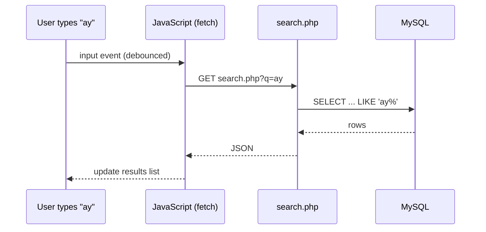

# Session 18: PHP and AJAX: Live Search and Shopping Cart

> Module: Navigating Dynamic Web Development with PHP · Term 2 (DISM) · ⏱ ~2 hours

## 🎯 Learning Objectives

By the end of this session you will be able to:

- Explain AJAX and the standards it uses (HTTP, XMLHttpRequest/fetch, JSON, XML)
- Build a live search that queries MySQL as the user types
- Return JSON and XML from PHP to JavaScript
- Implement an add-to-cart system with sessions and AJAX
- Debounce requests and handle errors

## 📖 Concepts Explained

### 1. What is AJAX?

**AJAX** (Asynchronous JavaScript And XML) lets a page talk to the server **in the background** and update part of the page without a full reload. Today we usually exchange **JSON** using `fetch()`, but the term remains.



| Standard | Role |
|---|---|
| HTTP | request/response transport |
| XMLHttpRequest / Fetch API | browser APIs for background requests |
| JSON / XML | data format |
| DOM | updating the page |

### 2. Good AJAX habits

- **Debounce** keystrokes (wait ~300 ms) so you don't send a request per letter.
- Set `Content-Type` correctly on the server and check `response.ok` on the client.
- Escape text with `textContent` (not `innerHTML`) to prevent XSS.
- For POST requests that change data, include a CSRF token.

### 3. Cart with sessions

The cart is an array in `$_SESSION['cart']` keyed by product id with quantities. AJAX calls `cart.php?action=add|remove|list` and gets the updated cart as JSON, so the badge and table refresh instantly.

## 💻 Code Examples

All examples below are also saved as files in this folder, so you can open and run them directly.

### Example 1: Products table (`setup.sql`)

```sql
-- setup.sql (uses the php_course database from Session 10)
USE php_course;
CREATE TABLE IF NOT EXISTS products (
  id INT AUTO_INCREMENT PRIMARY KEY,
  name VARCHAR(100) NOT NULL,
  price DECIMAL(9,2) NOT NULL
);
INSERT INTO products (name, price) VALUES
 ('PHP 8 Basics (book)', 1800), ('MySQL Pocket Guide', 950), ('Laravel Up and Running', 4200),
 ('JavaScript Cookbook', 2600), ('WordPress for Beginners', 1500);
```

**How it works:**

Adds a `products` table for the cart demo; live search uses the `students` table from Session 10.

### Example 2: Connection (`db.php`)

```php
<?php
// db.php - one shared PDO connection (edit credentials for your setup)
$host = '127.0.0.1'; $db = 'php_course'; $user = 'root'; $pass = '';
$dsn = "mysql:host=$host;dbname=$db;charset=utf8mb4";
try {
    $pdo = new PDO($dsn, $user, $pass, [
        PDO::ATTR_ERRMODE            => PDO::ERRMODE_EXCEPTION,
        PDO::ATTR_DEFAULT_FETCH_MODE => PDO::FETCH_ASSOC,
        PDO::ATTR_EMULATE_PREPARES   => false,
    ]);
} catch (PDOException $e) {
    http_response_code(500);
    exit('Database connection failed. Check db.php settings.');
}
function e(?string $v): string { return htmlspecialchars((string) $v, ENT_QUOTES, 'UTF-8'); }
```

**How it works:**

Same as Session 10.

### Example 3: Live search endpoint (JSON and XML) (`search.php`)

```php
<?php
// search.php?q=ay            -> JSON
// search.php?q=ay&format=xml -> XML
require __DIR__ . '/db.php';
$q = trim($_GET['q'] ?? '');
$rows = [];
if (mb_strlen($q) >= 1) {
    $stmt = $pdo->prepare("SELECT id, name, course, city FROM students WHERE name LIKE ? OR course LIKE ? ORDER BY name LIMIT 10");
    $stmt->execute(["%$q%", "%$q%"]);
    $rows = $stmt->fetchAll();
}

if (($_GET['format'] ?? '') === 'xml') {
    header('Content-Type: application/xml; charset=utf-8');
    $xml = new SimpleXMLElement('<students/>');
    foreach ($rows as $r) {
        $s = $xml->addChild('student');
        foreach ($r as $k => $v) $s->addChild($k, htmlspecialchars((string) $v));
    }
    echo $xml->asXML();
} else {
    header('Content-Type: application/json; charset=utf-8');
    echo json_encode(['query' => $q, 'count' => count($rows), 'results' => $rows]);
}
```

**How it works:**

One endpoint, two formats. `SimpleXMLElement` builds XML; JSON is the default.

### Example 4: Live search page (`live-search.html`)

```html
<!DOCTYPE html>
<html lang="en">
<head>
  <meta charset="UTF-8"><title>Live Search</title>
  <link href="https://cdn.jsdelivr.net/npm/bootstrap@5.3.3/dist/css/bootstrap.min.css" rel="stylesheet">
</head>
<body class="container py-4" style="max-width:560px">
  <h3>Find a student</h3>
  <input id="q" class="form-control" placeholder="Type a name or course..." autocomplete="off">
  <small id="status" class="text-muted"></small>
  <ul id="results" class="list-group mt-2"></ul>
  <button id="xmlBtn" class="btn btn-sm btn-outline-secondary mt-3">Load same results as XML</button>
<script>
const input = document.getElementById('q'), list = document.getElementById('results'), status = document.getElementById('status');

function debounce(fn, ms = 300) { let t; return (...a) => { clearTimeout(t); t = setTimeout(() => fn(...a), ms); }; }

async function search(term) {
  if (!term) { list.innerHTML = ''; status.textContent = ''; return; }
  status.textContent = 'Searching…';
  try {
    const res = await fetch('search.php?q=' + encodeURIComponent(term));
    if (!res.ok) throw new Error('HTTP ' + res.status);
    const data = await res.json();
    list.innerHTML = '';
    data.results.forEach(s => {
      const li = document.createElement('li');
      li.className = 'list-group-item';
      li.textContent = `${s.name} — ${s.course} (${s.city})`;   // textContent = XSS-safe
      list.appendChild(li);
    });
    status.textContent = `${data.count} result(s)`;
  } catch (err) { status.textContent = 'Error: ' + err.message; }
}
input.addEventListener('input', debounce(e => search(e.target.value.trim())));

// Classic XMLHttpRequest + XML parsing
document.getElementById('xmlBtn').onclick = () => {
  const xhr = new XMLHttpRequest();
  xhr.open('GET', 'search.php?format=xml&q=' + encodeURIComponent(input.value.trim()));
  xhr.onload = () => {
    const names = [...xhr.responseXML.getElementsByTagName('name')].map(n => n.textContent);
    alert('From XML: ' + (names.join(', ') || 'no results'));
  };
  xhr.send();
};
</script>
</body>
</html>
```

**How it works:**

- `debounce` waits 300 ms after the last keystroke before calling the server.
- `encodeURIComponent` makes the search term URL-safe.
- The XML button shows the older `XMLHttpRequest` style and reads `responseXML`.

### Example 5: Cart API with sessions (`cart.php`)

```php
<?php
// cart.php?action=list | add&id=1 | remove&id=1 | clear
session_start();
require __DIR__ . '/db.php';
header('Content-Type: application/json');

$_SESSION['cart'] ??= [];          // [productId => qty]
$id = (int) ($_GET['id'] ?? 0);

switch ($_GET['action'] ?? 'list') {
    case 'add':
        $_SESSION['cart'][$id] = ($_SESSION['cart'][$id] ?? 0) + 1; break;
    case 'remove':
        if (isset($_SESSION['cart'][$id]) && --$_SESSION['cart'][$id] <= 0) unset($_SESSION['cart'][$id]); break;
    case 'clear':
        $_SESSION['cart'] = []; break;
}

$items = []; $total = 0;
if ($_SESSION['cart']) {
    $ids = array_keys($_SESSION['cart']);
    $in  = implode(',', array_fill(0, count($ids), '?'));
    $stmt = $pdo->prepare("SELECT id, name, price FROM products WHERE id IN ($in)");
    $stmt->execute($ids);
    foreach ($stmt as $p) {
        $qty = $_SESSION['cart'][$p['id']];
        $items[] = $p + ['qty' => $qty, 'subtotal' => $qty * $p['price']];
        $total += $qty * $p['price'];
    }
}
echo json_encode(['items' => $items, 'count' => array_sum($_SESSION['cart']), 'total' => $total]);
```

**How it works:**

- Prices are always read from the database, never trusted from the browser.
- `IN (?, ?, ?)` placeholders are generated to match the number of ids.
- (For a production shop, use POST plus a CSRF token for add/remove.)

### Example 6: Shop page with AJAX cart (`shop.php`)

```php
<?php
// shop.php
require __DIR__ . '/db.php';
$products = $pdo->query("SELECT id, name, price FROM products")->fetchAll();
?>
<!DOCTYPE html><html><head><title>Book Shop</title>
<link href="https://cdn.jsdelivr.net/npm/bootstrap@5.3.3/dist/css/bootstrap.min.css" rel="stylesheet"></head>
<body class="container py-4">
<h3>Book Shop <span class="badge bg-primary" id="badge">0</span></h3>
<div class="row">
  <div class="col-md-7">
    <?php foreach ($products as $p): ?>
      <div class="d-flex justify-content-between border rounded p-2 mb-2">
        <span><?= e($p['name']) ?> — Rs <?= number_format($p['price']) ?></span>
        <button class="btn btn-sm btn-success" onclick="cart('add', <?= $p['id'] ?>)">Add to cart</button>
      </div>
    <?php endforeach; ?>
  </div>
  <div class="col-md-5">
    <h5>Your cart</h5>
    <table class="table table-sm" id="cartTable"></table>
    <p><b>Total: Rs <span id="total">0</span></b></p>
    <button class="btn btn-outline-danger btn-sm" onclick="cart('clear')">Clear</button>
    <button class="btn btn-primary btn-sm" onclick="alert('Checkout: order summary would be saved here (no payment).')">Checkout</button>
  </div>
</div>
<script>
async function cart(action = 'list', id = 0) {
  const res = await fetch(`cart.php?action=${action}&id=${id}`);
  const data = await res.json();
  document.getElementById('badge').textContent = data.count;
  document.getElementById('total').textContent = data.total.toLocaleString();
  const table = document.getElementById('cartTable');
  table.innerHTML = '';
  data.items.forEach(i => {
    const tr = table.insertRow();
    tr.insertCell().textContent = i.name;
    tr.insertCell().textContent = '× ' + i.qty;
    const btn = document.createElement('button');
    btn.className = 'btn btn-sm btn-link text-danger'; btn.textContent = 'remove';
    btn.onclick = () => cart('remove', i.id);
    tr.insertCell().appendChild(btn);
  });
}
cart();
</script>
</body></html>
```

**How it works:**

Every button calls `cart()`, which hits the API and redraws the badge, table and total without reloading the page.

## 🧪 Lab Practice

1. Run `setup.sql`, open `live-search.html` and search for 'ka' and 'php'.
2. Watch the requests in DevTools → Network; notice debouncing.
3. Highlight the matched text in each result.
4. Add quantity +/- buttons to the cart table.
5. Save the cart to an `orders` table on checkout (order + order_items).

## 📝 Assignment

**Mini Project – Add to Cart System**: extend the shop with product images, a product detail page, a cart page with quantity editing, and a checkout form (name, phone, address) that stores the order in MySQL inside a transaction and shows an order confirmation number. No real payment.

## ❓ Quick Quiz

1. What does the A in AJAX stand for?
   - a) Advanced
   - b) Asynchronous
   - c) Apache
   - d) Array
2. Why debounce a live search?
3. Which browser API is the modern way to make AJAX calls?
4. Why should prices come from the database and not from JavaScript?
5. Which property gives parsed XML from XMLHttpRequest?

<details>
<summary>Show answers</summary>

1. b) Asynchronous
2. To avoid sending a request on every keystroke and overloading the server.
3. `fetch()`
4. Client data can be modified by users.
5. `responseXML`

</details>

## 💼 Interview Questions

1. **What is AJAX and why use it?**

   <details><summary>Model answer</summary>

   A technique to exchange data with the server in the background and update parts of a page, giving faster, app-like experiences.

   </details>

2. **How do you prevent XSS when inserting AJAX results into the page?**

   <details><summary>Model answer</summary>

   Use textContent or properly escape values; avoid innerHTML with untrusted data; escape on the server too.

   </details>

3. **How would you store a cart for logged-out vs logged-in users?**

   <details><summary>Model answer</summary>

   Session (or localStorage) for guests; merge into a database cart table on login so it persists across devices.

   </details>

## ✅ Summary

- AJAX updates part of a page without reloading.
- fetch + JSON is the modern standard; XMLHttpRequest and XML still exist.
- Debounce live searches and escape output with textContent.
- A session-based cart plus a JSON API makes a fast add-to-cart system.

---

[⬅ Previous](../Session-17-Web-Concepts-and-JSON/README.md) · [🏠 Module Home](../README.md) · [Next ➡](../../05-Laravel-Framework-for-Web-Applications/README.md)

<sub>Prepared by Zeeshan Abbas · Aptech Learning North Nazimabad</sub>
