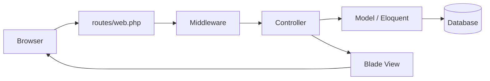

# Session 02: Laravel Fundamentals and MVC Architecture

> Module: Laravel Framework for Web Applications using PHP · Term 2 (DISM) · ⏱ ~2 hours

## 🎯 Learning Objectives

By the end of this session you will be able to:

- Explain why we use frameworks and Laravel's main features
- Describe the MVC pattern and the request lifecycle
- Navigate the Laravel directory structure
- Use Artisan commands to generate code
- Use common helper functions

## 📖 Concepts Explained

### 1. Why a framework?

Plain PHP makes you rebuild routing, validation, security, database access and templating in every project. A framework gives tested building blocks and **conventions** ("convention over configuration"): if you follow the naming rules, things just work.

Laravel highlights: expressive **routing**, **Eloquent ORM**, **Blade** templates, **Artisan** CLI, migrations, validation, authentication starters, queues, mail, testing.

### 2. MVC

| Layer | Responsibility | Laravel location |
|---|---|---|
| **Model** | data and business rules | `app/Models` |
| **View** | presentation (HTML) | `resources/views` (Blade) |
| **Controller** | receives request, uses models, returns a view/response | `app/Http/Controllers` |



### 3. Directory tour (Laravel 11)

| Folder/file | Purpose |
|---|---|
| `app/` | Models, Controllers, Providers |
| `bootstrap/app.php` | app configuration: routing, middleware, exceptions |
| `config/` | configuration files |
| `database/` | migrations, seeders, factories |
| `public/` | web root (`index.php`, built assets) |
| `resources/` | Blade views, CSS, JS |
| `routes/` | `web.php`, `console.php` (`api.php` via `php artisan install:api`) |
| `storage/` | logs, cache, uploaded files |
| `vendor/` | Composer packages |
| `.env` | environment secrets (never commit) |

### 4. Artisan

`php artisan list`, `make:controller`, `make:model -m`, `route:list`, `migrate`, `tinker`, `optimize:clear`.

### 5. Helpers

`route('name')`, `url('/path')`, `asset('img/logo.png')`, `config('app.name')`, `env('APP_DEBUG')` (only in config files), `now()`, `str()`, `dd()` (dump and die), `old('field')`, `session()`.

## 💻 Code Examples

All examples below are also saved as files in this folder, so you can open and run them directly.

### Example 1: A controller generated with Artisan (`app/Http/Controllers/PageController.php`)

```php
<?php
// php artisan make:controller PageController
namespace App\Http\Controllers;

class PageController extends Controller
{
    public function about()
    {
        $facts = [
            'framework' => 'Laravel ' . app()->version(),
            'php'       => PHP_VERSION,
            'app_name'  => config('app.name'),
            'today'     => now()->format('l, d M Y'),
            'slug'      => str('Aptech North Nazimabad')->slug(),
        ];
        return view('about', compact('facts'));
    }
}
```

**How it works:**

The controller gathers data with helper functions and passes it to the `about` view with `compact()`.

### Example 2: The view (`resources/views/about.blade.php`)

```html
{{-- resources/views/about.blade.php --}}
<!DOCTYPE html>
<html>
<head><title>About</title></head>
<body style="font-family:sans-serif">
  <h1>About this app</h1>
  <ul>
    @foreach ($facts as $key => $value)
      <li><strong>{{ $key }}</strong>: {{ $value }}</li>
    @endforeach
  </ul>
  <a href="{{ url('/') }}">Home</a>
</body>
</html>
```

**How it works:**

`{{ }}` prints escaped values; `@foreach` loops in Blade.

### Example 3: Route to the controller (`routes/web.php`)

```php
<?php
use App\Http\Controllers\PageController;
use Illuminate\Support\Facades\Route;

Route::get('/', fn () => view('welcome'));
Route::get('/about', [PageController::class, 'about'])->name('about');
```

**How it works:**

Run `php artisan route:list` to see the new named route.

## 🧪 Lab Practice

1. Explore each top-level folder and write one line about it.
2. Generate `PageController` and the `about` view; visit `/about`.
3. Run `php artisan route:list` and `php artisan about`.
4. Use `dd($facts)` in the controller and observe the output.
5. Change `APP_NAME` in `.env` and see it in the view.

## 📝 Assignment

Draw (on paper or with Mermaid) the path of a request to `/about` through the files you created, then explain each step in five sentences.

## ❓ Quick Quiz

1. In MVC, which part talks to the database?
   - a) View
   - b) Model
   - c) Controller
   - d) Route
2. Where are Blade views stored?
3. Command to list routes?
4. What does `dd()` do?
5. Which file holds environment secrets?

<details>
<summary>Show answers</summary>

1. b) Model
2. `resources/views`
3. `php artisan route:list`
4. Dumps variables and stops execution.
5. `.env`

</details>

## 💼 Interview Questions

1. **Explain MVC.**

   <details><summary>Model answer</summary>

   Model handles data and rules, View handles presentation, Controller handles input and coordinates; this separation keeps code organised and testable.

   </details>

2. **What is convention over configuration?**

   <details><summary>Model answer</summary>

   Following standard naming (e.g. model Post ↔ table posts) so the framework wires things automatically without configuration.

   </details>

3. **What is the public folder for?**

   <details><summary>Model answer</summary>

   It is the only web-accessible directory; it contains index.php (the front controller) and compiled assets, keeping app code outside the web root.

   </details>

## ✅ Summary

- Frameworks give secure, tested building blocks and conventions.
- Laravel follows MVC: Models, Blade Views, Controllers.
- Know the directory structure and keep `.env` secret.
- Artisan generates code and runs tasks; helpers save typing.

---

[⬅ Previous](../Session-01-Environment-Setup/README.md) · [🏠 Module Home](../README.md) · [Next ➡](../Session-03-Routing-Views-Blade/README.md)

<sub>Prepared by Zeeshan Abbas · Aptech Learning North Nazimabad</sub>
