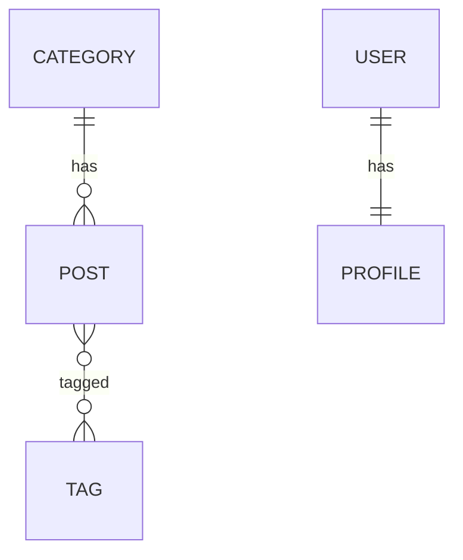

# Session 06: Eloquent Relationships and Advanced Features

> Module: Laravel Framework for Web Applications using PHP · Term 2 (DISM) · ⏱ ~2 hours

## 🎯 Learning Objectives

By the end of this session you will be able to:

- Define one-to-one, one-to-many and many-to-many relationships
- Eager load relations to avoid the N+1 problem
- Work with collections
- Write local and global query scopes
- Use model events, timestamps and soft deletes

## 📖 Concepts Explained

### 1. Relationships

| Type | Example | Methods |
|---|---|---|
| One-to-one | User has one Profile | `hasOne` / `belongsTo` |
| One-to-many | Category has many Posts | `hasMany` / `belongsTo` |
| Many-to-many | Post has many Tags, Tag has many Posts | `belongsToMany` (pivot table `post_tag`) |



### 2. N+1 problem

`foreach (Post::all() as $p) echo $p->category->name;` runs 1 query for posts + 1 per post. **Eager loading** fixes it: `Post::with('category')->get()` → 2 queries total.

### 3. Collections

Eloquent returns `Collection` objects with handy methods: `map`, `filter`, `pluck`, `groupBy`, `sortBy`, `sum`, `avg`, `first`, `count`.

### 4. Scopes

- **Local scope**: reusable query part, `scopePublished($q)` → `Post::published()->get()`.
- **Global scope**: applied to every query of the model automatically (e.g. hide archived rows).

### 5. Model events & soft deletes

Events: `creating`, `created`, `updating`, `updated`, `deleting`, `deleted` — e.g. auto-create a slug. **Soft deletes** set `deleted_at` instead of removing the row; `withTrashed()`, `onlyTrashed()`, `restore()`, `forceDelete()`.

## 💻 Code Examples

All examples below are also saved as files in this folder, so you can open and run them directly.

### Example 1: Categories, tags and pivot (`database/migrations/2025_01_03_000000_create_categories_and_tags.php`)

```php
<?php
use Illuminate\Database\Migrations\Migration;
use Illuminate\Database\Schema\Blueprint;
use Illuminate\Support\Facades\Schema;

return new class extends Migration {
    public function up(): void
    {
        Schema::create('categories', function (Blueprint $t) {
            $t->id(); $t->string('name')->unique(); $t->timestamps();
        });
        Schema::table('posts', function (Blueprint $t) {
            $t->foreignId('category_id')->nullable()->constrained()->nullOnDelete();
            $t->string('slug')->nullable()->unique();
            $t->softDeletes();
        });
        Schema::create('tags', function (Blueprint $t) {
            $t->id(); $t->string('name')->unique(); $t->timestamps();
        });
        Schema::create('post_tag', function (Blueprint $t) {
            $t->foreignId('post_id')->constrained()->cascadeOnDelete();
            $t->foreignId('tag_id')->constrained()->cascadeOnDelete();
            $t->primary(['post_id', 'tag_id']);
        });
    }
    public function down(): void
    {
        Schema::dropIfExists('post_tag');
        Schema::dropIfExists('tags');
        Schema::table('posts', function (Blueprint $t) {
            $t->dropConstrainedForeignId('category_id');
            $t->dropColumn(['slug', 'deleted_at']);
        });
        Schema::dropIfExists('categories');
    }
};
```

**How it works:**

Adds a foreign key and soft-delete column to posts, plus tags and the `post_tag` pivot table (alphabetical singular names).

### Example 2: Post with relations, scope, events, soft deletes (`app/Models/Post.php`)

```php
<?php
namespace App\Models;

use Illuminate\Database\Eloquent\Builder;
use Illuminate\Database\Eloquent\Factories\HasFactory;
use Illuminate\Database\Eloquent\Model;
use Illuminate\Database\Eloquent\Relations\{BelongsTo, BelongsToMany};
use Illuminate\Database\Eloquent\SoftDeletes;
use Illuminate\Support\Str;

class Post extends Model
{
    use HasFactory, SoftDeletes;

    protected $fillable = ['title', 'body', 'is_published', 'category_id'];
    protected function casts(): array { return ['is_published' => 'boolean']; }

    public function category(): BelongsTo { return $this->belongsTo(Category::class); }
    public function tags(): BelongsToMany { return $this->belongsToMany(Tag::class); }

    public function scopePublished(Builder $q): void { $q->where('is_published', true); }
    public function scopeSearch(Builder $q, ?string $term): void
    {
        $q->when($term, fn ($q) => $q->where('title', 'like', "%{$term}%"));
    }

    protected static function booted(): void
    {
        static::creating(function (Post $post) {
            $post->slug = Str::slug($post->title) . '-' . Str::random(5);
        });
    }
}
```

**How it works:**

Relations are methods; `scopePublished` becomes `Post::published()`; the `creating` event fills the slug automatically.

### Example 3: Category model (`app/Models/Category.php`)

```php
<?php
namespace App\Models;

use Illuminate\Database\Eloquent\Model;
use Illuminate\Database\Eloquent\Relations\HasMany;

class Category extends Model
{
    protected $fillable = ['name'];
    public function posts(): HasMany { return $this->hasMany(Post::class); }
}
```

**How it works:**

The inverse of `belongsTo`.

### Example 4: Tag model (`app/Models/Tag.php`)

```php
<?php
namespace App\Models;

use Illuminate\Database\Eloquent\Model;
use Illuminate\Database\Eloquent\Relations\BelongsToMany;

class Tag extends Model
{
    protected $fillable = ['name'];
    public function posts(): BelongsToMany { return $this->belongsToMany(Post::class); }
}
```

**How it works:**

Many-to-many on both sides through `post_tag`.

### Example 5: Try it in Tinker (`tinker-relations.md`)

```markdown
```php
$tech = Category::create(['name' => 'Technology']);
$post = $tech->posts()->create(['title' => 'Why Laravel?', 'body' => '...', 'is_published' => true]);
$post->category->name;                       // "Technology"
$php = Tag::create(['name' => 'php']); $web = Tag::create(['name' => 'web']);
$post->tags()->attach([$php->id, $web->id]);
$post->tags->pluck('name');                  // ["php","web"]
$post->tags()->sync([$php->id]);             // keep only php

Post::with('category', 'tags')->published()->get();          // eager loading
Category::withCount('posts')->get()->pluck('posts_count', 'name');
Post::published()->get()->groupBy('category_id')->map->count();

$post->delete();                 // soft delete
Post::count();                   // excludes it
Post::withTrashed()->count();    // includes it
Post::onlyTrashed()->first()->restore();
```
```

**How it works:**

Each line demonstrates one feature; `withCount` adds a `posts_count` attribute without loading posts.

## 🧪 Lab Practice

1. Run the migration and create the three models.
2. Create 3 categories and 10 posts, attach random tags.
3. Turn on the query log (`DB::enableQueryLog()`) and compare queries with and without `with()`.
4. Build a form that assigns a category to a post (select box from `Category::all()`).
5. Soft-delete a post, list trashed posts and restore one.

## 📝 Assignment

Model a **school**: `Teacher` hasMany `Course`, `Course` belongsToMany `Student` (pivot with `marks`), `Student` hasOne `Profile`. Seed data and show a page listing each course with its teacher, student count and average marks using eager loading and `withCount`/`withAvg`.

## ❓ Quick Quiz

1. Which method defines the inverse of hasMany?
   - a) hasOne
   - b) belongsTo
   - c) belongsToMany
   - d) morphTo
2. Default pivot table name for Post and Tag?
3. How do you fix the N+1 problem?
4. How is a local scope named and called?
5. What column does soft delete use?

<details>
<summary>Show answers</summary>

1. b) belongsTo
2. `post_tag`
3. Eager load with `with('relation')`.
4. Defined as `scopeName()` and called as `Model::name()`.
5. `deleted_at`

</details>

## 💼 Interview Questions

1. **Explain eager vs lazy loading.**

   <details><summary>Model answer</summary>

   Lazy loading fetches a relation when first accessed (one query per parent); eager loading fetches all related rows up front with one extra query, avoiding N+1.

   </details>

2. **attach vs sync on many-to-many?**

   <details><summary>Model answer</summary>

   attach adds pivot rows; sync makes the pivot match exactly the given ids, adding and removing as needed.

   </details>

3. **When would you use soft deletes?**

   <details><summary>Model answer</summary>

   When data must be recoverable or kept for audits, such as orders, users or posts.

   </details>

## ✅ Summary

- Relationships are methods: hasOne, hasMany, belongsTo, belongsToMany.
- Eager load to avoid N+1 queries.
- Collections offer powerful helpers.
- Scopes, model events and soft deletes keep logic in the model.

---

[⬅ Previous](../Session-05-Eloquent-ORM-Basics/README.md) · [🏠 Module Home](../README.md) · [Next ➡](../Session-07-CRUD-Controllers-Validation/README.md)

<sub>Prepared by Zeeshan Abbas · Aptech Learning North Nazimabad</sub>
