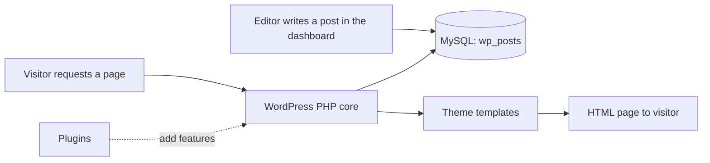

# Session 01: Introduction to CMS and WordPress

> Module: Build and Manage Websites with CMS · Term 2 (DISM) · ⏱ ~2 hours

## 🎯 Learning Objectives

By the end of this session you will be able to:

- Explain what a Content Management System is and how it works
- Compare WordPress, Joomla, Drupal and Shopify
- Distinguish WordPress.com from WordPress.org
- Describe WordPress user roles
- Identify real-world uses and key features of WordPress

## 📖 Concepts Explained

### 1. What is a CMS?

A **Content Management System** lets people create and manage website content through an admin dashboard instead of editing HTML files. Behind the scenes it is a web application (WordPress = PHP + MySQL) that stores content in a database and renders it through a **theme**.

Benefits: no coding needed for daily updates, separation of content and design, multiple users with permissions, huge plugin/theme ecosystems, built-in SEO-friendly URLs and media handling.

### 2. Popular CMSs

| CMS | Strength | Best for | Hosting |
|---|---|---|---|
| **WordPress** | easiest, largest ecosystem (≈40%+ of all websites) | blogs, business sites, WooCommerce stores | self-hosted or managed |
| Joomla | flexible user/permission system, multilingual built in | community portals | self-hosted |
| Drupal | enterprise-grade structure and security | government, universities | self-hosted |
| Shopify | all-in-one hosted e-commerce | online shops | hosted SaaS (monthly fee) |

### 3. WordPress.com vs WordPress.org

| WordPress.com | WordPress.org (self-hosted) |
|---|---|
| hosted service by Automattic | free software you install on your own hosting |
| quick start, limited control on free/low plans | full control: any theme, plugin, code |
| ads/branding on free plan | you pay for domain and hosting |

In this module we use **self-hosted WordPress.org** on a local server.

### 4. User roles

| Role | Can do |
|---|---|
| Administrator | everything: settings, plugins, themes, users |
| Editor | publish and manage all posts/pages, including others' |
| Author | publish and manage own posts, upload media |
| Contributor | write own posts but cannot publish |
| Subscriber | manage own profile, read |

Principle: give each person the **lowest** role that lets them do their job.

### 5. Key WordPress features

Block editor (Gutenberg), Site Editor for block themes, media library, menus, widgets, custom post types, REST API, automatic updates, multisite, thousands of free themes and plugins.

## 🧪 Lab Practice

1. Fill the CMS comparison worksheet below for WordPress, Joomla and Drupal (installation effort, learning curve, extensions, typical users, cost).
2. Explore the demo of three WordPress sites in different categories (blog, shop, portfolio) and note which features you see (menus, search, forms, galleries).
3. On https://wordpress.org/showcase/ find two famous sites built with WordPress.
4. Write a one-paragraph recommendation for a local bakery: WordPress.com, WordPress.org or Shopify, and why.
5. List which role you would give to: a guest blogger, a marketing manager, a site owner, a newsletter reader.

## 📝 Assignment

Prepare `cms-comparison.md` with a 6-row comparison table of WordPress, Joomla, Drupal and Shopify, and a short recommendation for three different clients (school, clothing brand, personal blog).

## ❓ Quick Quiz

1. What does CMS stand for?
   - a) Content Management System
   - b) Code Managing Software
   - c) Central Media Server
   - d) Cascading Menu Style
2. Which WordPress role can write but not publish?
3. Which is self-hosted: WordPress.com or WordPress.org?
4. Which CMS is a hosted e-commerce platform?
5. Which languages/database does WordPress use?

Show answers

1. a) Content Management System
2. Contributor
3. WordPress.org
4. Shopify
5. PHP and MySQL/MariaDB.

## 💼 Interview Questions

1. **Why would a business choose a CMS over a hand-coded site?**

   

Model answer

   Non-technical staff can update content, development is faster and cheaper, and features come from themes and plugins.

   

2. **Explain WordPress user roles.**

   

Model answer

   Administrator, Editor, Author, Contributor and Subscriber form a hierarchy of capabilities from full control down to profile-only access.

   

3. **When would you not use WordPress?**

   

Model answer

   For highly custom web applications with complex business logic, or when a hosted platform like Shopify better fits a store owner with no technical support.

   

## ✅ Summary

- A CMS separates content (database) from presentation (theme).
- WordPress dominates thanks to ease of use and its ecosystem.
- WordPress.org = self-hosted and fully controllable.
- Assign the lowest role that does the job.

---

[⬅ Previous](../README.md) · [🏠 Module Home](../README.md) · [Next ➡](../Session-02-Setting-Up-WordPress/README.md)

Prepared by Zeeshan Abbas · Aptech Learning North Nazimabad
