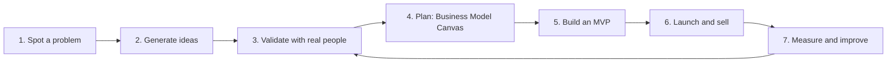

# Session 01: Fundamentals of Entrepreneurship

> Module: A Millennials Guide to Entrepreneurship · Term 2 (DISM) · ⏱ ~2 hours

## 🎯 Learning Objectives

By the end of this session you will be able to:

- Define an entrepreneur and entrepreneurship in your own words
- Classify the main types of entrepreneurship with local examples
- List the characteristics of successful entrepreneurs
- Explain the step-by-step process of starting a venture
- Describe what makes millennial and Gen-Z entrepreneurs different
- Map an idea on a Business Model Canvas and outline a short pitch

## 📖 Concepts Explained

### 1. Entrepreneur vs entrepreneurship

An **entrepreneur** is a person who spots a problem, takes a risk, and organises people, money and tools to solve it for profit (or for social good). **Entrepreneurship** is the *process* of doing that: finding the idea, testing it, launching it and growing it.

Analogy: a cook follows a recipe; an entrepreneur notices people in the area want healthy lunch, writes a new recipe, opens a stall and keeps improving it from customer feedback.

| Employee mindset | Entrepreneur mindset |
|---|---|
| Waits for tasks | Looks for problems to solve |
| Fixed salary, low risk | Variable income, higher risk and reward |
| Responsible for a part | Responsible for the whole result |
| Learns the job | Learns sales, money, people and product |

### 2. Types of entrepreneurship

| Type | Idea in one line | Pakistan-style example |
|---|---|---|
| Small business | Serve a local market, steady income | A computer repair shop, a home bakery |
| Scalable startup | Build something that can grow fast with investment | A ride-hailing or online grocery app |
| Social | Solve a social problem; profit is a tool, not the goal | Low-cost tutoring for out-of-school children |
| Intrapreneurship | Act like a founder *inside* a company | A developer who launches a new product line at work |
| Digital / online | Business runs mainly on the internet | A Shopify or Daraz store, a YouTube channel |
| Freelancing / solopreneur | One person sells skills as a service | A WordPress developer on Fiverr |
| Franchise | Run a proven brand under licence | A branch of a known food chain |

### 3. Characteristics of successful entrepreneurs

- **Problem-focused:** they fall in love with the customer's problem, not their own idea.
- **Resilient:** they treat failure as data, not as the end.
- **Calculated risk-taker:** small tests first, big bets later.
- **Self-disciplined:** no boss is watching, so they set their own deadlines.
- **Good communicator:** they can explain the idea to customers, team and investors.
- **Money-aware:** they know their costs, prices and cash in hand.
- **Lifelong learner:** they read, ask and adapt quickly.

### 4. The entrepreneurial process



| Step | What you actually do |
|---|---|
| Spot a problem | Talk to people; note complaints you hear again and again |
| Generate ideas | List 10 ways to solve it; pick the 2 easiest to test |
| Validate | Interview 10–15 possible customers; ask what they pay for today |
| Plan | Fill a one-page Business Model Canvas |
| MVP | Build the *smallest* version that delivers value (a landing page, a WhatsApp order form) |
| Launch | Get the first 10 paying customers by hand |
| Improve | Measure sales and feedback, then repeat the loop |

**MVP** = Minimum Viable Product. For a web developer it may simply be one demo website and one Fiverr gig.

### 5. Millennial and Gen-Z entrepreneurs

Millennials (born roughly 1981–1996) and Gen-Z (1997–2012) start businesses differently from earlier generations:

- **Digital-first:** they launch online with a phone and a laptop, often with no office.
- **Purpose-driven:** they want the business to mean something, not only earn.
- **Side hustle to full-time:** many start alongside study or a job.
- **Community and content:** they grow through social media, not big ad budgets.
- **Flexible work:** remote teams, freelancers and co-working spaces.
- **Fast learners:** YouTube, online courses and AI tools replace expensive training.

Challenges they face: little starting capital, little business experience, and comparing themselves to "overnight success" stories online.

### 6. Starting legally in Pakistan (the basics)

| Form | When it suits you | Where |
|---|---|---|
| Sole proprietor | You alone, small scale, freelancing | Get an NTN from FBR (IRIS portal) |
| Partnership | 2+ people sharing profit | Registrar of Firms in your province |
| Single Member Company (SMC-Pvt) | You alone but want a company and limited liability | SECP online registration |
| Private Limited (Pvt Ltd) | Co-founders, investors | SECP online registration |

Rules and fees change, so always confirm on the official [SECP](https://www.secp.gov.pk/) and [FBR](https://www.fbr.gov.pk/) websites. Karachi also has incubators (for example the National Incubation Center) that support early founders.

## 💻 Templates (Practical Files)

This is a non-coding session. Instead of code, the folder contains two ready-to-use templates:

| File | Use it for |
|---|---|
| `business-model-canvas.md` | Describe your whole business on one page (9 blocks) |
| `pitch-outline.md` | Prepare a 3–5 minute pitch with 8 slides |

The nine canvas blocks at a glance:

```text
Key Partners | Key Activities | Value Proposition | Customer Relationships | Customer Segments
             | Key Resources  |                   | Channels               |
Cost Structure                          | Revenue Streams
```

**How it works:** start in the middle with the **Value Proposition** (what problem you solve), then the right side (who the customer is and how you reach them), then the left side (what you need to deliver it), and finally the money blocks at the bottom.

## 🧪 Lab Practice

1. **Problem hunt (15 min):** write 10 problems you or your family faced this month (shopping, transport, school, bills). Circle the 2 that many people share.
2. **Type sort:** for each of these, write which type of entrepreneurship it is: a tuition academy, a Fiverr logo designer, a food delivery app, a clean-water NGO, a franchise pizza outlet.
3. **Interview:** ask 3 classmates about one circled problem. Record what they do today and what they would pay to fix it.
4. **Canvas:** fill `business-model-canvas.md` for your best idea, using short bullet points only.
5. **Elevator pitch:** using `pitch-outline.md`, say your idea in 60 seconds to a partner. Swap and give one improvement each.

## 📝 Assignment

Choose one business idea that uses your web development skills. Submit a completed Business Model Canvas plus a 1-page "validation note" summarising interviews with at least 5 possible customers (what they said, what surprised you, what you will change).

## ❓ Quick Quiz

1. What does MVP stand for?
   - a) Most Valuable Player
   - b) Minimum Viable Product
   - c) Maximum Value Plan
   - d) Market Validation Process
2. A developer who launches a new product inside her company is an example of which type?
3. Which canvas block should you usually fill first?
4. Name two traits of a successful entrepreneur.
5. Which body registers private limited companies in Pakistan?

<details>
<summary>Show answers</summary>

1. b) Minimum Viable Product
2. Intrapreneurship
3. Value Proposition (the problem you solve)
4. Any two: resilience, problem focus, discipline, communication, money awareness, calculated risk-taking, learning.
5. SECP (Securities and Exchange Commission of Pakistan)

</details>

## 💼 Interview Questions

1. **Tell us about a time you showed entrepreneurial thinking.**

   <details><summary>Model answer</summary>

   Use a short STAR story: a Situation with a problem, the Task you took on, the Action (for example, building a small site or tool on your own initiative) and the measurable Result.

   </details>

2. **What is the difference between a small business and a startup?**

   <details><summary>Model answer</summary>

   A small business aims for steady local profit and grows slowly; a startup searches for a repeatable, scalable model and aims to grow fast, often with outside investment.

   </details>

3. **Why validate an idea before building it?**

   <details><summary>Model answer</summary>

   To avoid spending months building something nobody pays for. Talking to customers and testing a cheap MVP gives evidence before big time or money is spent.

   </details>

## ✅ Summary

- An entrepreneur solves a problem and takes the risk of doing it.
- Types include small business, startup, social, intrapreneur, digital, freelancer and franchise.
- Follow the loop: problem → idea → validate → plan → MVP → launch → improve.
- Millennial founders are digital-first, purpose-driven and often start as a side hustle.
- One page (the canvas) and one short story (the pitch) are enough to start.

---

[⬅ Previous](../README.md) · [🏠 Module Home](../README.md) · [Next ➡](../Session-02-Team-Collaboration/README.md)

<sub>Prepared by Zeeshan Abbas · Aptech Learning North Nazimabad</sub>
