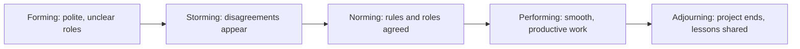

# Session 02: Team Collaboration

> Module: A Millennials Guide to Entrepreneurship · Term 2 (DISM) · ⏱ ~2 hours

## 🎯 Learning Objectives

By the end of this session you will be able to:

- Describe what a team is and what a team leader does
- Explain team norms and how to agree on them
- List and explain the common types of team players
- Explain the characteristics and key factors of a successful team
- Collaborate effectively with millennial and Gen-Z teammates, including remote work
- Write a simple team charter for a project

## 📖 Concepts Explained

### 1. Group vs team

A **group** is people in the same place. A **team** is people working toward **one shared goal**, depending on each other, and sharing responsibility for the result.

| Group | Team |
|---|---|
| Individual goals | One shared goal |
| "My marks" | "Our result" |
| Work is divided and forgotten | Work is divided, then integrated and checked together |
| Leader decides everything | Leader guides; members contribute ideas |

Analogy: passengers in a bus are a group; a cricket XI is a team.

### 2. The team leader

A good team leader is not the person who does all the work. The leader:

- Keeps the **goal** clear and reminds everyone of it
- **Assigns** tasks based on strengths
- **Removes blockers** (missing access, unclear requirements)
- Runs short, focused **meetings**
- Handles **conflict** early and fairly
- Gives **credit** to the team and takes responsibility for problems

Leadership styles you will meet:

| Style | Description | When it works |
|---|---|---|
| Directive | Leader decides and instructs | Emergencies, very new teams |
| Democratic | Team discusses, leader decides | Most student and startup projects |
| Servant | Leader supports and coaches | Experienced, self-driven teams |

### 3. Stages of team development



Storming is normal. Teams that write norms early pass through it faster.

### 4. Team norms

**Norms** are the agreed rules of how a team works. Write them down on day one.

| Area | Example norm |
|---|---|
| Communication | "Reply on the WhatsApp group within 12 hours." |
| Meetings | "15-minute stand-up every Monday and Thursday at 8 pm on Google Meet." |
| Tasks | "Every task lives on the Trello board with an owner and a due date." |
| Code | "No one pushes directly to `main`; use a branch and ask for review." |
| Decisions | "Discuss, then vote; the leader breaks a tie." |
| Conflict | "Raise issues privately first, never in front of the client." |

### 5. Types of team players

| Player type | Strength | Watch out for |
|---|---|---|
| **Contributor** (task-focused) | Delivers quality work, shares data | Can get lost in details |
| **Collaborator** (goal-focused) | Keeps everyone aimed at the big goal | May ignore small tasks |
| **Communicator** (people-focused) | Listens, builds trust, resolves tension | May avoid hard decisions |
| **Challenger** (questions everything) | Pushes for better ideas, spots risks | Can sound negative |

A balanced team has all four. In a 4-person eProject team, try to mix them deliberately.

### 6. What makes a team successful

- **Clear goal** that everyone can repeat in one sentence
- **Defined roles** (who owns frontend, backend, database, documentation)
- **Trust and psychological safety**: people can admit mistakes
- **Open communication** with the right tools
- **Accountability**: deadlines are visible and tracked
- **Diversity of skills and views**
- **Celebration** of small wins

### 7. Collaborating with millennials and Gen-Z

| They value | So the team should |
|---|---|
| Purpose | Explain *why* a task matters |
| Feedback | Give quick, frequent feedback, not once a term |
| Flexibility | Judge by results, allow flexible hours where possible |
| Technology | Use shared boards, cloud docs and chat instead of paper |
| Learning | Rotate tasks so people learn new skills |

**Remote collaboration toolkit:**

| Need | Free tool |
|---|---|
| Chat | WhatsApp group, Slack, Discord |
| Meetings | Google Meet, Zoom, Microsoft Teams |
| Tasks | Trello, GitHub Projects |
| Documents | Google Docs/Sheets |
| Code | Git + GitHub with pull requests |

## 💻 Templates (Practical Files)

This is a non-coding session. The folder contains `team-charter-template.md`, a one-page agreement your team fills on day one of any project (including the eProject).

A Trello board for a 2-week project can be as simple as:

```text
| Backlog            | To Do (this week)  | Doing          | Review           | Done            |
| Contact page       | Login form (Ali)   | DB design (Sana)| Navbar (Hamza)   | Wireframes      |
| Admin reports      | Product list (Ayesha)|               |                  | Repo created    |
```

**How it works:** every card has one owner. Cards move left to right. In each stand-up, everyone answers three questions: *What did I finish? What will I do next? What is blocking me?*

## 🧪 Lab Practice

1. **Form teams of 3–4.** Each member takes a short online "team role" self-check or simply writes which of the four player types they are most like, and why.
2. **Write norms:** agree on at least 6 norms (communication, meetings, tasks, code, decisions, conflict).
3. **Fill the charter:** complete `team-charter-template.md` together, including roles and a RACI row for one deliverable.
4. **Set up a board:** create a free Trello board with five columns and add 8 cards for a mini website project.
5. **Role play conflict:** one member misses two deadlines. Practise a calm, private conversation using "I noticed… / The impact is… / Can we agree…?"

## 📝 Assignment

Submit your team's completed charter and a screenshot of your task board with at least 10 cards and owners. Add a half-page reflection: which stage of team development are you in, and what one norm will help you most?

## ❓ Quick Quiz

1. Which stage comes after Storming?
   - a) Forming
   - b) Performing
   - c) Norming
   - d) Adjourning
2. What is a team norm?
3. Which player type focuses on people and trust?
4. Name three questions asked in a stand-up meeting.
5. Give one tool for tracking tasks in a remote team.

<details>
<summary>Show answers</summary>

1. c) Norming
2. An agreed rule about how the team works (communication, meetings, decisions, etc.).
3. The Communicator
4. What did I finish? What will I do next? What is blocking me?
5. Trello, GitHub Projects (any similar task board).

</details>

## 💼 Interview Questions

1. **Describe a conflict in a team and how you handled it.**

   <details><summary>Model answer</summary>

   Use STAR: explain the disagreement, that you spoke privately and calmly, focused on the shared goal and facts, agreed a clear next step, and what the result was for the project.

   </details>

2. **What role do you usually play in a team?**

   <details><summary>Model answer</summary>

   Name one player type honestly, give an example of it helping a project, and mention how you balance its weakness (for example, a contributor who now shares progress early).

   </details>

3. **How do you keep a remote team productive?**

   <details><summary>Model answer</summary>

   Clear written goals, a shared task board, short regular stand-ups, agreed response times, and judging people by delivered results rather than hours online.

   </details>

## ✅ Summary

- A team shares one goal and one result; a group does not.
- Leaders clarify goals, assign by strengths and remove blockers.
- Teams go through forming, storming, norming, performing and adjourning.
- Written norms and a team charter prevent most conflicts.
- Balance contributors, collaborators, communicators and challengers.
- Millennial teams work best with purpose, feedback, flexibility and good tools.

---

[⬅ Previous](../Session-01-Fundamentals-of-Entrepreneurship/README.md) · [🏠 Module Home](../README.md) · [Next ➡](../Session-03-Digital-Transformation/README.md)

<sub>Prepared by Zeeshan Abbas · Aptech Learning North Nazimabad</sub>
