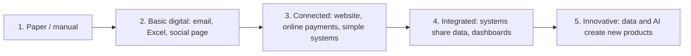

# Session 03: Digital Transformation

> Module: A Millennials Guide to Entrepreneurship · Term 2 (DISM) · ⏱ ~2 hours

## 🎯 Learning Objectives

By the end of this session you will be able to:

- Describe digital transformation and how it differs from simply "using computers"
- Explain why businesses need to transform digitally
- List and explain the key areas and stages of digital transformation
- Explain the factors that drive digital transformation
- Identify technologies commonly used, and where a web developer fits in

## 📖 Concepts Explained

### 1. What is digital transformation?

**Digital transformation** means using digital technology to change *how a business works and delivers value* to customers, not just putting old processes on a computer.

It helps to separate three words:

| Term | Meaning | Example: a tuition academy |
|---|---|---|
| **Digitisation** | Turn paper into digital data | Scan the attendance register into Excel |
| **Digitalisation** | Use digital tools to improve a process | Send fee reminders by WhatsApp automatically |
| **Digital transformation** | Rethink the business model with technology | Launch online classes, an app with recorded lectures and online fee payment, reaching students in other cities |

Analogy: digitisation is taking a photo of a recipe; transformation is opening a cloud kitchen that takes orders through an app.

### 2. Why it is needed

- **Customer expectations:** people want to order, pay and get support from their phone, 24/7.
- **Competition:** a competitor with online ordering takes customers who will not call or visit.
- **Efficiency:** automation cuts errors and repetitive work.
- **Data-driven decisions:** sales and website data show what works.
- **Reach:** a small Karachi shop can sell across Pakistan or abroad.
- **Resilience:** businesses that were online survived lockdowns far better.

In Pakistan, digital payments (mobile wallets such as JazzCash and Easypaisa, and the State Bank's instant payment system **Raast**), e-commerce marketplaces and online government services have pushed even small businesses to go digital.

### 3. Key areas of digital transformation

| Area | What changes | Example |
|---|---|---|
| **Customer experience** | How customers find, buy and get support | Website, online booking, chatbot, WhatsApp Business |
| **Operations / processes** | How internal work is done | Inventory system, online forms, automated invoices |
| **Business model** | How the business earns | From shop sales to subscriptions or online courses |
| **Culture and people** | How staff think and learn | Training staff on new tools, data-sharing mindset |
| **Data and analytics** | How decisions are made | Dashboards from sales data, Google Analytics |

### 4. Stages of digital transformation



| Stage | Signs | Next step a developer could offer |
|---|---|---|
| 1 Manual | Paper registers, cash only | A simple Google Form and spreadsheet |
| 2 Basic | Facebook page, Excel | A WordPress website with contact form |
| 3 Connected | Website + online payment | A PHP/Laravel order or booking system |
| 4 Integrated | Systems linked | Admin dashboard with reports, APIs between systems |
| 5 Innovative | Data drives products | Recommendations, chatbots, AI features |

Most small businesses around you are at stage 1 or 2. That gap is your market.

### 5. Drivers of digital transformation

| Driver | Explanation |
|---|---|
| Customer demand | Customers expect convenience and speed |
| Cheap smartphones and internet | Mobile internet makes online services reachable |
| Cloud computing | Rent servers and software monthly instead of buying |
| Competition and startups | New players force older businesses to adapt |
| Government and regulation | Online tax filing, digital payment push, e-government services |
| Cost pressure | Automation saves salaries and errors |
| Crises | Events like the pandemic made remote work and online sales urgent |

### 6. Common technologies

| Technology | Simple meaning | Term 2 link |
|---|---|---|
| Web and mobile apps | Customer-facing systems | PHP, Laravel, JavaScript, WordPress |
| Cloud | Hosting and storage on demand | Deploying your PHP app online |
| Databases and APIs | Store data and connect systems | MySQL, JSON APIs |
| Data analytics | Turn data into insight | Dashboards, Google Analytics |
| Artificial intelligence | Systems that predict or generate | Chatbots, recommendations |
| Internet of Things (IoT) | Connected sensors and devices | Smart meters, fleet tracking |
| Automation (RPA) | Software robots for repetitive tasks | Auto-generated invoices and emails |
| Cybersecurity | Protecting data and systems | Password hashing, HTTPS, backups |

### 7. A simple transformation plan for a small business

1. **Assess** where the business is today (use the checklist in this folder).
2. **Pick one pain point** that costs the most time or customers.
3. **Choose a small digital fix** and launch it in weeks, not months.
4. **Train the staff** and collect feedback.
5. **Measure** (orders, time saved, complaints) and pick the next step.

## 💻 Templates (Practical Files)

This is a non-coding session. The folder contains `digital-readiness-checklist.md`, a 20-point checklist you can use with a real shop or office to score its digital stage and suggest next steps.

Scoring guide used in the checklist:

```text
0–5 ticks   -> Stage 1 (manual)      : start with a social page + Google Form
6–10 ticks  -> Stage 2 (basic)       : offer a website with contact/booking form
11–15 ticks -> Stage 3 (connected)   : offer an online system (orders, payments)
16–20 ticks -> Stage 4–5 (integrated): offer dashboards, integrations, AI features
```

**How it works:** each tick is one digital practice the business already has. The total shows its stage, and the stage tells you which service to propose.

## 🧪 Lab Practice

1. **Three words:** for a pharmacy, write one example each of digitisation, digitalisation and digital transformation.
2. **Field check:** use `digital-readiness-checklist.md` with a real local business (family shop, clinic, academy). Record its score and stage.
3. **Pain point:** interview the owner or staff for 5 minutes. What wastes the most time?
4. **Proposal sketch:** design one digital fix (a page, a form, a small PHP system). Draw a quick wireframe.
5. **Tech match:** list which Term 2 technologies you would use to build it.

## 📝 Assignment

Write a 1–2 page **Digital Transformation Proposal** for the business you assessed: current stage and score, top 2 pain points, your proposed solution with a wireframe, technologies, a 4-week rollout plan, and how success will be measured.

## ❓ Quick Quiz

1. Scanning paper files into PDFs is an example of:
   - a) Digital transformation
   - b) Digitisation
   - c) Digitalisation
   - d) Automation
2. Name two key areas of digital transformation.
3. What is Raast?
4. Give two drivers of digital transformation.
5. Which stage describes a business whose systems share data and show dashboards?

<details>
<summary>Show answers</summary>

1. b) Digitisation
2. Any two: customer experience, operations, business model, culture and people, data and analytics.
3. Pakistan's instant digital payment system run by the State Bank of Pakistan.
4. Any two: customer demand, cheap smartphones/internet, cloud, competition, government policy, cost pressure, crises.
5. Stage 4: Integrated.

</details>

## 💼 Interview Questions

1. **What is the difference between digitisation and digital transformation?**

   <details><summary>Model answer</summary>

   Digitisation converts information into digital form; digital transformation uses technology to change processes and the business model itself to deliver new value.

   </details>

2. **Why do many digital transformation projects fail?**

   <details><summary>Model answer</summary>

   They focus on tools instead of people and goals: no clear problem, no staff training, too big a launch at once and no measurement of results.

   </details>

3. **How can a web developer contribute to a company's digital transformation?**

   <details><summary>Model answer</summary>

   By building customer-facing websites and booking systems, internal tools that replace paper, APIs that connect systems, and dashboards that turn data into decisions.

   </details>

## ✅ Summary

- Digital transformation changes how a business works and earns, not just its tools.
- It is driven by customers, cheap internet, cloud, competition, government and cost.
- Key areas: customer experience, operations, business model, culture, data.
- Businesses move through five stages; most local businesses are early, which is an opportunity.
- Start small: one pain point, one fix, measure, repeat.

---

[⬅ Previous](../Session-02-Team-Collaboration/README.md) · [🏠 Module Home](../README.md) · [Next ➡](../Session-04-Social-Media-Platforms-and-Impact/README.md)

<sub>Prepared by Zeeshan Abbas · Aptech Learning North Nazimabad</sub>
