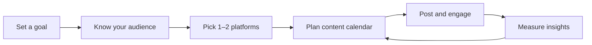

# Session 04: Social Media Platforms and their Impact

> Module: A Millennials Guide to Entrepreneurship · Term 2 (DISM) · ⏱ ~2 hours

## 🎯 Learning Objectives

By the end of this session you will be able to:

- Describe social media and why it matters to businesses
- List and explain the different types of social media platforms
- Explain how to use social media to build, market and grow a business
- Plan content with a simple content calendar and measure results
- Add Open Graph tags so your website looks good when shared
- Describe well-known social media success stories and what made them work

## 📖 Concepts Explained

### 1. What is social media?

**Social media** are online platforms where users create, share and react to content and connect with each other. For a business, it is a shop window, a customer service desk and a marketing channel, all in one app on the customer's phone.

Key difference from traditional media (TV, newspapers): it is **two-way**. Customers can reply, review, share and complain in public.

### 2. Types of social media

| Type | Purpose | Examples | Best for |
|---|---|---|---|
| Social networks | Connect with friends and pages | Facebook | Local businesses, community groups |
| Professional networks | Careers and B2B | LinkedIn | Freelancers, software houses, hiring |
| Media sharing (photo/short video) | Visual content | Instagram, TikTok | Food, fashion, design, lifestyle |
| Video platforms | Long-form video | YouTube | Tutorials, reviews, courses |
| Microblogging | Short updates and news | X (Twitter), Threads | News, tech, public conversation |
| Messaging | Private and group chat | WhatsApp, Telegram | Orders, customer support |
| Discussion forums | Questions and communities | Reddit, Quora, Stack Overflow | Expert reputation, research |
| Review platforms | Ratings and reviews | Google Business Profile reviews | Trust for local businesses |

### 3. Impact of social media on business

| Positive impact | Risk / negative impact |
|---|---|
| Free or low-cost reach | A bad review or post can go viral |
| Direct contact with customers | Needs constant time and content |
| Targeted ads by age, city, interest | Algorithm changes can drop reach overnight |
| Fast feedback on products | Fake news and fake accounts |
| Builds brand and trust | Privacy and data concerns |
| Generates leads and sales | Addictive use and comparison stress for creators |

### 4. How to leverage social media in business



**Step 1: Set a SMART goal.** Example: "Get 20 website enquiries from Instagram in 30 days."

**Step 2: Know your audience.** Who are they, which apps do they use, when are they online?

**Step 3: Choose platforms wisely.** Two well-run platforms beat five dead ones. A freelance developer: LinkedIn + GitHub. A home bakery: Instagram + WhatsApp Business.

**Step 4: Plan content with the 4E mix.**

| Content type | Share | Example for a web developer |
|---|---|---|
| **Educate** | ~40% | "3 signs your website is slow" carousel |
| **Engage** | ~20% | Poll: "Which homepage design do you prefer?" |
| **Entertain / behind the scenes** | ~20% | Short video of your work setup |
| **Earn (promote)** | ~20% | "Clinic websites from 7 days, DM to book" |

**Step 5: Engage.** Reply to comments and messages quickly. Social media is a conversation.

**Step 6: Measure.** Use the free **Insights/Analytics** in each app.

| Metric | Meaning |
|---|---|
| Reach | How many unique people saw the post |
| Impressions | How many times it was shown |
| Engagement rate | (likes + comments + shares + saves) ÷ reach × 100 |
| Click-through rate (CTR) | Clicks ÷ impressions × 100 |
| Conversions | Enquiries, sign-ups or sales from social media |

Example: 50 interactions on a post with 1,000 reach = 5% engagement rate.

**Paid ads basics:** start small (a low daily budget), target one city and one audience, test two images, and keep the one with the better cost per enquiry.

### 5. Personal branding for millennials

For freelancers, **you** are the brand:

- Same name, photo and short bio across LinkedIn, GitHub, Fiverr/Upwork
- Post your projects with a screenshot and what problem it solved
- Share what you learn each week (it shows growth and builds trust)
- Be professional: no arguments or offensive posts on public profiles

### 6. Success stories and lessons

| Story type | What happened | Lesson |
|---|---|---|
| Home-based food or fashion brands on Instagram | Many Pakistani home businesses started with a phone and an Instagram page, then grew to delivery across the city | Great photos, consistent posting and fast WhatsApp replies can replace a shop |
| Tech educators on YouTube | Urdu/Hindi programming channels built huge audiences by teaching free, then launched paid courses | Give value first, monetise later |
| Global brands such as Airbnb | Used user photos and stories to build trust | User-generated content is powerful and free |
| Freelancers on LinkedIn | Developers who post project case studies get inbound client messages | Show work publicly; clients come to you |

Common thread: **consistency, real value and genuine engagement**, not luck.

## 💻 Code Examples

### Open Graph and Twitter Card meta tags (`og-meta-tags.html`)

When someone shares your website link on Facebook, WhatsApp or LinkedIn, these tags control the title, description and image in the preview.

```html
<!DOCTYPE html>
<html lang="en">
<head>
  <meta charset="UTF-8">
  <meta name="viewport" content="width=device-width, initial-scale=1.0">
  <title>Sana Web Studio | Websites for Clinics</title>

  <!-- Normal description for search engines -->
  <meta name="description" content="Fast, mobile-friendly clinic websites in Karachi.">

  <!-- Open Graph: used by Facebook, WhatsApp, LinkedIn -->
  <meta property="og:title" content="Sana Web Studio | Websites for Clinics">
  <meta property="og:description" content="Mobile-friendly clinic websites with online booking.">
  <meta property="og:image" content="https://www.example.com/images/share-preview.jpg">
  <meta property="og:url" content="https://www.example.com/">
  <meta property="og:type" content="website">

  <!-- Twitter / X card -->
  <meta name="twitter:card" content="summary_large_image">
  <meta name="twitter:title" content="Sana Web Studio | Websites for Clinics">
  <meta name="twitter:image" content="https://www.example.com/images/share-preview.jpg">
</head>
<body>
  <h1>Sana Web Studio</h1>
  <p>Share this page on WhatsApp and see the preview card.</p>
</body>
</html>
```

**How it works:**

- `og:title`, `og:description` and `og:image` decide what appears in the shared preview card.
- `og:image` must be a full public URL (about 1200×630 pixels works well).
- `twitter:card` with `summary_large_image` shows a big image on X.
- Test on a live site with the Facebook Sharing Debugger or LinkedIn Post Inspector.

### Content calendar (`content-calendar.csv`)

A CSV file you can open in Excel or Google Sheets with columns: Date, Platform, Content type (4E), Topic, Format, Caption idea, Call to action, Status. Copy it and plan two weeks of posts.

## 🧪 Lab Practice

1. **Platform match:** for 4 businesses (home bakery, software house, tuition academy, freelancer), choose the best 2 platforms each and justify.
2. **Audit:** pick a local brand's Instagram or Facebook page. Note posting frequency, content types and how fast they reply.
3. **Calendar:** fill `content-calendar.csv` with 10 posts for 2 weeks using the 4E mix.
4. **Design:** make 2 posts in Canva (one Educate, one Earn) for your Session 01 idea.
5. **Share preview:** add the Open Graph tags to one of your earlier websites, upload the share image and test the WhatsApp preview.

## 📝 Assignment

Create a **30-day social media plan** for your business idea: SMART goal, target audience, chosen platforms with reasons, 2-week content calendar, 3 designed sample posts, and the 3 metrics you will track.

## ❓ Quick Quiz

1. Which platform type is LinkedIn?
   - a) Media sharing
   - b) Professional network
   - c) Microblogging
   - d) Forum
2. A post reached 2,000 people and got 100 interactions. What is the engagement rate?
3. What do Open Graph tags control?
4. What does the "E" in the 4E mix stand for? Name any two.
5. Why is it better to run 2 platforms well than 5 poorly?

<details>
<summary>Show answers</summary>

1. b) Professional network
2. 100 ÷ 2,000 × 100 = 5%
3. The title, description and image shown when a link is shared on social media.
4. Educate, Engage, Entertain, Earn.
5. Consistency and engagement matter more than presence; inactive pages hurt trust and waste time.

</details>

## 💼 Interview Questions

1. **How would you measure the success of a social media campaign?**

   <details><summary>Model answer</summary>

   Start from the goal, then track reach, engagement rate, click-through rate and especially conversions (enquiries or sales) and cost per conversion, comparing before and after.

   </details>

2. **How would you handle a negative public comment on a business page?**

   <details><summary>Model answer</summary>

   Reply quickly and politely, acknowledge the issue, move details to a private message, fix the problem and, if appropriate, follow up publicly. Never argue or delete fair criticism.

   </details>

3. **What are Open Graph tags and why should a developer add them?**

   <details><summary>Model answer</summary>

   Meta tags in the page head that define the preview title, description and image when a link is shared, which improves click-through on social platforms.

   </details>

## ✅ Summary

- Social media is two-way: a shop window, support desk and marketing channel.
- Types include networks, professional, media sharing, video, microblogging, messaging, forums and reviews.
- Leverage it with a goal, audience, 1–2 platforms, a content calendar, engagement and measurement.
- Use the 4E content mix and track engagement and conversions.
- Developers should add Open Graph tags so shared links look professional.

---

[⬅ Previous](../Session-03-Digital-Transformation/README.md) · [🏠 Module Home](../README.md) · [Next ➡](../Session-05-Foundations-of-Freelancing/README.md)

<sub>Prepared by Zeeshan Abbas · Aptech Learning North Nazimabad</sub>
