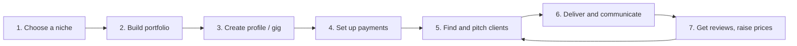

# Session 05: Foundations of Freelancing

> Module: A Millennials Guide to Entrepreneurship · Term 2 (DISM) · ⏱ ~2 hours

## 🎯 Learning Objectives

By the end of this session you will be able to:

- Describe freelancing and list its basic requirements
- Compare major freelance platforms (Fiverr, Upwork, LinkedIn, local clients)
- Follow the steps from choosing a niche to getting paid
- Write a strong profile, gig and proposal
- Set a sensible price and receive payments safely in Pakistan (Payoneer, bank transfer)
- Explain how to stand out as a millennial freelancer

## 📖 Concepts Explained

### 1. What is freelancing?

A **freelancer** is self-employed and sells skills to many clients, project by project, instead of working for one employer. You choose your clients, hours and prices, but you also handle sales, communication, deadlines, payments and taxes yourself.

| Pros | Cons |
|---|---|
| Flexible time and location | Income can be irregular at the start |
| Earn in dollars from global clients | No fixed salary, paid leave or benefits |
| Build your own brand | Strong competition on platforms |
| Learn business skills fast | You must manage time and self-discipline |

Pakistan is one of the world's larger freelancing countries, and IT services exports are a national priority, so the opportunity for web developers is real.

### 2. Basic requirements

| Requirement | Details |
|---|---|
| **A sellable skill** | From Term 2: WordPress sites, PHP/Laravel apps, MySQL work, JavaScript features, landing pages |
| **Portfolio** | 3–5 real or practice projects with live demo links and GitHub code |
| **Equipment** | Laptop, stable internet and a backup (mobile hotspot/UPS for load shedding) |
| **English communication** | Clear, polite written messages; basic speaking for calls |
| **Accounts** | Email, LinkedIn, GitHub, one platform profile, payment account |
| **Identity documents** | Valid CNIC (and matching name everywhere) for verification |
| **Soft skills** | Time management, honesty, handling feedback |

### 3. Popular platforms

| Platform | How it works | Good for beginners? |
|---|---|---|
| **Fiverr** | You create **gigs** (fixed packages); buyers come to you | Yes, with a narrow niche gig |
| **Upwork** | Clients post jobs; you send **proposals** using paid "Connects" | Yes, with a strong profile and targeted proposals |
| **LinkedIn** | Network, post work, get direct client messages | Yes, combined with a platform |
| **Freelancer.com, PeoplePerHour** | Bidding marketplaces | Possible |
| **Local clients** | Shops, clinics, academies near you | Excellent first portfolio projects |

Platforms charge a service fee on your earnings and change their rules often. Always read the current fee and terms in each platform's Help Center.

### 4. Steps to start freelancing



**Step 1: Choose a niche.** "Web developer" is too broad. "WordPress websites for dental clinics" or "Laravel admin dashboards for small businesses" is easier to sell.

**Step 2: Build a portfolio.** 3–5 projects. Use your Term 2 module mini-projects. Each item: screenshot, problem, solution, tech, live link.

**Step 3: Create the profile/gig.** Use the checklist in this folder (`freelancer-profile-checklist.md`).

**Step 4: Set up payments.**

| Method | Notes |
|---|---|
| **Payoneer** | Common for receiving Fiverr and other platform payouts; withdraw to a Pakistani bank account in PKR |
| **Direct bank transfer** | Upwork and some platforms can send to a local bank account |
| **Local clients** | Bank transfer, Raast or mobile wallets; always give an invoice |

Use your own verified name on every account. Never share passwords or verification codes, and never "rent" someone else's account; platforms ban this.

**Step 5: Find clients.** On Upwork, send short, specific proposals within hours of a job being posted. On Fiverr, keep your gig active, reply fast and use clear packages.

**Step 6: Deliver professionally.** Confirm requirements in writing, share progress, deliver on time, and keep all communication on the platform.

**Step 7: Reviews and growth.** Ask for honest feedback, then gradually raise your prices.

### 5. Pricing basics

Start by working out the minimum hourly rate you need, then price each project by estimated hours:

```text
Hourly rate = (monthly target + monthly expenses) / billable hours per month
Project price = estimated hours x hourly rate x 1.2 (20% buffer for revisions)
```

Remember the platform fee is taken out of what the client pays, so include it in your target. A small Python helper is included below.

### 6. Legal and tax basics in Pakistan

- Get an **NTN** from FBR (IRIS portal) and file your annual tax return. Being on the active taxpayer list usually reduces tax deductions on banking.
- Receive foreign income through **official banking channels** (bank, Payoneer to bank) so it counts as IT export remittance.
- Consider **PSEB freelancer registration**, which can bring benefits for registered IT exporters.
- If you grow into an agency, register a company with **SECP** (see Session 01).

Rates and rules change every budget year. Check [FBR](https://www.fbr.gov.pk/) and [PSEB](https://www.pseb.org.pk/) before you file.

### 7. How to stand out as a millennial freelancer

- **Specialise** in one niche and become known for it.
- **Respond fast** and communicate clearly; this alone beats many competitors.
- **Show proof**: case studies, demo videos, GitHub code.
- **Build a personal brand** on LinkedIn (Session 04).
- **Keep learning**: new versions (PHP 8, Laravel 11), AI tools, and free courses on DigiSkills.pk.
- **Under-promise, over-deliver** on time and quality.
- **Build long-term clients**: offer maintenance packages after delivery.

## 💻 Code Examples

### Freelance rate calculator (`rate_calculator.py`)

```python
# rate_calculator.py
# A simple helper to find your minimum hourly rate and a project price.

# Step 1: your numbers (change these)
monthly_target_usd = 400      # money you want to keep each month
monthly_expenses_usd = 60     # internet, electricity, software, hosting
billable_hours = 80           # hours of paid client work per month
platform_fee_percent = 20     # platform service fee (check current rate)

# Step 2: money needed before the platform fee is taken
needed_after_fee = monthly_target_usd + monthly_expenses_usd
needed_before_fee = needed_after_fee / (1 - platform_fee_percent / 100)

# Step 3: minimum hourly rate
hourly_rate = needed_before_fee / billable_hours
print("Minimum hourly rate: $", round(hourly_rate, 2))

# Step 4: price one project
estimated_hours = 15          # e.g. a 5-page WordPress website
buffer = 1.2                  # 20% extra for revisions and calls
project_price = estimated_hours * hourly_rate * buffer
print("Suggested project price: $", round(project_price, 2))
```

**How it works:**

- Step 1 stores your goals in clearly named variables.
- Step 2 grows the amount so that, after the platform fee is removed, you still keep your target.
- Step 3 divides by your paid hours to get the minimum hourly rate.
- Step 4 multiplies estimated hours by the rate and adds a 20% buffer. Run it with `python rate_calculator.py`.

## 🧪 Lab Practice

1. **Niche statement:** complete "I help ___ (client type) to ___ (result) by ___ (service)."
2. **Profile:** draft your title, overview and 3 portfolio items using `freelancer-profile-checklist.md`.
3. **Gig packages:** design Basic / Standard / Premium packages for one service (what is included, delivery days, revisions).
4. **Proposal:** find a real web development job post on Upwork and write a proposal using `proposal-template.md` (do not send unless ready).
5. **Pricing:** edit `rate_calculator.py` with your own numbers and price your Standard package.

## 📝 Assignment

Publish (or fully prepare, if under the platform's age limit) one freelancer profile or Fiverr gig. Submit: profile link or screenshots, your niche statement, 3 portfolio items with live links, your package table, one sample proposal and your rate calculation.

## ❓ Quick Quiz

1. On which platform do you mainly create "gigs" that buyers purchase?
   - a) Upwork
   - b) Fiverr
   - c) LinkedIn
   - d) GitHub
2. Why should you choose a niche?
3. Name one common way Pakistani freelancers receive platform payments.
4. Your target is $500 and you work 100 billable hours. Ignoring fees, what is your hourly rate?
5. Why must you keep communication and payment on the platform?

<details>
<summary>Show answers</summary>

1. b) Fiverr
2. It is easier to stand out, target the right clients and charge more as a specialist.
3. Payoneer (withdraw to a local bank) or direct bank transfer.
4. $5 per hour.
5. Platform rules require it, and it protects you in disputes and payment problems; breaking it can get your account banned.

</details>

## 💼 Interview Questions

1. **How do you manage multiple clients and deadlines?**

   <details><summary>Model answer</summary>

   A task board or calendar with every deadline, realistic estimates with buffers, regular progress updates to clients, and saying no to work that would break existing commitments.

   </details>

2. **How do you handle a client who keeps asking for extra changes?**

   <details><summary>Model answer</summary>

   Refer politely to the agreed scope and revision count, then offer the extra work as a paid add-on or a new milestone, always in writing.

   </details>

3. **Why should we hire you over a more experienced freelancer?**

   <details><summary>Model answer</summary>

   Highlight a focused niche, a relevant portfolio, fast communication, modern skills and a clear plan for the client's project, plus a commitment to deadlines.

   </details>

## ✅ Summary

- Freelancing means selling your skills to many clients as a self-employed professional.
- Basics: a sellable skill, portfolio, equipment, communication, accounts and verified identity.
- Follow the steps: niche → portfolio → profile → payments → clients → delivery → reviews.
- Price from your target, expenses, hours and platform fee; add a buffer.
- Get paid through official channels and keep your tax affairs in order.
- Stand out with specialisation, fast communication, proof of work and continuous learning.

---

[⬅ Previous](../Session-04-Social-Media-Platforms-and-Impact/README.md) · [🏠 Module Home](../README.md) · [Next ➡](../../eProject/README.md)

<sub>Prepared by Zeeshan Abbas · Aptech Learning North Nazimabad</sub>
