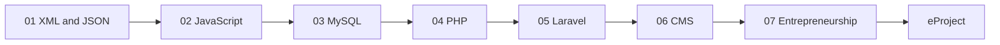

# Term 2: DISM (Diploma in Information Systems Management)

     

> ACCP in AI · Term 2 · 69 module sessions + 10 eProject sessions · ⏱ ~2 hours per session

Term 1 taught you to build good-looking static websites. **Term 2 makes them dynamic.** You will store and exchange data with XML and JSON, write modern JavaScript, design MySQL databases, build server-side applications with PHP and the Laravel framework, manage client websites with WordPress, and learn how to turn these skills into a business or freelancing career. The term ends with a team eProject: a complete PHP/Laravel web application.

## Modules

| No | Module | Sessions | Link |
|---|---|---|---|
| 01 | Data Processing with XML and JSON | 6 | [Open module](./01-Data-Processing-with-XML-and-JSON/README.md) |
| 02 | Programming with JavaScript | 12 | [Open module](./02-Programming-with-JavaScript/README.md) |
| 03 | Working with MySQL | 12 | [Open module](./03-Working-with-MySQL/README.md) |
| 04 | Navigating Dynamic Web Development with PHP | 18 | [Open module](./04-Navigating-Dynamic-Web-Development-with-PHP/README.md) |
| 05 | Laravel Framework for Web Applications using PHP | 8 | [Open module](./05-Laravel-Framework-for-Web-Applications/README.md) |
| 06 | Build and Manage Websites with CMS | 8 | [Open module](./06-Build-and-Manage-Websites-with-CMS/README.md) |
| 07 | A Millennials Guide to Entrepreneurship | 5 | [Open module](./07-A-Millennials-Guide-to-Entrepreneurship/README.md) |
| — | eProject: PHP Web Application Development | 10 | [Open eProject](./eProject/README.md) |

Session counts are taken from the session folders in this repository.

## Learning Outcomes

After completing Term 2 you will be able to:

- Store, validate, transform and exchange data using XML, XSD, XSLT, JSON and JSON Schema
- Write modern, modular JavaScript: classes, modules, async/await, fetch and performance techniques
- Design normalised MySQL databases and write queries with joins, views, procedures and transactions
- Build dynamic, secure PHP 8 applications with forms, sessions, file handling, OOP and PDO
- Develop MVC applications in Laravel 11 with Blade, Eloquent, validation and authentication
- Plan, build, optimise and secure WordPress websites for real clients
- Work in a team, understand digital transformation and start freelancing professionally
- Deliver a complete database-driven web application as a team eProject

## Suggested Study Order

Your centre's timetable may run some modules in parallel (Entrepreneurship is often spread across the term). The order above is the logical skill path if you study on your own.

## eProject

The term ends with a team project of up to 4 students: a PHP/Laravel web application with MySQL, built over 10 sessions from requirements to final demo. Read the [eProject guide](./eProject/README.md) early so you collect ideas and practise the skills it needs while you study the modules.

## How to Study

1. **Set up once:** install XAMPP (or Laragon), Composer, Node.js, VS Code and Git. Each module README lists its tools with official links.
2. **One session at a time:** read the concepts, then type (do not copy-paste) and run every code example from the session folder.
3. **Do the lab:** the lab practice tasks build the hands-on skill; the assignment proves it.
4. **Check yourself:** answer the quiz before opening the answers, then practise the interview questions aloud.
5. **Build the mini-project:** each module ends with one; together they form your portfolio.
6. **Commit to GitHub:** push your practice work weekly; it becomes proof for future employers and clients.
7. **Ask early:** bring questions to class or open an Issue on this repository.

---

[🏠 Repository Home](../README.md)

Prepared by Zeeshan Abbas · Aptech Learning North Nazimabad
