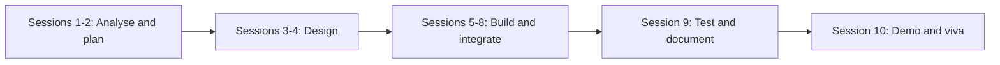

# eProject: PHP Web Application Development

     

> Term 2 (DISM) · 10 sessions (~20 hours) · team project · groups of up to 4 students

## What is the eProject?

The eProject is where everything from Term 2 comes together. Your team receives (or chooses) a real-world problem statement and builds a complete, working **database-driven web application** with PHP and Laravel, MySQL, Bootstrap and JavaScript. You plan it like a small software house: requirements, design, development, testing, documentation and a final demonstration.

It is not an exam you cram for. It is evidence of what you can build, and a strong eProject becomes the first project in your portfolio and freelancing profile (Module 07).

## Skills You Will Use

| Module | Used in the eProject for |
|---|---|
| [01 XML and JSON](../01-Data-Processing-with-XML-and-JSON/README.md) | JSON API responses, import/export, config data |
| [02 JavaScript](../02-Programming-with-JavaScript/README.md) | Form validation, fetch/AJAX, interactive UI |
| [03 MySQL](../03-Working-with-MySQL/README.md) | Normalised schema, keys, joins, views |
| [04 PHP](../04-Navigating-Dynamic-Web-Development-with-PHP/README.md) | Sessions, forms, file uploads, OOP, PDO |
| [05 Laravel](../05-Laravel-Framework-for-Web-Applications/README.md) | MVC, routes, Blade, Eloquent, validation, auth |
| [06 CMS](../06-Build-and-Manage-Websites-with-CMS/README.md) | Ideas for content, SEO and security practices |
| [07 Entrepreneurship](../07-A-Millennials-Guide-to-Entrepreneurship/README.md) | Team charter, collaboration, pitching the final demo |

## Team Rules

- Groups of **up to 4** members (individual projects allowed with faculty approval).
- Fill a [team charter](../07-A-Millennials-Guide-to-Entrepreneurship/Session-02-Team-Collaboration/team-charter-template.md) in the first session.
- Every member must write code and be able to explain any part of the project in the viva.
- Use one shared **GitHub repository**; every member commits from their own account.
- Keep a simple weekly log: what was done, by whom, what is next.

## Phases (10 Sessions)



| Session | Phase | Team goal by the end of the session |
|---|---|---|
| 1 | Kick-off | Problem statement understood, team charter signed, GitHub repo created |
| 2 | Requirements | User roles, feature list (must / should / could), user stories |
| 3 | Design | ER diagram, table list, sitemap, wireframes of key pages |
| 4 | Setup | Laravel project, migrations, seeders, base Blade layout with Bootstrap 5 |
| 5 | Build 1 | Authentication, roles, main CRUD module working |
| 6 | Build 2 | Remaining modules: search, filters, file uploads, relationships |
| 7 | Build 3 | Admin dashboard, reports, JavaScript interactions, JSON endpoint |
| 8 | Integrate | All modules joined, validation and error messages, responsive check |
| 9 | Test & document | Test cases run, bugs fixed, user guide and project report written |
| 10 | Demo | Final presentation, live demo, viva, submission |

## Deliverables Checklist

### Documents
- [ ] Problem definition (in your own words)
- [ ] Requirements: user roles, feature list, user stories
- [ ] ER diagram and table descriptions (fields, types, keys)
- [ ] Sitemap and wireframes for main pages
- [ ] Test cases table (input, expected result, actual result, pass/fail)
- [ ] User guide with screenshots (how to install, log in, use each feature)
- [ ] Project report: introduction, technologies, design, screenshots, challenges, future work
- [ ] Team charter and weekly log

### Software
- [ ] Complete source code in the GitHub repository (no `vendor/` or `node_modules/`; include `composer.json`)
- [ ] `.env.example` (never commit your real `.env`)
- [ ] Database migrations and seeders (or an exported `.sql` file)
- [ ] `README.md` in the project repo with setup steps and default login accounts
- [ ] Application runs on a fresh machine by following the README

### Presentation
- [ ] 8–10 slide presentation (use the [pitch outline](../07-A-Millennials-Guide-to-Entrepreneurship/Session-01-Fundamentals-of-Entrepreneurship/pitch-outline.md) as a guide)
- [ ] Demo script so the live demo flows smoothly
- [ ] Short screen-recorded demo video as a backup (optional but recommended)

## Minimum Technical Requirements

| Area | Requirement |
|---|---|
| Users | Registration, login, logout, at least 2 roles (e.g. admin and customer) |
| Data | At least 6 related tables with foreign keys |
| CRUD | Full create, read, update, delete on main entities |
| Validation | Server-side (Form Requests) and client-side (HTML5/JavaScript) |
| Security | Hashed passwords, CSRF tokens, authorisation on admin routes, no raw SQL from user input |
| UI | Responsive Bootstrap 5 layout that works on a 375 px phone screen |
| Extras (pick 2+) | Search and filters, image upload, pagination, PDF/CSV export, JSON API endpoint, email notification, charts on dashboard |

## Suggested Project Ideas

| # | Project | Key features |
|---|---|---|
| 1 | **Online Bookstore** | Catalogue with categories, cart, orders, admin stock management, order status tracking |
| 2 | **Clinic Appointment System** | Doctors' schedules, patient booking, appointment status, prescriptions history |
| 3 | **Tuition Academy Portal** | Courses, batches, student enrolment, attendance, fee records, results |
| 4 | **Event Ticketing** | Events listing, seat categories, booking with QR code reference, organiser dashboard |
| 5 | **Car Rental Service** | Vehicle listings, availability calendar, bookings, damage notes, invoices |
| 6 | **Recipe Sharing Community** | User recipes with images, ratings, comments, favourites, moderation |
| 7 | **Job Portal** | Employers post jobs, candidates upload CVs and apply, application tracking |
| 8 | **Hostel / PG Management** | Rooms, residents, rent payments, complaints, notices |
| 9 | **Library Management** | Books, members, issue/return, fines, overdue reports |
| 10 | **Local Services Marketplace** | Plumbers/electricians list services, customers book and review |

Your faculty may give an official problem statement instead. Follow the faculty's statement where it differs from this guide.

## Suggested Folder Structure

A standard Laravel 11 project, with your documents in a `docs/` folder:

```text
eproject-bookstore/
├── app/
│   ├── Http/
│   │   ├── Controllers/        # BookController, OrderController, Admin/...
│   │   ├── Middleware/         # e.g. EnsureUserIsAdmin
│   │   └── Requests/           # StoreBookRequest, UpdateBookRequest
│   ├── Models/                 # User, Book, Category, Order, OrderItem
│   └── Policies/
├── database/
│   ├── migrations/
│   ├── seeders/
│   └── factories/
├── public/                     # index.php, images, compiled assets
├── resources/
│   ├── views/
│   │   ├── layouts/app.blade.php
│   │   ├── books/              # index, show, create, edit
│   │   └── admin/
│   ├── css/
│   └── js/
├── routes/
│   ├── web.php
│   └── api.php                 # optional JSON endpoints
├── docs/
│   ├── requirements.md
│   ├── er-diagram.png
│   ├── wireframes/
│   ├── test-cases.md
│   ├── user-guide.pdf
│   └── project-report.pdf
├── .env.example
├── composer.json
└── README.md
```

## Evaluation Tips

What evaluators usually look for, and how to score well:

| Area | Tips |
|---|---|
| **Working application** | A smaller app that works perfectly beats a big one that crashes. Finish must-have features first. |
| **Database design** | Normalised tables, proper keys and relationships; be ready to explain your ER diagram. |
| **Code quality** | Meaningful names, controllers kept thin, validation in Form Requests, no copy-pasted blocks. |
| **Security** | Show hashed passwords, CSRF protection and that a normal user cannot open admin pages. |
| **UI/UX** | Consistent layout, clear navigation, helpful error messages, mobile friendly. |
| **Documentation** | Clear, complete, with screenshots; setup steps actually work. |
| **Teamwork** | Commits from every member, a weekly log and a fair task split. |
| **Presentation and viva** | Rehearse the demo; each member explains the parts they built and answers "why" questions. |

Common mistakes to avoid:

- Starting to code before the database design is agreed
- One member doing everything (it shows in the viva)
- Committing `.env`, `vendor/` or passwords to GitHub
- Leaving documentation for the last night
- Demoing with empty tables: always seed realistic sample data

---

[⬅ Previous Module](../07-A-Millennials-Guide-to-Entrepreneurship/README.md) · [🏠 Term Home](../README.md)

<sub>Prepared by Zeeshan Abbas · Aptech Learning North Nazimabad</sub>
