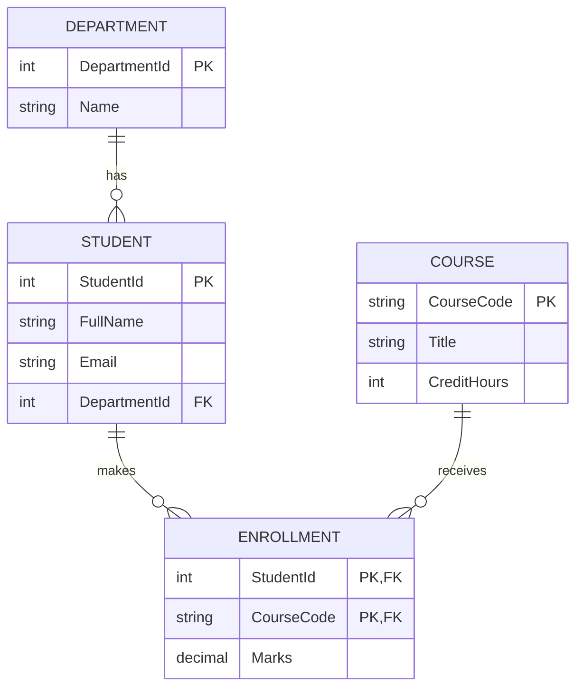

# Session 01: RDBMS Concepts, E-R Model and Normalization

> Module: Effective Data Solutions with SQL Server · Term 3 (HDSE I) · ⏱ ~2 hours

## 🎯 Learning Objectives

By the end of this session you will be able to:

- Explain the difference between data, information and a database
- Compare file-based storage with a Database Management System (DBMS)
- Describe the main database models and why the relational model won
- Read and draw an Entity-Relationship (E-R) diagram with correct relationships
- Normalize a messy table into 1NF, 2NF and 3NF
- Use relational operators (select, project, join, union) in plain language

## 📖 Concepts Explained

### 1. Data vs Information vs Database

| Term | Meaning | Example |
|---|---|---|
| **Data** | Raw facts with no context | `92`, `Ali`, `2025-03-14` |
| **Information** | Data that has been processed and has meaning | "Ali scored 92 in the SQL exam on 14 March" |
| **Database** | An organized collection of related data that can be stored, searched and updated | All students, courses and marks of a campus |

Think of a database like a well-organized cupboard: every item has a fixed shelf, so you can find it in seconds instead of searching a pile of papers.

### 2. Ways to Manage Data

| Approach | How it works | Problems |
|---|---|---|
| Manual (registers, files) | Paper records | Slow, easy to lose, hard to search |
| File-based system | Each program keeps its own text/CSV file | Duplicate data, inconsistency, no security, hard to share |
| **DBMS** | One central engine manages all data | Solves most of the above |

### 3. What a DBMS Gives You

A **DBMS** is software that stores data and lets many users and programs work with it safely.

- **Less redundancy** – one fact is stored once
- **Consistency** – rules (constraints) stop bad data
- **Security** – logins, roles and permissions
- **Concurrency** – many users at the same time without corrupting data
- **Backup and recovery** – data survives crashes
- **Query language** – ask questions with SQL instead of writing loops

### 4. Database Models

| Model | Structure | Where you still see it |
|---|---|---|
| Hierarchical | Tree (parent → children) | Windows Registry, XML files |
| Network | Graph (many parents allowed) | Old mainframes |
| **Relational** | Tables with rows and columns linked by keys | SQL Server, MySQL, PostgreSQL, Oracle |
| Document / NoSQL | JSON-like documents | MongoDB, Cosmos DB |

### 5. RDBMS Vocabulary

A **Relational DBMS (RDBMS)** stores data in tables (called *relations*).

| Formal term | Everyday term | Meaning |
|---|---|---|
| Relation | Table | A set of rows about one kind of thing |
| Tuple | Row / record | One item, e.g. one student |
| Attribute | Column / field | One property, e.g. `Email` |
| Domain | Allowed values | e.g. `Gender` can be `M`, `F` or `O` |
| Primary key | ID | Uniquely identifies a row |
| Foreign key | Link | A column that points to a primary key in another table |

**Characteristics of a good table:** every row is unique, column order does not matter, row order does not matter, each cell holds a single value, and every column has one data type.

**DBMS vs RDBMS (quick view):** a plain DBMS may store data as files with no relationships; an RDBMS stores tables, enforces keys and relationships, supports normalization, and serves many users with full ACID transactions.

### 6. The E-R Model

Before creating tables we *model* the data. An **E-R model** has three building blocks:

- **Entity** – a thing we store data about (Student, Course). Drawn as a rectangle.
- **Attribute** – a property of an entity (Name, Email). Drawn as an oval in classic Chen notation.
- **Relationship** – how entities are connected (Student *enrolls in* Course). Drawn as a diamond.

**Relationship types (cardinality):**

| Type | Example | How it becomes tables |
|---|---|---|
| One-to-One (1:1) | Student ↔ LibraryCard | Foreign key with a UNIQUE constraint |
| One-to-Many (1:M) | Department → Students | Foreign key on the "many" side |
| Many-to-Many (M:N) | Students ↔ Courses | A **junction table** (Enrollment) |

Here is our campus model in crow's-foot notation:



### 7. Normalization

**Normalization** is the process of splitting tables so that each fact is stored once. It removes three kinds of *anomalies*:

- **Insert anomaly** – you cannot add a course until a student enrolls in it
- **Update anomaly** – a course title stored 200 times must be changed 200 times
- **Delete anomaly** – deleting the last student of a course deletes the course too

Start with this un-normalized sheet a teacher might keep:

| StudentId | FullName | Dept | Courses |
|---|---|---|---|
| 1 | Ayesha Khan | CS | SQL101 (88), CS201 (75) |
| 2 | Bilal Ahmed | IT | SQL101 (91) |

**First Normal Form (1NF)** – every cell atomic, no repeating groups:

| StudentId | FullName | Dept | CourseCode | Marks |
|---|---|---|---|---|
| 1 | Ayesha Khan | CS | SQL101 | 88 |
| 1 | Ayesha Khan | CS | CS201 | 75 |
| 2 | Bilal Ahmed | IT | SQL101 | 91 |

**Second Normal Form (2NF)** – in 1NF *and* no column depends on only part of a composite key. The key is (StudentId, CourseCode) but `FullName` depends only on `StudentId`, so we split into `Student(StudentId, FullName, Dept)` and `Enrollment(StudentId, CourseCode, Marks)`.

**Third Normal Form (3NF)** – in 2NF *and* no non-key column depends on another non-key column (no *transitive* dependency). If `Student` also stored `DeptHeadName`, that depends on `Dept`, not on the student, so it moves into a `Department` table.

> Memory trick: every non-key column must depend on **the key, the whole key, and nothing but the key**.

**BCNF** (Boyce-Codd) is a slightly stricter 3NF: every determinant must be a candidate key. Most business databases aim for 3NF and denormalize only for reporting speed.

### 8. Relational Operators

| Operator | Plain meaning | SQL you will meet later |
|---|---|---|
| Restrict (Select) | Pick some **rows** | `WHERE` |
| Project | Pick some **columns** | `SELECT col1, col2` |
| Product | Every row × every row | `CROSS JOIN` |
| Join | Combine matching rows | `INNER JOIN` |
| Union | Rows from A or B | `UNION` |
| Intersect | Rows in both A and B | `INTERSECT` |
| Difference | Rows in A not in B | `EXCEPT` |

## 💻 Code Examples

You do not need to know T-SQL syntax yet; read this script to see how the E-R diagram turns into tables. File: `campus_schema.sql`.

```sql
CREATE DATABASE CampusDB;
GO
USE CampusDB;
GO
CREATE TABLE Department (
    DepartmentId INT IDENTITY(1,1) PRIMARY KEY,
    Name         NVARCHAR(50) NOT NULL UNIQUE
);

CREATE TABLE Student (
    StudentId    INT IDENTITY(1,1) PRIMARY KEY,
    FullName     NVARCHAR(100) NOT NULL,
    Email        NVARCHAR(120) NOT NULL UNIQUE,
    DepartmentId INT NOT NULL REFERENCES Department(DepartmentId)
);

CREATE TABLE Course (
    CourseCode  CHAR(6) PRIMARY KEY,
    Title       NVARCHAR(100) NOT NULL,
    CreditHours TINYINT NOT NULL CHECK (CreditHours BETWEEN 1 AND 6)
);

CREATE TABLE Enrollment (
    StudentId  INT     NOT NULL REFERENCES Student(StudentId),
    CourseCode CHAR(6) NOT NULL REFERENCES Course(CourseCode),
    Marks      DECIMAL(5,2) NULL CHECK (Marks BETWEEN 0 AND 100),
    PRIMARY KEY (StudentId, CourseCode)
);
```

**How it works**

- Each entity became one table, each attribute one column.
- `Department → Student` is 1:M, so `Student` holds the foreign key `DepartmentId`.
- `Student ↔ Course` is M:N, so the junction table `Enrollment` has a **composite primary key**.
- `CHECK` constraints enforce domains (marks 0–100, credit hours 1–6).

A second file, `sample_data.sql`, fills these tables so you can practise the operators in later sessions.

## 🧪 Lab Practice

1. On paper, list five entities for a **school library** (Book, Member, Author, Loan, Category) and their key attributes.
2. Mark each relationship as 1:1, 1:M or M:N. Which one needs a junction table?
3. Draw the E-R diagram using crow's-foot notation (pen and paper, draw.io, or a Mermaid block in a `.md` file).
4. Take this un-normalized row and normalize it to 3NF:
   `OrderNo=501, Customer=Sara, City=Karachi, Items="Pen x2, Notebook x1", CityZone=South`.
5. For each table you created, underline the primary key and circle the foreign keys.

## 📝 Assignment

Design a normalized (3NF) database for a **clinic appointment system** (Patient, Doctor, Specialization, Appointment, Prescription). Submit an E-R diagram plus a one-line justification for each table explaining which normal form rule created it.

## ❓ Quick Quiz

1. Which anomaly stops you from adding a course before any student enrolls?
2. A table has composite key (A, B) and column C depends only on A. Which normal form is violated?
3. How is a many-to-many relationship implemented in an RDBMS?
4. Which relational operator picks columns rather than rows?
5. Name two benefits of a DBMS over a file-based system.

<details>
<summary>Show answers</summary>

1. Insert anomaly.
2. 2NF (partial dependency).
3. With a junction (bridge) table holding the two foreign keys.
4. Project.
5. Any two: less redundancy, data integrity, security, concurrency, backup/recovery, query language.

</details>

## 💼 Interview Questions

1. **What is the difference between a primary key and a unique key?** A table has one primary key, which cannot be NULL; it can have many unique keys, and in SQL Server a unique key allows one NULL.
2. **Explain 3NF with an example.** Remove transitive dependencies: if `Employee` stores `DeptId` and `DeptName`, `DeptName` depends on `DeptId`, so it belongs in a `Department` table.
3. **When would you deliberately denormalize?** In reporting or read-heavy systems where joins are too slow, accepting some redundancy for speed (for example a data warehouse).

## ✅ Summary

- A DBMS centralizes data and adds integrity, security and concurrency.
- The relational model stores data in tables linked by primary and foreign keys.
- E-R diagrams model entities, attributes and relationships before you write SQL.
- M:N relationships always need a junction table.
- Normalization (1NF → 2NF → 3NF) removes duplicate data and anomalies.
- Relational operators map directly to SQL clauses you will use all term.

---

[⬅ Term Home](../../README.md) · [🏠 Module Home](../README.md) · [Next ➡](../Session-02-Introduction-to-SQL-Server-2022/README.md)

Prepared by Zeeshan Abbas · Aptech Learning North Nazimabad
