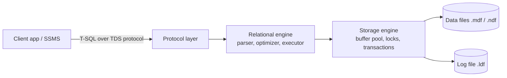

# Session 02: Introduction to SQL Server 2022

> Module: Effective Data Solutions with SQL Server · Term 3 (HDSE I) · ⏱ ~2 hours

## 🎯 Learning Objectives

- Describe what SQL Server 2022 is and where it fits in the Microsoft data platform
- Explain the basic architecture of the database engine and its version history
- List key new features of SQL Server 2022
- Connect to a SQL Server instance using SSMS (Windows and SQL authentication)
- Explore the AdventureWorks2022 sample database and the SSMS Object Explorer
- Create, save and run T-SQL script files

## 📖 Concepts Explained

### 1. What is SQL Server?

**Microsoft SQL Server** is a relational database engine. Applications (C#, ASP.NET Core, Python, Power BI) send it T-SQL commands; it stores data safely on disk and returns results.

| Edition | Who uses it | Cost |
|---|---|---|
| **Developer** | Students and developers (all features, not for production) | Free |
| **Express** | Small apps, max 10 GB per database | Free |
| Standard | Small and medium businesses | Paid |
| Enterprise | Large, mission-critical systems | Paid |

For this course install **Developer Edition** plus **SSMS** (SQL Server Management Studio).

### 2. Architecture in One Picture



- **Protocol layer** receives requests (TCP/IP port 1433 by default).
- **Relational engine** parses the query, the **query optimizer** chooses the cheapest plan, and the executor runs it.
- **Storage engine** reads 8 KB *pages* into memory (the **buffer pool**), manages locks and writes every change first to the **transaction log**.

### 3. Version History (short)

| Version | Year | Highlight |
|---|---|---|
| SQL Server 2005 | 2005 | SSMS, XML, CLR integration |
| 2012 | 2012 | Always On availability groups, columnstore |
| 2016 | 2016 | JSON support, Query Store, temporal tables |
| 2017 | 2017 | Runs on Linux and Docker, Python ML |
| 2019 | 2019 | Big data clusters, Intelligent Query Processing |
| **2022** | 2022 | Azure-connected features, ledger, PSP optimization |

### 4. What is New in SQL Server 2022

- **Azure Synapse Link and Azure SQL Managed Instance link** – sync with the cloud
- **Ledger tables** – tamper-evident history (blockchain-style hashes)
- **Parameter Sensitive Plan (PSP) optimization** – several cached plans for one query
- **Query Store on by default** for new databases and **Query Store hints**
- **New T-SQL functions** – `GREATEST`, `LEAST`, `STRING_SPLIT` with ordinal, `DATE_BUCKET`, `GENERATE_SERIES`, `DATETRUNC`
- **Contained availability groups** and improved backup to S3-compatible storage

### 5. Instances and Connecting

An **instance** is one running copy of the SQL Server service. One machine can host several:

- **Default instance** – connect using the machine name, e.g. `DESKTOP-01` or `localhost`
- **Named instance** – `MACHINE\INSTANCENAME`, e.g. `localhost\SQLEXPRESS`

**Authentication modes**

| Mode | How you log in | Typical use |
|---|---|---|
| Windows Authentication | Your Windows account | Lab PCs, company domains |
| SQL Server Authentication | Username + password (e.g. `sa`) | Web apps, Docker, Linux |

### 6. System and Sample Databases

| Database | Purpose |
|---|---|
| `master` | Server-wide settings, list of databases and logins |
| `model` | Template copied for every new database |
| `msdb` | SQL Agent jobs, backup history |
| `tempdb` | Temporary tables and sorting; recreated at every restart |

**AdventureWorks2022** is Microsoft's free sample for a fictional bicycle company. It has schemas such as `Person`, `Sales`, `Production`, `HumanResources` and `Purchasing`, which makes it perfect for practising queries on realistic data.

### 7. SSMS Tour

| Window | What it does |
|---|---|
| **Object Explorer** | Tree of servers, databases, tables, views, procedures, security |
| **Query Editor** | Where you type T-SQL (new tab: `Ctrl+N`) |
| **Results / Messages** | Grid output and messages such as "3 rows affected" |
| **Available Databases** drop-down | Which database the query runs against |
| Template Explorer (`Ctrl+Alt+T`) | Ready-made script templates |

Run the whole script with **F5** or *Execute*; run only the selected lines by highlighting them first.

### 8. Script Files and Batches

Save your work as `.sql` files and keep them in a folder or **SSMS solution/project**, ideally under Git.

- `GO` is not T-SQL; it is a **batch separator** understood by SSMS and `sqlcmd`.
- `USE DatabaseName;` switches the current database.
- `--` starts a single-line comment, `/* ... */` a multi-line comment.

## 💻 Code Examples

File: `explore_server.sql` – run each block separately.

```sql
-- 1. Which server and version am I connected to?
SELECT @@SERVERNAME AS ServerName,
       @@VERSION    AS VersionInfo,
       SERVERPROPERTY('Edition') AS Edition;

-- 2. List all databases on this instance
SELECT name, database_id, create_date, compatibility_level
FROM sys.databases
ORDER BY name;
```

**How it works**

- `@@SERVERNAME` and `@@VERSION` are system functions that return server details.
- `SERVERPROPERTY('Edition')` tells you whether you have Developer, Express, etc.
- `sys.databases` is a **catalog view** listing every database; compatibility level `160` means SQL Server 2022.

File: `adventureworks_tour.sql`

```sql
USE AdventureWorks2022;
GO
-- Top 5 most expensive products
SELECT TOP (5) ProductID, Name, ListPrice
FROM Production.Product
ORDER BY ListPrice DESC;

-- Count tables per schema
SELECT s.name AS SchemaName, COUNT(*) AS TableCount
FROM sys.tables AS t
JOIN sys.schemas AS s ON s.schema_id = t.schema_id
GROUP BY s.name
ORDER BY TableCount DESC;
```

**How it works**

- `Production.Product` uses a **two-part name**: `schema.table`.
- `TOP (5)` with `ORDER BY ... DESC` returns the five highest prices.
- The second query joins two catalog views to show how AdventureWorks is organized by schema.

## 🧪 Lab Practice

1. Install SQL Server 2022 Developer and SSMS (links in the module README). Choose **Mixed Mode** authentication and set a strong `sa` password.
2. Download `AdventureWorks2022.bak`, copy it to the SQL Server backup folder and restore it with *Databases → Restore Database* in SSMS.
3. Connect once with Windows Authentication and once with SQL Authentication (`sa`). Note the difference in the Object Explorer header.
4. Run `explore_server.sql` and write down your edition and compatibility level.
5. Create a folder `sql-lab` and save three scripts there: `01-server-info.sql`, `02-databases.sql`, `03-aw-products.sql`.

## 📝 Assignment

Write a one-page "My SQL Server setup" note (markdown) with screenshots of: the instance name, the edition, the AdventureWorks schemas in Object Explorer, and the result of a query returning the 10 cheapest products with a price above zero.

## ❓ Quick Quiz

1. Which free edition includes all Enterprise features but is licensed only for development?
2. What is the role of the transaction log (`.ldf`)?
3. How do you connect to a named instance called `SQLEXPRESS` on your own PC?
4. Is `GO` a T-SQL statement?
5. Which system database is recreated every time SQL Server restarts?

<details>
<summary>Show answers</summary>

1. Developer Edition.
2. It records every change before it is written to data files, enabling recovery and rollback.
3. `localhost\SQLEXPRESS` (or `.\SQLEXPRESS`).
4. No. It is a batch separator recognized by client tools such as SSMS and sqlcmd.
5. `tempdb`.

</details>

## 💼 Interview Questions

1. **What is the difference between an instance and a database?** An instance is a running SQL Server service with its own memory and settings; it can host many databases.
2. **Name three new features in SQL Server 2022.** Ledger tables, Parameter Sensitive Plan optimization, Azure Synapse Link, Query Store hints, `GREATEST`/`LEAST`.
3. **What does the query optimizer do?** It evaluates possible execution plans using statistics and picks the one with the lowest estimated cost.

## ✅ Summary

- SQL Server 2022 is Microsoft's relational engine; use the free Developer edition for learning.
- The engine has a relational layer (parse, optimize, execute) and a storage layer (pages, buffer pool, log).
- Connect via instance name using Windows or SQL authentication.
- `master`, `model`, `msdb` and `tempdb` are system databases; AdventureWorks2022 is for practice.
- SSMS lets you browse objects, write scripts and run batches separated by `GO`.

---

[⬅ Previous](../Session-01-RDBMS-ER-Model-and-Normalization/README.md) · [🏠 Module Home](../README.md) · [Next ➡](../Session-03-Transact-SQL-Fundamentals/README.md)

Prepared by Zeeshan Abbas · Aptech Learning North Nazimabad
