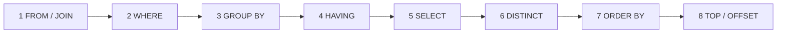

# Session 03: Transact-SQL Fundamentals

> Module: Effective Data Solutions with SQL Server · Term 3 (HDSE I) · ⏱ ~2 hours

## 🎯 Learning Objectives

- Explain what Transact-SQL (T-SQL) is and how it extends standard SQL
- Classify statements into DDL, DML, DCL and TCL
- Choose correct T-SQL data types for columns and variables
- Use language elements: variables, operators, expressions, functions and comments
- Apply set theory and predicate logic (`TRUE`, `FALSE`, `UNKNOWN`)
- Explain the logical processing order of a `SELECT` statement

## 📖 Concepts Explained

### 1. What is T-SQL?

**SQL** is the standard language for relational databases. **Transact-SQL (T-SQL)** is Microsoft's dialect: standard SQL *plus* variables, `IF`/`WHILE`, error handling, and many built-in functions.

### 2. Categories of Statements

| Category | Full name | Purpose | Examples |
|---|---|---|---|
| **DDL** | Data Definition Language | Create/change structure | `CREATE`, `ALTER`, `DROP`, `TRUNCATE` |
| **DML** | Data Manipulation Language | Work with rows | `SELECT`, `INSERT`, `UPDATE`, `DELETE`, `MERGE` |
| **DCL** | Data Control Language | Permissions | `GRANT`, `REVOKE`, `DENY` |
| **TCL** | Transaction Control Language | Group changes | `BEGIN TRAN`, `COMMIT`, `ROLLBACK` |

### 3. Common Data Types

| Group | Types | Tip |
|---|---|---|
| Exact numbers | `INT`, `BIGINT`, `SMALLINT`, `TINYINT`, `BIT` | `TINYINT` is 0–255 |
| Decimal | `DECIMAL(p,s)`, `NUMERIC`, `MONEY` | Use `DECIMAL(10,2)` for prices |
| Approximate | `FLOAT`, `REAL` | Scientific values; avoid for money |
| Text | `CHAR(n)`, `VARCHAR(n)`, `NCHAR(n)`, `NVARCHAR(n)` | `N` types store Unicode (Urdu, Arabic) |
| Date/time | `DATE`, `TIME`, `DATETIME2`, `DATETIMEOFFSET` | Prefer `DATETIME2` over old `DATETIME` |
| Other | `UNIQUEIDENTIFIER`, `VARBINARY(MAX)`, `XML`, `JSON` (stored as `NVARCHAR`) | |

> Unicode literals need an `N` prefix: `N'کراچی'`. Without it the text may turn into `????`.

### 4. Language Elements

- **Identifiers** – names of objects. Use `[square brackets]` if a name has spaces or is a keyword.
- **Variables** – start with `@`, declared with `DECLARE`, set with `SET` or `SELECT`.
- **Operators**

| Type | Operators |
|---|---|
| Arithmetic | `+ - * / %` |
| Comparison | `= <> != > < >= <=` |
| Logical | `AND OR NOT BETWEEN IN LIKE IS NULL EXISTS` |
| String concat | `+` or `CONCAT()` |
| Assignment | `=` and compound `+= -= *=` |

- **Functions** – built-in, e.g. `GETDATE()`, `LEN()`, `UPPER()`, `ROUND()`, `ISNULL()`.
- **Comments** – `--` or `/* */`.
- **Batch** – a group of statements sent together; ends with `GO` in SSMS.

### 5. Sets and Predicate Logic

A table is a **set** of rows: there is no guaranteed order unless you use `ORDER BY`. A **predicate** is an expression that evaluates to true or false, e.g. `Marks >= 50`.

SQL uses **three-valued logic** because of `NULL` (unknown value):

| A | B | A AND B | A OR B |
|---|---|---|---|
| TRUE | UNKNOWN | UNKNOWN | TRUE |
| FALSE | UNKNOWN | FALSE | UNKNOWN |
| UNKNOWN | UNKNOWN | UNKNOWN | UNKNOWN |

`WHERE` keeps only rows where the predicate is **TRUE**, so rows with UNKNOWN are filtered out. That is why `Marks = NULL` never matches; use `Marks IS NULL`.

### 6. Logical Order of SELECT

You *write* `SELECT` first, but SQL Server *logically processes* the clauses in this order:



Consequences you will notice:

- A column alias created in `SELECT` **cannot** be used in `WHERE` (WHERE runs earlier).
- An alias **can** be used in `ORDER BY` (it runs after SELECT).
- Aggregate filters (`COUNT(*) > 2`) go in `HAVING`, not `WHERE`.

## 💻 Code Examples

File: `tsql_basics.sql` (uses `CampusDB` from Session 01).

```sql
USE CampusDB;
GO
DECLARE @PassMark DECIMAL(5,2) = 50,
        @Today    DATE = CAST(GETDATE() AS DATE),
        @City     NVARCHAR(30) = N'کراچی';

SELECT @Today AS Today, @City AS City, LEN(@City) AS Letters;

-- Arithmetic, string and comparison operators
SELECT s.FullName,
       e.CourseCode,
       e.Marks,
       e.Marks / 100 * 4         AS GradePoints,
       CONCAT(s.FullName, ' - ', e.CourseCode) AS Label,
       CASE WHEN e.Marks >= @PassMark THEN 'Pass'
            WHEN e.Marks IS NULL      THEN 'Pending'
            ELSE 'Fail' END      AS Result
FROM Student AS s
JOIN Enrollment AS e ON e.StudentId = s.StudentId;
```

**How it works**

- `DECLARE ... = value` declares and initializes variables in one statement.
- `N'کراچی'` keeps Urdu text intact because the variable is `NVARCHAR`.
- `CASE` evaluates conditions top to bottom; the `IS NULL` branch catches students without marks.

File: `null_logic.sql`

```sql
USE CampusDB;
GO
-- Returns 0 rows: comparison with NULL is UNKNOWN
SELECT * FROM Enrollment WHERE Marks = NULL;

-- Correct way
SELECT * FROM Enrollment WHERE Marks IS NULL;

-- Alias works in ORDER BY but not in WHERE
SELECT StudentId, Marks * 1.1 AS Curved
FROM Enrollment
WHERE Marks * 1.1 > 80      -- repeat the expression here
ORDER BY Curved DESC;       -- alias allowed here
```

**How it works**

- The first query shows three-valued logic: `NULL = NULL` is UNKNOWN, so nothing is returned.
- `IS NULL` is the only correct test for missing values.
- The last query proves the logical processing order of `WHERE` versus `ORDER BY`.

## 🧪 Lab Practice

1. Classify these as DDL/DML/DCL/TCL: `TRUNCATE`, `MERGE`, `DENY`, `ROLLBACK`, `ALTER`.
2. Declare variables for your name (Unicode), date of birth and a `DECIMAL` fee, then print them with `SELECT` and `PRINT`.
3. Using `CampusDB`, list students whose email ends with `@campus.pk` using `LIKE`.
4. Show each enrollment with a `Result` column using `CASE`, ordered by `Result` then `Marks DESC`.
5. Write a query that tries to use a `SELECT` alias inside `WHERE`; read the error and fix it.

## 📝 Assignment

Create `my_tsql_cheatsheet.sql` containing one working example (with a comment) of each: variable, arithmetic operator, `LIKE`, `IN`, `BETWEEN`, `IS NULL`, `CASE`, `CONCAT`, `GETDATE`, and a statement from each of the four categories.

## ❓ Quick Quiz

1. Which category does `GRANT` belong to?
2. Why should you write `N'...'` for Urdu text?
3. What does `NULL > 10` evaluate to?
4. Which clause is processed first: `WHERE` or `SELECT`?
5. Which data type is best for storing a product price?

<details>
<summary>Show answers</summary>

1. DCL.
2. To make the literal Unicode so characters are not lost.
3. UNKNOWN.
4. `WHERE`.
5. `DECIMAL(p,s)` (for example `DECIMAL(10,2)`).

</details>

## 💼 Interview Questions

1. **Difference between `DELETE` and `TRUNCATE`?** `DELETE` is DML, can have a `WHERE`, logs each row and fires triggers; `TRUNCATE` is DDL, removes all rows quickly, resets identity and does not fire DML triggers.
2. **`VARCHAR` vs `NVARCHAR`?** `NVARCHAR` stores Unicode (2 bytes per character for most text) and supports all languages; `VARCHAR` uses a code page and is smaller.
3. **Why can't you use a column alias in `WHERE`?** Because `WHERE` is logically processed before `SELECT`, so the alias does not exist yet.

## ✅ Summary

- T-SQL = standard SQL + Microsoft extensions (variables, flow control, functions).
- Statements fall into DDL, DML, DCL and TCL.
- Pick precise data types; use `NVARCHAR` and `N'...'` for Unicode.
- `NULL` brings three-valued logic; test it with `IS NULL`.
- `SELECT` is processed FROM → WHERE → GROUP BY → HAVING → SELECT → ORDER BY.

---

[⬅ Previous](../Session-02-Introduction-to-SQL-Server-2022/README.md) · [🏠 Module Home](../README.md) · [Next ➡](../Session-04-Lab-Review-Database-Foundations/README.md)

Prepared by Zeeshan Abbas · Aptech Learning North Nazimabad
