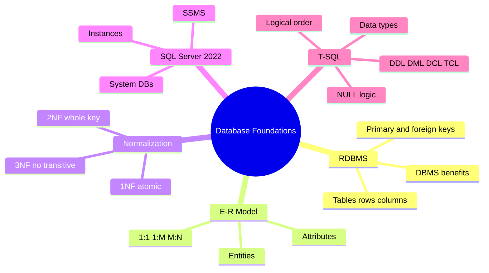

# Session 04: Lab and Review: Database Foundations

> Module: Effective Data Solutions with SQL Server · Term 3 (HDSE I) · ⏱ ~2 hours

## 🎯 Learning Objectives

- Revise RDBMS concepts, E-R modelling and normalization from Sessions 01–03
- Turn a written business scenario into a normalized design on your own
- Build the design as tables in SQL Server using a script file
- Write T-SQL queries that use variables, operators, `CASE` and `NULL` handling correctly
- Spot and fix the most common beginner mistakes

## 📖 Concepts Explained

This is a hands-on review session. Read the recap, then spend most of your time on the lab.

### 1. Recap Map



### 2. Key Ideas in One Table

| Topic | Remember this |
|---|---|
| Primary key | Unique, not NULL, one per table |
| Foreign key | Must match an existing primary key (or be NULL if allowed) |
| M:N relationship | Needs a junction table with two foreign keys |
| 1NF | One value per cell, no repeating columns like `Phone1, Phone2` |
| 2NF | No partial dependency on part of a composite key |
| 3NF | No column depends on another non-key column |
| `NVARCHAR` | Use for names and any multilingual text |
| `NULL` | Unknown; test with `IS NULL`, never `= NULL` |
| `GO` | Batch separator, not a T-SQL command |
| Processing order | FROM → WHERE → GROUP BY → HAVING → SELECT → ORDER BY |

### 3. Common Mistakes and Fixes

| Mistake | Why it is wrong | Fix |
|---|---|---|
| Storing `Courses = "SQL, C#"` in one cell | Breaks 1NF | Junction table |
| Using `FLOAT` for fees | Rounding errors | `DECIMAL(10,2)` |
| `WHERE Fee = NULL` | Always UNKNOWN | `WHERE Fee IS NULL` |
| Forgetting `USE CampusDB` | Tables created in `master` | Start every script with `USE` |
| Alias in `WHERE` | Alias not yet created | Repeat the expression or use a subquery |

## 💻 Code Examples

Scenario: **Karachi Book Club** keeps members, books, authors and loans. File: `bookclub_lab.sql`.

```sql
IF DB_ID('BookClubDB') IS NULL CREATE DATABASE BookClubDB;
GO
USE BookClubDB;
GO
CREATE TABLE Author (
    AuthorId INT IDENTITY PRIMARY KEY,
    Name     NVARCHAR(80) NOT NULL
);
CREATE TABLE Book (
    BookId   INT IDENTITY PRIMARY KEY,
    Title    NVARCHAR(150) NOT NULL,
    Price    DECIMAL(8,2)  NOT NULL CHECK (Price >= 0)
);
CREATE TABLE BookAuthor (            -- M:N junction
    BookId   INT REFERENCES Book(BookId),
    AuthorId INT REFERENCES Author(AuthorId),
    PRIMARY KEY (BookId, AuthorId)
);
CREATE TABLE Member (
    MemberId INT IDENTITY PRIMARY KEY,
    Name     NVARCHAR(80) NOT NULL,
    Phone    VARCHAR(15)  NULL
);
CREATE TABLE Loan (
    LoanId     INT IDENTITY PRIMARY KEY,
    BookId     INT  NOT NULL REFERENCES Book(BookId),
    MemberId   INT  NOT NULL REFERENCES Member(MemberId),
    LoanDate   DATE NOT NULL DEFAULT CAST(GETDATE() AS DATE),
    ReturnDate DATE NULL
);
GO
```

**How it works**

- A book can have many authors and an author many books, so `BookAuthor` resolves the M:N relationship.
- `Loan` links a member to a book (two 1:M relationships) and records dates.
- `ReturnDate NULL` means "not returned yet" — an honest use of NULL.

The file also inserts sample rows and runs this report:

```sql
DECLARE @Today DATE = CAST(GETDATE() AS DATE);
SELECT m.Name, b.Title, l.LoanDate,
       DATEDIFF(DAY, l.LoanDate, @Today) AS DaysOut,
       CASE WHEN l.ReturnDate IS NULL AND DATEDIFF(DAY, l.LoanDate, @Today) > 14
            THEN 'Overdue' WHEN l.ReturnDate IS NULL THEN 'On loan'
            ELSE 'Returned' END AS Status
FROM Loan l
JOIN Member m ON m.MemberId = l.MemberId
JOIN Book b   ON b.BookId   = l.BookId
ORDER BY Status, DaysOut DESC;
```

**How it works**

- `DATEDIFF(DAY, start, end)` counts days between two dates.
- The `CASE` checks NULL first, so returned books never show as overdue.
- `ORDER BY Status` can use the alias because ORDER BY runs after SELECT.

## 🧪 Lab Practice

1. Run `bookclub_lab.sql` and confirm five tables appear under *BookClubDB → Tables*.
2. Draw the E-R diagram for BookClubDB from the script (reverse-engineer it). Use *Database Diagrams* in SSMS to check yourself.
3. Add a `Category` table and link each book to exactly one category. Which side gets the foreign key?
4. Write a query listing books with their authors' names, and another listing members who have never borrowed a book.
5. Insert a loan dated 20 days ago and confirm the report shows it as *Overdue*.

## 📝 Assignment

Case study: a **tuition centre** has students, teachers, subjects, batches (a teacher teaches one subject to a batch at a time slot) and fee payments. Produce (a) a 3NF E-R diagram, (b) a `tuition_schema.sql` script with keys and `CHECK` constraints, and (c) three meaningful queries using `CASE` and `NULL` logic.

## ❓ Quick Quiz

1. In BookClubDB, why is `BookAuthor` needed?
2. Which column in `Loan` intentionally allows NULL and why?
3. A table has `Phone1`, `Phone2`, `Phone3`. Which normal form does it break?
4. What does `DATEDIFF(DAY, '2026-01-01', '2026-01-15')` return?
5. Which system database is the template for new databases?

<details>
<summary>Show answers</summary>

1. Book–Author is many-to-many.
2. `ReturnDate`; NULL means the book is still on loan.
3. 1NF (repeating group).
4. 14.
5. `model`.

</details>

## 💼 Interview Questions

1. **How do you convert an E-R diagram into tables?** Each entity becomes a table, attributes become columns, 1:M adds a foreign key on the many side, and M:N becomes a junction table.
2. **What is a composite key? Give an example.** A primary key made of more than one column, e.g. `(BookId, AuthorId)` in `BookAuthor`.
3. **Why is `DEFAULT` useful?** It supplies a value when an insert omits the column, such as today's date for `LoanDate`.

## ✅ Summary

- Good design starts on paper: entities, relationships, then normalization.
- Junction tables solve M:N; foreign keys enforce links.
- Scripts beginning with `IF DB_ID(...)` and `USE` are safe to re-run.
- `CASE`, `DATEDIFF` and `IS NULL` let you turn raw rows into useful reports.

---

[⬅ Previous](../Session-03-Transact-SQL-Fundamentals/README.md) · [🏠 Module Home](../README.md) · [Next ➡](../Session-05-Creating-and-Managing-Databases/README.md)

Prepared by Zeeshan Abbas · Aptech Learning North Nazimabad
