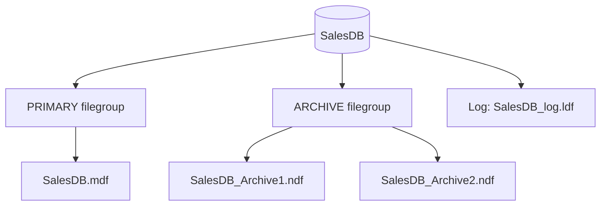

# Session 05: Creating and Managing Databases

> Module: Effective Data Solutions with SQL Server · Term 3 (HDSE I) · ⏱ ~2 hours

## 🎯 Learning Objectives

- Explain how a SQL Server database is stored: data files, log files and filegroups
- Create a database with default settings and with custom file options
- Add filegroups, data files and log files to an existing database
- Change database options safely and understand why system data should not be edited directly
- Drop a database and know what happens to its files
- Create and use a database snapshot for quick read-only copies and recovery

## 📖 Concepts Explained

### 1. Files Behind a Database

| File | Extension | Holds |
|---|---|---|
| Primary data file | `.mdf` | Startup info + data; exactly one per database |
| Secondary data file | `.ndf` | Extra data, optional, can live on other disks |
| Transaction log | `.ldf` | Record of every change; at least one per database |

A **filegroup** is a named collection of data files. Every database has a `PRIMARY` filegroup. You can add more (e.g. `ARCHIVE`) and place big or old tables on them, often on a different disk.



### 2. Size and Growth

Each file has a **SIZE** (starting size), **MAXSIZE** (limit or `UNLIMITED`) and **FILEGROWTH** (how much to add when full, in MB or %). Prefer fixed MB growth (e.g. 64 MB) over percentages, which grow unpredictably on large files.

### 3. Modifying System Data — Don't

System catalog tables in `master` and each database hold metadata. Never update them directly; always change things through supported commands (`ALTER DATABASE`, `sp_rename`, SSMS dialogs). Direct edits can make the server unstartable. Read metadata through **catalog views** such as `sys.databases` and `sys.database_files`.

### 4. Useful Database Options

| Option | Values | Meaning |
|---|---|---|
| `RECOVERY` | `SIMPLE`, `FULL`, `BULK_LOGGED` | How much log is kept for backups |
| `READ_ONLY` / `READ_WRITE` | | Lock the database against changes |
| `SINGLE_USER` / `MULTI_USER` | | Allow only one connection (maintenance) |
| `AUTO_SHRINK` | `ON`/`OFF` | Keep **OFF**; causes fragmentation |
| `COMPATIBILITY_LEVEL` | `160` = 2022 | Which engine behaviours apply |

### 5. Dropping a Database

`DROP DATABASE` removes the database **and deletes its files** from disk. It fails if someone is connected, so switch to `master` and, if needed, set `SINGLE_USER WITH ROLLBACK IMMEDIATE` first. There is no undo, so take a backup before dropping anything important.

### 6. Database Snapshots

A **snapshot** is a read-only, point-in-time view of a database. It starts almost empty; when a page in the source changes, the *original* page is copied into the snapshot's sparse file (*copy-on-write*).

Uses:

- Run reports on a stable copy while the source keeps changing
- Quick "undo" before a risky change: revert the source to the snapshot
- Not a backup: if the source is lost, the snapshot is useless

## 💻 Code Examples

File: `create_databases.sql`

```sql
USE master;
GO
-- 1. Simplest form: all defaults copied from the model database
CREATE DATABASE QuickDB;
GO
-- 2. Custom files (change the folder to one that exists on your PC)
CREATE DATABASE SalesDB
ON PRIMARY
(   NAME = SalesDB_Data,
    FILENAME = 'C:\SQLData\SalesDB.mdf',
    SIZE = 64MB, MAXSIZE = 1GB, FILEGROWTH = 64MB )
LOG ON
(   NAME = SalesDB_Log,
    FILENAME = 'C:\SQLData\SalesDB_log.ldf',
    SIZE = 32MB, FILEGROWTH = 32MB );
GO
```

**How it works**

- `NAME` is the *logical* name used inside SQL Server; `FILENAME` is the physical path.
- The folder must already exist and the SQL Server service account must have permission on it.

File: `filegroups_and_options.sql`

```sql
ALTER DATABASE SalesDB ADD FILEGROUP ARCHIVE;
GO
ALTER DATABASE SalesDB ADD FILE
(   NAME = SalesDB_Archive1,
    FILENAME = 'C:\SQLData\SalesDB_Archive1.ndf',
    SIZE = 32MB, FILEGROWTH = 32MB )
TO FILEGROUP ARCHIVE;
GO
ALTER DATABASE SalesDB ADD LOG FILE
(   NAME = SalesDB_Log2, FILENAME = 'C:\SQLData\SalesDB_log2.ldf', SIZE = 16MB );
GO
ALTER DATABASE SalesDB SET RECOVERY SIMPLE;
GO
USE SalesDB;
CREATE TABLE dbo.OldInvoice (InvoiceId INT PRIMARY KEY, Amount DECIMAL(10,2)) ON ARCHIVE;
SELECT name, type_desc, physical_name, size * 8 / 1024 AS SizeMB FROM sys.database_files;
GO
-- A second log file rarely helps; remove it again (it must be empty)
ALTER DATABASE SalesDB REMOVE FILE SalesDB_Log2;
GO
```

**How it works**

- A new filegroup is empty until you add at least one `.ndf` file `TO FILEGROUP`.
- `ON ARCHIVE` places the table's data in the archive filegroup.
- `size` in `sys.database_files` is in 8 KB pages, so `* 8 / 1024` converts to MB.

File: `snapshot_and_drop.sql`

```sql
USE master;
GO
CREATE DATABASE SalesDB_Snap ON
( NAME = SalesDB_Data,     FILENAME = 'C:\SQLData\SalesDB_Data.ss' ),
( NAME = SalesDB_Archive1, FILENAME = 'C:\SQLData\SalesDB_Archive1.ss' )
AS SNAPSHOT OF SalesDB;
GO
-- Something goes wrong in SalesDB ... revert:
RESTORE DATABASE SalesDB FROM DATABASE_SNAPSHOT = 'SalesDB_Snap';
GO
DROP DATABASE SalesDB_Snap;   -- drop snapshot first
ALTER DATABASE QuickDB SET SINGLE_USER WITH ROLLBACK IMMEDIATE;
DROP DATABASE QuickDB;
GO
```

**How it works**

- The snapshot needs one sparse file for **every data file** of the source, so both `SalesDB_Data` and `SalesDB_Archive1` are listed (the log is never part of a snapshot).
- `RESTORE ... FROM DATABASE_SNAPSHOT` rolls the source back to the snapshot moment.
- `SINGLE_USER WITH ROLLBACK IMMEDIATE` disconnects others so the drop can succeed.

## 🧪 Lab Practice

1. Create folder `C:\SQLData` (or use the default data path shown in *Server Properties → Database Settings*).
2. Run `create_databases.sql` and check the files in File Explorer.
3. Add the `ARCHIVE` filegroup and file, then create a table on it. Confirm with `sys.database_files` and `sys.filegroups`.
4. Insert three rows into `OldInvoice`, create a snapshot, delete the rows, then revert from the snapshot and confirm the rows are back.
5. Drop `QuickDB` and confirm its files are gone from disk.

## 📝 Assignment

Write `hospital_db.sql` that creates `HospitalDB` with a primary data file (128 MB), a `RECORDS` filegroup with two `.ndf` files, and a 64 MB log. Add a table on `RECORDS`, set recovery to `FULL`, create a snapshot, and include a comment explaining when you would revert to it.

## ❓ Quick Quiz

1. Which file type is mandatory and unique for every database?
2. What is a filegroup?
3. Why should `AUTO_SHRINK` stay off?
4. Is a database snapshot a replacement for backups?
5. What happens to physical files when you `DROP DATABASE`?

<details>
<summary>Show answers</summary>

1. The primary data file (`.mdf`), plus at least one log file.
2. A named group of data files used to place objects on storage.
3. Repeated shrinking and growing fragments indexes and wastes resources.
4. No; it depends on the source database and is lost with it.
5. They are deleted from disk.

</details>

## 💼 Interview Questions

1. **Why place the log file on a separate disk?** The log is written sequentially and constantly; separating it from random data I/O improves performance and helps recovery if one disk fails.
2. **Explain copy-on-write in snapshots.** The snapshot stores the original version of a page only when the source page is first modified after the snapshot was taken.
3. **Simple vs Full recovery model?** Simple truncates the log automatically and allows only full/differential restores; Full keeps log records for log backups and point-in-time recovery.

## ✅ Summary

- A database = `.mdf` + optional `.ndf` files in filegroups + `.ldf` log.
- `CREATE DATABASE` can use defaults or explicit file sizes and growth.
- `ALTER DATABASE` adds filegroups, files and changes options.
- Never edit system tables; use catalog views and supported commands.
- `DROP DATABASE` deletes files; snapshots give a fast read-only point-in-time copy.

---

[⬅ Previous](../Session-04-Lab-Review-Database-Foundations/README.md) · [🏠 Module Home](../README.md) · [Next ➡](../Session-06-Creating-and-Managing-Tables/README.md)

Prepared by Zeeshan Abbas · Aptech Learning North Nazimabad
