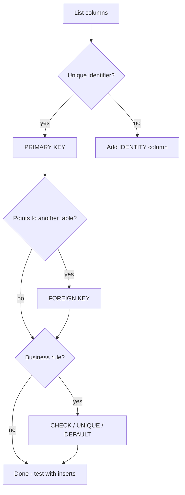

# Session 08: Lab and Review: Databases, Tables and Queries

> Module: Effective Data Solutions with SQL Server · Term 3 (HDSE I) · ⏱ ~2 hours

## 🎯 Learning Objectives

- Revise database files, filegroups, snapshots, tables, constraints, Azure SQL and `SELECT` (Sessions 05–07)
- Build a complete small database from an empty script
- Prove each constraint works by writing failing and passing inserts
- Write report queries with filtering, sorting, paging and XML
- Prepare for the modular objective exam on these topics

## 📖 Concepts Explained

### 1. Recap Table

| Topic | Key commands | Watch out for |
|---|---|---|
| Databases | `CREATE/ALTER/DROP DATABASE` | Paths must exist; drop needs no active users |
| Filegroups | `ADD FILEGROUP`, `ADD FILE ... TO FILEGROUP`, `ON fg` | A filegroup is empty until a file is added |
| Snapshots | `AS SNAPSHOT OF`, `RESTORE ... FROM DATABASE_SNAPSHOT` | Not a backup |
| Tables | `CREATE TABLE`, `ALTER TABLE`, `DROP TABLE IF EXISTS` | Drop children first |
| Constraints | PK, FK, UNIQUE, CHECK, DEFAULT, NOT NULL | Name them |
| Azure SQL | Portal + firewall + SSMS | No SQL Agent in SQL Database |
| SELECT | `DISTINCT`, `TOP`, `WHERE`, `ORDER BY`, `OFFSET/FETCH` | Paging needs ORDER BY |
| XML | `XML(schema)`, `.value()`, `.nodes()` | `.value()` needs a singleton path |

### 2. Self-Check Flow for Any New Table



## 💻 Code Examples

File: `event_management_lab.sql` — a mini **event ticketing** database.

```sql
IF DB_ID('EventDB') IS NULL CREATE DATABASE EventDB;
GO
USE EventDB;
GO
DROP TABLE IF EXISTS Ticket, Event, Venue;
CREATE TABLE Venue (
    VenueId  INT IDENTITY CONSTRAINT PK_Venue PRIMARY KEY,
    Name     NVARCHAR(80) NOT NULL CONSTRAINT UQ_Venue_Name UNIQUE,
    City     NVARCHAR(40) NOT NULL CONSTRAINT DF_Venue_City DEFAULT N'Karachi',
    Capacity INT NOT NULL CONSTRAINT CK_Venue_Capacity CHECK (Capacity BETWEEN 10 AND 50000)
);
CREATE TABLE Event (
    EventId   INT IDENTITY CONSTRAINT PK_Event PRIMARY KEY,
    Title     NVARCHAR(120) NOT NULL,
    StartsAt  DATETIME2(0)  NOT NULL,
    BasePrice DECIMAL(8,2)  NOT NULL CONSTRAINT CK_Event_Price CHECK (BasePrice >= 0),
    VenueId   INT NOT NULL CONSTRAINT FK_Event_Venue REFERENCES Venue(VenueId),
    Extras    XML NULL
);
CREATE TABLE Ticket (
    TicketId  UNIQUEIDENTIFIER CONSTRAINT PK_Ticket PRIMARY KEY DEFAULT NEWID(),
    EventId   INT NOT NULL CONSTRAINT FK_Ticket_Event REFERENCES Event(EventId) ON DELETE CASCADE,
    Buyer     NVARCHAR(80) NOT NULL,
    Seats     TINYINT NOT NULL CONSTRAINT CK_Ticket_Seats CHECK (Seats BETWEEN 1 AND 10),
    PricePaid DECIMAL(8,2) NOT NULL
);
```

**How it works**

- `DEFAULT N'Karachi'` fills the city when none is given.
- `UNIQUEIDENTIFIER DEFAULT NEWID()` gives each ticket a hard-to-guess ID.
- `ON DELETE CASCADE` on `Ticket` means cancelling an event removes its tickets automatically.

The file continues with inserts and these reports:

```sql
-- Upcoming events, next 30 days, cheapest first
SELECT e.Title, v.Name AS Venue, e.StartsAt, e.BasePrice
FROM Event e JOIN Venue v ON v.VenueId = e.VenueId
WHERE e.StartsAt BETWEEN SYSDATETIME() AND DATEADD(DAY, 30, SYSDATETIME())
ORDER BY e.BasePrice;

-- XML extras: which events have parking?
SELECT Title, Extras.value('(/extras/parking)[1]', 'nvarchar(10)') AS Parking
FROM Event
WHERE Extras.exist('/extras/parking') = 1;
```

**How it works**

- `DATEADD(DAY, 30, ...)` builds the end of the 30-day window.
- `.exist()` filters rows whose XML contains a `<parking>` element.

## 🧪 Lab Practice

1. Run `event_management_lab.sql` and draw its E-R diagram.
2. Write one insert that violates each named constraint (`UQ_Venue_Name`, `CK_Venue_Capacity`, `CK_Event_Price`, `FK_Event_Venue`, `CK_Ticket_Seats`) and note the message.
3. Add a `Category` column with a `CHECK` limiting values to `'Concert'`, `'Seminar'`, `'Sports'`.
4. Create a filegroup `TICKETS_ARCHIVE` with one file and a table `TicketArchive` on it.
5. Create a snapshot of `EventDB`, delete an event, observe the cascade, then revert.

## 📝 Assignment

Extend EventDB with a `Sponsor` table (M:N with `Event`, sponsorship amount per event). Write five report queries using `DISTINCT`, `TOP WITH TIES`, `LIKE`, `OFFSET/FETCH` and an XML `.nodes()` shred. Submit the script plus a screenshot of each result.

## ❓ Quick Quiz

1. What does `ON DELETE CASCADE` do on `FK_Ticket_Event`?
2. Which constraint fills `City` automatically?
3. How do you put a table on a specific filegroup?
4. Which XML method would list every `<item>` as a separate row?
5. Can you run `USE OtherDb` inside an Azure SQL Database connection?

<details>
<summary>Show answers</summary>

1. Deleting an event deletes all its tickets.
2. `DF_Venue_City` (DEFAULT).
3. Add `ON FilegroupName` at the end of `CREATE TABLE`.
4. `.nodes()` (with `CROSS APPLY`).
5. No; each Azure SQL Database connection is scoped to one database.

</details>

## 💼 Interview Questions

1. **Is `UNIQUEIDENTIFIER` a good clustered primary key?** Random `NEWID()` values cause page splits; prefer `NEWSEQUENTIALID()` or an `INT` clustered key with the GUID as a non-clustered unique column.
2. **How would you test that constraints are correct?** Write negative tests (inserts that must fail) and positive tests (inserts that must succeed) in a script.
3. **What happens to a snapshot when the source database is dropped?** You must drop all snapshots before you can drop the source.

## ✅ Summary

- A good table script names every constraint and is safe to re-run.
- Test constraints with deliberate failing inserts.
- Reports combine joins, date functions, sorting and paging.
- XML columns add flexible attributes you can still filter with `.exist()`.

---

[⬅ Previous](../Session-07-Azure-SQL-and-Accessing-Data/README.md) · [🏠 Module Home](../README.md) · [Next ➡](../Session-09-Advanced-Queries-Joins-Views-Procedures/README.md)

Prepared by Zeeshan Abbas · Aptech Learning North Nazimabad
