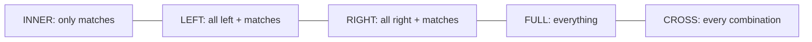

# Session 09: Advanced Queries, Joins, Views and Stored Procedures

> Module: Effective Data Solutions with SQL Server · Term 3 (HDSE I) · ⏱ ~2 hours

## 🎯 Learning Objectives

- Group and aggregate data with `GROUP BY`, `HAVING` and aggregate functions
- Write subqueries (scalar, multi-row, correlated) and table expressions (derived tables, CTEs)
- Combine tables with `INNER`, `LEFT`, `RIGHT`, `FULL` and `CROSS` joins and self-joins
- Combine result sets with `UNION`, `UNION ALL`, `INTERSECT`, `EXCEPT`
- Use `PIVOT`, `UNPIVOT`, `GROUPING SETS`, `ROLLUP` and `CUBE`
- Create views and stored procedures, and query metadata with catalog views

## 📖 Concepts Explained

### 1. Grouping and Aggregates

Aggregate functions summarise many rows into one value: `COUNT`, `SUM`, `AVG`, `MIN`, `MAX`, `STRING_AGG`.

- `GROUP BY` makes one group per distinct value.
- `HAVING` filters **groups** (after aggregation); `WHERE` filters **rows** (before).
- Every non-aggregated column in `SELECT` must appear in `GROUP BY`.

### 2. Subqueries and Table Expressions

| Kind | Example use |
|---|---|
| Scalar subquery | `WHERE ListPrice > (SELECT AVG(ListPrice) FROM ...)` |
| Multi-row with `IN` / `EXISTS` | Customers who have orders |
| Correlated | Refers to the outer row; runs per outer row |
| Derived table | `FROM (SELECT ...) AS t` |
| **CTE** | `WITH t AS (SELECT ...) SELECT ... FROM t` — readable, reusable in the same statement |

### 3. Joins at a Glance



| Join | Rows returned |
|---|---|
| `INNER JOIN` | Rows with a match in both tables |
| `LEFT OUTER JOIN` | All left rows; NULLs where no right match |
| `RIGHT OUTER JOIN` | All right rows; NULLs where no left match |
| `FULL OUTER JOIN` | All rows from both sides |
| `CROSS JOIN` | Cartesian product |
| Self-join | A table joined to itself (employee → manager) |

### 4. Set Operators

`UNION` (distinct rows from both), `UNION ALL` (keeps duplicates, faster), `INTERSECT` (rows in both), `EXCEPT` (rows in first not in second). Both queries need the same number of columns with compatible types.

### 5. Pivoting and Grouping Sets

- `PIVOT` turns row values into columns (months as columns); `UNPIVOT` does the reverse.
- `ROLLUP(a, b)` adds subtotals for `a` and a grand total.
- `CUBE(a, b)` adds subtotals for every combination.
- `GROUPING SETS ((a), (b), ())` lets you choose exactly which totals.
- `GROUPING(col)` returns 1 when the row is a subtotal for that column.

### 6. Views

A **view** is a saved `SELECT` that acts like a virtual table. Uses: hide complexity, restrict columns for security, give a stable interface. `WITH SCHEMABINDING` stops underlying tables changing in ways that break the view; `WITH CHECK OPTION` stops updates through the view that would make rows disappear from it.

### 7. Stored Procedures

A **stored procedure** is a named, compiled batch of T-SQL with parameters.

| Type | Example |
|---|---|
| User-defined | `dbo.usp_GetOrders` |
| System | `sp_help`, `sp_rename` (in `sys` schema) |
| Extended | `xp_` procedures calling external code (legacy) |
| Temporary | `#localProc`, `##globalProc` |

Benefits: plan reuse, less network traffic, security (grant `EXECUTE` without table access), protection from SQL injection when parameters are used. A procedure can call another (**nesting**, up to 32 levels; check `@@NESTLEVEL`).

### 8. Querying Metadata

| Source | Example |
|---|---|
| Catalog views | `sys.tables`, `sys.columns`, `sys.procedures`, `sys.views` |
| Information schema | `INFORMATION_SCHEMA.COLUMNS` (ANSI standard) |
| Functions | `OBJECT_ID()`, `OBJECT_NAME()`, `OBJECT_DEFINITION()` |
| System procedures | `sp_help`, `sp_helptext`, `sp_columns` |

## 💻 Code Examples

File: `aggregates_joins.sql` (AdventureWorks2022)

```sql
USE AdventureWorks2022;
GO
-- Customers with more than 20 orders, using a CTE
WITH OrderCounts AS (
    SELECT CustomerID, COUNT(*) AS Orders, SUM(TotalDue) AS Spent
    FROM Sales.SalesOrderHeader
    GROUP BY CustomerID
    HAVING COUNT(*) > 20
)
SELECT p.FirstName + ' ' + p.LastName AS Customer, oc.Orders, oc.Spent
FROM OrderCounts oc
JOIN Sales.Customer c ON c.CustomerID = oc.CustomerID
JOIN Person.Person p  ON p.BusinessEntityID = c.PersonID
ORDER BY oc.Spent DESC;

-- Products never sold (LEFT JOIN + IS NULL)
SELECT p.ProductID, p.Name
FROM Production.Product p
LEFT JOIN Sales.SalesOrderDetail d ON d.ProductID = p.ProductID
WHERE d.ProductID IS NULL;

-- Correlated subquery: most expensive product in each subcategory
SELECT p.Name, p.ListPrice, p.ProductSubcategoryID
FROM Production.Product p
WHERE p.ListPrice = (SELECT MAX(p2.ListPrice) FROM Production.Product p2
                     WHERE p2.ProductSubcategoryID = p.ProductSubcategoryID);
```

**How it works**

- The CTE computes per-customer totals once; the outer query adds names.
- `LEFT JOIN ... WHERE right.key IS NULL` is the classic "find rows with no match" pattern.
- The correlated subquery re-evaluates `MAX` for the current row's subcategory.

File: `pivot_rollup.sql`

```sql
-- Sales per territory and year with subtotals
SELECT t.Name AS Territory, YEAR(h.OrderDate) AS OrderYear,
       SUM(h.TotalDue) AS Total, GROUPING(t.Name) AS IsGrandTotal
FROM Sales.SalesOrderHeader h
JOIN Sales.SalesTerritory t ON t.TerritoryID = h.TerritoryID
GROUP BY ROLLUP (t.Name, YEAR(h.OrderDate));

-- Years as columns
SELECT Territory, [2012], [2013], [2014]
FROM (SELECT t.Name AS Territory, YEAR(h.OrderDate) AS Yr, h.TotalDue
      FROM Sales.SalesOrderHeader h
      JOIN Sales.SalesTerritory t ON t.TerritoryID = h.TerritoryID) AS src
PIVOT (SUM(TotalDue) FOR Yr IN ([2012], [2013], [2014])) AS pvt;
```

**How it works**

- `ROLLUP` adds a subtotal row per territory (year NULL) and a grand total (both NULL).
- `PIVOT` needs a source with exactly the grouping column, the spreading column (`Yr`) and the value. Adjust the year list to the years in your copy of AdventureWorks.

File: `views_procs_metadata.sql`

```sql
CREATE OR ALTER VIEW Sales.vTopCustomers
AS
SELECT c.CustomerID, SUM(h.TotalDue) AS Spent
FROM Sales.Customer c
JOIN Sales.SalesOrderHeader h ON h.CustomerID = c.CustomerID
GROUP BY c.CustomerID;
GO
CREATE OR ALTER PROCEDURE Sales.usp_OrdersByCustomer
    @CustomerID INT,
    @FromDate   DATE = '2000-01-01',
    @OrderCount INT OUTPUT
AS
BEGIN
    SET NOCOUNT ON;
    SELECT SalesOrderID, OrderDate, TotalDue
    FROM Sales.SalesOrderHeader
    WHERE CustomerID = @CustomerID AND OrderDate >= @FromDate
    ORDER BY OrderDate DESC;
    SET @OrderCount = @@ROWCOUNT;
END;
GO
DECLARE @n INT;
EXEC Sales.usp_OrdersByCustomer @CustomerID = 29825, @OrderCount = @n OUTPUT;
SELECT @n AS OrdersReturned;

SELECT name, type_desc, create_date FROM sys.objects
WHERE schema_id = SCHEMA_ID('Sales') AND type IN ('V', 'P');
EXEC sp_helptext 'Sales.usp_OrdersByCustomer';
```

**How it works**

- `CREATE OR ALTER` creates the object or replaces it if it exists.
- `@FromDate` has a default; `@OrderCount` is an **output parameter** filled from `@@ROWCOUNT`.
- `SET NOCOUNT ON` stops "rows affected" messages, reducing network chatter.
- `sys.objects` and `sp_helptext` show the new view and procedure's metadata and source.

## 🧪 Lab Practice

1. Count employees per job title and show only titles with more than 3 people.
2. List each employee with their manager's name using a self-join on `HumanResources.Employee` (`OrganizationNode.GetAncestor(1)`) or on a simple `Emp(EmpId, Name, ManagerId)` table you create.
3. Use `EXCEPT` to find products in `Production.Product` that do not appear in `Sales.SalesOrderDetail`. Compare with the LEFT JOIN result.
4. Build a `CUBE` report of sales by territory and ship method.
5. Create a view `Production.vProductCatalog` and a procedure `usp_ProductsByColor @Color` and run both.

## 📝 Assignment

For CampusDB, create (a) a view `vStudentResults` showing student, course, marks and grade, (b) a procedure `usp_CourseReport @CourseCode` that returns enrolled students and an output parameter with the class average, and (c) a `ROLLUP` query of average marks by department and course.

## ❓ Quick Quiz

1. What is the difference between `WHERE` and `HAVING`?
2. Which join keeps all rows from both tables?
3. `UNION` vs `UNION ALL`?
4. What does `ROLLUP(a, b)` add?
5. Name a benefit of stored procedures for security.

<details>
<summary>Show answers</summary>

1. `WHERE` filters rows before grouping; `HAVING` filters groups after aggregation.
2. `FULL OUTER JOIN`.
3. `UNION` removes duplicates; `UNION ALL` keeps them and is faster.
4. Subtotals for each `a` and a grand total.
5. Users can be granted `EXECUTE` on the procedure without direct table permissions; parameters prevent injection.

</details>

## 💼 Interview Questions

1. **CTE vs temporary table?** A CTE exists only for one statement and is not stored; a temp table is materialized in `tempdb`, can be indexed and reused across statements.
2. **`EXISTS` vs `IN` with a subquery?** `EXISTS` stops at the first match and handles NULLs safely; `NOT IN` returns no rows if the subquery contains a NULL.
3. **Can you update data through a view?** Yes, if the change affects only one base table and the view has no aggregates, `DISTINCT` or `GROUP BY`; otherwise use `INSTEAD OF` triggers.

## ✅ Summary

- `GROUP BY` + aggregates summarise; `HAVING` filters groups.
- Subqueries and CTEs break hard problems into readable steps.
- Choose the join that keeps the rows you need; use set operators to combine results.
- `PIVOT`, `ROLLUP`, `CUBE` and `GROUPING SETS` build reports in SQL.
- Views simplify reading; stored procedures package logic with parameters; catalog views reveal metadata.

---

[⬅ Previous](../Session-08-Lab-Review-Databases-Tables-Queries/README.md) · [🏠 Module Home](../README.md) · [Next ➡](../Session-10-Indexes/README.md)

Prepared by Zeeshan Abbas · Aptech Learning North Nazimabad
