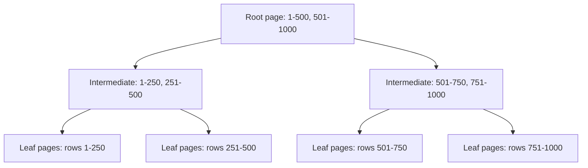

# Session 10: Indexes

> Module: Effective Data Solutions with SQL Server · Term 3 (HDSE I) · ⏱ ~2 hours

## 🎯 Learning Objectives

- Explain what an index is and why it speeds up queries
- Describe how SQL Server stores data: pages, extents, heaps and B-trees
- Compare clustered, non-clustered, unique, filtered, covering and columnstore indexes
- Create, inspect, rebuild, reorganize and drop indexes
- Read an execution plan to see whether an index is used (seek vs scan)

## 📖 Concepts Explained

### 1. Why Indexes?

Without an index, finding `Email = 'sara@x.pk'` means reading every row (a **table scan**). An index is like the index at the back of a textbook: it keeps keys sorted with pointers to rows, so SQL Server jumps straight to them (an **index seek**).

Trade-off: indexes speed up reads but slow down `INSERT`/`UPDATE`/`DELETE` and use disk space.

### 2. Storage Structure

| Unit | Size | Notes |
|---|---|---|
| **Page** | 8 KB | Smallest unit read from disk; holds rows |
| **Extent** | 8 pages = 64 KB | Unit of space allocation |
| **Heap** | — | Table with no clustered index; rows in no order |
| **B-tree** | — | Balanced tree: root → intermediate → leaf pages |



### 3. Types of Indexes

| Type | Leaf level contains | Per table |
|---|---|---|
| **Clustered** | The actual data rows, sorted by key | 1 |
| **Non-clustered** | Key + pointer (clustered key or RID) | Up to 999 |
| **Unique** | Enforces no duplicates | Many |
| **Composite** | Several key columns (order matters) | Many |
| **Covering / INCLUDE** | Extra columns stored at the leaf to avoid lookups | Many |
| **Filtered** | Only rows matching a `WHERE` | Many |
| **Columnstore** | Data stored by column, compressed; great for analytics | Many (1 clustered columnstore) |
| XML / Spatial / Full-text | Special data types | Many |

A primary key creates a clustered index by default; a `UNIQUE` constraint creates a unique non-clustered index.

### 4. Key Lookups and Covering

If a non-clustered index finds the row but the query needs other columns, SQL Server does a **key lookup** to the clustered index for each row. Adding those columns with `INCLUDE` makes the index **cover** the query and removes the lookups.

### 5. Index Management

| Task | Command |
|---|---|
| Create | `CREATE [UNIQUE] [NON]CLUSTERED INDEX ... ON t(cols) INCLUDE(...) WHERE ...` |
| Check fragmentation | `sys.dm_db_index_physical_stats` |
| Reorganize (5–30% fragmented) | `ALTER INDEX ix ON t REORGANIZE;` |
| Rebuild (>30%) | `ALTER INDEX ix ON t REBUILD WITH (ONLINE = ON);` (Enterprise/Developer) |
| Disable / drop | `ALTER INDEX ix ON t DISABLE;` / `DROP INDEX ix ON t;` |
| Fill factor | `WITH (FILLFACTOR = 90)` leaves room for inserts |

**Guidelines:** index columns used in `WHERE`, `JOIN` and `ORDER BY`; keep clustered keys narrow, unique and ever-increasing; avoid indexing tiny tables or columns that change constantly.

## 💻 Code Examples

File: `index_demo.sql`

```sql
USE CampusDB;
GO
DROP TABLE IF EXISTS dbo.Customer;
CREATE TABLE dbo.Customer (
    CustomerId INT IDENTITY PRIMARY KEY,           -- clustered index
    FullName   NVARCHAR(100) NOT NULL,
    City       NVARCHAR(40)  NOT NULL,
    Email      NVARCHAR(120) NOT NULL,
    IsActive   BIT NOT NULL DEFAULT 1,
    JoinedOn   DATE NOT NULL
);
-- 100,000 test rows using GENERATE_SERIES (SQL Server 2022)
INSERT INTO dbo.Customer (FullName, City, Email, IsActive, JoinedOn)
SELECT CONCAT(N'Customer ', value),
       CHOOSE(value % 4 + 1, N'Karachi', N'Lahore', N'Islamabad', N'Quetta'),
       CONCAT('c', value, '@mail.pk'),
       IIF(value % 10 = 0, 0, 1),
       DATEADD(DAY, -(value % 2000), '2026-01-01')
FROM GENERATE_SERIES(1, 100000);
GO
SET STATISTICS IO ON;   -- compare logical reads before/after
SELECT CustomerId, FullName FROM dbo.Customer WHERE Email = 'c77777@mail.pk';

CREATE UNIQUE NONCLUSTERED INDEX UX_Customer_Email ON dbo.Customer(Email);
SELECT CustomerId, FullName FROM dbo.Customer WHERE Email = 'c77777@mail.pk';

CREATE NONCLUSTERED INDEX IX_Customer_City_Joined
    ON dbo.Customer(City, JoinedOn) INCLUDE (FullName)
    WHERE IsActive = 1;
SELECT FullName, JoinedOn FROM dbo.Customer
WHERE City = N'Lahore' AND JoinedOn >= '2025-06-01' AND IsActive = 1;
```

**How it works**

- `GENERATE_SERIES` quickly produces numbers 1–100,000 to create realistic volume.
- With `STATISTICS IO ON`, the *Messages* tab shows logical reads: hundreds before the email index, about 3–5 after.
- The filtered, covering index serves only active customers and includes `FullName`, so no key lookups are needed.
- Press **Ctrl+M** (Include Actual Execution Plan) to see *Clustered Index Scan* change to *Index Seek*.

File: `index_maintenance.sql`

```sql
SELECT i.name AS IndexName, ps.avg_fragmentation_in_percent, ps.page_count
FROM sys.dm_db_index_physical_stats(DB_ID(), OBJECT_ID('dbo.Customer'), NULL, NULL, 'LIMITED') ps
JOIN sys.indexes i ON i.object_id = ps.object_id AND i.index_id = ps.index_id;

ALTER INDEX IX_Customer_City_Joined ON dbo.Customer REORGANIZE;
ALTER INDEX ALL ON dbo.Customer REBUILD WITH (FILLFACTOR = 90);
EXEC sp_helpindex 'dbo.Customer';
```

**How it works**

- The DMV reports fragmentation for each index; decide between reorganize and rebuild.
- `REBUILD ... FILLFACTOR = 90` recreates indexes leaving 10% free space per page.
- `sp_helpindex` lists every index and its keys.

## 🧪 Lab Practice

1. Run `index_demo.sql` with the actual execution plan on. Screenshot the plan before and after the email index.
2. Write a query filtering only by `JoinedOn`. Does `IX_Customer_City_Joined` help? Why not? (Hint: leading column.)
3. Create a non-clustered columnstore index on `(City, JoinedOn, IsActive)` and run `SELECT City, COUNT(*) ... GROUP BY City`. Compare reads.
4. Update 20,000 rows' emails, then check fragmentation and rebuild.
5. Drop the indexes you no longer need with `DROP INDEX`.

## 📝 Assignment

On AdventureWorks `Sales.SalesOrderDetail`, find a slow-ish query (e.g. filter by `ProductID` and `ModifiedDate`). Record logical reads, design a covering index, record reads again, and write a short note on the trade-offs of keeping that index.

## ❓ Quick Quiz

1. How many clustered indexes can a table have?
2. What is a heap?
3. What does `INCLUDE` add to a non-clustered index?
4. When would you rebuild instead of reorganize?
5. In a composite index on `(City, JoinedOn)`, which column should your query filter on to get a seek?

<details>
<summary>Show answers</summary>

1. One.
2. A table without a clustered index.
3. Non-key columns at the leaf level so the index covers more queries.
4. When fragmentation is high (roughly above 30%).
5. `City` (the leading column), optionally with `JoinedOn`.

</details>

## 💼 Interview Questions

1. **Clustered vs non-clustered index?** Clustered sorts and stores the table rows themselves; non-clustered is a separate structure pointing to rows.
2. **Why can too many indexes hurt?** Every write must update every index, increasing write time, locking and storage.
3. **What is an index seek vs scan?** A seek navigates the B-tree to specific keys; a scan reads all (or a range of) leaf pages.

## ✅ Summary

- Indexes are sorted B-tree structures that turn scans into seeks.
- Data lives in 8 KB pages grouped in extents; a table is a heap or a clustered index.
- Use clustered for the main key, non-clustered with `INCLUDE`/filters for frequent queries, columnstore for analytics.
- Monitor fragmentation; reorganize or rebuild; drop unused indexes.

---

[⬅ Previous](../Session-09-Advanced-Queries-Joins-Views-Procedures/README.md) · [🏠 Module Home](../README.md) · [Next ➡](../Session-11-Triggers/README.md)

Prepared by Zeeshan Abbas · Aptech Learning North Nazimabad
