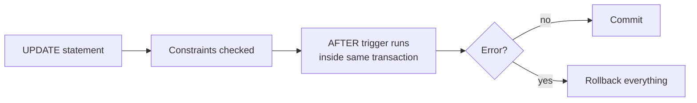

# Session 11: Triggers

> Module: Effective Data Solutions with SQL Server · Term 3 (HDSE I) · ⏱ ~2 hours

## 🎯 Learning Objectives

- Explain what triggers are and when to use (and avoid) them
- Create and alter DML triggers: `AFTER` and `INSTEAD OF`
- Use the `inserted` and `deleted` virtual tables and handle multi-row operations
- Use `UPDATE()` and `COLUMNS_UPDATED()` to react to specific column changes
- Describe nested and recursive triggers and their settings
- Understand the performance impact of triggers

## 📖 Concepts Explained

### 1. What is a Trigger?

A **trigger** is a special stored procedure that runs **automatically** when an event happens. You never call it directly.

| Type | Fires on | Example use |
|---|---|---|
| **DML trigger** | `INSERT`, `UPDATE`, `DELETE` on a table/view | Audit log, enforce complex rules |
| DDL trigger | `CREATE`, `ALTER`, `DROP` in a database/server | Block dropping tables in production |
| Logon trigger | A login connecting | Limit sessions per user |

### 2. AFTER vs INSTEAD OF

| | `AFTER` (`FOR`) | `INSTEAD OF` |
|---|---|---|
| When | After the statement succeeds and constraints pass | Replaces the statement |
| On | Tables only | Tables and views |
| Typical use | Auditing, cascading updates | Updatable complex views, soft delete |

### 3. The `inserted` and `deleted` Tables

Inside a DML trigger SQL Server gives you two read-only virtual tables with the same columns as the table:

| Statement | `inserted` | `deleted` |
|---|---|---|
| INSERT | New rows | empty |
| DELETE | empty | Old rows |
| UPDATE | New values | Old values |

### 4. Always Handle Multiple Rows

A trigger fires **once per statement**, not once per row. `UPDATE Product SET Price = Price * 1.1` touching 500 rows fires the trigger once with 500 rows in `inserted`. Never write `SELECT @id = Id FROM inserted` — join to `inserted` instead.

### 5. Detecting Column Changes

- `IF UPDATE(Price)` – true if `Price` appeared in the `SET` list (even if the value did not change).
- `COLUMNS_UPDATED()` – a bitmask of updated columns (advanced).
- To detect real changes, compare `inserted.Price <> deleted.Price`.

### 6. Nested and Recursive Triggers

- **Nested:** trigger on table A updates table B, which fires B's trigger. Enabled by the server option `nested triggers` (default on), up to 32 levels.
- **Recursive:** a trigger causes itself to fire again. Controlled by `ALTER DATABASE ... SET RECURSIVE_TRIGGERS ON|OFF` (default off).
- `TRIGGER_NESTLEVEL()` tells you how deep you are.

### 7. Performance Implications



- Triggers run inside the caller's transaction, so slow triggers hold locks longer.
- Hidden logic surprises developers; document triggers well.
- Prefer constraints for simple rules; use triggers only when constraints cannot do the job.
- Keep triggers set-based, short, and avoid returning result sets.

## 💻 Code Examples

File: `audit_trigger.sql`

```sql
USE CampusDB;
GO
DROP TABLE IF EXISTS dbo.PriceAudit;
CREATE TABLE dbo.PriceAudit (
    AuditId   INT IDENTITY PRIMARY KEY,
    ProductId INT,
    OldPrice  DECIMAL(10,2),
    NewPrice  DECIMAL(10,2),
    ChangedBy SYSNAME   DEFAULT SUSER_SNAME(),
    ChangedAt DATETIME2 DEFAULT SYSDATETIME()
);
GO
CREATE OR ALTER TRIGGER dbo.trg_Product_PriceAudit
ON dbo.Product
AFTER UPDATE
AS
BEGIN
    SET NOCOUNT ON;
    IF NOT UPDATE(Price) RETURN;

    INSERT INTO dbo.PriceAudit (ProductId, OldPrice, NewPrice)
    SELECT i.ProductId, d.Price, i.Price
    FROM inserted i
    JOIN deleted  d ON d.ProductId = i.ProductId
    WHERE i.Price <> d.Price;          -- only real changes
END;
GO
UPDATE dbo.Product SET Price = Price * 1.10;   -- many rows, one firing
SELECT * FROM dbo.PriceAudit;
```

**How it works**

- Uses the `Product` table from Session 06.
- `IF NOT UPDATE(Price) RETURN` exits early when the price column was not in the `SET` list.
- Joining `inserted` and `deleted` on the key handles any number of rows.

File: `instead_of_trigger.sql`

```sql
ALTER TABLE dbo.Product ADD IsDeleted BIT NOT NULL CONSTRAINT DF_Product_IsDeleted DEFAULT 0;
GO
CREATE OR ALTER TRIGGER dbo.trg_Product_SoftDelete
ON dbo.Product
INSTEAD OF DELETE
AS
BEGIN
    SET NOCOUNT ON;
    UPDATE p SET IsDeleted = 1
    FROM dbo.Product p
    JOIN deleted d ON d.ProductId = p.ProductId;
END;
GO
DELETE FROM dbo.Product WHERE ProductId = 1;   -- row is kept, flagged
SELECT ProductId, Name, IsDeleted FROM dbo.Product;
```

**How it works**

- The `DELETE` never happens; the trigger flags rows as deleted instead ("soft delete").
- Applications then filter `WHERE IsDeleted = 0` (a view helps).

File: `stock_rule_trigger.sql` shows a rule that rolls back an order line if it would push stock below zero, using `THROW` inside the trigger.

## 🧪 Lab Practice

1. Run `audit_trigger.sql`. Update one price, then all prices; count audit rows each time.
2. Update a product's `Name` only and confirm no audit row is written.
3. Add an `AFTER INSERT, DELETE` trigger that keeps a `ProductCount` column in `Category` up to date.
4. Run `stock_rule_trigger.sql` and try to order more than the stock; read the error.
5. Disable and enable a trigger with `DISABLE TRIGGER ... ON dbo.Product` / `ENABLE TRIGGER`.

## 📝 Assignment

In CampusDB create `MarksHistory` and a trigger on `Enrollment` that records old and new marks whenever marks change, plus an `INSTEAD OF DELETE` trigger that prevents deleting enrollments with marks above 0 (raise a clear error). Test with single- and multi-row statements.

## ❓ Quick Quiz

1. How many times does an `AFTER UPDATE` trigger fire for an update of 100 rows?
2. Which virtual table holds the old values in an UPDATE?
3. Can an `AFTER` trigger be created on a view?
4. Is `RECURSIVE_TRIGGERS` on or off by default?
5. Why is `SELECT @id = ProductId FROM inserted` dangerous?

<details>
<summary>Show answers</summary>

1. Once.
2. `deleted`.
3. No; views support only `INSTEAD OF` triggers.
4. Off.
5. With several rows it captures only one arbitrary value, so other rows are ignored.

</details>

## 💼 Interview Questions

1. **When would you choose a trigger over a constraint?** When the rule spans tables or needs procedural logic (auditing, cross-table checks) that a CHECK or FK cannot express.
2. **What are the drawbacks of triggers?** Hidden behaviour, longer transactions and locks, harder debugging, risk of nesting chains.
3. **How do you audit changes without triggers?** Temporal tables, Change Data Capture, Change Tracking, or SQL Server Audit.

## ✅ Summary

- Triggers run automatically on DML, DDL or logon events.
- `AFTER` reacts after success; `INSTEAD OF` replaces the action (works on views).
- Use `inserted`/`deleted` with joins; always design for many rows.
- Control nesting/recursion and keep triggers short to protect performance.

---

[⬅ Previous](../Session-10-Indexes/README.md) · [🏠 Module Home](../README.md) · [Next ➡](../Session-12-Lab-Review-Queries-Indexes-Triggers/README.md)

Prepared by Zeeshan Abbas · Aptech Learning North Nazimabad
