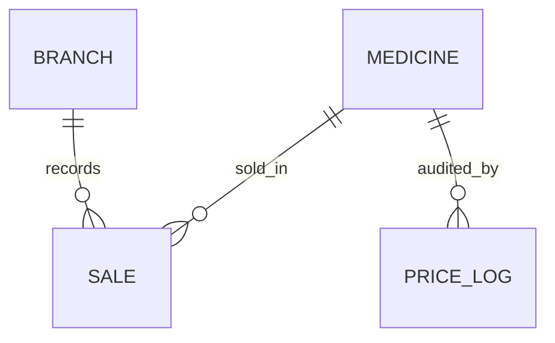

# Session 12: Lab and Review: Queries, Indexes and Triggers

> Module: Effective Data Solutions with SQL Server · Term 3 (HDSE I) · ⏱ ~2 hours

## 🎯 Learning Objectives

- Revise advanced queries, views, procedures, indexes and triggers (Sessions 09–11)
- Write multi-table reports using joins, CTEs and grouping sets
- Wrap reports in views and parameterised stored procedures
- Measure query cost and improve it with the right index
- Protect data with a well-written, multi-row-safe trigger

## 📖 Concepts Explained

### 1. Recap Table

| Topic | Must remember |
|---|---|
| `GROUP BY` / `HAVING` | HAVING filters groups; non-aggregated columns must be grouped |
| Subquery vs CTE | CTE improves readability; both are table expressions |
| Joins | LEFT JOIN + `IS NULL` finds missing matches |
| Set operators | Same column count and compatible types |
| `ROLLUP` / `CUBE` | Subtotals; `GROUPING()` marks total rows |
| Views | Saved SELECT; `WITH CHECK OPTION`, `SCHEMABINDING` |
| Procedures | Parameters, defaults, `OUTPUT`, `SET NOCOUNT ON` |
| Indexes | Clustered = table order; non-clustered + `INCLUDE` covers queries |
| Triggers | `inserted`/`deleted`, once per statement, AFTER vs INSTEAD OF |

### 2. A Mini Case: Pharmacy Chain

A pharmacy chain in Karachi wants: daily sales per branch, slow-moving medicines, a branch report procedure, faster lookups by medicine name, and an audit of price changes. We will build all five today.



## 💻 Code Examples

File: `pharmacy_lab.sql` (creates `PharmacyDB` with sample data, then the objects below).

```sql
-- 1. Report view: sales per branch per day
CREATE OR ALTER VIEW dbo.vDailyBranchSales AS
SELECT b.Name AS Branch, CAST(s.SoldAt AS DATE) AS SaleDate,
       COUNT(*) AS Bills, SUM(s.Qty * s.UnitPrice) AS Revenue
FROM dbo.Sale s JOIN dbo.Branch b ON b.BranchId = s.BranchId
GROUP BY b.Name, CAST(s.SoldAt AS DATE);
GO
-- 2. Procedure with an output parameter
CREATE OR ALTER PROCEDURE dbo.usp_BranchReport
    @BranchId INT, @Days INT = 7, @Revenue DECIMAL(12,2) OUTPUT
AS
BEGIN
    SET NOCOUNT ON;
    SELECT m.Name, SUM(s.Qty) AS UnitsSold
    FROM dbo.Sale s JOIN dbo.Medicine m ON m.MedicineId = s.MedicineId
    WHERE s.BranchId = @BranchId AND s.SoldAt >= DATEADD(DAY, -@Days, SYSDATETIME())
    GROUP BY m.Name ORDER BY UnitsSold DESC;

    SELECT @Revenue = ISNULL(SUM(Qty * UnitPrice), 0)
    FROM dbo.Sale
    WHERE BranchId = @BranchId AND SoldAt >= DATEADD(DAY, -@Days, SYSDATETIME());
END;
GO
-- 3. Index for name searches
CREATE NONCLUSTERED INDEX IX_Medicine_Name ON dbo.Medicine(Name) INCLUDE (Price);
```

**How it works**

- The view hides the join and grouping; analysts just `SELECT * FROM dbo.vDailyBranchSales`.
- The procedure returns a result set **and** an output value, with a default window of 7 days.
- The covering index makes `WHERE Name LIKE 'Pana%'` a seek that already contains `Price`.

```sql
-- 4. Slow movers: medicines with no sale in 30 days (NOT EXISTS)
SELECT m.Name FROM dbo.Medicine m
WHERE NOT EXISTS (SELECT 1 FROM dbo.Sale s
                  WHERE s.MedicineId = m.MedicineId
                    AND s.SoldAt >= DATEADD(DAY, -30, SYSDATETIME()));
```

**How it works**

- `NOT EXISTS` is NULL-safe and stops searching at the first matching sale.

## 🧪 Lab Practice

1. Run `pharmacy_lab.sql`; then query `vDailyBranchSales` with a `ROLLUP` on Branch.
2. Execute `usp_BranchReport` for each branch and display the output revenue.
3. Compare logical reads of a name search before and after `IX_Medicine_Name` (`SET STATISTICS IO ON`).
4. Finish the `trg_Medicine_PriceLog` trigger in the script so it logs only real price changes; test with a multi-row update.
5. Use `sys.objects` to list every view, procedure, trigger and index you created.

## 📝 Assignment

Add a `Supplier` table and write: a view of medicines per supplier with stock value, a procedure `usp_ReorderList @Threshold` returning medicines below a stock threshold, an index supporting it, and an `INSTEAD OF DELETE` trigger on `Supplier` that blocks deleting suppliers who still have medicines.

## ❓ Quick Quiz

1. Why is `NOT EXISTS` safer than `NOT IN` here?
2. What does `ISNULL(SUM(...), 0)` protect against?
3. Which object would you create so that a report user never sees the `Sale` table directly?
4. What makes `IX_Medicine_Name` a covering index for name + price queries?
5. A price update touches 30 medicines. How many rows should the audit trigger insert if 5 prices actually change?

<details>
<summary>Show answers</summary>

1. `NOT IN` returns nothing if the subquery yields a NULL.
2. `SUM` returns NULL when there are no rows.
3. A view (or procedure) with permissions granted only on it.
4. `INCLUDE (Price)` stores price at the leaf.
5. 5.

</details>

## 💼 Interview Questions

1. **How would you find the most expensive queries on a server?** Query Store or `sys.dm_exec_query_stats` ordered by total CPU/reads.
2. **What is parameter sniffing?** A procedure's cached plan is built for the first parameter values and may be poor for others.
3. **How do you find unused indexes?** `sys.dm_db_index_usage_stats` with few seeks/scans but many updates.

## ✅ Summary

- Real reports combine joins, grouping and table expressions.
- Views and procedures give safe, reusable interfaces.
- Measure with `STATISTICS IO` and execution plans before adding an index.
- Triggers must be set-based and react only to real changes.

---

[⬅ Previous](../Session-11-Triggers/README.md) · [🏠 Module Home](../README.md) · [Next ➡](../Session-13-Programming-Transact-SQL/README.md)

Prepared by Zeeshan Abbas · Aptech Learning North Nazimabad
