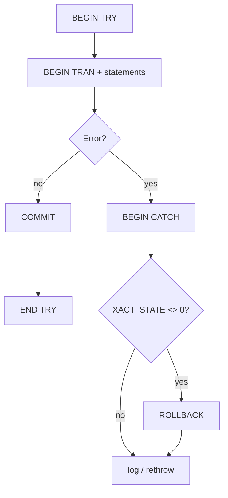

# Session 14: Transactions and Error Handling

> Module: Effective Data Solutions with SQL Server · Term 3 (HDSE I) · ⏱ ~2 hours

## 🎯 Learning Objectives

- Define a transaction and the ACID properties
- Implement explicit transactions with `BEGIN TRAN`, `COMMIT`, `ROLLBACK` and save points
- Distinguish autocommit, implicit and explicit transactions, and mark a transaction
- Explain isolation levels, lock types and blocking/deadlocks
- Handle errors with `TRY...CATCH`, `ERROR_*()` functions, `@@ERROR`, `RAISERROR` and `THROW`

## 📖 Concepts Explained

### 1. What is a Transaction?

A **transaction** is a group of statements that succeed or fail **as one unit**. Classic example: transferring Rs. 5,000 from account A to B needs two updates; if the second fails, the first must be undone.

| ACID | Meaning |
|---|---|
| **Atomicity** | All or nothing |
| **Consistency** | Data moves from one valid state to another (constraints hold) |
| **Isolation** | Concurrent transactions do not see each other's half-done work |
| **Durability** | Once committed, changes survive a crash (thanks to the log) |

### 2. Transaction Modes

| Mode | How it works |
|---|---|
| Autocommit (default) | Each statement is its own transaction |
| Explicit | You write `BEGIN TRAN ... COMMIT/ROLLBACK` |
| Implicit | `SET IMPLICIT_TRANSACTIONS ON`; a transaction starts automatically and stays open until you commit |

**Useful pieces:** `@@TRANCOUNT` (open transaction depth), `SAVE TRAN name` (partial rollback point), `BEGIN TRAN name WITH MARK 'description'` (records a mark in the log so you can restore to that point later), `XACT_STATE()` (1 committable, -1 doomed, 0 none), `SET XACT_ABORT ON` (any runtime error rolls back the whole transaction — recommended).

### 3. Isolation Levels and Concurrency Problems

| Level | Dirty read | Non-repeatable read | Phantom |
|---|---|---|---|
| READ UNCOMMITTED | possible | possible | possible |
| **READ COMMITTED** (default) | no | possible | possible |
| REPEATABLE READ | no | no | possible |
| SERIALIZABLE | no | no | no |
| SNAPSHOT | no | no | no (uses row versions, readers don't block writers) |

- **Dirty read** – reading uncommitted data that may be rolled back.
- **Non-repeatable read** – reading the same row twice gives different values.
- **Phantom** – re-running a range query returns new rows.

### 4. Locks

| Lock | Taken by | Notes |
|---|---|---|
| Shared (S) | Reads | Many readers together |
| Exclusive (X) | Writes | Blocks others |
| Update (U) | Read-then-update | Prevents a common deadlock |
| Intent (IS, IX) | Higher levels (page/table) | Signals locks below |
| Schema (Sch-S, Sch-M) | DDL | Sch-M blocks everything |

Lock **granularity** goes row → page → table; SQL Server may **escalate** many row locks to a table lock. **Blocking** = one session waits for another's lock. **Deadlock** = two sessions wait for each other; SQL Server kills one (error 1205).

### 5. Error Handling



| Function (only inside CATCH) | Returns |
|---|---|
| `ERROR_NUMBER()` | Error number (e.g. 547 = constraint) |
| `ERROR_MESSAGE()` | Text |
| `ERROR_SEVERITY()` | 0–25 (11–16 user-correctable) |
| `ERROR_STATE()` | State code |
| `ERROR_LINE()` | Line number |
| `ERROR_PROCEDURE()` | Procedure/trigger name |

- `@@ERROR` – the old way: error number of the **last** statement (resets after every statement).
- `RAISERROR(msg, severity, state)` – raise a custom error (supports `%s`, `%d` formatting).
- `THROW` – modern: `THROW 50001, 'message', 1;` or plain `THROW;` inside CATCH to rethrow the original error. Always terminate the previous statement with `;`.

## 💻 Code Examples

File: `bank_transfer.sql`

```sql
USE CampusDB;
GO
DROP TABLE IF EXISTS dbo.Account;
CREATE TABLE dbo.Account (
    AccountNo CHAR(4) PRIMARY KEY,
    Holder    NVARCHAR(50),
    Balance   DECIMAL(12,2) NOT NULL CHECK (Balance >= 0)
);
INSERT INTO dbo.Account VALUES ('A001', N'Hina', 20000), ('A002', N'Omar', 5000);
GO
CREATE OR ALTER PROCEDURE dbo.usp_Transfer
    @From CHAR(4), @To CHAR(4), @Amount DECIMAL(12,2)
AS
BEGIN
    SET NOCOUNT ON;
    SET XACT_ABORT ON;
    BEGIN TRY
        IF @Amount <= 0
            THROW 50010, 'Amount must be positive.', 1;

        BEGIN TRAN;
            UPDATE dbo.Account SET Balance -= @Amount WHERE AccountNo = @From;
            IF @@ROWCOUNT = 0 THROW 50011, 'Source account not found.', 1;

            UPDATE dbo.Account SET Balance += @Amount WHERE AccountNo = @To;
            IF @@ROWCOUNT = 0 THROW 50012, 'Target account not found.', 1;
        COMMIT;
        PRINT 'Transfer complete.';
    END TRY
    BEGIN CATCH
        IF XACT_STATE() <> 0 ROLLBACK;
        SELECT ERROR_NUMBER() AS Num, ERROR_SEVERITY() AS Sev, ERROR_STATE() AS State,
               ERROR_LINE() AS Line, ERROR_PROCEDURE() AS ProcName, ERROR_MESSAGE() AS Msg;
        THROW;   -- rethrow to the caller
    END CATCH;
END;
GO
EXEC dbo.usp_Transfer 'A001', 'A002', 3000;          -- succeeds
EXEC dbo.usp_Transfer 'A002', 'A001', 999999;        -- CHECK fails (547), rolled back
SELECT * FROM dbo.Account;
```

**How it works**

- `SET XACT_ABORT ON` guarantees a rollback if any statement errors.
- Overdrawing violates `CHECK (Balance >= 0)`, error 547 jumps to CATCH.
- `XACT_STATE() <> 0` means a transaction is still open, so we roll it back before rethrowing.

File: `savepoints_isolation.sql`

```sql
BEGIN TRAN OrderBatch WITH MARK 'Daily order import';
    INSERT INTO dbo.Account VALUES ('A003', N'Kiran', 1000);
    SAVE TRAN BeforeBonus;
    UPDATE dbo.Account SET Balance += 500;
    ROLLBACK TRAN BeforeBonus;            -- undo only the bonus
    SELECT @@TRANCOUNT AS OpenTrans;      -- still 1
COMMIT;

-- Demonstrate RAISERROR with formatting and @@ERROR
UPDATE dbo.Account SET Balance = -1 WHERE AccountNo = 'A003';
IF @@ERROR <> 0
    RAISERROR(N'Update failed for account %s', 16, 1, 'A003');

SET TRANSACTION ISOLATION LEVEL SNAPSHOT;  -- needs ALLOW_SNAPSHOT_ISOLATION ON
```

**How it works**

- `ROLLBACK TRAN savepoint` undoes work after the save point but keeps the transaction open.
- `WITH MARK` writes a named mark into the log for point-in-time restore.
- `@@ERROR` must be checked **immediately** after the statement.

## 🧪 Lab Practice

1. Run `bank_transfer.sql`; try a transfer to a non-existent account and check balances stay unchanged.
2. Open **two query windows**. In window 1: `BEGIN TRAN; UPDATE dbo.Account SET Balance += 1 WHERE AccountNo='A001';` (do not commit). In window 2: `SELECT * FROM dbo.Account;` — observe blocking. Then try `SET TRANSACTION ISOLATION LEVEL READ UNCOMMITTED` in window 2.
3. Run `SELECT * FROM sys.dm_tran_locks WHERE request_session_id = <spid>` to see the locks.
4. Turn on snapshot isolation: `ALTER DATABASE CampusDB SET ALLOW_SNAPSHOT_ISOLATION ON;` and repeat step 2 with `SNAPSHOT`.
5. Write a CATCH block that logs errors into an `ErrorLog` table before rethrowing.

## 📝 Assignment

Create `usp_EnrollStudent @StudentId, @CourseCode` that, in one transaction, inserts the enrollment and increments a `SeatsTaken` column on `Course`, refusing (with `THROW`) if seats are full. Log every failure to `ErrorLog` with all six `ERROR_*` values.

## ❓ Quick Quiz

1. Which ACID property is provided by the transaction log after a crash?
2. What is SQL Server's default isolation level?
3. What does `ROLLBACK TRAN savepoint_name` do to `@@TRANCOUNT`?
4. Which is preferred in new code: `RAISERROR` or `THROW`?
5. What does `XACT_STATE() = -1` mean?

<details>
<summary>Show answers</summary>

1. Durability.
2. READ COMMITTED.
3. Nothing; the transaction stays open.
4. `THROW` (though `RAISERROR` is still useful for formatted messages and severity control).
5. The transaction is uncommittable and must be rolled back.

</details>

## 💼 Interview Questions

1. **What is a deadlock and how do you reduce them?** Two transactions each hold a lock the other needs. Access objects in the same order, keep transactions short, use proper indexes, consider snapshot isolation.
2. **Why use `SET XACT_ABORT ON`?** It ensures any runtime error rolls back the entire transaction, avoiding half-committed work and orphaned open transactions.
3. **Difference between READ COMMITTED SNAPSHOT and SNAPSHOT?** RCSI gives statement-level consistency automatically for READ COMMITTED; SNAPSHOT gives transaction-level consistency and must be requested explicitly.

## ✅ Summary

- Transactions make multi-step changes atomic; ACID describes the guarantees.
- Use explicit transactions with `XACT_ABORT ON`, save points for partial undo, marks for restore points.
- Isolation levels balance correctness against blocking; locks implement them.
- `TRY...CATCH` with `ERROR_*()` and `THROW` gives clean, modern error handling.

---

[⬅ Previous](../Session-13-Programming-Transact-SQL/README.md) · [🏠 Module Home](../README.md) · [Next ➡](../Session-15-PolyBase-Query-Store-and-ML/README.md)

Prepared by Zeeshan Abbas · Aptech Learning North Nazimabad
